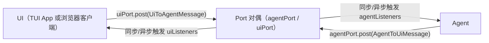
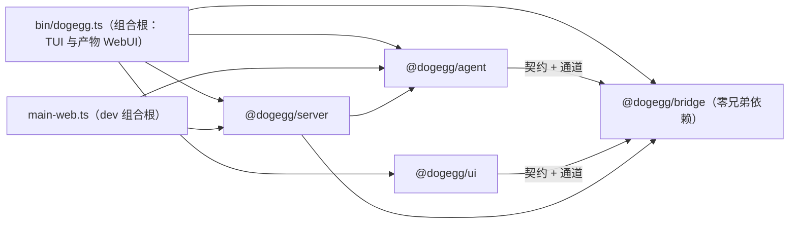
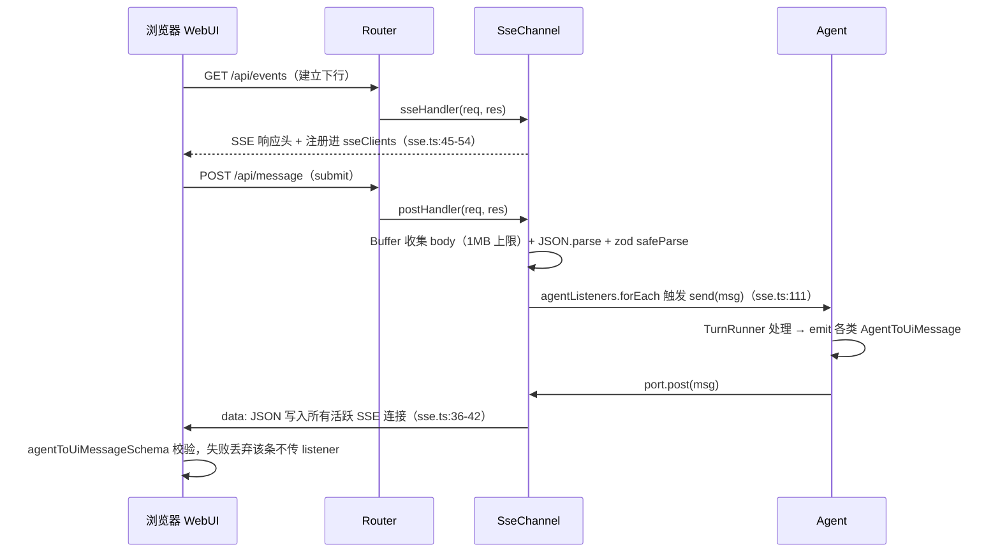

# 01 - 四包架构与消息契约

> 职责：定义 DogEggAgent 的物理拆分（四个 npm 包 + 两个组合根）、包间依赖立法，以及横跨所有传输的双向消息契约。本文回答三个问题：为什么拆四包、消息长什么样、同一份契约如何同时跑在"同进程同步"与"SSE+zod"两条通道上。
> 文中源码行号为撰写时参考，以代码为准（组合根与契约行号随功能演进漂移）。
>
> **交互图**：[架构总览](./assets/architecture-overview.html)（四包/组合根/通道装配全景）。

## 1. 职责与边界

```
agent ←→ bridge ←→ ui
                ←→ server（WebUI 传输）
```

| 包 | 职责 | 依赖 | 关键入口 |
|---|---|---|---|
| `@dogegg/bridge` | 契约与通道：消息类型、zod schema、权限/glob/config 纯派生、Port 接口 | 零兄弟依赖（仅 `zod`） | `bridge/src/index.ts` |
| `@dogegg/agent` | 后端全部业务：轮次引擎、LLM、工具、权限、MCP、skills、会话、配置 | bridge | `agent/src/agent.ts`（门面） |
| `@dogegg/ui` | 两个前端：TUI（ink/React）+ WebUI（React DOM） | bridge | `ui/src/tui`、`ui/src/webui` |
| `@dogegg/server` | WebUI 传输层：HTTP 路由、SSE 通道、静态文件 serve | agent + bridge（**不** import ui） | `server/src/http/http-server.ts` |

只有**组合根**同时 import agent 与前端：

- TUI 模式：`bin/dogegg.ts`——`import { Agent } from '@dogegg/agent'`（bin/dogegg.ts:9）、`import { renderTui } from '@dogegg/ui'`（bin/dogegg.ts:11），装配 `InMemoryChannel` 后把 `channel.agentPort` 给 Agent、`channel.uiPort` 给 TUI（bin/dogegg.ts:104-109）。
- WebUI 模式：仓库根 `main-web.ts`（dev，main-web.ts:1-2 注释：唯一 import agent + server、不 import ui）与 bin/dogegg.ts:78-100（产物）——构造 `SseChannel`、`new Agent(channel, ...)`（main-web.ts:68）、`new HttpServer({ router: new Router({ channel }), staticDir, port })`（main-web.ts:92）。WebUI 前端是 Vite 构建出的**静态文件**被 server serve，不是代码被 import——这就是"server 不依赖 ui"立法成立的原因。

`bridge/src/index.ts` 是 bridge 唯一对外脸面（纯 re-export，bridge/src/index.ts:1-13）。依赖方向由**架构测试**从约定升级为可执行断言：`bridge/test/architecture.test.ts`（详见 3.3 D-3）。

## 2. 核心数据结构：消息契约全清单

契约文件全部住 `bridge/src/contract/`。消息是**判别联合**（discriminated union on `type`），类型定义与 zod schema 一一对应成对出现：

- 上行（前端→后端）：`ui-to-agent.ts` 类型（:5-33）+ `ui-to-agent-schema.ts` zod；
- 下行（后端→前端）：`agent-to-ui.ts` 类型 + `agent-to-ui-schema.ts` zod。

### 2.1 下行 AgentToUiMessage（agent-to-ui.ts，schema 同序）

> 契约随功能演进行号会漂移——本节不再钉死行号，字段以 `bridge/src/contract/agent-to-ui.ts` 当前代码为准；括注只保留语义出处。

| type | 载荷要点 | 用途 |
|---|---|---|
| `state` | `from: State; to: State` | 状态机迁移广播（State 十态见 shared.ts:8-18） |
| `text_delta` / `thought_delta` | `delta: string` | 流式正文 / reasoning 增量 |
| `stream_reset` | — | LLM 请求层重试从零重发增量——UI 须先清空当前流式 partial（text/thinking）再接收新尝试的 delta，防残文叠加（不落盘、不产生新块） |
| `message` | `role: 'user'\|'assistant'\|'tool'; id: string; text?` | 完整消息入库通知；id 与 tool_start 同源，供定位/折叠；role='user' 时可选携带原文 `text`——UI 据此做回声去重（本端乐观插入后忽略同文本回声）与无乐观插入场景的实时插入（assistant/tool 不带 text） |
| `tool_pending` | `name: string` | 模型流式生成工具参数期间的可见反馈（tool_call_start → tool_start 之间） |
| `tool_start` / `tool_end` | `id, name, input` / `output, error?` | 工具执行起止；**拒绝/失败也发 tool_end**（error 标原因） |
| `permission_request` | `id, tool, input, alwaysScope?` | alwaysScope = agent 推导的第四档范围模式 |
| `session_ready` | `id, messages, busy, thinking?, live?` | resume 后回放；必填 `busy` = 快照重发时 agent 是否在跑（运行中刷新/新标签接入不得把 UI 打回 idle）；可选 `live{partial, runningTool}` = 运行中的轮内现场（当前流式文本 + 进行中工具调用，恢复现场续拼）；空闲期快照不带 live |
| `session_list` | `sessions: { id, updatedAt, preview, cwd?, title? }` | 侧栏列表；cwd 供项目分组 |
| `session_deleted` | `id` | 删除后刷新列表 |
| `config_state` / `config_updated` | `config: Config` | 编辑器读/写响应 |
| `tools_list` | `tools: ToolListItem[]` | identity 随行（builtin / mcp·服务名），UI 按来源分组 |
| `context_state` | `estimatedTokens, windowTokens, percent, breakdown?, lastTurn?, sessionUsage?, compactions` | /context 仪表盘：估算与真实用量并排 |
| `system_state` | `path, content` | 生效系统提示词全文 |
| `status_state` | `sessionId, provider, model, cwd, state, estimatedTokens, windowTokens, usage?` | 状态栏单帧 |
| `log_state` | `path, tail` | /log 面板 |
| `history_cleared` | — | /clear 回执 |
| `notice` | `text, channel?: 'skills'\|'mcp'\|'config'` | channel 让管理面板内联定位错误（skills/mcp/config 的 CRUD 失败与 busy 拒绝），普通提示不带 |
| `permissions_list` | `permissions: ToolPermission[]` | /permissions 响应（会话提升清单） |
| `skills_list` / `skill_content` | 六字段含 `missing` 标孤儿 / 全文 | skills 面板 |
| `mcp_list` | servers 含 `transport` 明细 + 运行时 `status` | /mcp 面板 |
| `compaction` | `before_tokens, after_tokens, source: 'manual'\|'auto'` | source 决定 UI 弹 overlay 还是插提示块 |
| `finished` | `usage?` | 轮次收尾 |
| `error` | `{ message, name? }` | **可序列化错误形状**——JSON.stringify(Error) 丢 stack/name，进程内 Port 与 SSE 必须同构 |

### 2.2 上行 UiToAgentMessage（ui-to-agent.ts:5-33）

按语义分四类（"运行中阻塞"的实际判定落点见括注；与 `agent/src/agent.ts` 的 `send()` 分发注释对应）：

- **轮次/工作集类**（TurnRunner 入口查 gate.busy，turn-runner.ts:82 / :147）：`submit`（:6）、`compact_request`（:32）；
- **会话生命周期类**（SessionManager.blocked() 统一判定，session/manager.ts:31-37）：`new_session{cwd?}`（:9）、`resume_session{id}`（:11）、`delete_session{id}`（:30）、`clear_history`（:31）运行中阻塞；`list_sessions`（:10）与 `rename_session{title}`（:23）不阻塞；
- **控制类**（任意时刻放行——取消与决议恰恰要在运行中送达）：`permission_decision{id, decision}`（:7）、`cancel`（:8）、`permission_revoke{tool, pattern?}`（:22）；
- **查询/管理类**（:12-33）：查询类 `config_request`（:12）、`tools_request`（:16）、`context_request`（:17）、`system_request`（:18）、`status_request`（:19）、`log_request`（:20）、`permissions_request`（:21）、`skills_request`（:24）、`mcp_request`（:27）任意时刻放行；写文件/配置的管理类 `config_set/add/remove`（:13-15，ConfigController 内查 gate.busy，config/controller.ts:47）、`skills_manage`（:25）、`invoke_skill`（:26）、`mcp_manage`（:28）、`set_cwd`（:29，agent.ts:756）运行中阻塞；`quit`（:33）直接 `process.exit(0)`（agent.ts:796-797）。

`PermissionDecision` 四档 `'allow_once' | 'allow_always' | 'allow_always_scoped' | 'reject'`（shared.ts:22）、`ToolPermission { tool, patterns }`（shared.ts:26-29）、`ContextBreakdown { system, user, assistant, tool, tools }`（shared.ts:32-38）、`Message`（OpenAI 线格式，shared.ts:40-50）都定义在 `bridge/src/contract/shared.ts`（shared.ts:22-50）。

### 2.3 契约内的跨端派生逻辑

bridge 的 contract/ 不只有类型，还有**对契约数据的纯派生函数**——它们被 agent 与 UI 共用，故必须在契约层而非某一端（详见 3.6 D-6）：

- `classifyPermission`（contract/permission.ts）——权限三桶求值，详见《06-权限引擎》；
- `globToRegExp / matchGlob / matchWildcard`（contract/glob.ts:18-68）——一份 glob 实现三端（agent 工具、权限匹配、UI 展示）永不漂移（glob.ts:1-3 注释）；
- `isConfigured`（contract/config.ts:204-210）——"能否提问"的完整性判定；
- `COMPACTION_THRESHOLD = 0.8`（shared.ts:6）——压缩阈值常量：**它是跨端显示策略**，后端 trigger 与前端 info-panel 变色共用，刻意放契约防两端漂移（shared.ts:3-5 注释）；
- `PRIMARY_SPECIFIER / BUILTIN_PATH_TOOLS`（config.ts:68-73）——权限主参数表，详见《06》《10》。

## 3. 设计逐项详解

### 3.1 D-1 传输无关 Port 与同步投递语义

**设计问题**：同一套 agent 业务要同时服务"同进程 TUI"与"跨进程 WebUI"，且 agent 代码不得感知传输差异；TUI 还依赖旧版 agent.send/emit 的同步时序（`port.post()` 返回时监听器已执行完）保证焦点/状态切换的确定性。

**方案与取舍**：bridge 只引入一个新抽象——对偶的 `AgentPort`/`UiPort` 接口（port.ts:4-6 注释："这一层是 bridge 唯一的新抽象——把「两端如何互通」从具体传输（同进程 / SSE / WebSocket）中抽离"）。`post` 返回 `void | Promise<void>`（port.ts:6 注释），把同步投递与异步 fetch 装进同一签名；备选是让 agent 直接依赖 EventEmitter 或 HTTP 客户端——那会把传输细节焊进业务层。`InMemoryChannel` 选同步 forEach 而非队列异步：与旧版 agent.send/emit 时序完全一致是硬约束（in-memory.ts:5 注释），确定性优先。

代码走查——`bridge/src/channel/port.ts:7-19`：

```ts
export interface AgentPort {
  /** 订阅来自 UI 的消息，返回退订函数。 */
  onMessage(cb: (msg: UiToAgentMessage) => void): () => void
  /** 向 UI 发消息（发后即忘——同步或异步，取决于传输实现）。 */
  post(msg: AgentToUiMessage): void | Promise<void>
}

export interface UiPort {
  /** 订阅来自 agent 的消息，返回退订函数。 */
  onMessage(cb: (msg: AgentToUiMessage) => void): () => void
  /** 向 agent 发消息（发后即忘——同步或异步，取决于传输实现）。 */
  post(msg: UiToAgentMessage): void | Promise<void>
}
```

两个接口各只有 `onMessage`（返回退订函数）与 `post` 两个成员——抽象面刻意最小，传输实现只需提供这两个能力。

代码走查——`bridge/src/channel/in-memory.ts:15-30`：

```ts
  constructor() {
    this.agentPort = {
      onMessage: (cb) => {
        this.agentListeners.add(cb)
        return () => { this.agentListeners.delete(cb) }
      },
      post: (msg) => { this.uiListeners.forEach((l) => l(msg)) },
    }
    this.uiPort = {
      onMessage: (cb) => {
        this.uiListeners.add(cb)
        return () => { this.uiListeners.delete(cb) }
      },
      post: (msg) => { this.agentListeners.forEach((l) => l(msg)) },
    }
  }
```

关键在 `post` 的语义——`this.uiListeners.forEach((l) => l(msg))`（in-memory.ts:21）是**同步调用**：agentPort.post 遍历的是 uiListeners（agent 发给 UI），uiPort.post 对偶遍历 agentListeners（:28）。`Set` 存监听器支持多订阅，`onMessage` 返回的闭包即退订函数（:19 / :26）。整个类 30 行（in-memory.ts:8-31），无队列无缓冲——同步性即它的全部价值。

Port 通道双向收发示意：



### 3.2 D-2 判别联合契约与双端 zod 校验

**设计问题**：契约消息要跨进程序列化，两端各有一个不可信边界——server 收到的 POST body 可能是任意 JSON（恶意/损坏），WebUI 收到的 SSE JSON 可能被代理截断；同时错误对象必须能 JSON 往返。

**方案与取舍**：类型与 zod schema 一一成对——类型给编译期，schema 给运行期；上行在 server 入口校验（sse.ts:105），下行在 WebUI 客户端校验（agent-to-ui-schema.ts:7 注释：失败则丢弃、不传给 listener）。下行 `error` 用 `{ message, name? }` 可序列化形状而非 Error 实例（agent-to-ui.ts:6 注释："将来接 SSE 时，序列化/反序列化的正是这一套类型，故 error 用可序列化形状而非 Error"）——同一份类型要服务进程内回调与 SSE JSON 两种传输。

代码走查——`bridge/src/contract/agent-to-ui.ts:7-22`：

```ts
export type AgentToUiMessage =
  | { type: 'state'; from: State; to: State }
  | { type: 'text_delta'; delta: string }
  | { type: 'thought_delta'; delta: string }
  // LLM 请求层重试从零重发增量：UI 须先清空当前流式 partial（text/thinking），再接收新尝试的
  // delta——否则第 2 次尝试的 delta 追加在第 1 次残文后，展示与持久化分叉。不落盘、不产生新块。
  | { type: 'stream_reset' }
  // id 为真值（非空串），与 tool_start 的 id 同源，供 UI 定位/折叠/滚动。
  // role='user' 时应携带消息原文（发射点：turn-runner runTurn，会话历史里的同一条 user 消息）——
  // UI 靠 text 做回声去重（本端乐观插入 local_user 后忽略同文本回声）与无乐观插入场景
  //（invoke_skill 的用户轮次、其它标签页看远端用户消息）的实时插入。assistant/tool 不带 text。
  | { type: 'message'; role: 'user' | 'assistant' | 'tool'; id: string; text?: string }
  | { type: 'tool_pending'; name: string } // 模型正在流式生成工具调用参数（tool_call_start → tool_start 之间）——大参数期间 UI 需有可见反馈
  | { type: 'tool_start'; id: string; name: string; input: unknown }
  | { type: 'tool_end'; id: string; name: string; output: string; error?: string } // 拒绝/失败工具也发 tool_end（error 标明原因），不再静默塞消息
  | { type: 'permission_request'; id: string; tool: string; input: unknown; alwaysScope?: { pattern: string } } // alwaysScope = agent 推导的范围模式（存在时 UI 渲染第四档「对此范围不再询问」）；措辞由各 UI 自组
```

判别联合让消费端 switch 完备可查；行内注释即载荷语义的立法处（如 tool_end 对拒绝/失败也发、message.id 与 tool_start.id 同源）。

代码走查——`bridge/src/contract/agent-to-ui-schema.ts:5-13`：

```ts
// AgentToUiMessage 的 zod schema——用于 SSE 客户端校验下行消息。
// 与 agent-to-ui.ts 的类型定义一一对应，只是加了运行时验证能力。
// SSE onmessage 收到的 JSON 经此 schema 校验，失败则丢弃（不传给 listener）。
const stateSchema = z.enum([
  'idle', 'thinking', 'responding', 'tool_calling', 'waiting_permission',
  'executing', 'finished', 'cancelled', 'error', 'compacting',
])

export const agentToUiMessageSchema: z.ZodType<AgentToUiMessage> = z.discriminatedUnion('type', [
```

schema 用 `z.discriminatedUnion` 与类型同构，`z.ZodType<AgentToUiMessage>` 把 schema 输出锚定回类型——两端漂移会在编译期暴露。State 的 zod 枚举（:8-11）与 shared.ts:8-18 的十态逐一对应。

### 3.3 D-3 依赖立法可执行化：architecture.test.ts

**设计问题**：架构约束只写在文档里会静默腐烂（"先临时 import 一下"式的边界侵蚀）；需要把依赖方向变成 CI 可拦截的断言，且断言本身要住在被守边界的所有者一侧。

**方案与取舍**：测试放 bridge——"桥是边界的所有者，由它守门"（architecture.test.ts:5-6 注释）。实现是正则扫描四包源码的 import 语句（importsOf，:20-27），产出五组方向断言；另有 index 纯 re-export 断言（:58-85）、跨域一层门面断言（:87-104 与 :162-179）、agent 域间依赖矩阵（:125-160）、前端边界断言（:183-199）。体量红线已移除（:7 注释，S2）——"不堆功能进单文件"由 review 把关，不做机械行数断言。

代码走查——`bridge/test/architecture.test.ts:33-56`：

```ts
describe('architecture: 依赖方向', () => {
  it('agent 与 ui 互不依赖（不 import 对方的包名）', () => {
    expect(files.agent.flatMap((f) => f.imps)).not.toContain('@dogegg/ui')
    expect(files.ui.flatMap((f) => f.imps)).not.toContain('@dogegg/agent')
  })
  it('bridge 不依赖任何兄弟包（契约不反向依赖）', () => {
    expect(files.bridge.flatMap((f) => f.imps)).not.toContain('@dogegg/agent')
    expect(files.bridge.flatMap((f) => f.imps)).not.toContain('@dogegg/ui')
    expect(files.bridge.flatMap((f) => f.imps)).not.toContain('@dogegg/server')
  })
  it('server 不依赖 ui（前端是静态文件被 serve，不是代码被 import）', () => {
    expect(existsSync(pkgDir.server)).toBe(true)
    expect(files.server.flatMap((f) => f.imps)).not.toContain('@dogegg/ui')
  })
  it('webui 不依赖 agent 或 server（前端只依赖 bridge + shared）', () => {
    const webuiFiles = walk('ui/src/webui')
    expect(webuiFiles.flatMap((f) => importsOf(f))).not.toContain('@dogegg/agent')
    expect(webuiFiles.flatMap((f) => importsOf(f))).not.toContain('@dogegg/server')
  })
  it('shared 不依赖 agent 或 ui 的 tui/webui 子路径', () => {
    const sharedFiles = walk('ui/src/shared')
    expect(sharedFiles.flatMap((f) => importsOf(f))).not.toContain('@dogegg/agent')
  })
})
```

五组断言与 §1 的依赖立法一一对应（:34-37 agent↔ui、:38-42 bridge、:43-46 server、:47-51 webui、:52-55 shared）。agent 域间矩阵 ALLOWED 表（:131-142）规定 turn 依赖 session/llm/tools/context/permission/shared/ROOT，能力模块依赖为空；ROOT（agent.ts 门面 / ctx.ts / index.ts）依赖一切、不受矩阵约束（:149）。

**2026-09 修订（随批次 1/2 落地，architecture.test.ts:128-130 立法）**：① **shared 成为任何域可依赖的底层支撑层例外**——gate（并发原语）、logger、atomicWrite（原子写）、resolveTargetPath（路径解析）等平台级原语入驻 shared 后，矩阵不再逐域列举对 shared 的依赖（否则每入驻一个原语都要改矩阵），任何域都可依赖 shared，而 shared 自身不依赖任何域（ALLOWED.shared = []，断言侧以 filter(t !== 'shared') 实现例外放行，:154-155）；② **未配对 tool_calls 修补下沉 bridge**——修补规则提炼为契约级纯函数 `patchUnpairedToolCalls`（bridge/src/contract/message-pairing.ts），turn（LLM 请求前、检查点写入前）与 session（会话加载后）共用同一规则，跨域逻辑收口进契约层，session 不依赖 turn 的立法保持不变。

四包依赖关系：



### 3.4 D-4 组合根装配：一套构造，两种传输

**设计问题**：Agent 必须在不知道传输形态的情况下被装配；dev（Vite 代理前端）与产物（静态文件）两种 WebUI 形态还要共用同一套组合逻辑；配置非法时的失败路径也要在进程启动处闭环。

**方案与取舍**：组合根解析 argv 选通道（bin/dogegg.ts:14-15，`isWeb = args.includes('-web') || args.includes('--web')`）；配置加载失败时 `loadConfigOrExit()`（bin/dogegg.ts:43-73）把 ZodError issues 逐条拼成人话（`i.path.join('.')：i.message`），指明待修文件 `store.sourcePath()`、恢复方式与本地存在的格式文档路径后 `process.exit(1)`。TUI 分支 `new InMemoryChannel()` → `new Agent(channel.agentPort, …)` → `renderTui(channel.uiPort)`（bin/dogegg.ts:104-111）；WebUI 分支见下。

代码走查——`bin/dogegg.ts:78-82`：

```ts
if (isWeb) {
  // ── WebUI 模式 ──
  // SSE 通道：本身就是 AgentPort，agent 与 HTTP 路由共享同一实例。
  const channel = new SseChannel()
  const agent = new Agent(channel, config, process.cwd(), { logger })
```

`SseChannel` 实例**同时**是 AgentPort（给 Agent）与路由依赖（给 Router）——注意 `SseChannel implements AgentPort`（server/src/channel/sse.ts:16），agent 拿到的仍是同一个 AgentPort 接口、对传输无感知——agent 与 HTTP 路由共享同一实例，消息才能在两者间流动；随后检查静态资源目录并 `new HttpServer({ router: new Router({ channel }), staticDir, port }).start()`（bin/dogegg.ts:92-100，目录缺失的处理见 §5）。Agent 构造函数（agent.ts:66-134）依次建 SessionStore、ToolRegistry.withBuiltins()、Conversation、SkillsManager、ctx（config/permission/assembler/machine/gate 五件套，agent.ts:79-85）、ConfigEditor、Compactor、AgentLoop、TurnRunner、SessionManager、ConfigController、McpManager；`void this.rebuildMcp().catch(() => {})`（agent.ts:131）启动即异步拉起已配置的 MCP server，不阻塞消息循环；最后一步 `this.port.onMessage((msg) => { this.send(msg).catch(() => {}) })`（agent.ts:133）——**Agent 只有消息这一个进出通道**，构造完成即进入纯消息驱动状态，无任何对外暴露的方法。dev 模式（VITE_DEV=1）staticDir 为 null，非 API 路径 404，前端由 Vite dev server 代理（main-web.ts:80-83）。

### 3.5 D-5 SSE 通道：一条 HTTP 连接承载双向

**设计问题**：浏览器里下行需要服务端推送（流式 delta 一条接一条），上行需要请求-响应；还要容忍多标签页同时观看、坏消息与断连。

**方案与取舍**：下行 SSE（`GET /api/events`，浏览器 EventSource 自带重连）+ 上行 POST（`/api/message`）。多标签页共享同一 Agent 事件流——都是观察者（sse.ts:14 注释）；POST body 上限 1MB（`MAX_BODY_SIZE`，sse.ts:8）防恶意大 body 耗尽内存；失败分流四档（415 content-type 非 JSON / 413 超限 / 400 invalid JSON / 400 + zod issue 明细）。路由表 `server/src/http/router.ts:23-50` 定义 `/api/events`（仅 GET）、`/api/message`（仅 POST）、`/api/fs`（目录浏览）、`/api/shells`（shell 检测，结果缓存）四个端点；未命中返回 false 交给静态文件 fallback（router.ts:53-59）。sseHandler 写 SSE 响应头（`text/event-stream` + no-cache + keep-alive）并把 `res` 加入 `sseClients`，断连由 `res.on('close')` 清理（sse.ts:45-54）。

代码走查——`server/src/channel/sse.ts:36-42`：

```ts
  post(msg: AgentToUiMessage): void {
    const data = `data: ${JSON.stringify(msg)}\n\n`
    for (const res of this.sseClients) {
      try { res.write(data) } catch { /* 连接已断开，write 失败——清理在 close 事件里做 */ }
    }
  }
```

Agent 侧 `emit` → `port.post(msg)` 到达这里：消息被 `JSON.stringify` 成 `data: {...}\n\n` 写入**所有**活跃 SSE 连接。write 异常被吞、留给 close 事件清理（sse.ts:40 注释）——单条坏连接不影响其它订阅者。

代码走查——`server/src/channel/sse.ts:102-113`：

```ts
      try {
        const raw = JSON.parse(body)
        // zod 校验——确保 POST body 是合法的 UiToAgentMessage。
        const result = uiToAgentMessageSchema.safeParse(raw)
        if (!result.success) {
          res.writeHead(400, { 'Content-Type': 'application/json' })
          res.end(JSON.stringify({ error: 'Invalid message', details: result.error.issues }))
          return
        }
        this.agentListeners.forEach((l) => l(result.data))
        res.writeHead(200, { 'Content-Type': 'text/plain' })
        res.end('ok')
```

校验通过才 `agentListeners.forEach((l) => l(result.data))`（sse.ts:111）触发 Agent 的订阅回调——不可信输入在进入业务前被 zod 拦截。body 以 `Buffer[]` 收集、'end' 时统一 UTF-8 解码（避免多字节字符被 chunk 边界截断，sse.ts:80-101）；超限先写 413 响应、flush 完成后再 `req.destroy()` 断开（尽力让客户端读到 413，sse.ts:87-97）。

一次完整的消息往返（WebUI 模式）：



### 3.6 D-6 契约内纯派生：跨端逻辑防漂移

**设计问题**：有些逻辑两端都要用——压缩阈值既驱动后端触发又驱动前端进度条变色；glob 既给 agent 工具筛文件又给权限匹配又给 UI 展示。放任何一端都会让另一端复制实现，迟早漂移。

**方案与取舍**：把**无状态、跨包共用的判断逻辑**下沉到契约层（bridge/contract/），与类型同住——bridge 不依赖任何兄弟包，天然是公共代码的家。备选是放 agent 再 export 给 UI——但那要求 UI 依赖 agent，违反四包解耦。

代码走查——`bridge/src/contract/shared.ts:1-6`：

```ts
// 后端与前端共享的核心类型。此文件是纯类型，无任何运行时逻辑，不依赖其它域。

// 上下文压缩阈值——Context 已用 token 超过窗口的此比例时触发压缩。
// 后端（trigger.ts, enforce.ts, agent-loop）和前端（info-panel 进度条过载判断）共用此常量。
// 【立法】这是跨端显示策略常量：阈值决定 UI 变色与后端触发，必须一致，刻意放契约防两端漂移。
export const COMPACTION_THRESHOLD = 0.8
```

注释明确了它为何住契约（shared.ts:3-5）：这是跨端**显示策略**而非后端内部参数——阈值不一致时用户看到的进度条颜色与实际触发时机对不上。

代码走查——`bridge/src/contract/glob.ts:1-9`：

```ts
// glob 模式匹配——契约层纯派生（与 classifyPermission/isConfigured 同类：无状态、跨包共用的判断逻辑）。
// 三个消费方：agent 的 glob 工具（按模式筛文件路径）、权限参数化规则（§4.2 的 tool/参数模式匹配）、
// UI 权限展示。住 bridge 保证一份实现三端永不漂移。
//
// 文法子集（刻意不实现 [] / {}——见设计 §7 非目标）：
//   **  跨任意路径段（含零段）     a/**/b 匹配 a/b 与 a/x/y/b
//   *   单段内任意字符（不含 /）   *.ts 只匹配根级；跨段需写 **/*.ts
//   ?   单个字符（不含 /）
//   其余字面量（正则元字符自动转义，点号等无需用户处理）
```

glob.ts:1-3 注释点名三个消费方与"一份实现三端永不漂移"的立法理由；实现本体 `globToRegExp`（glob.ts:18-49）与两个匹配入口 `matchGlob`（:55-57，path 主参数）、`matchWildcard`（:62-68，command 主参数）构成完整派生层。

## 4. 关键立法与不变量

- **I1 四包解耦**：agent/ui 互不 import；bridge 零兄弟依赖；server 不 import ui。由 architecture.test.ts 持续断言，违反即测试失败。
- **I2 组合根唯一**：只有 bin/dogegg.ts（dev 另有 main-web.ts）同时 import agent 与前端；Agent 构造函数不 new 任何 UI 对象。
- **I3 index 纯 re-export**：所有 `index.ts(x)` 只含 import/export 行，禁止实现声明（architecture.test.ts:58-85 的检查逻辑：出现 `export const/function/class` 即违规）。
- **I4 跨域 import 只走一层门面**：允许 `../config`，禁止 `../config/editor` 深路径（architecture.test.ts:87-104）。
- **I5 agent 域间依赖矩阵**（architecture.test.ts:128-139 的 ALLOWED 表）：

  | 域 | 允许依赖 |
  |---|---|
  | turn | session, llm, tools, context, permission, shared, ROOT |
  | session | shared, ROOT |
  | config | ROOT |
  | tools / llm / permission / skills / shared | （无） |
  | context | tools |
  | mcp | tools |

  ROOT（agent.ts 门面 / ctx.ts / index.ts）依赖一切、不受矩阵约束（architecture.test.ts:146）。能力模块之间互不依赖、无回穿——所有编排都集中在 turn 与 ROOT。

  2026-09 修订：shared 是任何域可依赖的底层支撑层例外（不逐域列举，shared 自身不依赖任何域——见 §3.3）；跨域修补逻辑（未配对 tool_calls）下沉为 bridge 契约级纯函数 patchUnpairedToolCalls，session 不依赖 turn 不变。
- **I6 错误必须可序列化**：下行 error 是 `{ message, name? }` 而非 Error 实例（agent-to-ui.ts:59），因为同一份类型要服务进程内回调与 SSE JSON 两种传输。
- **I7 拒绝/失败也发 tool_end**：不静默塞消息（agent-to-ui.ts:21），UI 才能对每个 tool_start 收敛到唯一终态。

## 5. 失败模式与恢复

- **配置非法**：loadConfigOrExit 逐 issue 输出（ZodError 的 path + message），给出"改写为当前格式 / 整段删除回退出厂默认"两条恢复路径与本地文档路径，exit(1)（bin/dogegg.ts:47-73）；损坏 JSON 的 ConfigParseError 单列输出（message 自带文件路径与修复指引）。**两个入口同源对齐**：main-web.ts:31-57 的 loadConfigOrExit 与 bin 逐字同源（仅文档回退首候选路径不同），dev:web 与产物启动同一套失败话术。人话提示而非裸 zod 堆栈，是加载失败路径的产品立法。
- **WebUI assets 缺失**：bin/dogegg.ts:92-97 检查 dist/web 不存在则提示 `npm run build:web` 后退出；main-web.ts 生产模式（非 VITE_DEV=1）有同款检查（main-web.ts:85-88，中文提示）。dev 模式（VITE_DEV=1）staticDir 为 null，非 API 路径 404，前端由 Vite dev server 代理（main-web.ts:80-83）。
- **POST body 超限/非法**：415（content-type 非 application/json）、413（超限先写响应 flush 后 `req.destroy()` 尽力送达）、400（JSON.parse 失败）、400 + issue 明细（zod 校验失败）多档分流（sse.ts:66-125）。
- **SSE 客户端发坏消息**：下行 schema 校验失败即丢弃该条，不断流、不崩 UI；连接断开由 `res.on('close')` 清理 sseClients（sse.ts:54），`post` 的 write 异常被吞、留给 close 事件清理（sse.ts:40 注释）。
- **消息处理器抛错**：Agent 侧 `this.send(msg).catch(() => {})`（agent.ts:133）——单条消息处理失败不炸订阅循环；错误以 `error` 消息形式在业务路径内显式 emit。
- **架构回归**：任何 import 方向或 index 污染的改动会立即被 architecture.test.ts 的断言拦截，防止"先临时 import 一下"式的边界侵蚀。

## 6. 与其它子系统的接缝

- **→ 02 轮次引擎**：`send()` 的 submit/compact/cancel 分支是 TurnRunner/BusyGate/PendingPermissions 的唯一入口（agent.ts:598-651）。
- **→ 04/05 工具**：`tools_list` 的 ToolListItem 带 ToolIdentity，identity 由注册关口维护（contract/tools.ts:10-19）。
- **→ 06 权限**：`permission_request.alwaysScope` 与 `PermissionDecision` 四档、`permissions_list` 的 ToolPermission 形状都由本契约定义（shared.ts:22-29）。
- **→ 07 MCP**：`mcp_manage` 的 save/delete/toggle 走上行消息；transport 判别联合（stdio/http）是 config.ts 契约的一部分（config.ts:26-43）。
- **→ 09 会话**：`session_list` 载荷里的 `cwd`/`title` 支撑 WebUI 项目分组与手动命名。
- **→ 11/12 前端**：两个前端分别消费 `channel.uiPort`（TUI）或 SSE+fetch（WebUI），共享同一套消息语义；`ui/src/shared/` 是双前端共用的 reducer/展示层（详见《12》§6）。
