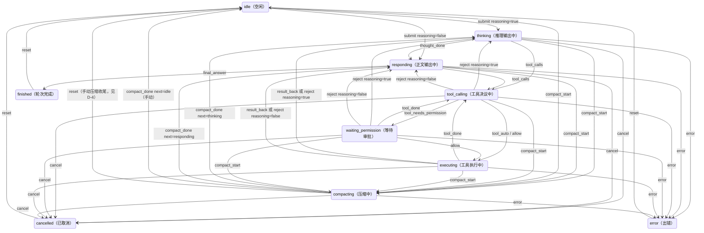
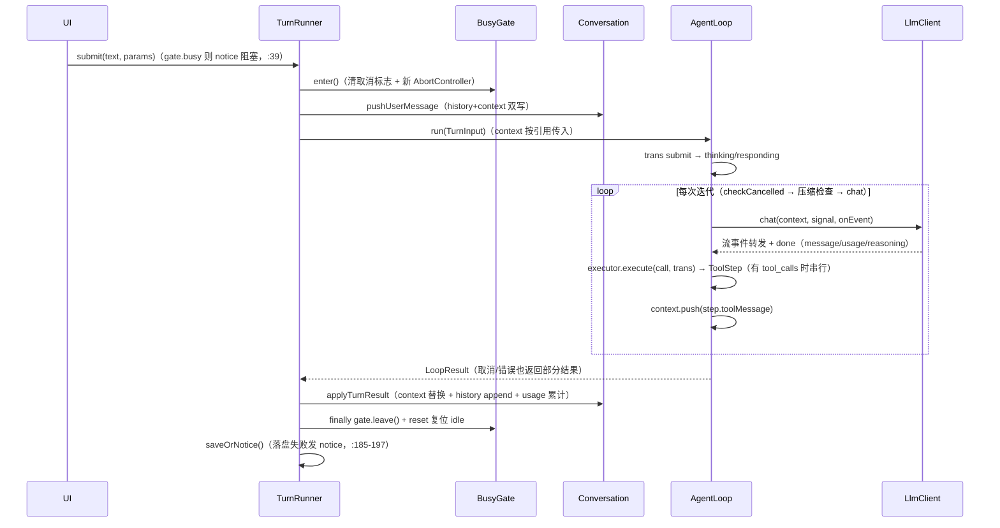
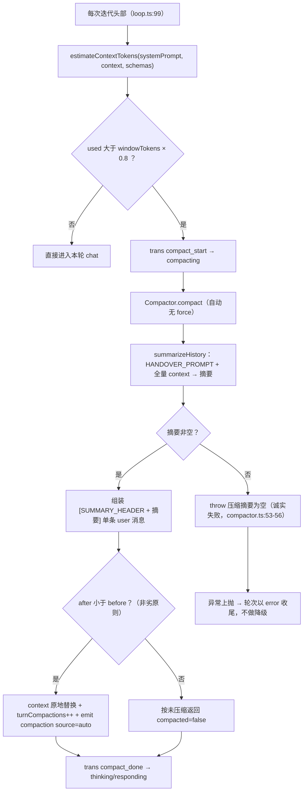
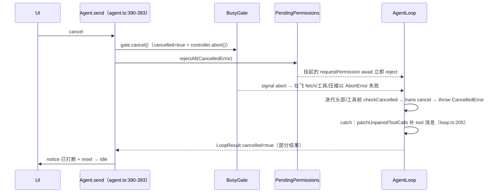

# 02 - 对话轮次引擎

> 职责：把"用户说一句话"变成"一轮完整的 agentic 对话"——驱动 LLM 调用、工具执行、权限审批、上下文压缩、取消与收尾落盘。核心编排住 `agent/src/turn/`，门面装配在 `agent/src/agent.ts`。

## 1. 职责与边界

`turn/` 域的文件分工（依赖矩阵允许 turn 依赖 session/llm/tools/context/permission/shared/ROOT，见 bridge/test/architecture.test.ts:128-139）：

| 文件 | 职责 |
|---|---|
| `agent/src/turn/turn-runner.ts` | 三命令实现归属：submit / cancel / compact；R2 阻塞语义与落盘 |
| `agent/src/turn/loop.ts` | AgentLoop：问模型 → 执行工具 → 回填 → 再问的主循环 |
| `agent/src/turn/state.ts` | TransitionInput + 迁移表 + StateMachine（10 态） |
| `agent/src/turn/tool-executor.ts` | 单个 tool_call 的完整流程（解析 → 权限 → 执行/拒绝 → 回填） |
| `agent/src/turn/compactor.ts` | 压缩编排器（loop 自动 + 手动 /compact 共用入口） |
| `agent/src/turn/summarize.ts` | 摘要提示词与离线总结调用 |
| `agent/src/turn/pending.ts` | 挂起中的权限请求（Promise 注册表） |
| `agent/src/turn/title.ts` | 自动标题生成 |
| `agent/src/turn/types.ts` | LoopServices / TurnInput / LoopResult 契约 |

**R1/R2/R3 三条内建立法**（散布在代码注释中，是本域设计的骨架）：

- **R1 双写分离**：`history`（完整原文，UI 显示与持久化用）与 `context`（发给模型的消息，可压缩）分开持有（agent/src/session/conversation.ts:24）；loop 只操作 context，本轮新增消息收集进 `newMessages` 由 core 同步 append 到 history（agent/src/turn/loop.ts:13-15）。压缩只换 context，history 永不回缩。
- **R2 并发闸门**：同一时刻只允许一个"动 context"的操作（轮次或手动压缩）在飞（agent/src/shared/gate.ts:2）；运行中动工作集的命令发 notice 阻塞，纯查询放行（agent/src/agent.ts:345 注释）。
- **R3 可见失败**：拒绝（reject 桶 / 用户 reject）、未知工具、参数校验失败也发 tool_end（带 error 标记），不静默塞消息（agent/src/turn/tool-executor.ts:20-21）。

## 2. 核心数据结构

### 2.1 状态机：10 态 + 15 种迁移输入（agent/src/turn/state.ts）

State 十态定义在 bridge（bridge/src/contract/shared.ts:8-18）：`idle / thinking / responding / tool_calling / waiting_permission / executing / finished / cancelled / error / compacting`。迁移输入 `TransitionInput` 共 15 种 kind（state.ts:7-22）：`submit / thought_done / final_answer / tool_calls / tool_auto / tool_needs_permission / allow / tool_done / reject / result_back / compact_start / compact_done / cancel / error / reset`。

**全转移表**（state.ts:53-75 的 `transition` 纯函数 + VALID_FROM 白名单 :27-43）：

| input | 合法来源态（VALID_FROM） | 目标态 |
|---|---|---|
| `submit{reasoning}` | idle, finished, cancelled, error | reasoning → thinking / 否则 responding |
| `thought_done` | thinking | responding |
| `final_answer` | responding | finished |
| `tool_calls` | responding, thinking | tool_calling |
| `tool_auto` | tool_calling | executing |
| `tool_needs_permission` | tool_calling | waiting_permission |
| `allow` | waiting_permission | executing |
| `tool_done` | executing, waiting_permission | tool_calling（还有下一个工具） |
| `reject{reasoning}` | executing, waiting_permission, tool_calling | reasoning → thinking / 否则 responding |
| `result_back{reasoning}` | executing | reasoning → thinking / 否则 responding |
| `compact_start` | thinking, responding, idle, tool_calling, executing, waiting_permission | compacting |
| `compact_done{next}` | compacting | 指定态（loop 自动回 thinking/responding；手动回 idle） |
| `cancel` | thinking, responding, tool_calling, waiting_permission, executing, compacting | cancelled |
| `error` | 同上六态 | error |
| `reset` | finished, cancelled, error, idle, compacting | idle |

关键机制：`transition` 先查 VALID_FROM，**(input, from) 非法组合返回当前态不迁移**（state.ts:55-56）——对逻辑错误的防护性立法。`reject/result_back` 携带 reasoning 参数，因为"重新请求模型"与 submit 一样受推理模型影响（state.ts:47-48 注释）。全项目**唯一**状态机实例住 `ctx.machine`；loop 在轮内 fire（loop.ts:42-47 的 `trans` 闭包），门面 emitState 在轮外 fire（agent/src/agent.ts:122-133），无双机镜像（state.ts:78-79 注释）。

### 2.2 轮次参数、结果与挂起项（types.ts、turn-runner.ts、pending.ts、tool-executor.ts）

- `TurnParams`（turn-runner.ts:15-22）：`client / model / maxOutput / maxRetries / reasoning / windowTokens`——门面在**命令时刻**从 config 解析成值传入，控制器不持探针回指门面内脏（所有权立法，turn-runner.ts:14 注释）。
- `TurnInput`（types.ts:28-43）：TurnParams + `systemPrompt / context / permission / maxIterations / cwd / shellProgram / signal`；`context` 字段注释立法"发给模型的消息列表（会被压缩）。loop 原地修改它并返回"（types.ts:36）。
- `LoopResult`（types.ts:48-61）：`context`（可能已压缩）、`newMessages`、`thinking[]`、`usage`（轮内多次调用累加的真实用量）、`compactions`、`cancelled?`、`error?`——**成功/取消/错误都返回部分结果**（types.ts:57-60 注释）。
- `PermissionResolution`（pending.ts:5-8）：`decision` + `scopePattern?`——模式在请求时由 agent 推导、随挂起项登记（pending.ts:16-17 注释），scoped 决议时随结果带回。`ToolStep`（tool-executor.ts:12-15）：`toolMessage`（要回填的 tool 消息）+ `transitionInput`（要 fire 的迁移输入）——executor 不直接操作状态机，迁移决定权留给 loop。

## 3. 设计逐项详解

### 3.1 D-1 十态状态机：白名单迁移与唯一实例

**设计问题**：轮次生命周期要广播给 UI（状态栏/输入框/流式块随之切换），但状态序列不能出现非法组合（如从 finished 直接 tool_calls）；迁移逻辑必须是可独立单测的纯函数。**方案与取舍**：输入驱动（15 种 kind）而非事件驱动——每种输入显式声明合法来源态（VALID_FROM 白名单），非法组合**原地不动**而非抛错（state.ts:25-26 注释："防止逻辑错误导致非法状态序列……现有调用序列都在合法范围内，不会受影响"）。备选是让调用点自行保证前置态——检查逻辑散落各处、无单测载体。迁移表本体 `transition` 是纯函数（state.ts:53-75），`StateMachine` 只是"当前态 + fire"的薄封装（state.ts:80-92）。

代码走查——`agent/src/turn/state.ts:27-43`：

```ts
const VALID_FROM: Record<TransitionInput['kind'], ReadonlySet<State>> = {
  submit: new Set(['idle', 'finished', 'cancelled', 'error']),
  thought_done: new Set(['thinking']),
  final_answer: new Set(['responding']),
  tool_calls: new Set(['responding', 'thinking']),
  tool_auto: new Set(['tool_calling']),
  tool_needs_permission: new Set(['tool_calling']),
  allow: new Set(['waiting_permission']),
  tool_done: new Set(['executing', 'waiting_permission']),
  reject: new Set(['executing', 'waiting_permission', 'tool_calling']),
  result_back: new Set(['executing']),
  compact_start: new Set(['thinking', 'responding', 'idle', 'tool_calling', 'executing', 'waiting_permission']),
  compact_done: new Set(['compacting']),
  cancel: new Set(['thinking', 'responding', 'tool_calling', 'waiting_permission', 'executing', 'compacting']),
  error: new Set(['thinking', 'responding', 'tool_calling', 'waiting_permission', 'executing', 'compacting']),
  reset: new Set(['finished', 'cancelled', 'error', 'idle', 'compacting']),
}
```

表即立法：`reject` 可从 executing/waiting_permission/tool_calling 三态触发（工具被拒后无需再请求模型），而 `result_back` 只从 executing；`compact_done` 只能离开 compacting——所以手动压缩若已 cancelled/error，收尾必须用 `reset` 而非 `compact_done`（见 D-4 手动路径）。十态状态机全图（迁移边按 VALID_FROM 真实画出）：



### 3.2 D-2 submit 一轮编排：闸门、双写与收尾落盘

**设计问题**：一轮对话跨 gate 状态、Conversation 工作集、loop、会话落盘四个所有者；无论成功/取消/错误，gate 必须释放、状态必须复位、会话必须尝试落盘。**方案与取舍**：runTurn 用 try/finally 保证三件事无条件发生（gate.leave / reset 复位 / saveOrNotice）；R1 双写只在一个入口做（pushUserMessage），loop 返回后一次性 applyTurnResult 同步工作集。备选是让 loop 直接写 Conversation——turn 域将依赖 session 内部细节，且压缩替换与 newMessages append 的时序难以保证原子。

代码走查——`agent/src/turn/turn-runner.ts:94-99`：

```ts
  private async runTurn(text: string, params: TurnParams): Promise<void> {
    const controller = this.deps.ctx.gate.enter()
    this.deps.conversation.pushUserMessage(text)
    this.deps.emit({ type: 'message', role: 'user', id: newId() })
    try {
      const result = await this.deps.loop.run({
```

逐段对应：`gate.enter()`（:95）置 running=true、清取消标志、new AbortController 返回（gate.ts:20-25）；`pushUserMessage`（:96）是 R1 双写唯一入口——同一消息对象进 history 与 context（conversation.ts:65-69）。TurnInput 组装（:99-113）：`client/model/maxOutput/maxRetries/reasoning` 直取 TurnParams（:100-104），`systemPrompt` 现取 assembler（:105）、`windowTokens`（:106）、`context` 以 **Conversation.getContext() 的引用**传入——loop 原地修改（:107）、`permission` 用 ctx 当前实例（:108）、`maxIterations` 取 config（:109）、`cwd/shellProgram`（:110-111）、`signal: controller.signal`（:112）。loop 返回后 `applyTurnResult`（:117，:114-116 的 R1 注释）做 context 整体替换（可能已压缩）、newMessages append 进 history、thinking 累积、usage 累计并记 lastTurn、compactions 累加（conversation.ts:73-84）。其后 `result.cancelled` → notice"已打断"（:118-119）；`result.error` → emitState error + emit error 消息（:120-122）；兜底 catch（:124-127，理论上 loop 已 catch 全部）；finally（:128-133）：`gate.leave()` + `emitState({kind:'reset'})` 复位 idle + `saveOrNotice()` 落盘（保存失败发 notice"会话保存失败"，不静默，:185-197）。成功结束后台生成标题 `void this.maybeAutoTitle(params)`（:42，fire-and-forget 不阻塞下一轮提交）。submit/compact 入口先查 gate.busy 发 notice"运行中，请稍候"（:39 / :89）——R2 阻塞的轮次侧落点。

submit 一轮的完整时序：



### 3.3 D-3 AgentLoop 主循环：迭代骨架与终结条件

**设计问题**：一轮提交可能触发任意多次模型调用（工具轮回）；要有明确的终结条件与逐次迭代的取消检查点，且每次迭代的状态迁移都有唯一出口。

**方案与取舍**：无限 `for(;;)` + 显式终结出口——每次迭代头部先 `checkCancelled()`（loop.ts:85-88，为真则 trans cancel + 抛 CancelledError），再查 `maxIterations >= 0 && iterations++ >= maxIterations`（:90-93；-1 = 无限的立法在 bridge/src/contract/config.ts:119，只有正整数上限才参与比较）。`trans` 闭包（:42-47）是轮内状态迁移的唯一出口：先经 StateMachine 算下一态，变化才 emit。每轮新建 ToolExecutor（:31-37）——permission 是轮次参数，config 编辑重建的实例下一轮生效。

代码走查——`agent/src/turn/loop.ts:172-177`：

```ts
        const calls = assistant.tool_calls ?? []
        if (calls.length === 0) {
          trans({ kind: 'final_answer' })
          this.services.emit({ type: 'finished', usage: { ...turnUsage } })
          return { context, newMessages, thinking, usage: { ...turnUsage }, compactions: turnCompactions }
        }
```

无 tool_calls 是唯一正常 return：trans final_answer → finished + 带轮内累计用量。其上游依次是（loop.ts:119-170）：`client.chat({…}, turn.signal, onEvent)`（:121-143）——onEvent 分发 LlmStreamEvent：`text_delta`（若在 thinking 则先 thought_done 转 responding）发 text_delta；`thought_delta` 仅 reasoning 开启时转发（:136-137）；`tool_call_start` 发 tool_pending（大参数流式生成期间的可见反馈，:138-141）。chat 抛 AbortError → trans cancel + CancelledError，其余异常 → trans error 上抛（:144-152）；`result.usage` 累加进 turnUsage（:154-157，usage 缺失自然跳过——部分兼容端点无 usage，估算口径仍可用）；push thinking 条目（:159-163，与 assistant 消息一一对应，reasoning 关闭时存空字符串、rebuildBlocksFromHistory 跳过不显示）；assistant 消息 push 进 context + newMessages + emit message（:168-170）。下游：trans tool_calls（:179）后**串行**执行每个 call（:183-200）——每个工具前再查取消（:186-189）；`executor.execute(...)` 返回 ToolStep，toolMessage push 进 context + newMessages、`state = trans(step.transitionInput)`（:197-199）。`registry.schemas()` 每次请求模型时现取（:126）——MCP 工具动态增减即时生效。

### 3.4 D-4 压缩管线：阈值、交接文档、非劣与诚实失败

**设计问题**：context 会逼近模型窗口上限；压缩本身又是一次 LLM 调用（可能失败/被取消/产出比原文更长），压缩语义必须"可预期、可失败、不劣化"。**方案与取舍**：①粗估不引 tokenizer（精度需求不高，estimate.ts:2 注释）；②阈值 80% 留缓冲（避免模型正要回答时才触发压缩打断，trigger.ts:3 注释），常量放 bridge 契约防两端漂移；③摘要定位为**任务交接文档**（新上下文的唯一内容）而非缩写；④非劣 + 诚实失败：产出不比原文短就当没压，摘要失败异常上抛，不做降级。

**触发与执行**（loop.ts:99-116）：每次迭代头部 `estimateContextTokens(turn.systemPrompt, context, registry.schemas())` 现算（:99），超过 `windowTokens * COMPACTION_THRESHOLD` → trans compact_start（:100-101）→ `compactor.compact({context, systemPrompt, tools, windowTokens, signal})`（:102-108）→ compacted 则 `context.length = 0; context.push(...result.context)` **原地替换** + `turnCompactions++` + emit compaction `source:'auto'`（:109-114）→ trans compact_done 回 thinking/responding（:115）。

代码走查——`agent/src/turn/compactor.ts:51-65`：

```ts
    // 全量交给模型总结——摘要将作为后续对话的唯一上下文（任务交接文档）。
    const summary = await this.summarize(input.context, input.signal)
    if (!summary.trim()) {
      // 空摘要会让后续对话失去全部上下文——视为压缩失败而非静默通过。
      throw new Error('压缩摘要为空')
    }
    const context = [{ role: 'user' as const, content: `${SUMMARY_HEADER}\n${summary}` }]
    const after = estimateContextTokens(input.systemPrompt, context, input.tools)
    // 非劣原则：压缩的产出不能比原文更大。简短/寒暄对话的交接文档可能比原文还长
    //（结构化提示词鼓励逐项展开）——此时压缩没有意义，按未压缩返回。自动路径天然不受影响
    //（80% 触发时 context 已很大，摘要必然更短）；主要是手动 /compact 小 context 的保护。
    if (after >= before) {
      return { compacted: false, context: input.context, before, after: before }
    }
    return { compacted: true, context, before, after }
```

产出是 `[SUMMARY_HEADER + 摘要]` 的**单条 user 消息**（:57；SUMMARY_HEADER = '[对话已压缩——以下是此前上下文的结构化摘要]'，:16）——无保留尾巴（keep=N 已废，切缝会拆散 tool_calls/tool 配对）、无淘汰、无硬丢弃（:23-25 注释）；下次压缩对 [摘要 + 新对话] 重新完整总结，无叠加劣化。前置于上述摘录的两个守卫（:44-50）：context 为空直接跳过；`!input.force && !shouldCompact(...)` 未达阈值跳过——`force` 语义（:30 注释）：force=true（/compact 手动）跳过阈值检查无条件压缩，force=false（自动）需超窗口 80%。`shouldCompact(used, windowTokens)` = `used > windowTokens * COMPACTION_THRESHOLD`（agent/src/context/compaction/trigger.ts:4-6）；`COMPACTION_THRESHOLD = 0.8` 住 bridge contract/shared.ts:6——后端触发与前端进度条过载变色共用同一常量，防两端漂移（shared.ts:3-5 立法注释）。`estimateContextTokens`（agent/src/context/token/budget.ts:6-11）把 systemPrompt + 全部消息（assistant 的 tool_calls 单独 stringify）+ 工具 schema JSON 求和；底层 `estimateTokens`（agent/src/context/token/estimate.ts:3-7）按 CJK 字符（正则 `[一-鿿]`）每字 1 token、其余 4 字符 ≈ 1 token 粗估。

**摘要提示词与调用形态**（summarize.ts:8-19 的 HANDOVER_PROMPT）：强制逐项保留 1) 当前任务目标与用户核心诉求；2) 已完成步骤与结果；3) 文件路径与关键代码位置；4) 重要决策及理由；5) 未完成事项与下一步计划；6) 用户偏好与约束——另附两条输出纪律：中文结构化条目；长度与信息密度匹配（寒暄一两句即可，不许凑类别展开）。`summarizeHistory`（summarize.ts:25-43）是"离线"单次 chat——不进 agent loop、不发 stream 事件、tools 传空、`maxOutput: 2000`（:36，1000 会截断长任务交接信息）、`maxRetries: 1`（:37）；signal 接收外部 signal 让取消能中断摘要调用（:24 注释：非无人持有的 new AbortController）。summarize 回调闭合在 agent.ts:310-315——调用时读当前 config 解析 provider/model，配置热切换后自动生效。

**history 为何不动**：history 是 UI 显示与持久化的完整原文，压缩是"给模型看的信息管理"而非"删记录"——resume 后用户仍能看到全部对话，模型只看到摘要 + 后续对话。R1 的直接推论（compactor.ts:19-20）。**失败语义（诚实失败）**：summarize 抛错或返回空摘要 → 异常上抛（:53-56；:27-28 立法注释"不做降级，由用户决定 /compact 重试或 /new"），调用方按错误收尾。

压缩判定与执行：



**手动压缩（/compact）**（turn-runner.ts:140-182）：gate.enter 占闸（防压缩期间 submit 并发写 context）→ trans compact_start（:141-142）→ `compactor.compact({... force: true, signal})`（:144-151）→ compacted 则 `replaceContext` + `incrementCompaction()`（手动压缩的计数入口，自动的走 LoopResult.compactions，:152-162）→ 落盘 → emit compaction source='manual'（:162）；未压缩 → notice"当前上下文无需压缩"（:163-166）。失败分支：AbortError 是用户取消——走 cancelled 态而非 error（:167-175）；否则 error。finally：还在 compacting 用 compact_done 回 idle，已 cancelled/error 用 reset 回 idle（compact_done 的 VALID_FROM 不含 cancelled/error，:176-181）。

### 3.5 D-5 单工具执行：四分支与 R3 可见失败

**设计问题**：每个 tool_call 都可能遇到四种前置失败（未知工具/参数校验失败/reject 桶/用户拒绝）与一种执行异常；每种失败都必须同时满足三个收敛——UI 有终态（tool_end 配对）、模型有交代（tool 消息回填）、状态机有归宿（迁移输入）。**方案与取舍**：execute 返回 `ToolStep{toolMessage, transitionInput}` 把"回填"与"迁移"一并交还 loop（tool-executor.ts:12-15）；`isLast` 决定迁移语义——非最后一个工具用 `tool_done` 回 tool_calling 继续执行，最后一个用 `reject/result_back` 重新请求模型（:39-40 两个闭包）。R3 立法（:20-21 注释）：四种前置失败也发 tool_end 带 error，不静默塞消息。

代码走查——`agent/src/turn/tool-executor.ts:42-58`：

```ts
    // 未知工具：发 tool_end 带错误，回填消息，迁移到 reject/tool_done。
    const tool: Tool | undefined = this.services.registry.get(call.function.name)
    if (!tool) {
      const content = `未知工具 ${call.function.name}`
      this.services.emit({ type: 'tool_end', id: call.id, name: call.function.name, output: content, error: content })
      return { toolMessage: { role: 'tool', tool_call_id: call.id, content }, transitionInput: rejectOrDone() }
    }

    // 参数解析校验：LLM 给的 arguments 是 JSON 字符串，先解析再用 zod schema 校验。
    let args: unknown
    try {
      args = tool.schema.parse(JSON.parse(call.function.arguments || '{}'))
    } catch {
      const content = '参数校验失败'
      this.services.emit({ type: 'tool_end', id: call.id, name: tool.name, output: content, error: content })
      return { toolMessage: { role: 'tool', tool_call_id: call.id, content }, transitionInput: rejectOrDone() }
    }
```

两个分支同构：emit tool_end（error 标原因）→ 返回带 tool 消息的 ToolStep → 迁移取 `rejectOrDone()`。参数校验是 `tool.schema.parse(JSON.parse(call.function.arguments || '{}'))`（:53）——zod 失败即"参数校验失败"，LLM 层不做参数语义校验（见《03》）。

**权限分支**（:60-93）：`permission.classify(tool.name, args, ctx.cwd)`（:62）——args（zod 解析后）与 cwd 一并交给 manager，参数化规则需要参数值、cwd 用于路径归一化（详见《06》）。reject 桶（:69-72）：emit tool_end denied → 回填 deniedMessage（:66）——明确告诉模型"请勿再次尝试同一工具"，防止权限请求死循环（:64-65 注释）。ask 桶（:75-88）：trans tool_needs_permission → `await requestPermission(tool, args)` 挂起等待（Promise 由 PendingPermissions 登记，agent.ts:298-306）→ `permission.apply(tool, decision, scopePattern, cwd)` 提升落库（:79）→ 用户 reject 同 reject 桶（:80-83）；allow_once/allow_always 则 trans allow → runAndEmit（:85-87）。allow 桶（:91-93）：trans tool_auto → runAndEmit。

**runAndEmit**（:99-117）：emit tool_start → `tool.execute(args, ctx)`（try/catch 兜底 :107-113，保证 tool_start 总有配对 tool_end——INV-4）→ `truncate(result.content)`（8000 字符上限，agent/src/context/truncate.ts:3-8）→ emit tool_end → 返回 tool 消息；ask 放行后与 auto 分支共用此逻辑（:96 注释，消除两分支逐行重复）。

### 3.6 D-6 取消传播：协作检查点 + 在飞中断 + 补配对

**设计问题**：取消要"及时"（挂起的 fetch/工具/压缩立即失败）也要"一致"（取消后 context 仍是合法对话状态——OpenAI API 要求每个 tool_call 有配对 tool 消息，否则下一轮请求 400）。**方案与取舍**：双机制立法（gate.ts:4-9 注释）——**协作检查点**（isCancelled 轮询，保证取消后逻辑一致）与**在飞中断**（AbortSignal，保证及时性）职能不同、不可互相替代；两路都由 `cancel()` 一次触发。用户 `cancel` 消息的处置在门面：`ctx.gate.cancel()` + `pending.rejectAll(new CancelledError())`（agent.ts:391-392）——挂起中的权限请求全部以 CancelledError 拒绝，tool-executor 的 await 立即抛出。

代码走查——`agent/src/shared/gate.ts:1-9`：

```ts
// 并发闸门：R2 语义的落地处——运行中（轮次/手动压缩）时动工作集的命令发 notice 阻塞，纯查询放行。
// 轮次与压缩共用一个闸门：同一时刻只允许一个「动 context」的操作在飞。
//
// 【取消双机制立法】本类同时承载两套取消语义，职能不同、不可互相替代：
// 1. 协作检查点——isCancelled() 由 loop 在每次迭代与工具之间轮询，保证「取消后逻辑一致」
//    （返回部分结果、补全未配对 tool_calls）；
// 2. 在飞中断——enter() 返回的 AbortSignal 让挂起的 fetch / 工具 / 压缩立即失败（AbortError），
//    保证「取消的及时性」。
// 两路都由 cancel() 一次触发；loop 同时消费二者（checkCancelled 回调 + signal）。
```

`cancel()` 置标志并 `controller?.abort()`（gate.ts:32-35）；`enter()` 返回的 signal 随 TurnInput 传给 `client.chat`（loop.ts:130）、工具 ctx（loop.ts:193）与 compactor——挂起的 fetch / 工具 / 压缩立即以 AbortError 失败。协作检查点在 loop 每次迭代头部（loop.ts:85）与每个工具执行前（loop.ts:186）。AbortError 在 loop.ts:146-149 统一转 CancelledError；对 shell 工具，signal 进一步传播到子进程树终止（kill-tree，详见《05》）。**补配对**：`patchUnpairedToolCalls(context)`（loop.ts:54-78）向后扫描**最后一条**带 tool_calls 的 assistant 消息（不要求在数组尾部）——:51-53 注释：多工具批量调用时 tool 1 执行完、tool 2 被取消，尾部是 tool1_result，只查尾部会漏。收集该 assistant 之后已配对的 tool_call_id（:64-68），为每个未配对 id 补 `{ role: 'tool', tool_call_id: tc.id, content: 'cancelled（用户打断了操作）' }`（:73）并同时 push 进 context 与 newMessages（:74-75）——部分结果里也不丢。catch 块（loop.ts:202-210）在 CancelledError 与普通错误两条路径上都先 patch 再返回部分结果（:204 注释：旧实现直接 throw 导致 newMessages 丢失）——`cancelled: true` 时已完成的 assistant/tool 消息不丢（:206-207）。挂起权限请求的结算侧：`PendingPermissions.rejectAll`（pending.ts:30-33）遍历全部挂起项 reject 后清空 Map，无 Promise 泄漏；`resolve`（:25-28）把 decision 与登记时存下的 scopePattern 一起带回。

取消传播时序：



### 3.7 D-7 自动标题：竞态窗口与 token 预算

**设计问题**：首轮结束后自动生成会话标题（替代截断的 preview），但生成是异步 LLM 调用——期间用户可能 /rename 手动命名（竞态）、可能连续提交（in-flight 重复）、推理模型还可能把小 token 预算全烧在思考上导致空结果。**方案与取舍**：fire-and-forget（不阻塞下一轮提交，失败静默——标题是装饰）；四重前置检查 + 写回前再查一次。`generateTitle`（title.ts:12-42）与 summarizeHistory 同模式（离线单次 chat）；TITLE_PROMPT 立法"只输出标题本身，≤32 字、不加引号前后缀"（title.ts:5）；输入取首条 user/assistant 消息各前 500 字符；`maxOutput: 512, maxRetries: 1`（title.ts:30-31）——给 64 会被推理模型的思考烧光导致 content 为空 → 静默失败（title.ts:9-10 注释）；失败/空结果返回 null；清洗：取首行、剥引号、截 32 字（title.ts:36-37）。

代码走查——`agent/src/turn/turn-runner.ts:49-57`：

```ts
  private maybeAutoTitle(params: TurnParams): void {
    if (this.titleGenerating) return
    if (this.deps.conversation.getTitle()) return
    if (this.deps.ctx.gate.busy) return
    const history = this.deps.conversation.getHistory()
    const user = history.find((m) => m.role === 'user')
    const assistant = history.find((m) => m.role === 'assistant')
    if (!user || !assistant || typeof user.content !== 'string') return
    this.titleGenerating = true
```

前置四查（:50-53：in-flight 去重、已有标题跳过、gate 空闲）+ 首轮需同时存在 user + assistant 消息（:54-56）；前置立法注释在 :45-47。写回前**再查一次标题**（turn-runner.ts:65）——生成期间 /rename 手动命名可能已落，手动命名优先、自动结果直接丢弃；写回后落盘 + notice + session_list 广播（:66-77）；finally 复位 titleGenerating（:78-80）。

## 4. 关键立法与不变量

- **INV-1**：history 单调增长，永不因压缩回缩（R1）；context 可被压缩替换。
- **INV-2**：context 中每条 assistant.tool_call 的 id 必有配对 tool 消息（patchUnpairedToolCalls 保证）——OpenAI 线格式（shared.ts:46-50）可回放的前提。
- **INV-3**：同一时刻至多一个 gate.enter() 区间（R2）；轮次与手动压缩共用闸门。
- **INV-4**：tool_start 与 tool_end 一一配对（runAndEmit 的 try/catch 兜底，tool-executor.ts:107-113）。
- **INV-5**：状态机迁移必须过 VALID_FROM 白名单，非法组合原地不动（防非法状态序列）。
- **INV-6**：压缩产出必须非空且严格小于原文（非劣原则），否则视为未压缩。
- **INV-7**：thinking 条目与 assistant 消息一一对应（空串占位），保证 resume 重建显示时索引对齐。

## 5. 失败模式与恢复

| 失败 | 语义 | 恢复 |
|---|---|---|
| LLM API 失败（chat 抛错） | trans error → LoopResult.error → emit error 消息 | 已完成的 assistant/tool 消息保留（loop.ts:202-210）；用户重新 submit |
| 达到 maxIterations | 同 error 路径（loop.ts:90-93） | 调大 config.maxIterations 或设 -1 |
| 用户取消 | AbortError→CancelledError，补全未配对 tool_calls，cancelled: true | context 完整可继续；下一轮 submit 正常 |
| 权限请求中取消 | PendingPermissions.rejectAll 让 await 抛出（agent.ts:392） | 挂起项清理干净，无 Promise 泄漏 |
| 压缩摘要为空 / LLM 失败 | 异常上抛 = 轮次 error，不降级（诚实失败） | /compact 重试或 /new |
| 工具抛异常 | runAndEmit try/catch → tool_end 带 error → 错误文本回填给模型 | 模型看到错误改换路径 |
| 落盘失败 | saveOrNotice 发 notice（turn-runner.ts:194-196） | 用户感知而非静默丢会话 |
| loop 内意外异常 | runTurn 兜底 catch（:124-127，理论上 loop 已 catch 全部） | error 态 + reset 复位 |
| 标题生成失败/竞态 | 返回 null 或写回前发现已有标题 → 丢弃 | 会话继续用 preview 或手动 /rename |

## 6. 与其它子系统的接缝

- **→ 03 LLM**：loop 消费 `LlmClient.chat` 的流式回调（LlmStreamEvent 三类），见《03》。
- **→ 04/05 工具**：`registry.schemas()` 每次请求模型时现取（loop.ts:126）——MCP 工具动态增减即时生效；工具实现见《05》。
- **→ 06 权限**：ask 桶 → requestPermission 挂起 → PendingPermissions → UI 决议 → apply 提升落库，完整链路见《06》。
- **→ 09 会话**：applyTurnResult / snapshotFull / load 是 Conversation 与 SessionStore 的交接面，见《09》。
- **← 10 配置**：TurnParams 每轮从 config 现解析（agent.ts:318-329），config_updated 重建 assembler/permission 后下一轮生效。
