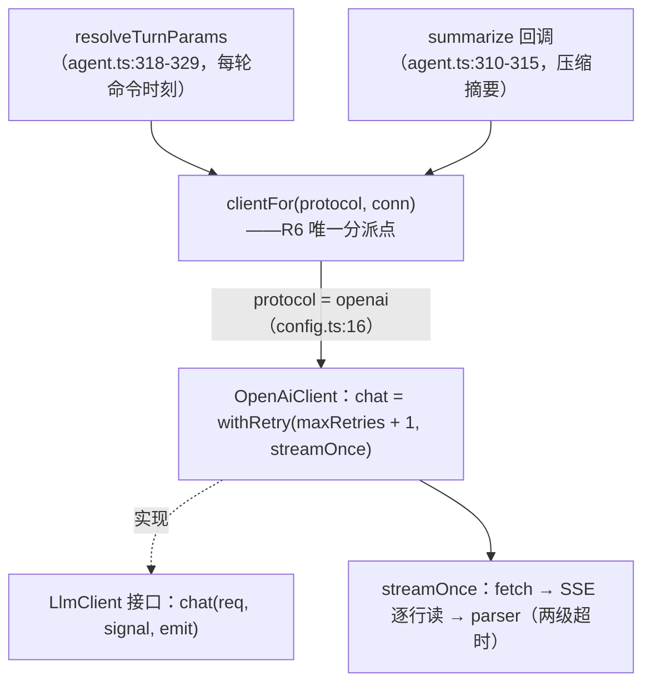
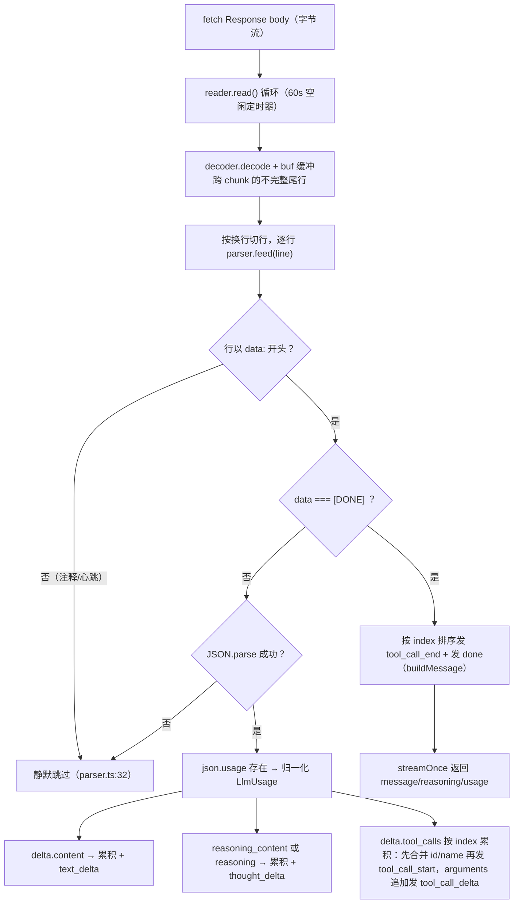
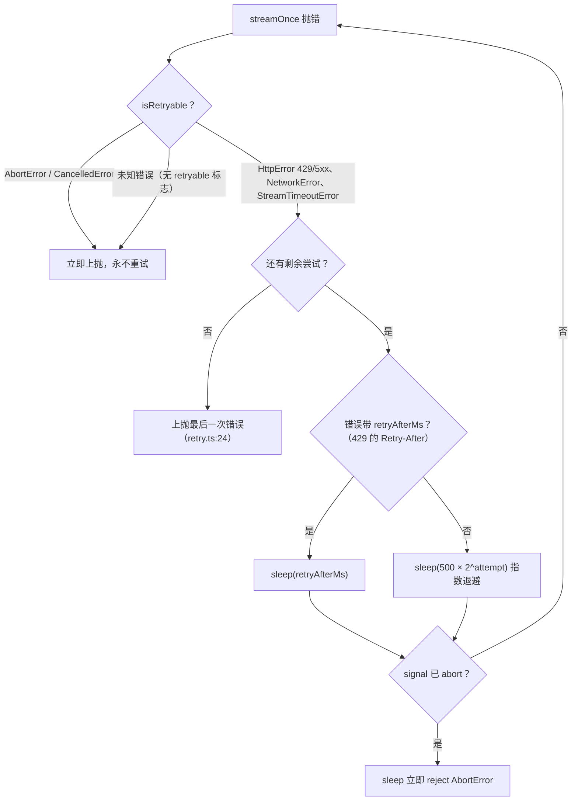

# 03 - LLM 接入层

> 职责：把「context + 工具集 + 参数」翻译为对 provider 端点的流式 HTTP 请求，把响应 SSE 翻译回统一的增量事件流。agent 的其余部分（AgentLoop 等）只认识 `LlmClient` 接口与 `LlmStreamEvent`，对"OpenAI 兼容"这一实现细节无感知。全部代码住 `agent/src/llm/`。

## 1. 职责与边界

| 文件 | 职责 |
|---|---|
| `agent/src/llm/types.ts` | LlmStreamEvent / ChatRequest / ChatResult / LlmClient / LlmUsage 契约 |
| `agent/src/llm/client-for.ts` | protocol → client 分派（新增协议的唯一改动点） |
| `agent/src/llm/provider/openai/openai-client.ts` | OpenAiClient：重试编排（唯一对外类） |
| `agent/src/llm/provider/openai/stream.ts` | 单次流式请求：fetch → SSE 逐行读 → parser，两级超时 |
| `agent/src/llm/provider/openai/parser.ts` | 行驱动 SSE 解析器（可无网络单测） |
| `agent/src/llm/provider/openai/request.ts` | ChatRequest + 连接参数 → HTTP 请求体组装 |
| `agent/src/llm/provider/openai/retry.ts` | withRetry：指数退避 + Retry-After 尊重 |
| `agent/src/llm/provider/openai/errors.ts` | 三类可分类错误 + isRetryable 判定 |
| `agent/src/llm/provider/openai/sse-types.ts` | SSE chunk 最小类型形状（全字段可选、逐字段窄化） |

依赖矩阵中 `llm` 域依赖为空（architecture.test.ts:132-136）——它只依赖 bridge 的 Message 类型与自身，是最底层的无状态能力模块。

## 2. 核心数据结构

### 2.1 LlmStreamEvent——provider 到 loop 的七种流事件（types.ts:4-11）

`agent/src/llm/types.ts:4-11`：

```ts
export type LlmStreamEvent =
  | { type: 'text_delta'; text: string }
  | { type: 'thought_delta'; text: string }
  | { type: 'tool_call_start'; index: number; id: string; name: string }
  | { type: 'tool_call_delta'; index: number; argsJsonDelta: string }
  | { type: 'tool_call_end'; index: number; id: string; name: string; arguments: string }
  | { type: 'done'; message: Message; reasoning?: string; usage?: LlmUsage }
  | { type: 'error'; error: Error }
```

设计原理：**流式通道（前五类增量）与终结通道（done 携带完整组装产物）分离**。AgentLoop 的 onEvent 回调只转发前三种（loop.ts:131-142），`tool_call_delta/tool_call_end` 仅供需要逐分片可见的消费者使用，done 的 `message` 是最终 assistant 消息（进 context/history），`reasoning` 单独携带供持久化——不进 history/context（types.ts:34-35），`usage` 是 API 精确用量。

### 2.2 ChatRequest 与连接参数分离（types.ts:15-22, 41-44）

`agent/src/llm/types.ts:15-22 … 41-44`（省略 LlmUsage/ChatResult）：

```ts
export interface ChatRequest {
  model: string
  systemPrompt: string
  messages: Message[] // 仅 user / assistant / tool 历史；system 由 client 自行拼接
  tools: object[]
  maxOutput: number
  maxRetries: number
}
…
export interface LlmClientConn {
  baseURL: string
  apiKey: string
}
```

`LlmClient.chat(req, signal, emit): Promise<ChatResult>`（types.ts:48）——signal 是取消传播的入口（见《02》§3.6），emit 是流事件出口。`maxRetries` 保留在请求级而非连接级——"压缩摘要等离线调用会用更激进的重试策略"（types.ts:14 注释）。

### 2.3 ChatResult 与 LlmUsage（types.ts:26-38）

`LlmUsage { promptTokens, completionTokens, totalTokens }`——OpenAI snake_case 在 parser 转 camelCase（types.ts:24 注释）。精确值与本地粗估（context/token/estimate.ts）在 /context 面板并排展示，可见校准误差（types.ts:25 注释；载荷见 `context_state.lastTurn`）。

## 3. 设计逐项详解

### 3.1 D-1 接口先行：LlmClient 抽象与 protocol 分派

**设计问题**：agent 上层（AgentLoop / 压缩 / 标题）需要调模型，但不能耦合任何具体 provider 的 SDK 或协议细节；将来新增协议时调用方应当零改动。

**方案与取舍**：单方法接口 `LlmClient` + 工厂 `clientFor(protocol, conn)` 作为唯一分派点（R6 立法，client-for.ts:5-6 注释："agent 只调此函数，不直接引用 OpenAiClient……将来新增协议在此加分支即可，agent 调用方一行不改"）。连接参数（baseURL/apiKey）在构造时注入实例，不随请求传递——同一 provider 的多个模型复用同一实例，模型名是请求级参数（openai-client.ts:6 注释："换模型不换连接"）。

代码走查——`agent/src/llm/types.ts:40-49`：

```ts
// 客户端连接参数：构造 OpenAiClient 等 LlmClient 实例时注入。
export interface LlmClientConn {
  baseURL: string
  apiKey: string
}

// LLM 客户端接口：一个协议一个实现（openai → OpenAiClient）。
export interface LlmClient {
  chat(req: ChatRequest, signal: AbortSignal, emit: (e: LlmStreamEvent) => void): Promise<ChatResult>
}
```

接口只有一个 `chat`：请求（值）、取消（signal）、流事件（emit 回调）三个入参把"一次对话"的全部输入显式化，无隐藏状态。

代码走查——`agent/src/llm/client-for.ts:5-12`：

```ts
// protocol → client 分派（R6）：agent 只调此函数，不直接引用 OpenAiClient。
// v1 只支持 openai 协议；将来新增协议在此加分支即可，agent 调用方一行不改。
export function clientFor(protocol: Config['providers'][number]['protocol'], conn: LlmClientConn): LlmClient {
  switch (protocol) {
    case 'openai':
      return new OpenAiClient(conn)
  }
}
```

`protocol` 类型直接取自 config schema（`Config['providers'][number]['protocol']`，bridge/src/contract/config.ts:16 当前仅 `'openai'`）——新增协议 = config enum 加一项 + 此处加一个 case，类型系统会强制两处同步。实现类 `OpenAiClient`（openai-client.ts:8-14）整个类只做重试编排一件事：`withRetry(req.maxRetries + 1, () => streamOnce(this.conn, req, signal, emit), signal)`（:12）——maxRetries + 1 次尝试；单次请求的全部复杂度（超时/解析/错误分类）在 streamOnce，重试策略在 withRetry；连接参数归实例所有（:6 注释："同一 provider 的多个模型复用同一实例"）。选原生 fetch + 手写 SSE 而非官方 SDK：流式事件透传与错误分类需要完全控制。

LlmClient 接口与 OpenAI 实现的适配关系：



### 3.2 D-2 请求组装：system 拼接与 include_usage

**设计问题**：OpenAI 请求体的字段映射、system 消息的位置、流式真实用量的开关都要有唯一归属；URL 与鉴权头要容错用户配置（尾斜杠）。

**方案与取舍**：组装集中在 `buildRequest` 纯函数；system 在 client 层拼接而非让调用方传——ChatRequest.messages 只含 user/assistant/tool 历史（request.ts:4 注释），保证历史消息（OpenAI 线格式）可直接持久化回放；`stream_options: { include_usage: true }` 恒开——流式模式真实用量随流末尾独立 chunk 返回，是用量双口径（《09》§3.7）与压缩触发校准的数据前提。

代码走查——`agent/src/llm/provider/openai/request.ts:3-22`：

```ts
// ChatRequest + 连接参数 → HTTP 请求（URL + init）。
// system 消息在此拼接——ChatRequest.messages 只含 user/assistant/tool 历史，不含 system。
export function buildRequest(req: ChatRequest, conn: LlmClientConn): { url: string; init: RequestInit } {
  return {
    url: `${conn.baseURL.replace(/\/+$/, '')}/chat/completions`,
    init: {
      method: 'POST',
      headers: { 'content-type': 'application/json', authorization: `Bearer ${conn.apiKey}` },
      body: JSON.stringify({
        model: req.model,
        stream: true,
        // include_usage：流式模式拿到真实用量（usage 随流末尾的独立 chunk 返回）。
        stream_options: { include_usage: true },
        messages: [{ role: 'system', content: req.systemPrompt }, ...req.messages],
        tools: req.tools,
        max_tokens: req.maxOutput,
      }),
    },
  }
}
```

URL 尾斜杠容错（:7，`replace(/\/+$/, '')`）；`tools: req.tools` 是**注册表 schemas() 现算值**——工具注册/摘除即时反映到下一次请求（《02》§3.3）。

**maxOutput 与 reasoning 的关系**：模型级 `maxOutput` 配置来自 config（bridge/src/contract/config.ts:7-12 的 modelSchema，默认 16384），经 `agent.current()`（agent.ts:159-171）→ `resolveTurnParams`（agent.ts:318-329）→ TurnParams → loop → 请求体。`model.reasoning`（config.ts:11）决定的是**状态机走向**（submit 后进 thinking 还是 responding，loop.ts:82）与 thought_delta 是否转发（loop.ts:136），而非请求体参数——ChatRequest 无 reasoning 开关，思考 token 自然计入 maxOutput 预算（title.ts:9-10 注释解释了这一预算竞争：离线调用给 512 而非 64 就是为此）。

### 3.3 D-3 行驱动 SSE 解析器：增量流 → 事件流

**设计问题**：OpenAI 流式 chunk 是零散增量——正文分片、reasoning 分片、tool_call 的 id/name/arguments 各自分片到达且可能乱序；解析器要把它们拼成有序事件流，还要容忍坏行与心跳。

**方案与取舍**：**行驱动**闭包 `feed(line) → LlmStreamEvent[]`（parser.ts:11 注释："便于无网络单测，直接喂 mock SSE 行"）——解析与网络解耦，测试不需要 fetch。内部累积状态 `content`（正文）、`reasoning`（思考全文）、`usage`、`calls: Map<index, PendingToolCall>`（:16-19）。tool_call 按 index 累积（arguments 分片拼接，:13 注释"流式可能分多次送达同一 tool call 的参数"），done 时按 index 排序输出——分片乱序到达不改变最终 tool_calls 顺序。[DONE] 时组装最终 assistant 消息的 `buildMessage`（:22-27）取 `content || null`——纯工具调用的 assistant 消息 content 为 null（OpenAI 线格式允许，见 shared.ts:49），tool_calls 按 index 排序展开。feed 的分发逻辑（parser.ts:30-84）：非 `data:` 开头的行（SSE 注释/心跳）静默跳过（:32）；`data: [DONE]` 按 index 排序逐 tool call 发 `tool_call_end` 再发 done（:34-39）；JSON.parse 失败返回空数组——坏行不炸流（:44-45）；`json.usage` 存在（include_usage 的末尾 chunk，choices 为空数组，sse-types.ts:15）→ 归一化为 LlmUsage（:48-54）；`delta.content` → 累积 + text_delta（:57-60）；**reasoning 双字段兼容** `delta.reasoning_content ?? delta.reasoning`（:63，:61-62 注释——前者是 OpenAI 官方字段，后者是部分兼容端点的变体；字段形状见 sse-types.ts:10-12），累积全文，done 携带供 resume 恢复思考块。tool_call 分支的累积细节：

代码走查——`agent/src/llm/provider/openai/parser.ts:68-82`：

```ts
      for (const tc of Array.isArray(delta.tool_calls) ? delta.tool_calls : []) {
        const idx = typeof tc.index === 'number' ? tc.index : 0
        const isNew = !calls.has(idx)
        if (isNew) calls.set(idx, { id: tc.id ?? '', name: '', args: '' })
        const cur = calls.get(idx)!
        if (tc.id) cur.id = tc.id
        if (tc.function?.name) cur.name = tc.function.name
        // tool_call_start 必须在字段合并之后发出——OpenAI 协议里 name/id 往往随首个分片才到，
        // 先合并再广播，下游的 tool_pending 才能携带真实工具名（而非空串）。
        if (isNew) events.push({ type: 'tool_call_start', index: idx, id: cur.id, name: cur.name })
        if (tc.function?.arguments) {
          cur.args += tc.function.arguments
          events.push({ type: 'tool_call_delta', index: idx, argsJsonDelta: tc.function.arguments })
        }
      }
```

关键时序立法：**tool_call_start 必须在字段合并之后发出**（:75-76 注释）——先合并 id/name 再广播，下游 tool_pending 才能携带真实工具名而非空串；index 缺省按 0（:69）。`tc.function?.arguments` 追加到 `cur.args` 并发 tool_call_delta（:78-81）。

**一次完整的 done 组装示例**：模型流式返回 `{content: "我来", tool_calls: [{index:0, id:"a1", function:{name:"read_file"}}]} {tool_calls:[{index:0, function:{arguments:'{"pa'}}]} {tool_calls:[{index:0, function:{arguments:'th":"x"}}]} [DONE]`——parser 累积 content、按 index 0 合并 id/name/arguments 三分片，[DONE] 时发 `tool_call_end{arguments:'{"path":"x"}'}` + `done{message:{role:'assistant', content:'我来', tool_calls:[...]}}`。loop 收到 done 后把整条 assistant 消息 push 进 context（《02》§3.3），参数由 ToolExecutor 层 zod 校验——LLM 层不做参数语义校验。

SSE 流式解析管线：



### 3.4 D-4 两级超时与失败归因还原

**设计问题**：流式请求的失败形态比普通请求多——连接阶段超时、读到一半流停滞、用户中途取消、流"正常"结束却没有最终消息；错误必须归因准确，否则重试层会把不可重试的取消当超时重试、把该重试的超时当致命错误上抛。

**方案与取舍**：两级超时模型（stream.ts:7-12 注释），均**不含总时长上限**——"持续出字节的流是健康的，生成长度由 maxOutput 决定"（:7 注释）：①连接超时 `CONNECT_TIMEOUT_MS = 60s`（fetch 发起 → 响应头，含 DNS/TLS/首响）；②空闲超时 `IDLE_TIMEOUT_MS = 60s`（相邻 chunk 最大间隔，首个 chunk 前的 body 等待同受约束）。两级统一抛 StreamTimeoutError（可重试）；用户取消走 AbortError，互不混淆（:10 注释）。

代码走查——`agent/src/llm/provider/openai/stream.ts:20-38`：

```ts
  // 连接超时：独立 controller 承载——超时 abort 与用户 abort 需区分归因。
  const connectCtrl = new AbortController()
  let connectTimedOut = false
  const onUserAbort = () => connectCtrl.abort()
  signal.addEventListener('abort', onUserAbort, { once: true })
  const connectTimer = setTimeout(() => { connectTimedOut = true; connectCtrl.abort() }, CONNECT_TIMEOUT_MS)

  let res: Response
  try {
    res = await fetch(url, { ...init, signal: connectCtrl.signal })
  } catch (e) {
    clearTimeout(connectTimer)
    signal.removeEventListener('abort', onUserAbort)
    if (signal.aborted) throw new DOMException('Aborted', 'AbortError') // 用户取消
    if (connectTimedOut) throw new StreamTimeoutError('connect')        // 连接超时（可重试）
    throw new NetworkError(e)                                           // 网络错误（可重试）
  }
  clearTimeout(connectTimer)
  // 注意：onUserAbort 监听保留——body 阶段用户 abort 仍需中断（fetch body 绑定 connectCtrl.signal）。
```

连接超时用独立 AbortController 承载（:21-25）——外部 signal abort 时联动 abort connectCtrl（:23-24），fetch 只见一个 signal 但归因靠 `connectTimedOut` 标志：`signal.aborted` → AbortError（用户取消，不重试，:33）；`connectTimedOut` → StreamTimeoutError('connect')（:34）；其余 → NetworkError（:35）。HTTP 非 2xx → `HttpError(status, msg, retryAfterMs)`（:40-47），Retry-After header 解析支持秒数与 HTTP-date 两种格式（parseRetryAfter，:118-125）。

**读流循环**（:61-96）：每次 `reader.read()` 挂一个 60s 空闲定时器，超时 `reader.cancel(timeout)`（:64-67）；read reject 时区分 `signal.aborted`（AbortError）、StreamTimeoutError、NetworkError（:75-82）；数据按行切分喂 parser（`buf` 缓冲跨 chunk 的不完整尾行，:85-95）；连接关闭时最后一批字节可能无尾随换行，残余行单独处理（:98-104）。**超时归因还原**是本文件最精巧的失败归因设计。

代码走查——`agent/src/llm/provider/openai/stream.ts:109-114`：

```ts
  if (!finalMessage) {
    // 超时触发的 cancel 会优雅结束流——归因还原成 StreamTimeoutError（retry 层可重试）。
    if (timeout) throw timeout
    throw new Error('流未产生最终消息')
  }
  return { message: finalMessage, reasoning: finalReasoning, usage: finalUsage }
```

`reader.cancel` 会让后续 read 以 done"正常"结束——必须在循环外还原为 StreamTimeoutError（可重试），否则长生成被掐断时会误报成"流未产生最终消息"（:49-50 注释）；只有真正没有超时标志且无最终消息才抛 `'流未产生最终消息'`（:112）。

### 3.5 D-5 重试编排与错误分类

**设计问题**：重试必须区分"值得再试"（限流/服务端故障/网络抖动/超时）与"再试无意义"（4xx 请求本身有问题）与"禁止重试"（用户取消）；退避还要尊重服务端的限流指导。

**方案与取舍**：错误分类（errors.ts 三类 + retryable getter）与重试策略（withRetry）分离；429 的 `retryAfterMs`（来自 Retry-After header）优先于指数退避——尊重 API 限流指导；退避等待期间 signal abort 立即中断——取消的及时性在重试层同样成立。

**可重试性判定** `isRetryable`（errors.ts:39-47）：AbortError/CancelledError 永不重试（:40-41，用户意图立即上抛）；有 `retryable` getter 的错误按 getter——HttpError = 429 或 ≥500（errors.ts:13-16，"4xx（除 429 外）不可重试——请求本身有问题，重试也不会成功"），NetworkError / StreamTimeoutError 恒可重试（:26 / :35）；未知错误默认不重试（:45-46，避免对未预期错误反复打）。

代码走查——`agent/src/llm/provider/openai/retry.ts:7-25`：

```ts
export async function withRetry<T>(attempts: number, run: () => Promise<T>, signal?: AbortSignal): Promise<T> {
  let lastError: Error | null = null
  for (let i = 0; i < Math.max(1, attempts); i++) {
    try {
      return await run()
    } catch (e) {
      lastError = e as Error
      // AbortError / CancelledError：用户取消，立即上抛。
      if (!isRetryable(lastError)) throw lastError
      // 不可重试的错误（4xx 等）：fail-fast，不浪费重试次数。
      // isRetryable 已经排除了 AbortError，这里处理的是可重试错误的退避。
      if (i < attempts - 1) {
        const delay = getBackoffDelay(lastError, i)
        await sleep(delay, signal)
      }
    }
  }
  throw lastError!
}
```

`Math.max(1, attempts)` 保证至少尝试一次；不可重试 fail-fast（:15）；最后一次尝试失败后不再 sleep 直接落到底部 `throw lastError!`（:24）——重试耗尽 → 最后一次错误上抛 → loop 的 catch 转 error 态（《02》§3.3）。退避策略 `getBackoffDelay`（retry.ts:27-33）：429 的 `retryAfterMs` 优先，其余指数退避 `500 * 2 ** attempt`（500ms, 1s, 2s...）。可中断 `sleep`（retry.ts:35-44）：signal 已 abort 时立即 reject（:38），等待中 abort 则 clearTimeout + reject——不等计时结束。

请求重试与错误分类：



### 3.6 D-6 实例生命周期与三种调用形态的预算立法

**设计问题**：client 实例何时创建、配置热切换后旧实例怎么办；同一 client 还要服务主循环/压缩/标题三种调用形态，各自的 maxRetries/maxOutput 预算不同。

**方案与取舍**：**按需创建、无全局缓存**——两处调用点（轮次主循环 agent.ts:322 的 resolveTurnParams，每轮命令时刻解析；压缩摘要 agent.ts:313 的 summarize 回调）都现读 config（`resolveCurrent` + `current()`），配置热切换（换 provider/改 apiKey）后下一次调用自动用新连接，无失效问题。`resolveCurrent`（agent/src/config/resolve.ts:6-10）解析当前 provider/model：defaultProvider 未命中回落首个 provider，model 同理（调用方需先经 isConfigured 判定）。三种形态的预算立法：主循环用配置值（默认重试 3 次 config.ts:120 + maxOutput 16384 config.ts:10）；压缩摘要 `maxRetries: 1, maxOutput: 2000`（summarize.ts:36-37，摘要是唯一上下文不能截断）；标题生成 `maxRetries: 1, maxOutput: 512`（title.ts:30-31，给 64 会被推理模型思考烧光）。这正是 `maxRetries` 放在**请求级**而非连接级的原因（types.ts:14 注释）。

代码走查——`agent/src/agent.ts:310-315`：

```ts
  private summarize = (old: Message[], signal?: AbortSignal): Promise<string> => {
    const { provider } = resolveCurrent(this.ctx.config)
    const cur = this.current()
    const client = this.clientOverride ?? clientFor(provider.protocol, { baseURL: cur.baseURL, apiKey: cur.apiKey })
    return summarizeHistory({ client, model: cur.model }, old, signal)
  }
```

压缩回调闭在 ctx 上（agent.ts:308 注释："调用时读当前 config 解析 provider/model"）；`clientOverride` 是测试接缝（AgentOptions.client，agent.ts:23-24）。signal 透传让压缩期间 cancel 能中断摘要调用。

代码走查——`agent/src/agent.ts:318-329`：

```ts
  private resolveTurnParams(): TurnParams {
    const cur = this.current()
    const { provider } = resolveCurrent(this.ctx.config)
    return {
      client: this.clientOverride ?? clientFor(provider.protocol, { baseURL: cur.baseURL, apiKey: cur.apiKey }),
      model: cur.model,
      maxOutput: cur.maxOutput,
      maxRetries: this.ctx.config.maxRetries,
      reasoning: cur.reasoning,
      windowTokens: cur.contextWindow,
    }
  }
```

"当前轮次的 provider 连接与模型参数——在命令时刻解析成值传入 TurnRunner（派生值不进 ctx）"（agent.ts:317 注释）——连接参数与模型参数在这里一次性固化，控制器不持探针回指门面内脏。

## 4. 关键立法与不变量

- **INV-1**：agent 上层只依赖 `LlmClient` 接口 + `clientFor`，不感知具体 provider（R6）。
- **INV-2**：done 事件前必有完整增量序列；`tool_call_start` 在 name/id 合并后发出（parser.ts:75-76）。
- **INV-3**：取消（AbortError）在重试层零延迟上抛，永不重试（retry.ts:14-15）。
- **INV-4**：两级超时都归因到 StreamTimeoutError，与用户 AbortError 互不混淆（stream.ts:10 注释）。
- **INV-5**：ChatRequest.messages 不含 system——拼接是 client 的职责（request.ts:4），保证历史消息（OpenAI 线格式）可直接持久化回放。
- **INV-6**：`stream_options: { include_usage: true }` 恒开（request.ts:15）——真实用量是用量双口径（《09》§3.7）与压缩触发校准的数据前提。
- **INV-7**：tool_call 按 index 累积、done 时按 index 排序输出（parser.ts:23-25）——分片乱序到达不改变最终 tool_calls 顺序。
- **INV-8**：thought_delta 只在 `turn.reasoning` 为真时被 loop 转发（loop.ts:136）——配置关闭思考的模型即便端点返回 reasoning 也不进 UI，且 done.reasoning 被存空串占位（loop.ts:163）。

### 4.1 错误分类与用户感知的映射

错误从本层上抛后经过两站翻译，用户看到的形态由这两站决定：

1. **第一站（loop）**：AbortError → cancelled；其余 → trans error + LoopResult.error（《02》§3.3）；
2. **第二站（TurnRunner）**：emit `{type:'error', error:{message}}` → UI 聊天区错误块 + TUI 自动重填上次提交文本（use-agent-events onErrorRetry / use-turn-tracking retryText）。
3. 错误消息本身是人话（errors.ts 的构造文案）：`流式连接超时（服务器未及时响应）`、`流式空闲超时（长时间无数据）`、`网络错误: <cause>`、`HTTP <status>`——排查时无需看堆栈。

## 5. 失败模式与恢复

| 失败 | 分类 | 恢复 |
|---|---|---|
| HTTP 429 / 5xx | HttpError（retryable） | Retry-After 或指数退避后重试，耗尽上抛 |
| HTTP 4xx（除 429） | HttpError（不可重试） | fail-fast 上抛 → 轮次 error（如 apiKey 无效，重试无意义） |
| DNS/TLS/连接失败 | NetworkError（可重试） | 指数退避重试 |
| 连接超时（60s 无响应头） | StreamTimeoutError('connect') | 重试 |
| 空闲超时（60s 无 chunk） | StreamTimeoutError('idle') | 重试——归因还原设计防止误报"流未产生最终消息" |
| 用户取消 | AbortError | 不重试，直接上抛；loop 转 cancelled（《02》§3.6） |
| SSE 坏行/心跳 | parser 静默跳过 | 不中断流 |
| JSON.parse 失败（data 行内） | parser 返回空事件数组（parser.ts:44-45） | 该 chunk 丢弃，后续 chunk 正常 |
| 流结束无 done 消息 | throw '流未产生最终消息'（stream.ts:112） | 若由超时引起则还原为可重试超时；否则上抛 |
| tool_call 参数分片乱序/缺 index | index 缺省按 0（parser.ts:69）；done 时按 index 排序 | 最终消息形状不受分片时序影响 |
| usage 缺失 | usage undefined（部分兼容端点） | loop 的 turnUsage 累加跳过（loop.ts:154-157）——估算口径仍可用 |
| reasoning 字段缺失（普通模型） | reasoning undefined；loop 存空串 thinking 条目 | 思考块不显示，索引对齐不破坏 |

## 6. 与其它子系统的接缝

- **→ 02 轮次**：AgentLoop 消费 chat 的三事件转发（text_delta/thought_delta/tool_call_start → tool_pending）与 done 的 message/usage/reasoning。
- **← 10 配置**：baseURL/apiKey/model/maxOutput/reasoning/contextWindow 全部来自 config schema（config.ts:7-20）；`isConfigured`（config.ts:169-175）决定"能否发起请求"。
- **→ 07 MCP / 04 工具**：请求体 tools 参数来自注册表 schemas()——MCP 工具动态注册无需触碰本层。
- **→ 09 会话**：ChatResult.reasoning 持久化进会话文件 thinking 数组（conversation.ts:73-84），resume 后恢复思考块显示。
- **← 05 工具**：schemas() 的产物（OpenAI tools 参数）由本层原样进请求体——本层不理解工具语义，工具的执行回路完全在 turn/tools 域。
