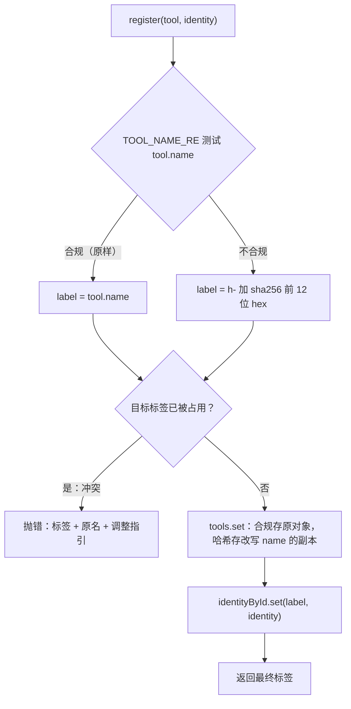
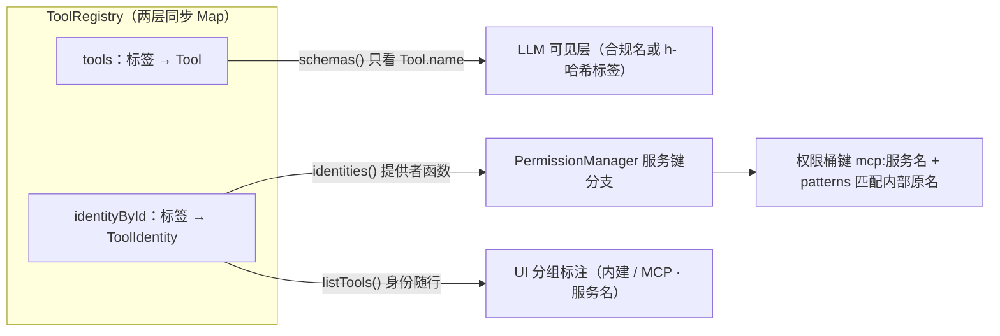
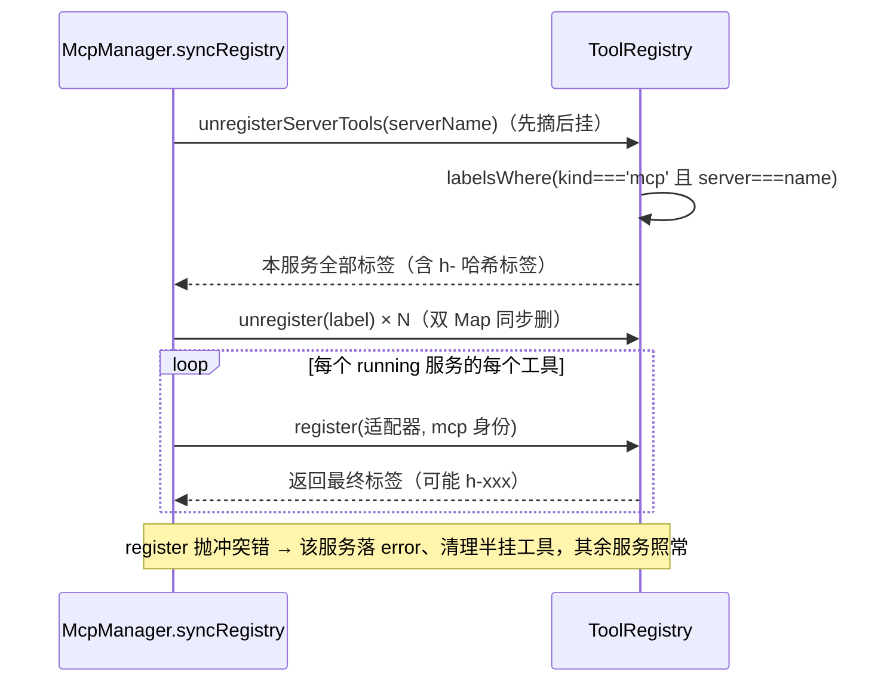

# 04 - 工具注册表与合规关口

> 职责：`agent/src/tools/registry.ts` 是一切工具（内建 7 个 + MCP 动态注册 + 未来任何来源）进入系统的**唯一关口**。注册那一刻同时完成三件事——合规转换、冲突可见失败、身份记录——此后系统的其余部分（LLM 请求、权限引擎、UI）都从注册表读取"工具 + 身份"的一致快照。

## 1. 职责与边界

| 文件 | 职责 |
|---|---|
| `agent/src/tools/registry.ts` | ToolRegistry：注册关口（register/unregister）、身份登记与查询、schemas()/listTools() 产物组装 |
| `agent/src/tools/types.ts` | Tool 契约与 ToolContext / ToolResult（工具实现侧的类型立法） |
| `bridge/src/contract/tools.ts` | ToolIdentity 可辨识联合与 ToolListItem（身份是契约数据，agent 与两端 UI 共享） |
| `agent/src/mcp/manager.ts` | MCP 侧的关口消费方：syncRegistry 注册 / unregisterServerTools 摘除 |

注册表持有两张同步的 Map（registry.ts:30-31）：

```ts
private readonly tools = new Map<string, Tool>()            // 标签 → 工具
private readonly identityById = new Map<string, ToolIdentity>()  // 标签 → 身份
```

依赖矩阵中 `tools` 域依赖为空（`bridge/test/architecture.test.ts:132` 的 `tools: []`）——它不 import 其它 agent 域，是最底层能力模块。

## 2. 核心数据结构

**身份可辨识联合**（bridge/src/contract/tools.ts:10-12，两态立法注释 ：6-9）：

```ts
export type ToolIdentity =
  | { kind: 'builtin' }
  | { kind: 'mcp'; server: string; name: string }  // server=配置里的服务裸名；name=服务侧声明的内部工具名
```

身份住 bridge 的原因（tools.ts:1-4 注释）：权限匹配引擎（contract/permission.ts）与 tools_list 载荷（contract/agent-to-ui.ts）都消费它，属契约数据。`server` 是权限桶键 `mcp:<服务名>` 的精确匹配对象；`name` 是服务侧声明的内部工具名（tools/list 原文），**与 LLM 可见的命名空间标签无关**。`ToolListItem`（tools.ts:15-19）= `{ name, description, identity }`——tools_list 的单条载荷，identity 每条必带。

**Tool 契约**（`agent/src/tools/types.ts:19-25`）的五个成员各自服务一个消费方：

| 成员 | 消费方 | 说明 |
|---|---|---|
| `name` | schemas() / get() | LLM 可见名（可能被关口改写为哈希标签） |
| `description` | schemas() / listTools() | 模型选工具的依据；MCP 适配器缺省补 `(MCP <server>) <tool>` |
| `schema`（zod） | ToolExecutor 参数校验（tool-executor.ts:53） | `schema.parse(JSON.parse(arguments))`，失败回填"参数校验失败" |
| `parameters`（JSON Schema） | schemas() → 请求体 tools | 暴露给 LLM 的参数说明书；MCP 透传服务端原生 inputSchema |
| `execute(args, ctx)` | ToolExecutor.runAndEmit | 返回 `{content}` 或 `{error}`，不抛错（见《05》INV-1） |

`ToolContext`（types.ts:6-14）带 `cwd / signal / shellProgram? / shellTimeoutMs?`——signal 是轮次取消的传播通道，shellProgram/shellTimeoutMs 仅 shell 工具消费。

## 3. 设计逐项详解

### 3.1 D-1 register：三动作合一的统一关口

**设计问题**：LLM 供应商 API 对函数名有硬约束（字符集 `[a-zA-Z0-9_-]`、长度 ≤64，OpenAI 系与 Anthropic 系一致），且校验发生在 API 请求层并**拒绝整个请求**——一个非法工具名会让每轮对话整体 400。约束：①任何来源注册的非法名都不能流向 `schemas()`；②冲突不能静默覆盖；③权限引擎与 UI 需要知道"工具从哪来"，而哈希标签不可解析，身份必须另立事实源；④关口必须可穷举测试。

**方案与取舍**：三动作内聚在 register 一个函数（registry.ts:53-71，立法注释 ：21-28）——①合规转换：不合规名整体哈希为 `h-<sha256 前 12 位 hex>` 确定性标签（同名必同标签，跨会话/跨重建稳定）；②冲突可见失败：抛错而非覆盖（静默顶掉会让先注册的工具无声失联，:25 注释）；③身份记录：与工具注册同事务写入第二张 Map。备选是"每来源自转"（如 McpManager 在 makeAdapter 里自己改名），被否决的原因见 §4 的失败对比——内聚后行为可穷举测试（`agent/test/tools/registry.test.ts` 存在同域测试）。

```ts
// agent/src/tools/registry.ts:53-71
  register(tool: Tool, identity: ToolIdentity = { kind: 'builtin' }): string {
    const label = TOOL_NAME_RE.test(tool.name)
      ? tool.name
      : `h-${createHash('sha256').update(tool.name).digest('hex').slice(0, 12)}`
    if (this.tools.has(label)) {
      throw new Error(`工具注册名冲突：${label}（原名 ${tool.name}）已被占用——请调整来源命名（如 /mcp 中的服务名）`)
    }
    // 哈希改写保留原型：class 实现的 Tool（GrepTool 等）方法在原型上，{...tool} 浅拷贝只搬
    // 自有字段会把 execute/schema 一起丢掉（哈希档工具一执行就崩）——用 Object.create 挂
    // 原原型再覆盖自有字段，只改 name 一个字。
    this.tools.set(
      label,
      label === tool.name
        ? tool
        : Object.assign(Object.create(Object.getPrototypeOf(tool)), tool, { name: label }),
    )
    this.identityById.set(label, identity)
    return label
  }
```

逐行解说：`:53` identity 缺省 `{ kind: 'builtin' }`——内建构造路径零改动接入；`:54-56` 合规测试失败时整体哈希，sha256 保证确定性；`:57-59` 冲突抛错，消息含标签、原名与指引（"请调整来源命名（如 /mcp 中的服务名）"）；`:60-68` **变换落在 Tool 对象本身**且**保留原型**——class 实现的 Tool（GrepTool 等）方法在原型上，`{...tool}` 浅拷贝只搬自有字段会把 execute/schema 一起丢掉（哈希档工具一执行就崩），故用 `Object.create` 挂原原型再覆盖自有字段、只改 name 一个字（:60-62 注释）；这保证 `schemas()` 发给模型的名字必然合规；若只改键不改对象，一次非法名仍会让请求整体 400（:13-15 注释）；`:69` 身份与工具同事务登记；`:70` 返回最终标签——调用方不重复推导合规结果，哈希逻辑单点存在。合规名的判定基准（registry.ts:16）：

```ts
// agent/src/tools/registry.ts:16
export const TOOL_NAME_RE = /^[a-zA-Z0-9_-]{1,64}$/
```



### 3.2 D-2 身份 / 标签 / 权限三层关系（含中文服务名 worked example）

**设计问题**：MCP 工具的 LLM 可见名可能不合规（中文服务名拼出的命名空间标签），权限规则与 UI 分组却必须能用**任意字符的服务名**定位工具。约束：三层（LLM 可见标签、注册表身份、权限桶键）之间不能靠字符串解析互相推导——哈希标签不可逆，服务名含任何字符都不能有歧义。

**方案与取舍**：身份（identityById）是"工具从哪来"的唯一事实源（:27-28 注释），LLM 可见名只是展示层。哈希只影响标签，权限按身份的内部原名匹配、调用回路发内部原名——服务侧全程无感。备选"从标签反解身份"（解析 `mcp__<server>__<tool>`）在哈希场景直接失效，被立法禁止（INV-3）。

一次 MCP 工具名哈希的具体例子——配置了服务名 `文件搜索`（中文），服务侧声明工具 `search`：

1. syncRegistry 构造适配器名 `mcp__文件搜索__search`（mcp/manager.ts:201）；
2. `TOOL_NAME_RE.test()` 失败（含中文）→ label = `h-` + sha256("mcp__文件搜索__search") 前 12 位 hex（registry.ts:56）；
3. Tool 对象被改写 name（registry.ts:63-68，浅拷贝副本但保留原型）——模型看到的是 `h-3f9a…` 这样的合规名 + description 里的语义说明；
4. 身份仍是 `{ kind: 'mcp', server: '文件搜索', name: 'search' }`——权限服务键 `mcp:文件搜索` 的 patterns（如 `search`）照常按**内部原名**匹配（permission.ts:73）；调用回路 `callTool({ name: 'search' })` 发的也是内部原名（manager.ts:211）。



### 3.3 D-3 MCP 动态注册与按身份摘除

**设计问题**：MCP server 可启停、工具清单可变（/mcp 面板保存后 diff 重建），注册表必须随之增删。约束：①摘除必须精确——哈希标签 `h-xxx` 不带 `mcp__` 之类前缀，**按前缀字符串扫描会漏删**；②单服务注册失败（命名冲突）不能拖垮其它服务；③摘除要幂等（"先摘后挂"的重建模式无需存在性检查）。

**方案与取舍**：摘除按**身份谓词**反查标签（labelsWhere，registry.ts:96-100）而非前缀扫描（mcp/manager.ts:191-192 注释明确此立法）；syncRegistry 对所有 server 先全量摘除再重挂运行中的（先摘后挂，工具清单变化自动收敛）；注册抛错时该服务整体落 error、半挂工具清理，异常按服务隔离。

```ts
// agent/src/mcp/manager.ts:171-189
  private syncRegistry(): void {
    for (const name of this.servers.keys()) this.unregisterServerTools(name)
    for (const [serverName, rt] of this.servers) {
      if (rt.status !== 'running') continue
      try {
        for (const t of rt.tools) {
          this.deps.registry.register(this.makeAdapter(serverName, rt, t), { kind: 'mcp', server: serverName, name: t.name })
        }
      } catch (e) {
        rt.status = 'error'
        rt.error = (e as Error).message
        rt.tools = []
        this.unregisterServerTools(serverName) // 清掉半挂状态：冲突前已注册的本服务工具一并摘除
        // 服务判死即断连（error 态不再持连接）：连接若留着，下次 rebuild 走 startOne 顶替
        // map 条目时旧 client 无人关闭——stdio 子进程泄漏。连接已建立，关闭必须兜底。
        void this.closeQuietly(rt)
      }
    }
  }
```

解说：`:172` 全量摘除——先摘后挂，server 工具清单可能变化；`:174` 只重挂 running 态；`:176-177` 逐工具注册，身份携带**服务裸名 + 内部原名**；`:179-186` 单服务失败落 error 并清掉半挂工具，且**判死即断连**（error 态不再持连接——连接留着会在下次 rebuild 顶替 map 条目时泄漏 stdio 子进程，:184-185 注释），其余服务不受影响（详见《07》§3）。摘除侧（manager.ts:191-197）：

```ts
// agent/src/mcp/manager.ts:191-197
  // 按身份摘除（替代旧的前缀字符串扫描）：从注册表身份里找本服务的全部标签，逐个摘除。
  // 哈希标签不带 mcp__ 前缀，前缀扫描会漏删——身份是唯一可靠的归属事实源。
  private unregisterServerTools(serverName: string): void {
    for (const label of this.deps.registry.labelsWhere((id) => id.kind === 'mcp' && id.server === serverName)) {
      this.deps.registry.unregister(label)
    }
  }
```

注册表侧配套 API（registry.ts:73-77、:96-100）：`unregister` 双 Map 同步删、不存在时静默（幂等）；`labelsWhere` 遍历身份 Map 返回命中标签——删除顺序无关。

```ts
// agent/src/tools/registry.ts:73-77
  // 运行期摘除（MCP server 停止/工具清单变化时用）——工具与身份同步删除；不存在时静默。
  unregister(name: string): void {
    this.tools.delete(name)
    this.identityById.delete(name)
  }
```



**内建注册路径**（启动时，registry.ts:35-49）：组合根 `new Agent(...)` → `ToolRegistry.withBuiltins()`（agent.ts:74）依次 new 七个工具实例（ReadFileTool / WriteFileTool / EditFileTool / ShellTool / LsTool / GlobTool / GrepTool），构造函数 `for (const t of tools) this.register(t)`——走同一关口，缺省 identity = builtin。

### 3.4 D-4 makeAdapter：第三方实现如何装进 Tool 契约

**设计问题**：MCP 工具的调用回路（client.callTool）与 Tool 契约（schema 校验 + execute 返回 `{content}|{error}`）形状不同。约束：①参数校验权在 server——本地 zod 强校验会拒绝服务端合法的异形参数，只能做"对象"级宽松校验（manager.ts:17 立法）；②第三方工具默认走权限 ask（三桶无规则时的固定安全默认，无需额外处理，manager.ts:18 立法）；③调用要有确定上界（超时 + 取消），失败必须落 `{error}` 不抛错。

**方案与取舍**：闭包适配器——makeAdapter 捕获 rt（运行时壳）与 tool 描述，产出 `satisfies Tool` 的对象。schema 用 `z.record(z.string(), z.unknown())` 只挡非对象；parameters 直接透传服务端原生 inputSchema（LLM 看到的是服务端写的参数说明书）；execute 内部处理未运行、isError、异常三种失败路径，全部返回 `{error}` 文本。

```ts
// agent/src/mcp/manager.ts:199-220
  // MCP 工具 → Tool 适配器：schema 宽松（对象透传），parameters 用 server 提供的原生 JSON Schema。
  private makeAdapter(serverName: string, rt: McpServerRuntime, tool: { name: string; description: string; inputSchema: Record<string, unknown> }): Tool {
    const fullName = `mcp__${serverName}__${tool.name}`
    return {
      name: fullName,
      description: tool.description || `(MCP ${serverName}) ${tool.name}`,
      schema: z.record(z.string(), z.unknown()),
      parameters: tool.inputSchema,
      execute: async (args, ctx) => {
        const client = rt.client
        if (!client) return { error: `MCP server ${serverName} 未运行` }
        try {
          const result = await client.callTool({ name: tool.name, arguments: (args ?? {}) as Record<string, unknown> }, undefined, { signal: ctx.signal, timeout: CALL_TIMEOUT_MS })
          const content = result.content as Array<{ type?: string; text?: string }> | undefined
          const text = (content ?? []).map((b) => (b.type === 'text' ? b.text : JSON.stringify(b))).join('\n')
          if (result.isError) return { error: text || `MCP 工具 ${fullName} 执行失败` }
          return { content: text }
        } catch (e) {
          return { error: `MCP 调用失败：${(e as Error).message}` }
        }
      },
    } satisfies Tool
  }
```

解说：`:201` 命名空间标签 `mcp__<server>__<tool>`——LLM 可见名的原始形态，合规与否交给关口（D-1）裁决；`:204` description 缺省补 `(MCP <server>) <tool>`，哈希改名后模型仍能从语义描述选对工具；`:205` zod 仅做对象级宽松校验（真实校验权在 server）；`:206` 原生 inputSchema 透传；`:209` client 已摘除（server 停止竞态）时返回 error 而非抛错；`:211` callTool 发**内部原名** `tool.name`，且把轮次的 `ctx.signal` 与 60s 超时（`CALL_TIMEOUT_MS`，:43）一并交给 SDK——取消与超时在调用层收敛；`:214` isError 是 MCP 协议层的"工具执行失败"，与传输层异常（:216-217）都归一为 `{error}`。

### 3.5 D-5 schemas() 现算与身份查询面

**设计问题**：工具集是动态的（MCP 启停、/mcp 保存），LLM 请求、权限引擎、UI、/permissions 都消费工具与身份。约束：不能有失效协议（缓存快照 + 失效广播复杂且易漏），消费方也不应各自解析工具名。

**方案与取舍**：四个只读查询面 + 每次现算——`get(name)`（:79-81）给 ToolExecutor；`identityOf/identities()`（:88-94）给权限引擎（返回内部 Map 的只读视图，零拷贝，classify 现取成本可忽略）；`labelsWhere`（:96-100）给按服务摘除；`listTools()`（:102-109）给 tools_list 广播。`schemas()`（:111-117）每轮请求现算（loop.ts:145 传入），MCP 启停后的下一次模型请求立即携带新工具集，无需任何失效协议（:19 注释：替代旧 import 期固化的 toolSchemas() 快照）。

```ts
// agent/src/tools/registry.ts:102-109
  // tools_list 载荷：工具 + 身份（注册表不变量：凡注册必有身份；?? 兜底仅为类型完备）。
  listTools(): { name: string; description: string; identity: ToolIdentity }[] {
    return this.all().map((t) => ({
      name: t.name,
      description: t.description,
      identity: this.identityOf(t.name) ?? { kind: 'builtin' },
    }))
  }
```

```ts
// agent/src/tools/registry.ts:111-117
  // 组装为 OpenAI `tools` 参数：每个工具一个 { type: 'function', function: {...} }。
  schemas(): object[] {
    return this.all().map((t) => ({
      type: 'function',
      function: { name: t.name, description: t.description, parameters: t.parameters },
    }))
  }
```

消费路径总表：

| 消费方 | API | 时机 |
|---|---|---|
| LLM 请求 | `schemas()` | AgentLoop 每次请求模型时现算（loop.ts:145）——注册表变化即时反映 |
| 权限引擎 | `identities()` 只读快照（:92-94） | PermissionManager 构造时注入**提供者函数**（agent.ts:81）——classify 时现取永远新鲜（permission/manager.ts:22-23 注释） |
| 工具执行 | `get(name)`（:79-81） | ToolExecutor 查到即执行、查不到按"未知工具"回填（tool-executor.ts:43-48） |
| UI 分组 | `listTools()`（:102-109） | tools_list 广播（agent.ts:281-283）——identity 随行，UI 按内建/MCP·服务名分组标注 |
| /permissions | `identities()` | classifyPermission 的服务键分支判定 |

## 4. 关键立法与不变量

- **INV-1 凡注册必有身份**：`listTools()` 的 `?? { kind: 'builtin' }` 兜底仅为类型完备（:102 注释）；unregister 双 Map 同步删，不存在孤儿身份。
- **INV-2 LLM 可见名必合规**：TOOL_NAME_RE 不过关即哈希改写 Tool 对象本身——schemas() 产物永远合法。
- **INV-3 身份从不从 LLM 可见名解析**：哈希标签不透明也无妨；"工具从哪来"唯一事实源是 identityById（:27-28 注释）。
- **INV-4 schemas() 每次现算**：无缓存快照，注册/摘除对下一次请求立即可见。
- **INV-5 冲突抛错不覆盖**：冲突是调用方的 bug 或配置问题，必须显式暴露。
- **INV-6 注册顺序无关紧要**：schemas() 输出按注册序（Map 迭代序），模型对工具顺序不敏感；权限匹配按名不按序——无隐式顺序依赖。
- **INV-7 register 返回值契约**：返回最终标签（:70）——调用方（McpManager.syncRegistry）不重复推导合规结果，哈希逻辑单点存在。

### 为什么关口在注册表（失败模式对比）

- 合规转换放注册表而非各工具来源：未来任何新工具来源（MCP、插件、SDK 注入）自动被覆盖，不靠每个来源自觉转译；若放 MCP 侧，下一个非 OpenAI 名字约束的来源就会重新踩 400 坑。
- 身份放注册表而非 McpManager 侧：注册与摘除是同一关口，工具与身份天然一致；若身份散在 manager，任何绕过 manager 的注册路径都会产生"有工具无身份"的孤儿——权限服务键静默失配。
- 冲突检测放注册表而非事后校验：静默覆盖的失联是纯运行期现象，测试难以覆盖；抛错把问题提前到注册时刻（启动或 /mcp 保存），失败立刻可见。

**与"每来源自转"方案的具体失败对比**：若合规转换交给 McpManager（在 makeAdapter 里自己改 name），则——①下一个非 MCP 来源（SDK 注入、插件）注册非法名时无人兜底，每轮请求整体 400；②"对象 name 字段被改写"这一关键动作容易被实现成"只改 Map 键"，schemas() 仍吐非法名；③注册表的单测无法覆盖合规行为。三动作内聚在 register 一个函数里（19 行），行为可穷举测试。

## 5. 失败模式与恢复

- **注册名冲突**：register 抛错 → McpManager 捕获后该服务落 error 态、`unregisterServerTools` 清理半挂工具（mcp/manager.ts:183），其余服务照常（详见《07》）；内建路径冲突属编程错误，启动即崩（合理）。
- **MCP 工具名与内建同名**：如服务提供 `read_file`——首次注册即冲突抛错（标签已被内建占用），服务不可用而非内建被顶掉；恢复方式是改名服务或停用。
- **同名哈希碰撞**：12 位 hex（48 bit）冲突概率可忽略；即便碰撞也走冲突抛错路径，不会静默顶替。
- **模型调用已摘除的工具**：loop 内 registry.get 查不到 → ToolExecutor 回填"未知工具 X"（tool-executor.ts:43-48），模型下一轮改换工具——不炸轮次。
- **身份快照滞后**：PermissionManager 持有的是提供者函数而非快照，每次 classify 现取（permission/manager.ts:36）——不存在"停服后权限还按旧身份放行"的窗口。
- **测试注入子集**：AgentOptions.registry（agent.ts:35）允许测试注入只含部分内建工具的注册表——工具行为测试不依赖全部 7 工具；注入路径同样走 register 关口，被测对象与生产同构。

### 5.1 UI 侧的身份消费（tools_list → 分组/标注）

`listTools()` 的 identity 随行让 UI 无需任何名字约定即可分组（agent-to-ui.ts:21 立法注释）：

- TUI：toolsList 镜像进 app.tsx（:45），既供 /tools 面板展示，又供 /config 权限树的 selectTool 选择器（build.ts 的 KNOWN_TOOLS 回退仅在未播种时使用——app.tsx:307 注释："空数组不是'无工具'而是'未播种'"）；
- WebUI：use-panel-data 的 toolsList 镜像 → Available Tools 卡按 `identity.kind` 分"内建 / MCP · 服务名"两组；use-turn-tracking 的 identitiesRef 按名建索引供 effectivePerm 判定服务键规则（use-turn-tracking.ts:33-34）；
- 两端都不解析工具名字符串——哈希标签 `h-xxx` 在 UI 上也只是"一个来源为某 MCP 服务的工具"。

## 6. 与其它子系统的接缝

- **→ 05 内建工具集**：withBuiltins 的 7 个实现。
- **→ 07 MCP**：makeAdapter 适配 MCP 调用回路为 Tool 契约（`mcp__<server>__<tool>` 命名空间标签、zod 仅做对象级宽松校验、原生 inputSchema 透传）；syncRegistry 的注册/摘除全走本关口。
- **→ 06 权限**：identities() 提供者注入 PermissionManager，服务键分支（mcpServerHit）按身份匹配。
- **→ 02 轮次**：schemas() 进每次 LLM 请求；get() 进工具执行。
- **→ 01 契约**：ToolListItem/ToolIdentity 定义在 bridge contract/tools.ts，UI 与 agent 共享同一形状。
