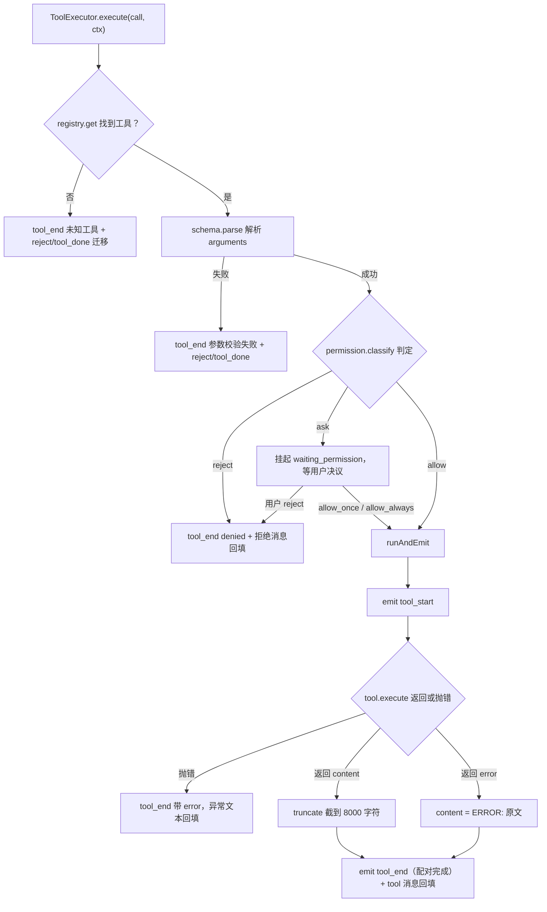
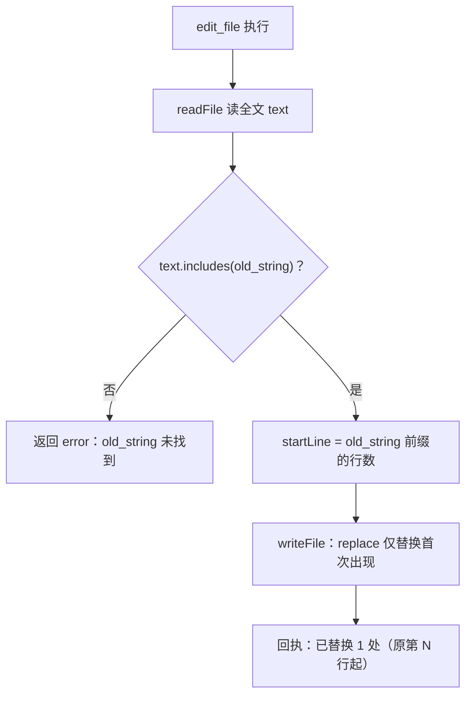
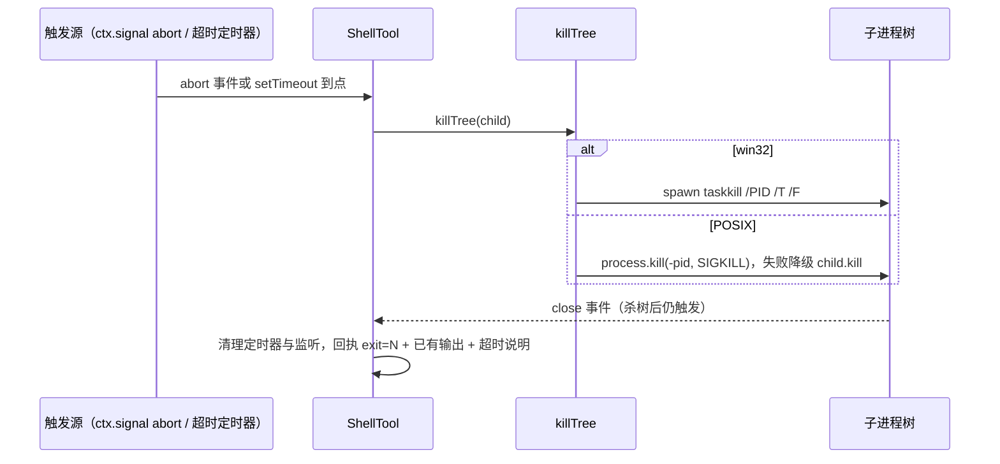
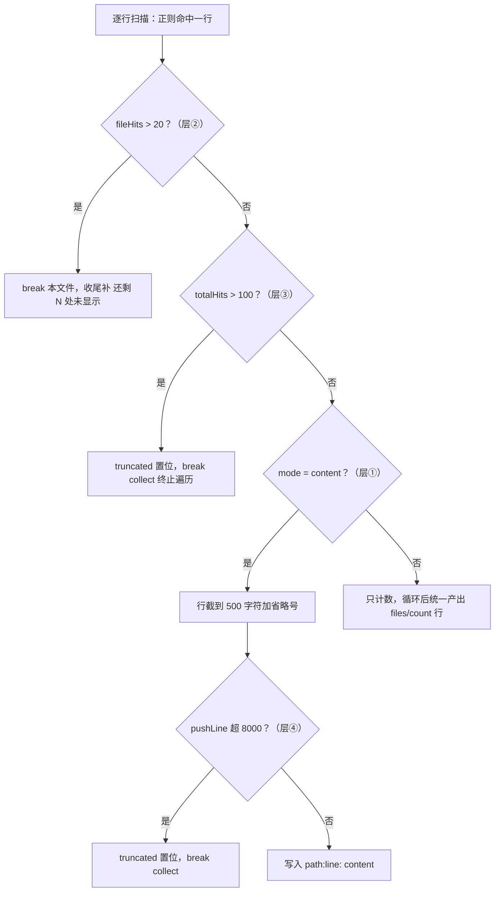

# 05 - 内建工具集

> 职责：7 个内建工具（read_file / write_file / edit_file / shell / ls / glob / grep）的实现——每个工具是一个实现 `Tool` 契约的类（`agent/src/tools/types.ts:19-25`：`name / description / schema(zod) / parameters(OpenAI JSON schema) / execute(args, ctx)`），全部经注册表关口（《04》）与权限关口（《06》）后执行。

## 1. 职责与边界

每个工具一个文件夹（模块 = 文件夹），内分三职责：`tool.ts`（实现）/ `schema.ts`（zod + OpenAI JSON schema 双份参数定义）/ `index.ts`（re-export）。共享底座：

| 文件 | 职责 |
|---|---|
| `agent/src/tools/traverse/walker.ts` | glob/grep 共用递归遍历器（只产出 posix 相对路径） |
| `agent/src/tools/traverse/ignore.ts` | 内置目录黑名单 IGNORED_DIRS + 二进制判定 isBinaryFile |
| `agent/src/tools/traverse/ignore-gitignore.ts` | .gitignore 核心子集谓词 loadGitIgnore |
| `agent/src/tools/shell/support/interpreter.ts` | 解释器解析 resolveShell（配置 → 程序 + flag + kind） |
| `agent/src/tools/shell/support/detect.ts` | 本机可用 shell 扫描 detectShells（PATH 扫描 + 缓存） |
| `agent/src/tools/shell/support/kill-tree.ts` | 进程树杀 killTree（按 OS 分） |
| `agent/src/tools/shell/support/guidance.ts` | 系统提示的"Shell 环境"引导段 shellGuidance |
| `agent/src/context/truncate.ts` | 全局回执截断 truncate（8000 字符 cap） |

**输出治理总立法**：所有回执有确定上界，截断处注明"还剩多少 + 怎么办"——让模型能自行修正而非重试同一模式（glob/tool.ts:10 注释的先例表述）。最终统一兜底是 ToolExecutor 的 `truncate`（context/truncate.ts:3-8，8000 字符 cap）。

## 2. 核心数据结构

**工具结果二态**（types.ts:16）：`ToolResult = { content: string } | { error: string }`——错误是回执的一种，不是异常（见 D-1）。

**参数 schema 的双份维护**：每个工具文件夹的 `schema.ts` 同时维护两份定义（以 grep 为例，grep/schema.ts:4-10 与 :13-27）：`grepSchema`（zod，运行时校验 LLM 返回参数——ToolExecutor 的 `schema.parse` 用它）与 `grepParameters`（OpenAI JSON Schema，进请求体给模型看参数说明）。两份**手工对齐**——字段名、必填性必须一致，description 写给模型的行为引导（如 output_mode 的"先粗后细"，schema.ts:23）。这是刻意不做的自动化（v1 工具数量小，手写 description 的表达力优先于 zod→JSON Schema 的机械转换）。

**权限主参数总表**：权限引擎按"主参数"匹配模式（bridge/src/contract/config.ts:68 的 `PRIMARY_SPECIFIER = { shell: 'command' }`，其余默认 `'path'`）：

| 工具 | 主参数 | 匹配函数 | 默认权限（出厂，config.ts:123-139） |
|---|---|---|---|
| read_file | path | matchGlob（分段 glob） | allow（whole） |
| write_file | path | matchGlob | ask（whole） |
| edit_file | path | matchGlob | ask（whole） |
| shell | command | matchWildcard（平文本通配） | ask（whole） |
| ls / glob / grep | path | matchGlob | allow（whole） |

## 3. 设计逐项详解

### 3.1 D-1 统一执行管线：tool_start/tool_end 强制配对 + 截断兜底

**设计问题**：七个工具 + 未来 MCP 工具的执行路径必须一致——UI 靠 tool_start/tool_end 渲染工具卡片，配对缺失就是永久"转圈"；模型靠 tool 消息拿结果，异常路径若把异常抛给调度器，轮次状态机没有对应的迁移输入。约束：安全（拒绝/失败也要可见）、可测（管线行为与具体工具解耦）、上下文有界（任何回执有上界）。

**方案与取舍**：管线收在 ToolExecutor（旧 R3 立法，tool-executor.ts:21-22）——未知工具、参数校验失败、配置层拒绝、用户拒绝四种"非成功"也发 tool_end（带 error 标记），不再静默塞消息；工具 execute 抛异常由 runAndEmit 的 try/catch 兜底（tool-executor.ts:101 注释），保证 tool_start 总有配对的 tool_end；成功与失败回执统一过 truncate 才回填。备选"让工具各自负责截断"被否决——每工具自觉必漏，单一兜底点可测。

```ts
// agent/src/turn/tool-executor.ts:104-125
  private async runAndEmit(
    call: { id: string; function: { name: string } },
    tool: Tool,
    args: unknown,
    ctx: ToolContext,
  ): Promise<Message> {
    this.services.emit({ type: 'tool_start', id: call.id, name: tool.name, input: args })
    let result
    try {
      result = await tool.execute(args, ctx)
    } catch (e) {
      // 异常文本同样过 truncate：错误文本长度不可控（MCP server 抛什么 agent 管不着），
      // 不治理会把超长错误整段回填模型撑爆窗口——与正常结果 content 同口径。
      const errMsg = truncate(String(e))
      this.services.emit({ type: 'tool_end', id: call.id, name: tool.name, output: errMsg, error: errMsg })
      return { role: 'tool', tool_call_id: call.id, content: errMsg }
    }
    // error 结果路径同理：result.error 来自工具/MCP server，长度不可控，必须同样治理。
    const content = 'content' in result ? truncate(result.content) : truncate(`ERROR: ${result.error}`)
    this.services.emit({ type: 'tool_end', id: call.id, name: tool.name, output: content, error: 'error' in result ? result.error : undefined })
    return { role: 'tool', tool_call_id: call.id, content }
  }
```

解说：`:110` 先发 tool_start 再执行——UI 即时反馈"正在跑"；`:112-120` 工具抛错也被捕获并走同一 tool_end 出口（error 标记），异常文本同样过 truncate，不会炸轮次；`:122` 成功与 `{error}` 结果都先过 `truncate` 再回填；`:123` tool_end 的 error 字段只在 `{error}` 分支携带。全局截断的实现（agent/src/context/truncate.ts:1-8）：

```ts
// agent/src/context/truncate.ts:1-8
// 工具结果超长截断（尤其 shell 输出会撑爆窗口）。默认上限 8000 字符，超出则在末尾标注。
// 截断后的内容会作为 tool 消息回填模型，故需保留可读性——末尾标注「已截断」而非直接砍断。
export const TOOL_RESULT_CAP = 8000

export function truncate(text: string, cap = TOOL_RESULT_CAP): string {
  if (text.length <= cap) return text
  return text.slice(0, cap) + '\n…（输出过长，已截断）'
}
```



### 3.2 D-2 文件三工具：错误回执约定与 edit_file 替换算法

**设计问题**：read_file / write_file / edit_file 直接动用户文件。约束：①失败不能中断 loop——错误要作为 tool 消息回填模型，让模型自行调整（read_file/tool.ts:8 注释）；②edit_file 必须防误替换——LLM 凭记忆写的 old_string 常有缩进/空白偏差；③改动落点要让模型与 UI 都知道（连续编辑、diff 标行号）。

**方案与取舍**：三工具统一"失败返回 `{error: String(e)}` 而非抛错"（execute 抛错由 D-1 兜底）。edit_file 用**逐字符包含检查 + 替换首次出现**（String.replace 非全局，天然只替换第一处）——这是 code agent 的核心约束：逐字符匹配含缩进/空白，防止误替换（edit_file/tool.ts:8 注释）；多处命中时模型应通过扩大 old_string 上下文来定位——当前实现不主动检测多处命中（替换的是确定性的首次出现）。回执带**行号锚点**一举两得：模型知道改动落点便于连续编辑；UI（ui/src/shared/tool-display）解析它给 diff 标真实行号。回执格式是"回执即契约"，改动需本工具与 UI 两处同步（grep/tool.ts:20-21 注释的同款立法）。

```ts
// agent/src/tools/edit_file/tool.ts:18-39
  async execute(args: unknown, ctx: ToolContext): Promise<ToolResult> {
    const { path, old_string, new_string } = args as z.infer<typeof editFileSchema>
    if (!old_string) return { error: 'old_string 不能为空' }
    try {
      // 路径解析走 resolveTargetPath（立法见 shared/target-path.ts）：join 在 Windows 上遇到
      // 绝对路径参数会产生变形路径（盘符冒号被吞），读取与分类会指向不同文件。
      const p = resolveTargetPath(ctx.cwd, path)
      const text = await readFile(p, 'utf8')
      if (!text.includes(old_string)) return { error: 'old_string 未找到' }
      // 锚点：old_string 在原文件中的 1-based 起始行。写进回执一举两得——模型知道改动落点
      // 便于后续连续编辑；UI（shared/tool-display）解析它给 diff 标真实行号。
      const startLine = text.slice(0, text.indexOf(old_string)).split('\n').length
      // 函数形态替换（先例：skills/manager.ts 的 forInvocation）：字符串形态的替换值里
      // $& / $` / $' / $$ 会被重新解释（$& = 整个匹配、$$ = 字面 $ 等），new_string 里的
      // 这些序列会被篡改写入；函数返回值按字面插入，不做二次解释。
      // String.replace 只替换首个匹配——多处出现的语义是「只改第一处」（测试固化该行为）。
      await atomicWriteFile(p, text.replace(old_string, () => new_string))
      return { content: `已替换 1 处（原第 ${startLine} 行起）` }
    } catch (e) {
      return { error: String(e) }
    }
  }
```

解说：`:20` old_string 为空一律拒绝（空串会命中文件开头把 new_string 静默插到文件头——schema `.min(1)` 是第一道关口，这里对绕过 schema 的直调路径双保险；new_string 为空则合法，语义是「删除片段」）；`:26` 不含即 error，回执文本稳定（UI/模型都可依赖）；`:29` 锚点 = old_string 之前的前缀按 `\n` 切分后的段数——即 1-based 起始行；`:34` **函数形态替换** `replace(old_string, () => new_string)`——new_string 按**字面**写入，`$&`/`$$` 等 `$` 序列不重解释（字符串形态的替换值会被 String.replace 二次解释篡改内容）；只替换第一处（非全局，多处出现语义是「只改第一处」）；**落盘走 `atomicWriteFile`（tmp + rename 原子写，立法见 shared/atomic.ts）**——整文件覆写中途崩溃不能留半截内容。回执格式 `已替换 1 处（原第 N 行起）` 是契约（tool-display.ts 的正则 `/（原第 (\d+) 行起）/` 按此解析）。

**read_file（tool.ts）**：1MB 封顶（`READ_FILE_MAX_BYTES`，超限报错并指引「grep 定位后再读片段」）；**二进制探测**——先读原始 Buffer，取前 8KB（`BINARY_PROBE_BYTES`，与 grep 的 BINARY_PROBE_BYTES 同口径）经 `isBinaryFile` 判定（含 NUL 即二进制，不依赖扩展名），命中直接拒绝并回执，**探测必须发生在 utf8 解码之前**（解码后 NUL 已成 `\u0000` 混在字符串里，乱码会整段灌进上下文，且与 grep 的「二进制跳过」口径脱节）；**BOM 剥离**——解码后若首字符是 `\uFEFF`（UTF-8 BOM）则去掉（留着会污染首行内容，模型常把 BOM 当内容复述出去），剥离必须在解码之后按字符串处理。**write_file（tool.ts）**：`atomicWriteFile` 整文件覆写或创建（原子写，不建多级目录，父目录缺失直接失败回模型）。参数 path 在权限侧被 realpath 归一（见《06》§3.5），工具本身不感知；write_file 新建文件的目标不存在 → 权限按"真实父目录 + 文件名"判定（permission/manager.ts 注释）。



### 3.3 D-3 shell 解释器选择：五步保守解析

**设计问题**：`command` 是单条字符串，用哪个解释器执行由配置决定。约束：①配置可能缺省/损坏（误存占位文本）；②本机可能没有配置的 shell；③powershell 5.1 与 pwsh 7+ 语法能力不同（5.1 无 `&&` `||`），不能混为一谈；④模型要知道实际解释器（语法差异是失败主因）。

**方案与取舍**：resolveShell 五步全部**回退平台默认而非猜测语义**（interpreter.ts:6-11 立法）——未知程序名（nu/fish）不猜；配置的 kind 不在本机扫描结果内不允许生效（"配置只在扫描结果中选择"立法，detect.ts:4）。扫描用 PATH 查找而非逐个 spawn 探测（快且确定）；cmd 在 Windows 上视为必然可用（System32 恒在，detect.ts:84 注释）；结果运行期缓存（detect.ts:82，测试可 resetDetectCache :109-112 重置）。**powershell（5.1）与 pwsh（7+）是两个 kind**（interpreter.ts:9 注释）。**P1-5 bash 身份消歧**（detect.ts:9-18 立法）：win32 上 CreateProcess 对"裸名"spawn 按 System32-先于-PATH 搜索序解析，装了 WSL 的机器上 System32\bash.exe（WSL 启动器）会压过 PATH 上的 Git Bash——判据为"PATH 扫描命中的 bash 落点在 System32 目录下"（isWslBashLauncher，detect.ts:54-57），命中的 bash 从检测结果剔除、`resolveShellPath('bash')` 同步返回 null，保证"检测说有 Git Bash、执行起来就是 Git Bash"（消歧只在身份存疑时收窄可用面，fail-closed）。

```ts
// agent/src/tools/shell/support/interpreter.ts:24-38
export function resolveShell(program: string | undefined, platform: NodeJS.Platform = process.platform, detected: ShellKind[] = detectShells(platform)): ShellSpec {
  if (!program || !program.trim()) return defaultShell(platform)
  if (/[^\x00-\x7F]/.test(program)) return defaultShell(platform)
  const map: Record<string, ShellSpec> = {
    cmd: { program: 'cmd', flag: '/c', kind: 'cmd' },
    powershell: { program: 'powershell', flag: '-Command', kind: 'powershell' },
    pwsh: { program: 'pwsh', flag: '-Command', kind: 'pwsh' },
    bash: { program: 'bash', flag: '-c', kind: 'bash' },
    sh: { program: 'sh', flag: '-c', kind: 'sh' },
  }
  const resolved = map[program.toLowerCase()]
  if (!resolved) return defaultShell(platform) // 未知解释器：不猜测语义，回退平台默认
  if (!detected.includes(resolved.kind)) return defaultShell(platform) // 配置了本机没有的 shell：回退平台默认
  return resolved
}
```

解说：`:25` 空/空白 → 平台默认（win: `cmd /c`，其它: `bash -c`，defaultShell :19-21）；`:26` 含非 ASCII（误存占位文本）→ 回退默认；`:27-33` 已知程序名映射表 `{cmd, powershell, pwsh, bash, sh}` → 标准程序 + flag + kind；`:35` 未知程序名不猜测语义；`:36` kind 不在本机扫描结果（`detected`）内 → 回退默认。**本机扫描**（detect.ts:36-49）：PATH 扫描（Windows 按 PATHEXT 补扩展名，detect.ts:30-35）。**系统提示引导**（guidance.ts）：`shellGuidance(spec)` 产出"## Shell 环境"段注入系统提示（agent.ts:82 组装时拼接）——模型训练分布偏 Unix/bash，不注入则 Windows 上 cmd/PowerShell 语法差异（无 grep、5.1 无 `&&`、`%VAR%`）就是失败主因（guidance.ts:3-6 注释）；每类解释器一段保守可执行的要点（宁少勿错，:6 注释）。

### 3.4 D-4 shell 子进程生杀大权：取消与超时双路径收敛 killTree

**设计问题**：shell 命令可能交互式/常驻（dev server、游戏循环），不自行退出。约束：①无超时会卡死整轮对话；②用户 cancel（轮次 AbortSignal）必须能杀死已 spawn 的子进程树；③Windows 与 POSIX 的"杀整棵树"机制不同；④被杀后仍要走正常回填路径（已有输出对模型有价值）。

**方案与取舍**：两条触发路径（abort 监听 + 超时定时器）收敛到同一个 `kill()` → killTree（shell/tool.ts:61 注释"取消三件套之一"）；kill 后还有**二级看门狗**兜底（`KILL_WATCHDOG_MS = 5s`，tool.ts:18-27）——杀树失败或逃逸守护进程持有 stdio 管道时 close 永不触发会挂死整轮，宽限一过销毁流、按已采集输出强制收场。killTree **按 OS 分不按 shell 类型分**（kill-tree.ts:3-5 注释）——win32 用 `taskkill /PID <pid> /T /F`（spawn 失败静默放弃，不能崩掉 agent 进程，:10-12 注释）；POSIX 用 `process.kill(-pid, SIGKILL)` 杀整个 detached 进程组，失败降级 `child.kill`。采集侧 **`SHELL_OUTPUT_CAP = 1MB` 有界输出**（BoundedOutput 类，tool.ts:13-16、:32-57）——失控命令（cat 大文件、死循环打印）不把 agent 进程拖向 OOM，按 Buffer 块累积、close 时一次性 concat + utf8 解码（跨 chunk 多字节字符不乱码），超限丢弃字节数在回执末尾可见。spawn 细节按解释器分两支（P1-4 立法，tool.ts:92-105 注释）：**cmd 分支禁止「裸名数组」形态**——数组形态下 node 按 MSVCRT 规则对参数转义，命令串内嵌的 `"` 会被改写成 `\"` 而 cmd.exe 不认（含引号命令被错拆，实测 `findstr /c:"hello world"` 报错）；改用与 `{ shell: true }` 内部实现一致的 **verbatim 引号包裹形态**——`spawn(ComSpec ?? 'cmd.exe', ['/d', '/s', '/c', '"' + command + '"'], { windowsVerbatimArguments: true, ... })`，三要素缺一不可：`/d`（跳过 AutoRun 注册表启动脚本防污染输出）、`/s`（cmd 只剥离整体首尾一对引号、内部引号原样保留）、整体 `"..."` 包裹 + `windowsVerbatimArguments: true`（禁止 node 做 MSVCRT 转义，命令串逐字节原样到达 cmd.exe——没有 verbatim 时包裹引号自身也会被转义破坏）；powershell/pwsh/bash/sh 保持「程序 + flag + 命令」数组形态（这些解释器把 flag 后命令串当单个参数自行解析，与 node 转义兼容）。**stdio 立法（P2-14，tool.ts:86-90）**：`stdio: ['ignore', 'pipe', 'pipe']`——stdin 显式 `ignore`（旧实现缺省 pipe 却从不写入、从不 end，读 stdin 的交互命令会干等输入挂满 120s 超时；`ignore` 让 stdin 指向空设备、读立即得 EOF，交互命令按「无输入」自然失败）；POSIX detached 使子进程在独立进程组，`kill(-pid)` 才能整组杀；Windows 不设 detached（taskkill /T 不需要）；不用 `shell:true`（DEP0190 弃用警告）。**绝对路径接线（P1-5，tool.ts:79-84）**：执行程序优先用 `resolveShellPath(spec.kind)` 的绝对路径——与 detectShells 走同一份扫描判定，保证「检测到的 shell」和「实际启动的 shell」是同一个文件（win32 绝对路径 spawn 绕过 CreateProcess 的 System32-先于-PATH 搜索序，否则装了 WSL 的机器上裸名 bash 会被 System32 的 WSL 启动器截胡）；解析不到（null）回退裸名。三个完成路径（close / error / 看门狗）统一收场 `finish`（tool.ts:127-136）——幂等（先到者定胜负）且清理两个定时器与 abort 监听。

```ts
// agent/src/tools/shell/tool.ts:138-163
      // 杀进程 + 二级看门狗：kill 后 close 仍可能永不到达（taskkill 失败、逃逸守护进程持有
      // stdio 管道）——宽限期内 close 未到就销毁流、按已采集输出强制收场，防止整轮挂死。
      // 正常路径（close 先到）由 finish 清掉看门狗，行为完全不变。
      const kill = () => {
        killTree(child)
        if (killed) return
        killed = true
        watchdog = setTimeout(() => {
          child.stdout?.destroy()
          child.stderr?.destroy()
          finish({ content: `${output.text()}\n[进程未正常退出，已按已有输出返回]` })
        }, killWatchdogMs)
        watchdog.unref() // 看门狗只是兜底：不阻止事件循环自然收尾（真实收场靠 close）
      }
      const onAbort = () => kill()
      ctx.signal.addEventListener('abort', onAbort, { once: true })

      // 超时：杀进程树（close 事件仍会触发，走正常回填路径），把已有输出 + 超时说明回填模型。
      timer = setTimeout(() => { timedOut = true; kill() }, timeoutMs)
      child.on('close', (code) => {
        finish({
          content: timedOut
            ? `exit=${code}（命令超过 ${Math.round(timeoutMs / 1000)}s 未结束，已终止进程树；如需长任务请放后台并轮询输出）\n${output.text()}`
            : `exit=${code}\n${output.text()}`,
        })
      })
```

解说：`:152-153` abort 监听（`{ once: true }`）——用户 cancel 时轮次的 AbortSignal 直达子进程树（《02》§3.6 的在飞中断在 shell 工具上的落点）；`:78` `SHELL_TIMEOUT_MS = 120_000`（:11）为缺省超时（`ctx.shellTimeoutMs` 可覆盖）；`:157-163` close 事件里 `finish` 清理两个定时器与监听——杀树后 close 仍触发，走正常回填；`:159-161` 超时回执 = exit code + 超时说明 + 已累积输出（BoundedOutput 合并解码），模型可据此调整（放后台/轮询）。killTree 的 OS 分支（kill-tree.ts:7-25）：win32 spawn taskkill；POSIX `process.kill(-pid, 'SIGKILL')`，两级 catch 降级到 `child.kill` 再到静默（进程已退出）。



### 3.5 D-5 walker 共享遍历器：剪枝、确定性与探索边界

**设计问题**：glob/grep 共用递归遍历，大仓库 + 深层树 + 恶意软链都是真实威胁面。约束：①遍历范围必须 = root 子树（目录链接成环、文件链接逃逸 root）；②产出顺序跨平台确定（NTFS 近字典序、ext4 哈希序——不排序则 grep 回执命中顺序在 Linux 上不确定，测试也不稳定）；③遍历要可取消、单点失败不致命；④遍历与消费分离（walker 不关心 pattern/正则，:5-7 注释）。

**方案与取舍**：**迭代式 DFS**（stack 而非递归，:40 注释）——深层树调用栈浅、中断检查点规整，逆序压栈让产出顺序接近字母序；**symlink 一律跳过**（:11-12 注释）——"遍历范围 = root 子树"的隐含承诺不破；**剪枝三规则**：IGNORED_DIRS 按目录名剪枝（node_modules/.git/dist/build/out/.next/coverage/.dogegg，ignore.ts:6-15）、symlink、.gitignore 谓词（文件与目录分别判定，:61, 64）。**gitignore 坐标换算归 walker**（:21-27 注释、:31-39 实现）：gitignore 规则按会话 cwd 根锚定，而 walker 产出相对 rootDir 的路径——path 传子目录时两个坐标系错位（锚定规则双向失真），提供 `cwd` 选项时谓词收到"相对 cwd 的 posix 路径"，换算由 walker 统一负责。

```ts
// agent/src/tools/traverse/walker.ts:42-55
  while (stack.length > 0) {
    opts.signal?.throwIfAborted()
    const relDir = stack.pop()!
    const absDir = relDir === '' ? rootDir : join(rootDir, relDir)
    let entries
    try {
      entries = await readdir(absDir, { withFileTypes: true })
    } catch {
      continue // 无权限/已消失的目录跳过——遍历是探索性操作，单点失败不致命
    }
    // 排序保证遍历顺序跨平台确定：readdir 顺序依文件系统而异（NTFS 近字典序、ext4 哈希序），
    // 不排序则 grep 回执的命中顺序（及其测试）在 Linux 上不确定。
    const sorted = [...entries].sort((a, b) => (a.name < b.name ? -1 : a.name > b.name ? 1 : 0))
    const childDirs: string[] = []
```

```ts
// agent/src/tools/traverse/walker.ts:56-69
    for (const e of sorted) {
      if (e.isSymbolicLink()) continue
      const rel = relDir === '' ? e.name : `${relDir}/${e.name}`
      if (e.isDirectory()) {
        if (ignored.has(e.name)) continue
        if (ignoreHit(rel, true)) continue
        childDirs.push(rel)
      } else if (e.isFile()) {
        if (ignoreHit(rel, false)) continue
        yield rel
      }
    }
    // 逆序压栈让产出顺序接近字母序（确定性对测试与回执可读性都重要）。
    for (let i = childDirs.length - 1; i >= 0; i--) stack.push(childDirs[i]!)
```

解说：第一段 `:43` 每个目录处理间隙 `signal.throwIfAborted()`——轮次取消能中断大仓库遍历；`:46-51` readdir 失败跳过继续（探索性操作单点失败不致命）；`:52-55` 排序。第二段 `:57` symlink 无条件跳过；`:60` IGNORED_DIRS 按名剪枝；`:61/:64` gitignore 谓词经 `ignoreHit` 统一入口以 `(relPath, isDir)` 双参判定（封口 `/` 仅目录规则依赖 isDir，:36-39 的坐标前缀换算）；`:65` 只产出 posix 形式的相对路径字符串，内容读取归调用方；`:68-69` 逆序压栈。

### 3.6 D-6 gitignore 核心子集：`!` 取反靠顺序语义

**设计问题**：用户项目的忽略意愿就是搜索的忽略意愿（M2.5）——glob/grep 都要吃 .gitignore，但完整 gitignore 语法（嵌套文件、字符组、转义）解析成本高。约束：解析失败不能让搜索整体失败；取反（`!`）必须符合 git 直觉。

**方案与取舍**：核心子集（ignore-gitignore.ts:6-13 立法）——`#` 注释、封口 `/` 仅目录、含 `/` 相对根锚定 / 纯名字匹配任意层级（前缀 `**/`，:31-35）、`* ** ?` 通配（复用 bridge 的 globToRegExp，:3）、`!` 取反靠**顺序语义**（后命中覆盖先命中）。**刻意不支持**（:12 立法）：嵌套 .gitignore、字符组、转义。单条非法模式跳过不拖垮整体；文件不存在/读取失败返回 undefined（无规则行为不变，:39-48）。

```ts
// agent/src/tools/traverse/ignore-gitignore.ts:49-63
  const rules: IgnoreRule[] = []
  for (const line of raw.split(/\r?\n/)) {
    const t = line.trim()
    if (t === '' || t.startsWith('#')) continue
    const negated = t.startsWith('!')
    const body = negated ? t.slice(1).trim() : t
    if (body === '') continue
    try {
      const { re, dirOnly } = compileRule(body)
      rules.push({ re, negated, dirOnly })
    } catch {
      continue // 单条非法模式跳过，不拖垮整个忽略表
    }
  }
  if (rules.length === 0) return undefined
```

```ts
// agent/src/tools/traverse/ignore-gitignore.ts:65-74
  // gitignore 顺序语义：逐条判定，后命中的覆盖先命中的（! 取反即靠顺序生效）。
  return (relPath: string, isDir: boolean): boolean => {
    let ignored = false
    for (const r of rules) {
      if (r.dirOnly && !isDir) continue
      if (r.re.test(relPath)) ignored = !r.negated
    }
    return ignored
  }
```

解说：第一段 `:52` 注释与空行跳过；`:53-54` `!` 剥离后按普通模式编译、negated 记号；`:59-61` 单条非法 `continue`。第二段：`!` 取反不需要任何特殊处理——`ignored = !r.negated` 让**最后一条命中的规则决定去留**（git 顺序语义）；`:69` dirOnly 规则对文件直接跳过。

### 3.7 D-7 grep：输出治理四层

**设计问题**：搜索结果天然不可控——一次宽泛的正则在大仓库可能命中几十万行，直接回填会撑爆上下文。约束：四层治理要能**提前终止**（不是扫完再裁剪），且每层截断都带"怎么办"指引。

**方案与取舍**（grep/tool.ts:10-17 立法注释）：①`MAX_LINE_LENGTH = 500` 单行截断（minified/长字符串字面量）；②`MAX_HITS_PER_FILE = 20` 单文件命中封顶（生成文件/数据文件里同一 pattern 密集出现）；③`MAX_TOTAL_HITS = 100` 总命中封顶，`break collect` 提前结束整个遍历；④`MAX_OUTPUT_LENGTH = 8000` 总字符 cap（对齐 read_file 先例），pushLine 写满即置 truncated 拒绝后续写入（:75-84）。附带 `MAX_FILE_SIZE = 1MB` 超大文件跳过（:16）。命中行 `相对路径:行号: 内容` 前缀格式是"回执即契约"（:21-22 注释，UI formatter 按此解析）。搜索起点走 `resolveTargetPath`（P3 绝对路径立法，:52-56）；path 指向**文件**时进入单文件模式（产出一个空 rel 读 root 本身，:60-66）；glob 过滤只对遍历产物生效——显式点名文件时 glob 不参与过滤（否则 `globRe.test('')` 必败、点名文件恒被误过滤，:106-107 注释）。

```ts
// agent/src/tools/grep/tool.ts:112-128
      let fileHits = 0
      for (let i = 0; i < fileLines.length; i++) {
        if (!re.test(fileLines[i]!)) continue
        fileHits++
        totalHits++
        if (fileHits > MAX_HITS_PER_FILE) break // 第 ② 层：单文件封顶（停止扫描本文件）
        if (totalHits > MAX_TOTAL_HITS) { truncated = true; break collect } // 第 ③ 层：总命中封顶

        // 第 ① 层：单行截断。行写入可能触发 ④ 层——返回 false 即提前收场。
        // 文件级模式（files_with_matches/count）不产出行级输出，命中只计数，行在循环后统一产出。
        if (mode === 'content') {
          const clipped = fileLines[i]!.length > MAX_LINE_LENGTH
            ? fileLines[i]!.slice(0, MAX_LINE_LENGTH) + '…'
            : fileLines[i]!
          if (!pushLine(`${displayPath}:${i + 1}: ${clipped}`)) break collect
        }
      }
```

解说：`:117` ② 层 break 只放弃本文件；`:118` ③ 层 `break collect`（带标签循环）直接终止整个 `for await` 遍历——后续文件不再打开；`:123-125` ① 层行截断加 `…`；`:126` ④ 层在 pushLine 内判定（`outputLength + line.length > MAX_OUTPUT_LENGTH` 即置 truncated 并返回 false），返回 false 时同样 `break collect`。溢出说明在收尾统一补：② 层触发时 `countMatches`（:171-175）补数"该文件还有 N 处未显示"（:130-134）；④/③ 层触发时末尾"（输出已截断，请用更具体的 pattern 或 glob 参数收窄搜索）"（:146-148）。



其余要点：正则/glob 非法各自返回带修正指引的 error（:36-50）；`output_mode` 三态 content/files_with_matches/count（schema 描述引导"先粗后细"大搜索策略）；glob 过滤对完整相对路径与文件名**任一命中即通过**——用户直觉 `*.ts` 应匹配 src/x.ts（:25-26 注释，:108 代码双测）；二进制探测读首 8KB 判 NUL（hasBinaryHead :154-168 + ignore.ts:20-25 的 isBinaryFile——刻意不用扩展名白名单，内容判定一条规则覆盖全部，误判方向安全，ignore.ts:18-19 注释）；`\r` 归一掉 Windows 行尾不影响行号（:110-111）；无命中时若有跳过大文件则在回执注明（:141-144）。

### 3.8 D-8 探索漏斗与单点报错边界（ls / glob）

**设计问题**：三个探索工具要引导模型"先粗后细"，且各自封顶；遍历的容错语义要与"路径写错"的报错语义区分。

**方案与取舍**：ls 单层 readdir（不递归——递归是 glob 的事，ls/schema.ts:3 注释）；目录在前加 `/` 后缀、文件在后附人类可读大小（B/KB/MB，ls/tool.ts:13-17 与 :20）；大小获取失败显示 `?` 不致命（:42-44）；隐藏文件正常显示——agent 需要看 .github/.gitignore，黑名单只作用于递归遍历（:21 注释）；MAX_ENTRIES = 500 封顶注明总数（:52-54）；symlink 跳过与 walker 同一立场（:47）。glob 的 matcher `globToRegExp(pattern)` 编译一次遍历内复用（glob/tool.ts:26，来自 bridge——与权限参数化规则共用一份实现，:14 注释）；**根路径 stat 预检**——walker 对单目录失败是"跳过继续"，但整个根不存在必须显式报错：

```ts
// agent/src/tools/glob/tool.ts:33-37
    const root = path ? resolveTargetPath(ctx.cwd, path) : ctx.cwd
    // 前置检查：walker 对单目录读失败是「跳过继续」语义（探索不因单点失败中断），
    // 但整个根都不存在必须显式报错——否则「模式写错」和「路径写错」在模型侧不可区分。
    const rootStat = await stat(root).catch(() => null)
    if (!rootStat) return { error: `路径不存在：${path ?? '.'}` }
```

解说：没有这个预检，`pattern` 写错和 `path` 写错都表现为"（无匹配文件）"，模型会盲目换 pattern 重试（起点目录本身走 resolveTargetPath 的 P3 绝对路径立法，:30-32 注释）；MAX_MATCHES = 100 封顶 + "请收窄 pattern"提示（:46, 54-57）；无命中回"（无匹配文件）"。

**探索漏斗**：三个探索工具被刻意设计成"先粗后细"的漏斗，grep 的 schema 描述直接引导模型（grep/schema.ts:23 的 output_mode description："大搜索先用 files_with_matches 锁定文件再精搜"）：

1. **ls**（单层拓扑）：看目录结构——目录在前加 `/`、文件附大小，模型先建立项目形态认知；
2. **glob**（路径匹配，不读内容）：按模式定位候选文件——只匹配路径，遍历器不打开文件，大仓库代价可控；
3. **grep**（内容搜索）：漏斗最后一层——先 `output_mode: 'files_with_matches'` 锁定文件，再对单文件 `output_mode: 'content'` 精读命中行（带行号）。

漏斗各层共用 walker 遍历器与 gitignore 过滤——忽略意愿（.gitignore + IGNORED_DIRS）在全漏斗一致，模型不会在 glob 里看到 node_modules 又在 grep 里被过滤产生困惑。

## 4. 关键立法与不变量

- **INV-1**：工具失败返回 `{ error }` 而非抛错——错误是给模型的信息，不是给调度器的异常（read_file/tool.ts:8 注释的统一约定；execute 抛错由 ToolExecutor runAndEmit 兜底）。
- **INV-2**：所有回执有确定上界（glob 100 / ls 500 / grep 四层 / 全局 8000 字符）。
- **INV-3**：遍历范围 = root 子树（symlink 全跳过 + 目录黑名单剪枝），探索永不逃逸、永不入环。
- **INV-4**：matcher 一份实现三端共用（bridge globToRegExp）——glob 工具、grep 过滤、权限参数化规则永不漂移。
- **INV-5**：回执格式是契约（edit 行号锚点、grep `path:line: content`），改动须工具与 ui/shared/tool-display 同步。
- **INV-6**：shell 子进程的生杀大权在 AbortSignal（用户取消）与超时定时器两条路径，都收敛到 killTree。

## 5. 失败模式与恢复

| 失败 | 行为 | 模型侧恢复 |
|---|---|---|
| 文件不存在/无权限 | `{ error: String(e) }` 回填 | 读错误文本改路径或先 ls 探查 |
| edit old_string 未找到 | `{ error: 'old_string 未找到' }` | 先 read_file 核对再重试 |
| shell 命令超时 | 杀树 + 已有输出 + 超时说明回填（tool.ts:155-163） | 按提示放后台/轮询或拆分命令 |
| shell spawn 失败（程序不存在） | child error → `{ error }`（:164-166） | 报告用户或换命令 |
| shell 杀树后进程不退出 | 二级看门狗 5s 宽限后销毁流、按已采集输出强制收场（tool.ts:138-151） | 整轮不挂死 |
| 大仓库遍历 | 四层/封顶截断 + 收窄指引 | 换更具体 pattern/path/output_mode |
| 遍历中用户取消 | throwIfAborted 上抛 → ToolExecutor catch → tool_end error | 轮次已 cancelled，无后续 |
| 单目录读失败/竞态删除 | 跳过继续，不中断整体（walker.ts:49-51、grep:101-105） | 无需恢复 |
| 配置了本机没有的 shell | resolveShell 回退平台默认（interpreter.ts:36） | 用户改配置（server /api/shells 可查询可用列表） |

## 6. 与其它子系统的接缝

- **→ 04 注册表**：withBuiltins 注册，identity 缺省 builtin。
- **→ 06 权限**：主参数表决定匹配函数；path 参数在权限侧 realpath 归一，工具自身不做权限判断。
- **→ 02 轮次**：ToolContext 的 cwd/signal/shellProgram 由 loop 逐轮下传（loop.ts:232）；超时 killTree 与取消传播衔接。
- **→ 11/12 前端**：tool_display 按"回执即契约"格式解析渲染（行号锚点、命中前缀）。
- **→ 10 配置**：shellProgram/shellTimeoutMs 可配；server 的 /api/shells 供 WebUI 设置区列出本机可用解释器（server/src/http/router.ts:44-50）。
