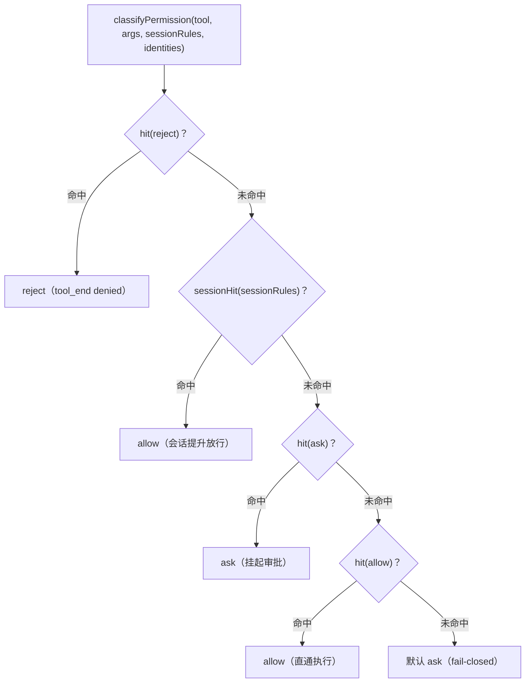
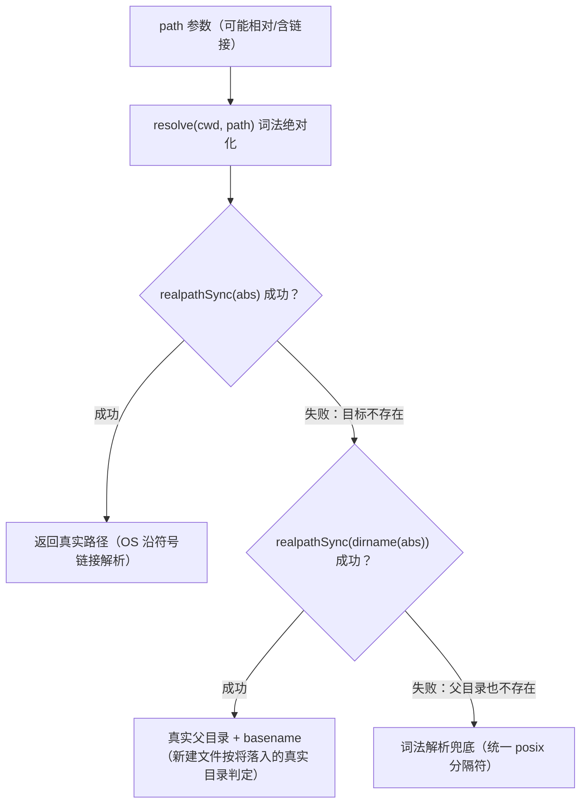
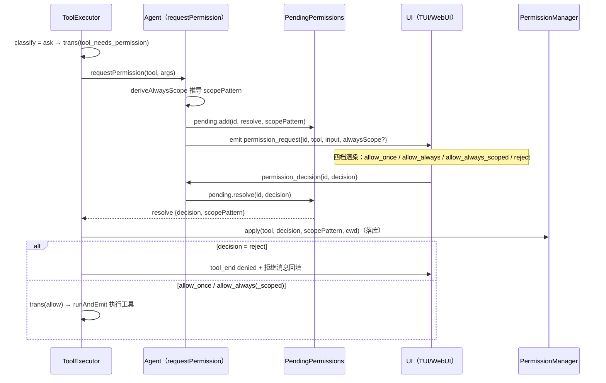

# 06 - 权限引擎

> 职责：对每一次工具调用 `(tool, args)` 求值出 `allow / reject / ask` 三值判定。引擎分两层：**配置三桶的纯派生判断**（`bridge/src/contract/permission.ts`——无状态无 IO，agent 运行时与两端 UI 共用同一实现）+ **运行时会话提升**（`agent/src/permission/manager.ts`——会话内 allow_always 的登记/撤销/恢复）。
>
> **交互图**：[权限判定全流程](./assets/permission-decision.html)（classify → ask → 四档决议 → 提升/撤销的完整回路）。

## 1. 职责与边界

| 文件 | 职责 |
|---|---|
| `bridge/src/contract/permission.ts` | classifyPermission 纯派生 + toolEntryMatches 双分支 + mcpServerHit + sessionHit |
| `bridge/src/contract/config.ts` | permissionSchema（v3 结构化三桶）、PRIMARY_SPECIFIER 主参数表、加载期两条 superRefine |
| `bridge/src/contract/glob.ts` | matchGlob（分段 glob）/ matchWildcard（平文本通配）——一份实现三端共用 |
| `agent/src/permission/manager.ts` | PermissionManager：classify 前归一化、apply/restore/revoke 会话提升、内置读豁免 |
| `agent/src/permission/derive.ts` | deriveAlwaysScope：批准时推导"最窄可复用范围" |
| `agent/src/turn/tool-executor.ts` | 判定结果的三分支执行（reject / ask 挂起 / allow 直通） |
| `agent/src/turn/pending.ts` | 挂起权限请求的 Promise 注册表 |

## 2. 核心数据结构与配置形态

数据形态（v3 结构化，ADR-0012/0013）：`config.json` 的书写格式 = 内存形态 = 匹配引擎输入，三层同构（config.ts:47-58 注释）：

```ts
// 三桶 = 键 → { whole, patterns }（config.ts:60-63 bucketRuleSchema）
allow/reject/ask: Record<键, { whole: boolean, patterns: string[] }>
// whole: true  → 整键命中（patterns 仅作取消整选时的恢复内容，不参与匹配）
// whole: false → patterns 生效（OR）；空数组 = 键存在但不命中（编辑中空选态）
```

- **桶键**：内建工具名（`read_file`…）或 MCP 服务键 `mcp:<服务裸名>`——前缀使服务键与内建键的键空间彻底正交（内建名不含冒号），"这个键是不是服务键"由语法自明（permission.ts:34-35 立法注释）。
- **主参数表**（config.ts:66-76）：`PRIMARY_SPECIFIER = { shell: 'command' }`，其余默认 `'path'`——`whole=false` 时模式字符串对应工具的哪个参数由它统一裁决，三端共享同一解释；`BUILTIN_PATH_TOOLS = ['read_file','write_file','edit_file','ls','glob','grep']`（config.ts:73）界定"patterns 是路径模式"的键集合（作用域校验只对这些键生效）。
- **匹配函数**（bridge/src/contract/glob.ts）：path 主参数用 `matchGlob`（:55-57——`*` 单段、`**` 跨段、`?` 单字符，段边界是安全性质）；command 主参数与工具名用 `matchWildcard`（:62-68——`*` 与 `**` 同义为任意字符序列，命令是平文本无层级）。
- **会话提升形态**（shared.ts:26-29）：`ToolPermission { tool, patterns }` 按 工具 分组——patterns 空 = 整工具提升；非空 = 范围模式列表（运行时内存结构，不受配置"空选 = 不命中"立法影响，permission.ts:28-29 注释）。

## 3. 设计逐项详解

### 3.1 D-1 classifyPermission：五级优先级的纯派生

**设计问题**：三桶 + 会话提升 + 服务键多个判定来源可能同时命中同一工具调用，必须有一个全序决定最终三值。约束：①安全方向兜底（判定不出就 ask，fail-closed）；②用户会话内最新意图必须生效（否则提升对 ask 桶工具失效）；③纯函数、无 IO——agent 与两端 UI 共用同一实现，判定永不漂移。

**方案与取舍**（permission.ts:21-27 优先级立法）：`reject > sessionAllowed > ask 规则 > allow 规则 > 默认 ask`。reject 最优先是安全立法；sessionRules 第二是因为它是用户在本会话最新的显式意图（"此工具别再问了"），否则对 ask 桶工具（write_file/shell 最常被提升的）提升会失效，而配置层 reject 仍能压住它（安全底线）；ask 压过 allow 是"例外强制确认"——显式窄规则压过宽放行。备选"allow 优先"会让配置里的 ask 例外永远失效，被立法排除。

```ts
// bridge/src/contract/permission.ts:49-57
  const hit = (bucket: 'allow' | 'reject' | 'ask'): boolean =>
    Object.entries(cfg[bucket]).some(([ruleTool, rule]) => toolEntryMatches(ruleTool, rule, tool, args)) ||
    mcpServerHit(cfg[bucket], tool, identities)

  if (hit('reject')) return 'reject'
  if (sessionHit(sessionRules, tool, args)) return 'allow'
  if (hit('ask')) return 'ask'
  if (hit('allow')) return 'allow'
  return 'ask'
```

解说：`:49-51` 每桶的命中 = **名字分支**（toolEntryMatches 逐键）OR **服务分支**（mcpServerHit 按身份）——两分支任一命中即桶命中（:39-40 注释），跨桶优先级不受影响（"allow 整组 + ask 勾选个别"可行，反向被桶优先级压制）；`:53-57` 五级顺序判定，末行 `return 'ask'` 是 fail-closed 兜底。



完整回路见篇首交互图 [permission-decision.html](./assets/permission-decision.html)；D-2/D-3 是 `hit` 内部的两个分支，D-4 是 `sessionHit`。

### 3.2 D-2 名字分支 toolEntryMatches：whole 与参数化匹配

**设计问题**：桶键对工具怎么算"命中"？内建键精确同名、手写遗留键可能带通配（`mcp__x__*`）、whole 与参数化两种规则形态并存。约束：fail-closed——无参数可比、参数值非字符串、模式全不命中一律不命中（:95-96 注释，安全默认）。

**方案与取舍**（:92-102 注释立法）：键名匹配允许精确或平文本通配（防御手写通配键；编辑器只产精确名）；`whole` 即整键规则出现就命中、patterns 不参与；参数化匹配**按主参数分派匹配函数**——path 用 matchGlob（路径有层级，段边界是安全性质：`*` 单段、`**` 跨段，作用域由锚点在归一化阶段声明，:98-99 注释）、command 用 matchWildcard（命令是平文本，`git *` 通配到结尾即够）。`patterns.some(...)` 是 OR 语义；空数组 = 键存在但不命中（编辑中空选态）。

```ts
// bridge/src/contract/permission.ts:103-113
function toolEntryMatches(ruleTool: string, rule: PermissionRule, tool: string, args?: ToolArgs): boolean {
  if (ruleTool !== tool && !matchWildcard(ruleTool, tool)) return false
  if (rule.whole) return true
  if (!args) return false
  const key = primarySpecifier(ruleTool)
  const matches = (p: string, v: string): boolean => (key === 'path' ? matchGlob(p, v) : matchWildcard(p, v))
  return rule.patterns.some((p) => {
    const v = args[key]
    return typeof v === 'string' && matches(p, v)
  })
}
```

解说：`:104` 键名不匹配（含通配不匹配）即整键不命中；`:105` whole 直接命中——整工具规则无参数语义（LLM 可见名即使被哈希改名也不影响，键按工具名精确写）；`:106` 无 args（UI 展示判定）fail-closed 不命中；`:107` 主参数表裁决取哪个参数；`:110-111` 参数值非字符串视为不命中。

### 3.3 D-3 服务分支 mcpServerHit：按注册期身份匹配服务键

**设计问题**：MCP 工具的 LLM 可见名可能是哈希标签（不可解析），服务级权限规则（"这个服务的工具都要 ask"）必须不依赖名字字面。约束：**工具启用匹配，永不涉及执行参数**（permission.ts:37-38 立法）；匹配从不解析 LLM 可见名——服务名含任何字符都无歧义（:61 注释）。

**方案与取舍**：身份由注册关口随工具维护（agent 注入快照，见《04》D-5），桶键 `mcp:<服务名>` 的 patterns 与**内部工具名**做平文本通配。备选"解析 `mcp__<server>__<tool>` 标签"在哈希场景失效且对含 `__` 的服务名有歧义，被立法排除（见《04》INV-3）。

```ts
// bridge/src/contract/permission.ts:62-74
function mcpServerHit(
  bucket: Record<string, PermissionRule>,
  tool: string,
  identities?: ReadonlyMap<string, ToolIdentity>,
): boolean {
  const id = identities?.get(tool)
  if (id?.kind !== 'mcp') return false
  // 服务规则仅按 mcp:<服务名> 前缀键命中——裸服务名键在加载期被拒绝，不存在回退形态。
  const rule = bucket[`mcp:${id.server}`]
  if (!rule) return false
  if (rule.whole) return true
  return rule.patterns.some((p) => matchWildcard(p, id.name))
}
```

解说：`:67-68` 身份快照查不到或非 mcp → 不命中（内建工具走不到这分支；无身份快照时服务分支整体跳过，见 §5）；`:70` 精确构造 `mcp:<服务名>` 键——裸服务名键不存在回退形态（加载期已拒，见 D-8）；`:72` whole = 整组命中（该服务下所有工具，不管内部名字）；`:73` patterns 与内部工具名 `id.name` 平文本通配。

### 3.4 D-4 会话提升层 sessionHit：运行时规则的命中语义

**设计问题**：会话提升（apply 落库的 allow_always/allow_always_scoped）要参与优先级第二级的判定，形态与配置规则同构但语义细节不同（空数组 = 整工具提升，而非配置的"空选不命中"）。

**方案与取舍**：与配置规则同分派（path 用 matchGlob、command 用 matchWildcard），但模式在**落库时已是绝对形式**（apply 里 toMatchablePath 解析，见 D-7），运行时不再做锚点解析。空数组是运行时内存结构的"整工具"内部语义（permission.ts:28-29 注释），与配置 v3"空选 = 不命中"刻意不同。

```ts
// bridge/src/contract/permission.ts:78-89
function sessionHit(rules: ReadonlyMap<string, string[]> | undefined, tool: string, args?: ToolArgs): boolean {
  const patterns = rules?.get(tool)
  if (!patterns) return false
  if (patterns.length === 0) return true
  if (!args) return false
  const key = primarySpecifier(tool)
  return patterns.some((p) => {
    const v = args[key]
    if (typeof v !== 'string') return false
    return key === 'path' ? matchGlob(p, v) : matchWildcard(p, v)
  })
}
```

解说：`:79-80` 无提升记录 → false；`:81` patterns 空 = 整工具命中；`:82` 无 args 时不命中（范围模式需要参数值可比）；`:84-88` OR 语义逐条匹配。

### 3.5 D-5 classify 前归一化：按真实位置判定 + 内置读豁免

**设计问题**：配置里的路径模式与 LLM 给的 path 参数坐标系不同（相对/绝对/`~`/符号链接）。约束：①词法 resolve 会被符号链接欺骗——cwd 内的链接指向 cwd 外时，词法路径在范围内而实际读取越界（manager.ts:131-132 注释，ADR-0010 匹配语义的边界补全）；②规则侧归一化只做解析、不决定作用域（:116-117 立法——作用域由锚点声明，schema 加载期已拒绝无锚点的字面量模式）；③系统提示引导模型读 skills 的 SKILL.md，不该反复弹审批。

**方案与取舍**：PermissionManager.classify 在调用 bridge 引擎前做三件事——参数侧归一（path → realTargetPath 三级解析）、规则侧归一（normalizeRules：仅主参数为 path 的**内建**键归一，`mcp:` 前缀键与 shell 跳过，:102-104 注释）、内置读豁免（仅 read_file、仅配置桶落 ask）。cwd 由调用方传入（ToolExecutor 持有 turn.cwd）——set_cwd 切换目录后天然生效（:32 注释）；cwd 缺省（UI display-only）时跳过归一化，参数化规则本就不参与展示判定（:33 注释）。

```ts
// agent/src/permission/manager.ts:34-46
  classify(tool: string, args?: ToolArgs, cwd?: string): 'allow' | 'reject' | 'ask' {
    const normalizedArgs = cwd ? this.normalizeArgs(args, cwd) : args
    const identities = this.identities?.()
    const decision = cwd
      ? classify(this.normalizeRules(cwd), tool, normalizedArgs, this.sessionRules, identities)
      : classify(this.cfg, tool, normalizedArgs, this.sessionRules, identities)
    // 内置读豁免：仅 read_file、仅配置桶落 ask（reject / 会话提升等更早判定不受影响）。
    if (decision === 'ask' && tool === 'read_file' && this.builtinReadDirs.length > 0) {
      const p = typeof normalizedArgs?.path === 'string' ? normalizedArgs.path : undefined
      if (p && this.builtinReadDirs.some((d) => p === d || p.startsWith(d + '/'))) return 'allow'
    }
    return decision
  }
```

解说：`:35` 参数侧归一；`:36` 身份提供者**现取**（注册表随 MCP 启停变化，:22-23 注释）；`:37-39` 有 cwd 时规则也归一到同一坐标系再进引擎；`:40-44` 豁免只把"配置桶落 ask 的 read_file"翻成 allow——reject/会话提升等更早判定不受影响（目标在 `builtinReadDirs`（用户级 skills 目录，agent 管理的资产，:15 注释）内或其子路径）。realTargetPath 三级解析（manager.ts:168-179）：

```ts
// agent/src/permission/manager.ts:168-179
function realTargetPath(p: string, cwd: string): string {
  const abs = resolve(cwd, p.replace(/\\/g, '/'))
  try {
    return foldPath(realpathSync(abs).replace(/\\/g, '/'))
  } catch {
    try {
      return foldPath(resolve(realpathSync(dirname(abs)), basename(abs)).replace(/\\/g, '/'))
    } catch {
      return foldPath(abs.replace(/\\/g, '/'))
    }
  }
}
```

解说：`:171` 目标存在 → realpathSync（OS 沿符号链接解析真实位置，含 Windows junction）；`:174` 目标不存在（write_file 新建）→ 真实父目录 + 文件名（新建文件按将落入的真实目录判定）；`:176` 父目录也不存在 → 词法解析兜底（极端；判定不因 IO 异常中断，方向是保守）。各分支产出统一过 foldPath（P2-12）。规则侧的 normalizePattern（manager.ts:149-155）：`./`/`../` → resolve(cwd)、`~/` → resolve(homedir())、盘符或 `/` 开头 → resolve 折叠、`*` 开头保留原样（glob 从文件系统根匹配）——产出同样统一 fold。

**win32 路径大小写归一（foldPath，P2-12）**：Windows 文件系统大小写不敏感，配置里写的 `D:/Work/**` 与磁盘上的 `d:/work` 是同一个位置——foldPath 只在 `process.platform === 'win32'` 时把路径 toLowerCase，模式侧（normalizePattern / toMatchablePath）、参数侧（realTargetPath）与内置豁免表（builtinReadDirs）**两侧同步 fold**，匹配在 fold 后的同一坐标系进行；不 fold 的话 win32 用户按真实大小写写的模式会恒失配、豁免静默失效（manager.ts:122-138 立法）。**fold 只限 path 类字符串**：command 有大小写语义（`GET` 与 `get` 是不同参数）、工具名是精确标识符——两者都保持原文通配匹配，绝不 fold（manager.ts:12 注释）。

**TOCTOU 理论窗口（已知边界，接受）**：classify（realTargetPath 的 realpath 判权）与工具实际 open 是两次独立的 IO——符号链接在两步之间被换向存在理论窗口（判权时指向范围内、打开时已被换成范围外目标）。**本地单用户威胁模型下接受**：攻击者与被保护对象同权，无需绕权限；根治需执行侧在 open 前对同一目标再做一次 realpath 校验（属工具执行层职责，不在本匹配层，manager.ts:164-167 注释立法）。



### 3.6 D-6 挂起-决议回路：ask 桶到四档审批的往返

**设计问题**：ask 判定后轮次必须挂起等待人类决议，且取消、超时、重复决议都不能泄漏 Promise 或卡死轮次。约束：①决议通道与 UI 无关（TUI/WebUI 共用同一消息契约）；②"对此范围不再询问"第四档的可选范围由 agent 推导，UI 不做策略；③无头（SDK）使用要能替换人工审批。

**方案与取舍**：Promise 注册表模式——requestPermission 生成 id、注册 resolve 到 PendingPermissions、发 `permission_request` 下行消息；UI 决议经 `permission_decision` 上行回给 resolve。第四档的 scopePattern 由 deriveAlwaysScope 推导随请求下发（agent-to-ui.ts:22），scoped 决议时由挂起项带回。SDK 接缝立法（agent.ts:462 注释）：无头使用时可注入程序化 permissionHandler 替代 Port 往返，LoopServices.requestPermission 是策略注入点（turn/types.ts:14-15）。

```ts
// agent/src/agent.ts:463-481
  private requestPermission(tool: string, input: unknown): Promise<PermissionResolution> {
    return new Promise((resolve, reject) => {
      const id = newId()
      // 推导「对此范围不再询问」的模式（deriveAlwaysScope）随请求下发；推导不出时 UI 维持三档。
      // tool/input 一并存入挂起项——snapshot 重发挂起审批时按原 id 还原 permission_request 载荷。
      const scopePattern = deriveAlwaysScope(tool, input, this.conversation.getCwd())
      this.pending.add(id, { resolve, reject, scopePattern, tool, input })
      // 【P2-3 立法】emit 包 try/catch：pending.add 之后 emit 一抛（如 emit 链路落盘 appendFileSync
      // 磁盘满），旧实现 Promise 永不 settle → 工具的 await 永久挂起、gate 永久 busy，进程锁死。
      // 捕获后用 PendingPermissions 的 reject 语义唤醒该等待（pending 只有 rejectAll——loop 串行
      // 执行工具，同一时刻至多一个挂起请求，rejectAll 不会误伤其他等待），异常沿 await 正常
      // 传播为工具失败（executor → loop catch → 轮次 error 收尾），并清空挂起表防泄漏。
      try {
        this.emit({ type: 'permission_request', id, tool, input, ...(scopePattern ? { alwaysScope: { pattern: scopePattern } } : {}) })
      } catch (e) {
        this.pending.rejectAll(e as Error)
      }
    })
  }
```

**PendingPermissions**（pending.ts:29-58）是挂起项注册表：`add(id, pending)` 登记 `{resolve, reject, scopePattern, tool, input}`；`resolve` 按消息里的 id 结算并把挂起时存的 scopePattern 随决议带回（pending.ts:38-41，scoped 落库要用）；`snapshot` 按原 id 重发挂起审批（恢复链）；`rejectAll` 在 cancel 消息时统一拒绝所有挂起（agent.ts:650）——无 Promise 泄漏，单工具的 await 抛出走取消路径。requestPermission 的 `:468` 推导可能返回 undefined（fail-safe，见 D-7）——此时消息不带 alwaysScope，UI 维持三档。



消息回路总表：

| 消息 | 方向 | 触发点 |
|---|---|---|
| `permission_request{id, tool, input, alwaysScope?}` | 下行 | requestPermission（agent.ts:463-481），scopePattern 由 deriveAlwaysScope 推导 |
| `permission_decision{id, decision}` | 上行 | UI 四档按钮 → PendingPermissions.resolve（agent.ts:652-654） |
| `permissions_request` / `permissions_list` | 上/下行 | /permissions 命令；返回 snapshotPermissions（agent.ts:722-727） |
| `permission_revoke{tool, pattern?}` | 上行 | 撤销提升 → manager.revoke → 重推 permissions_list（agent.ts:751-755） |

### 3.7 D-7 范围推导与提升落库：最窄可复用范围

**设计问题**：用户批准一次调用后想"此类别不再问"，但放多宽是个策略问题——太宽（全项目）损害安全，太窄（单文件）消除不了重复审批噪音。约束：推导不出（参数缺失/形态异常/在 cwd 外）就返回 undefined，弹层退回三档（fail-safe，derive.ts:5-6 注释）——第四档永远只是便利项，缺席不损害安全语义。

**方案与取舍**（derive.ts:8-12 立法注释）：command 主参数取**首词前缀**（`git status` → `git *`——命令按程序名聚类是用户心里"这类命令"的边界；无参命令 → 精确名）；path 主参数取**所在目录** `./<dir>/**`（重复审批的痛点来自同一片区域反复改），文件在 cwd 根部时回退精确 `./<file>`（父目录即 cwd，给 `./**` 等于放行全项目）；参数即 cwd 本身或在 cwd 外 → undefined 保守不提供（derive.ts:33）。落库侧 apply 区分两档：allow_always = 整工具（patterns 空，**提宽不提示**，/permissions 可见可撤）；allow_always_scoped = 追加范围模式（去重；已是整工具提升则忽略窄范围；path 模式在落库时解析为绝对）。

```ts
// agent/src/permission/derive.ts:15-39
export function deriveAlwaysScope(tool: string, input: unknown, cwd: string): string | undefined {
  const key = primarySpecifier(tool)
  const input_ = input as { command?: unknown; path?: unknown } | null

  if (key === 'command') {
    const cmd = input_?.command
    if (typeof cmd !== 'string') return undefined
    const tokens = cmd.trim().split(/\s+/).filter((t) => t !== '')
    if (tokens.length === 0) return undefined
    return tokens.length > 1 ? `${tokens[0]} *` : tokens[0]!
  }

  if (key === 'path') {
    const p = input_?.path
    if (typeof p !== 'string' || p.trim() === '') return undefined
    const cwdAbs = resolve(cwd)
    const abs = resolve(cwdAbs, p)
    const rel = relative(cwdAbs, abs).replace(/\\/g, '/')
    if (rel === '' || rel.startsWith('..')) return undefined // 参数即 cwd 本身 / 在 cwd 外：不提供范围提升（保守）
    const dir = dirname(rel)
    return dir === '.' ? `./${rel}` : `./${dir}/**`
  }

  return undefined
}
```

解说（derive）：`:21/:23` 非字符串命令或空串 → undefined；`:24` 多词命令 → 首词 + ` *`，单词 → 精确名；`:29` 空 path → undefined；`:31-32` 参数 resolve 后 relative 回 cwd——这是"在不在 cwd 内"的判定基准；`:33` 相对结果为空（参数即 cwd）或 `..` 打头（在 cwd 外）→ 保守不提供；`:35` 目录部分为 `.`（文件在根部）回退精确文件模式，否则给目录 glob。

**第四档的 UI 文案已明示 shell 范围覆盖面**：范围提升是「命令前缀匹配」——放行的是该前缀下的一切命令形态，包括用 `&&` 串联的命令链（`git status && rm -rf /` 这种首词为 git 的链条同样命中 `git *`）。因此两端 UI 在第四档上都向用户言明覆盖面：TUI 决策项副行标注「shell 类范围含该前缀的一切命令（含 && 命令链）」（ui/src/tui/features/permission/decisions.ts），WebUI 审批横幅在 scoped 按钮的 title 悬停注明「shell 范围含该前缀的一切命令（含命令链）」（permission-banner/view.tsx）——知情同意落在弹层，不依赖用户自行理解通配语义。

**落库 apply**（manager.ts:50-64）：`:51-54` `allow_always` 整工具提升——`sessionRules.set(tool, [])` 覆盖已有窄范围（用户选了"总是允许"就是最新意图，提宽不提示，/permissions 可见可撤）；`:55-63` `allow_always_scoped` 且带 scopePattern 才追加——`:57` 已是整工具提升时窄范围无意义直接忽略；`:58` path 模式用 toMatchablePath（:181-186，词法 resolve，**不含 realpath**——模式描述授权意图）解析为绝对并 fold；`:62` 去重追加（`current.includes(resolved)` 不重复入列）。撤销（revoke，:73-83）：不带 pattern 撤整工具；带 pattern 撤单条——**撤光即整条提升移除**（与配置桶"删光模式留整工具"刻意不同：这里每条模式是独立的授权事件，:71-72 注释）；撤后重推 permissions_list（agent.ts:751-755）。快照/恢复（:86-93）：`snapshotPermissions()` 供落盘、配置编辑保留授权（agent.ts:564-566 重建 manager 时 snapshot→restore）、/permissions 展示三处共用；`restore` 按存档直接还原（resume 先 reset 再 restore，session/manager.ts:75-76）。**会话隔离**：`newSession` 时 `permission.reset()`（session/manager.ts:52）——allow_always 只对当前会话生效；配置三桶持久、提升临时，两者独立。

### 3.8 D-8 加载期校验：两条 superRefine 把静默失配挡在门外

**设计问题**：权限配置是手写/编辑器产出的数据，两类错误在运行期只表现为"规则不生效"（静默失配），用户无从排查。约束：错误要在加载期（以及 /config 编辑期的 validate/回滚）就可见。

**方案与取舍**：

**第一条：作用域前缀校验**（permissionSchema，config.ts:89-113）：内建 path 工具（BUILTIN_PATH_TOOLS）的 patterns 必须显式声明作用域——锚点（`./` `../` `~/`）、盘符（绝对）、或以 `*` 开头（无锚点，从文件系统根匹配）。字面量打头的裸模式（`docs/**`、`test`）从根匹配只能命中盘根条目，必然是忘了写锚点 → **拒绝加载**（:92-94 立法注释）。三个细节：只对内建 path 工具生效（MCP 服务键的 patterns 是工具名选择器，无路径锚点语义，:94-96 注释）；shell 的 command 模式无作用域概念不校验；**patterns 无论 whole 与否都校验**——它们是规则的待命态（取消整选后生效），编写期就该正确（:96-97 注释）。

```ts
// bridge/src/contract/config.ts:98-112
  for (const bucket of [p.allow, p.reject, p.ask]) {
    for (const [tool, rule] of Object.entries(bucket)) {
      if (!(BUILTIN_PATH_TOOLS as readonly string[]).includes(tool)) continue
      for (const pat of rule.patterns) {
        const unified = pat.replace(/\\/g, '/')
        const ok = /^(\.\.\/|\.\/|~\/|\*)/.test(unified) || /^[a-zA-Z]:\//.test(unified) || unified.startsWith('/')
        if (!ok) {
          ctx.addIssue({
            code: 'custom',
            message: `权限模式 "${pat}"（${tool}）缺少作用域前缀——以 ./ 或 ../（cwd）、~/（主目录）、*（任意位置，如 **/x）或盘符（绝对路径）开头`,
          })
        }
      }
    }
  }
```

**第二条：服务键强制前缀交叉校验**（configSchema 的 superRefine，config.ts:144-162）：permission 桶键若与 mcpServers 里的服务名同名但未加 `mcp:` 前缀——在前缀化立法下不作为服务键生效（**静默失配**），加载期直接拒绝并指明写法 `"mcp:<服务名>"`（:147-149 注释）。仅校验全局 mcpServers 名单；项目级服务的裸键由调用方按需校验（:146 注释）。

```ts
// bridge/src/contract/config.ts:147-162
  .superRefine((cfg, ctx) => {
    // 服务键强制前缀立法：服务键必须写 mcp:<服务名>——裸服务名键在前缀化立法下不作为服务键
    // 生效（静默失配），加载期直接拒绝并指明写法。服务名零约束（前缀隔离保证与内建名无歧义）。
    const names = new Set(cfg.mcpServers.map((srv) => srv.name))
    if (names.size === 0) return
    for (const bucket of [cfg.permission.allow, cfg.permission.reject, cfg.permission.ask]) {
      for (const key of Object.keys(bucket)) {
        if (key.startsWith('mcp:')) continue
        if (names.has(key)) {
          ctx.addIssue({
            code: 'custom',
            message: `权限键 "${key}" 是 MCP 服务名——服务键必须写为 "mcp:${key}"（见 docs/config.md 的 MCP 服务键章节）`,
          })
        }
      }
    }
  })
```

解说（第一条）：`:100` 非 BUILTIN_PATH_TOOLS 键直接跳过（服务键/shell 不在校验范围）；`:102` 反斜杠归一；`:103` 合法锚点——`../` `./` `~/` `*` 打头、盘符、`/` 打头。解说（第二条）：`:151` 无 MCP 服务时整体跳过（不误伤同名内建键）；`:154` 已带前缀的键合法跳过；`:155` 裸键撞上服务名才报错。

### 3.9 D-9 端到端判定走查（worked example）

配置样例（config.json 节选）：

```json
{ "allow": { "read_file": { "whole": true, "patterns": [] },
             "shell": { "whole": false, "patterns": ["git *", "npm run *"] } },
  "reject": { "shell": { "whole": false, "patterns": ["rm -rf *"] } },
  "ask": {} }
```

四次调用（cwd = /work/proj）的判定路径：

1. **read_file `{path:"src/a.ts"}`**：名字分支——allow 桶 read_file whole=true → 命中。但先过 reject/session/ask 检查（都未命中）→ **allow**。参数已被 normalizeArgs realpath 归一（若 src 是符号链接指向 /work/proj 外，真实位置失配 → 整工具 whole 不看参数，仍 allow——whole 规则无参数语义）；
2. **shell `{command:"git status"}`**：reject 桶 `rm -rf *` 通配不命中；会话提升无记录；ask 桶空；allow 桶 shell 的 `git *` matchWildcard 命中 → **allow**（规则合法性由加载期"便利而非安全边界"立法声明，见 INV-6）；
3. **shell `{command:"rm -rf build"}`**：reject 桶 `rm -rf *` 命中 → **reject**——硬拒绝优先于 allow 桶的任何模式，ToolExecutor 直接 tool_end denied 回填；
4. **write_file `{path:"docs/x.md"}`**：三桶无规则 → 兜底 **ask** → waiting_permission 挂起。UI 弹四档，用户选 scoped（alwaysScope 推导为 `./docs/**`）→ apply 落库 sessionRules `write_file → ['/work/proj/docs/**']` → 本次 trans allow 执行；下次同目录 write_file 走 sessionHit（matchGlob 命中）→ **allow** 不再弹。

第 4 步展示了"配置静态层"与"运行时提升层"的接力：前者管安全基线，后者管会话内的审批噪音消除。

## 4. 关键立法与不变量

- **INV-1 优先级**：reject > 会话提升 > ask > allow > 默认 ask（fail-closed 兜底）。
- **INV-2 fail-closed 匹配**：无参数可比、参数值非字符串、模式全不命中 → 不命中 → 落 ask。
- **INV-3 按真实位置判定**：参数与提升模式都归一到绝对 posix；realpath 防符号链接逃逸。
- **INV-4 服务键语法自明**：`mcp:` 前缀即语义，裸服务名键加载即拒。
- **INV-5 会话提升临时的**：随会话 reset/restore，不进配置；快照形态与会话文件同构。
- **INV-6 shell 参数化规则是"便利而非安全边界"**：通配会命中 `git status && rm -rf /` 命令链——命令链拆分器是独立后续批次，当前防线是 ask 桶显式压制 + 默认 ask（permission.ts:31-33 立法）。
- **INV-7 匹配函数按主参数分派**：path → matchGlob（段语义）、command/工具名 → matchWildcard（平文本）——同一函数族（bridge/src/contract/glob.ts）服务权限、glob 工具、grep 过滤三端，永不漂移。

## 5. 失败模式与恢复

- **无身份快照（identities 缺省）**：服务分支跳过，仅走名字分支（manager.ts:22-23, :36-39）——内建永远可判定，MCP 服务键规则失配落 ask（安全方向）。
- **realpath 全失败**（目标与父目录都不存在等极端）：词法解析兜底（manager.ts:173-177）——判定不因 IO 异常中断，方向是保守。
- **提升期间配置编辑**：onConfigChanged 重建 manager 前先 snapshotPermissions、重建后 restore（agent.ts:564-566）——授权不丢。
- **UI 未回决议**：cancel 消息触发 `pending.rejectAll(new CancelledError())`（agent.ts:650）——无 Promise 泄漏；单工具的 await 抛出走取消路径。
- **用户重复批准不同范围**：apply 去重（同模式不重复入列）；整工具提升后 scoped 不再追加（manager.ts:57）。
- **撤销不存在的提升**：revoke 静默（manager.ts:75）——UI 与 agent 状态短暂不一致时无副作用。
- **derive 推导异常**（参数缺失/形态异常/在 cwd 外）：返回 undefined → 弹层退回三档（fail-safe，derive.ts:5-6）——第四档永远只是便利项，缺席不损害安全语义。
- **手写裸服务名键**：加载期拒绝（config.ts:144-162）+ /config 编辑期校验回滚——静默失配不可能上线。

## 6. 与其它子系统的接缝

- **→ 02 轮次**：ask 桶触发 waiting_permission 态 + 挂起；决议后 apply 落库再执行（tool-executor.ts:79-93）。
- **→ 04 注册表**：identities() 提供者是服务键分支的事实源（agent.ts:81）。
- **→ 07 MCP**：服务键 `mcp:<名>` 与 McpManager 的服务命名一一对应（同名覆盖合并见《07》）。
- **→ 09 会话**：sessionPermissions 字段随会话存档 persist/restore（session/manager.ts:76）。
- **→ 11/12 前端**：PermissionDecision 四档渲染、permissions_list/revoke 消息、shared/permission.ts 的展示逻辑（详见《12》§4）。
