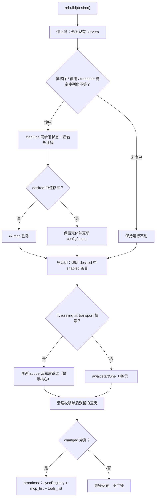
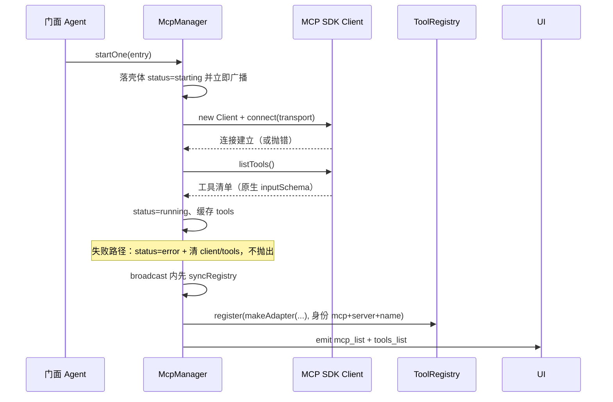
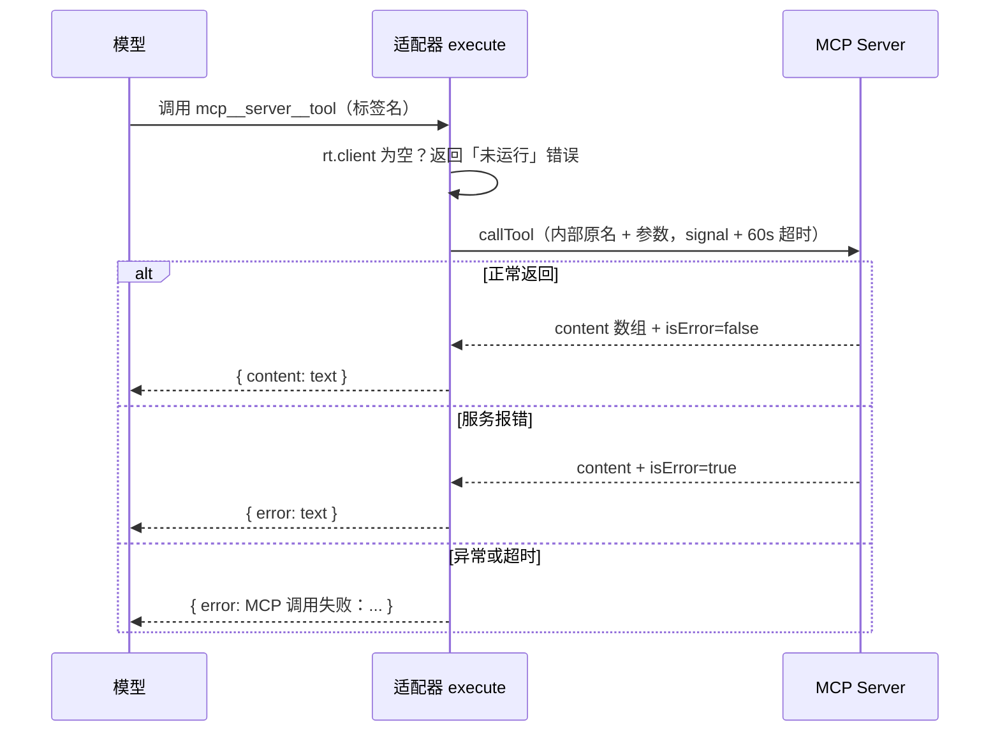

# 07 - MCP 客户端

> 职责：管理全部 MCP（Model Context Protocol）服务的连接生命周期——把配置里的 server 声明收敛到运行中的 Client 实例、把服务的工具适配进注册表、把状态广播给 UI。`agent/src/mcp/manager.ts` 是官方 SDK Client 之上的一层薄封装；`agent/src/mcp/project.ts` 负责项目级配置与合并。
>
> **交互图**：[MCP 生命周期](./assets/mcp-lifecycle.html)（rebuild diff → startOne/stopOne → syncRegistry → 调用回路）。

## 1. 职责与边界

| 文件 | 职责 |
|---|---|
| `agent/src/mcp/manager.ts` | McpManager：rebuild diff、startOne/stopOne、syncRegistry、工具适配器、状态广播 |
| `agent/src/mcp/project.ts` | .dogegg/.mcp.json 读写（容错）+ mergeMcpServers 合并立法 |
| `agent/src/agent.ts` | rebuildMcp 串行链（mcpRebuildChain）+ awaitMcpRebuildSettled 互斥 + handleMcpManage CRUD 分层 |
| `bridge/src/contract/config.ts` | mcpServerSchema / mcpTransportSchema（stdio/http 判别联合，config.ts:26-43） |
| `agent/src/tools/registry.ts` | 注册关口（身份登记、合规哈希、冲突抛错） |

立法总纲（manager.ts:13-19 注释）：工具名 `mcp__<server>__<tool>`（LLM 可见命名空间标签，不合规由注册关口整体哈希）；注册必带身份 `{ kind: 'mcp', server, name }`（权限服务键按身份匹配，与标签字面无关）；参数不本地强校验（zod 仅"对象"级宽松校验，真实校验权在 server——原生 JSON Schema 透传给 LLM）；第三方工具默认走权限 ask（三桶无规则时的固定安全默认）；生命周期全部异步不阻塞消息循环。**启动期两阶段（connect / listTools）各有 30s 超时上限**（`MCP_STARTUP_TIMEOUT_MS`，manager.ts:45-50）——CALL_TIMEOUT_MS 只覆盖 callTool，启动期没有内建上限，挂死的 server 会卡死整条串行重建链；`deps.startupTimeoutMs` 是测试接缝（缺省 30s）。

## 2. 核心数据结构

```ts
// agent/src/mcp/manager.ts:21-30
export type McpStatus = 'running' | 'starting' | 'error' | 'stopped'

interface McpServerRuntime {
  config: McpServerConfig
  scope: 'global' | 'project'
  status: McpStatus
  error?: string
  client?: Client
  tools: { name: string; description: string; inputSchema: Record<string, unknown> }[]
}
```

字段级语义：`scope` 记录条目来自哪一层，是写回 config.json 还是 .mcp.json 的唯一依据；`client` 只在 running 态有值（stopped/error 时为 `undefined`，适配器据此判定"未运行"）；`tools` 缓存 tools/list 原文（原生 `inputSchema` 不转换），stopOne/注册失败时清空。

`mcp_list` 载荷的单条形状是 `McpServerStatusView`（manager.ts:32-41 → 契约 agent-to-ui.ts:56）：`name / enabled / scope / transport（明细——编辑预填）/ type / status / error? / tools[{name, description}]`——配置与运行时状态**一个快照发全**，面板不需要第二次查询。配置来源两层（bridge config.ts:26-43 + project.ts:7-8）：全局放 config.json 的 `mcpServers`，项目级放 `<cwd>/.dogegg/.mcp.json`（同 schema）；`enabled=false` 只停用不删除（调试时保留配置）。`McpMergedEntry { server, scope }`（project.ts:34-37）是 rebuild 的输入单元。

## 3. 设计逐项详解

### 3.1 D-1 合并立法：项目级服务发现与同名覆盖

**设计问题**：配置有两个来源（全局 config.json、项目 `.dogegg/.mcp.json`），rebuild 需要一份统一的期望状态输入；同名冲突必须有确定性的胜负规则；/mcp 面板的启停/删除要能写回正确的层。约束：项目配置错误不能拖垮全局。

**方案与取舍**：`mergeMcpServers` 把两层合成 `McpMergedEntry[]`，且 **scope 随条目下发**（project.ts:39-40 注释立法）——manager 与面板不需要二次查询归属。备选是合并时丢弃来源、操作时按名字在两层各查一遍：同名条目下有歧义且多一次 IO，被否决。项目文件读取容错三连（文件缺失 / JSON 损坏 / 条目校验失败 → 空数组，project.ts:8 注释「项目配置错误不拖垮全局」）。

**代码走查**：

```ts
// agent/src/mcp/project.ts:41-46
export function mergeMcpServers(globalServers: McpServerConfig[], projectServers: McpServerConfig[]): McpMergedEntry[] {
  const merged = globalServers
    .filter((g) => !projectServers.some((p) => p.name === g.name))
    .map((server) => ({ server, scope: 'global' as const }))
  return [...merged, ...projectServers.map((server) => ({ server, scope: 'project' as const }))]
}
```

逐段解说：`:43` 全局条目先 `filter` 剔除被项目同名的（`some` 精确按 `name` 匹配）——同名时项目覆盖全局，全局条目整条退出竞争；`:44` 幸存的全局条目 map 成 `{ server, scope: 'global' }`；`:45` 项目条目**全量**排在后面——顺序立法「全局在前、项目新增在后」（:39 注释），rebuild 的 diff 顺序与面板分组展示都依赖它。

项目侧读取 `readProjectMcp`（project.ts:16-25）：`:18` 文件缺失 → 空数组（多数项目没有项目级配置，这是正常路径不是错误）；`:19-21` JSON.parse 与 zod 校验（`z.array(mcpServerSchema)`，条目 schema 复用全局定义）同在一个 try——JSON 损坏或条目不合法都落到 `:22-24` 的 catch 返回空数组，**三层故障一种处置**，调用方永远拿到合法形状。写入侧 `writeProjectMcp`（project.ts:27-32）`mkdirSync(recursive)` 建目录、格式化两空格 + 尾换行；落盘走 `atomicWriteFileSync`（:29-31，原子写立法见 shared/atomic.ts——.mcp.json 中断半写会损坏项目级配置，读取侧虽有损坏容错但用户配置静默丢失不可自愈）。

### 3.2 D-2 rebuild diff 重建生命周期

**设计问题**：把「期望状态」收敛为「运行状态」。触发源多且可能重复触发（见 D-3），每次都必须收敛到同一结果；未变更的服务不能被无谓断连——否则工具短暂消失，模型看到的 tools 清单不稳定。

**方案与取舍**：**diff 停启**而非全量重启——只动有差异的服务，未变更者保持连接（幂等核心，:57 注释「多次调用收敛到 desired」）。transport 比较用 `stableStringify` 相等性（:250-260 立法）：对象键排序后再 stringify——手编配置文件键序不同（如 command/args 互换书写）不该被误判为传输变化而触发无谓重启，逐字段手写比较又容易在新增字段时遗漏。未变更但 **scope 迁移**（global↔project 同名覆盖）也要刷新归属——scope 停留旧值会让面板的删除/启停写回错误层；归属真的变了才置 changed（静态刷新无需重播广播，:77-82）。

**代码走查**：

```ts
// agent/src/mcp/manager.ts:58-71
  async rebuild(desired: McpMergedEntry[]): Promise<void> {
    let changed = false
    const desiredNames = new Set(desired.map((d) => d.server.name))

    // 停止：被移除 / 停用 / 配置变化的现有 server（被移除的顺带清出 map）。
    for (const [name, rt] of [...this.servers]) {
      const next = desired.find((d) => d.server.name === name)
      if (!next || !next.server.enabled || stableStringify(next.server.transport) !== stableStringify(rt.config.transport)) {
        void this.stopOne(name) // 同步落状态 + 后台关连接——广播不被 close 时序阻塞
        if (!next) this.servers.delete(name)
        else { rt.config = next.server; rt.scope = next.scope } // 保留壳体让 listStatus 反映最新配置
        changed = true
      }
    }
```

逐段解说：`:60` desiredNames 集合供 :88 清理阶段判「残留」；`:63` 遍历现有 servers（展开成数组，遍历中删除安全）；`:65` 三种情况任一命中即停——被移除（`!next`）、停用（`!next.server.enabled`）、传输配置变化（transport 稳定序列化不等）；`:66` `stopOne` 同步落状态、close 后台竞速（调用方 `void` 丢弃维持原语义）；`:67` 被移除的顺带 `servers.delete`；`:68` 仍在的**保留壳体**并更新 config/scope——服务虽停但 listStatus 要反映最新配置（面板编辑预填与状态展示靠它）。

```ts
// agent/src/mcp/manager.ts:72-91
    // 启动：启用中的 server——新增 / 传输变化 / 尚未运行的才启动；disabled 跳过（保持 stopped）。
    for (const entry of desired) {
      if (!entry.server.enabled) continue
      const existing = this.servers.get(entry.server.name)
      if (existing?.status === 'running' && stableStringify(existing.config.transport) === stableStringify(entry.server.transport)) {
        // 迁移不改传输也要刷新归属（global↔project 同名覆盖）：scope 停留旧值会让面板的
        // 删除/启停写回错误层。归属真的变了才置 changed——静态刷新无需重播广播。
        if (existing.scope !== entry.scope) changed = true
        existing.config = entry.server
        existing.scope = entry.scope
        continue
      }
      await this.startOne(entry)
      changed = true
    }
    // 清理被移除后残留的空壳。
    for (const name of [...this.servers.keys()]) if (!desiredNames.has(name)) this.servers.delete(name)

    if (changed) this.broadcast()
  }
```

逐段解说：`:74` disabled 条目直接跳过（「只停用不删除」语义）；`:76-83` **已 running 且 transport 相等 → 刷新归属后 continue**，diff 幂等的核心：重复触发不重启健康服务，但 scope 迁移（global↔project 同名覆盖）仍要更新归属（:77-78 注释）；`:84` `await startOne` 串行执行（多个待启动服务按序 connect，避免并发 connect 交错）；`:88` 清理停止侧之后仍可能残留的空壳；`:90` 只有发生真实变化才广播。

**流程图**（diff 决策全貌，配合 [MCP 生命周期](./assets/mcp-lifecycle.html)交互图）：



一次 rebuild diff 的具体走查——现有运行中：`{fs: stdio(node fs.js) global}`、`{web: http(url-a) global}`；desired：`{fs: 未变}`、`{web: http(url-b)}`（URL 改了）、`{db: stdio project 新增 enabled}`、`{old}` 已删除：

1. 停止侧：fs 比对通过 → 不动；web transport JSON 不等 → `stopOne('web')`（状态 stopped、摘除 mcp__web__* 工具、后台 1s 竞速 close）+ 更新壳体 config；old 在 desired 中找不到 → stopOne + 从 map 删除；
2. 启动侧：db enabled 且无 existing → `await startOne`（starting 广播 → connect → listTools → running 广播）；fs 已 running 且 transport 相等 → 跳过；web 刚被 stopOne（status=stopped）→ 重新 startOne（连接 url-b）；
3. 清理：无残留（old 已在第 1 步删除）；
4. changed=true → broadcast：mcp_list 反映 fs=running / web=running（新 URL）/ db=running / old 消失；tools_list 的 MCP 组相应增删。

### 3.3 D-3 触发源与串行重建链（含开轮互斥）

**设计问题**：rebuild 的触发源多——启动（agent.ts:131）、config_updated（onConfigChanged，agent.ts:569）、set_cwd（agent.ts:774）、/mcp 面板 manage（agent.ts:419）。这些触发可能**时间上重叠**（如保存配置紧接着切目录），而 rebuild 内部有 await 间隙，裸调用会交错重入。此外 submit/invoke_skill 开轮时若重建仍在飞，开轮时刻的工具清单与重建完成后的清单漂移（工具清单随 system 消息快照进轮）、重建中停掉的 server 其在飞 MCP 工具会被断连。

**方案与取舍**：门面用 **promise 链串行化**——每次 rebuildMcp 把实际工作 append 到链尾。备选的互斥锁要处理释放与异常路径、去抖会让最后一次变更延迟生效；promise 链零额外状态、异常自然被 catch 吸收。merge 在**执行时刻**取值（链上每个 rebuild 调 `this.mergeMcp()`）——排队中的重复请求自动收敛到最新配置。重建完成后再查权限键失配（裸服务名 / 遗留标签形态，warnMcpPermissionKeys——此刻生效服务名单含项目级，才是权威事实）。**开轮互斥（P2-4）**：submit/invoke_skill 在 gate 占用前 `await this.awaitMcpRebuildSettled()`（agent.ts:603 / :669）——busy 门只挡「新触发」的重建，不挡「已在飞」的，轮次必须自己等它收敛：等待期间又有新重建排队（尾引用变化）则继续等，直到「我们等的仍是尾」，保证提交时刻重建静止；只读链尾、绝不触发新重建，链自身不 await gate（无死锁面），时长上限由启动超时兜底（每个 server 最坏 30s）。

**代码走查**：

```ts
// agent/src/agent.ts:337-345
  private mcpRebuildChain: Promise<void> = Promise.resolve()
  private rebuildMcp(): Promise<void> {
    this.mcpRebuildChain = this.mcpRebuildChain
      .then(() => this.mcp.rebuild(this.mergeMcp()))
      // 重建完成后再查权限键失配（裸服务名 / 遗留标签形态）：此刻生效服务名单（含项目级）才是权威事实。
      .then(() => this.warnMcpPermissionKeys())
      .catch(() => { /* 重建失败不中断后续重建——状态在 mcp_list 可见 */ })
    return this.mcpRebuildChain
  }
```

```ts
// agent/src/agent.ts:353-360
  private async awaitMcpRebuildSettled(): Promise<void> {
    let tail = this.mcpRebuildChain
    for (;;) {
      await tail
      if (tail === this.mcpRebuildChain) return
      tail = this.mcpRebuildChain
    }
  }
```

逐段解说：`:337` 链头是已决议的 Promise，首个 rebuild 立即执行；`:339-344` 每次**重新赋值** `mcpRebuildChain`——后续调用 append 到最新链尾，promise 链串行化的标准手法；`:340` `this.mergeMcp()` 在 then 回调内求值——轮到本节执行时才读当前配置（而非入队时刻）；`:343` catch 吞掉单次失败（agent.ts:335-336 注释：交错重入会让同一 server 被起两个进程、旧 client 变孤儿泄漏——串行化是防泄漏的立法，失败可见性由 startOne 的 error 态保证）。`awaitMcpRebuildSettled`（:347-352 立法注释）：循环 await 链尾直到尾引用稳定——消息在 await 点交错是常态，一次等待不够。

### 3.4 D-4 startOne：两种 transport 的启动时序

**设计问题**：把一条 server 声明变成「已连接 + 工具清单已知」的运行态。失败形态多样（程序不存在、网络不通、协议错误）且启动耗时不可控。约束：失败不能炸消息循环（生命周期全部异步），UI 要能看到 starting 中间态。

**方案与取舍**：先落壳体 `starting` 并立即广播，再进入可能失败的 connect/listTools；**任何失败落 error 态而非抛出**（:93 注释「面板可见」）——失败是服务级事实（存续于此服务的生命周期内），不是调用方需要处理的异常。transport 按判别联合二选一：stdio 本地子进程、http 远程 Streamable HTTP。connect 与 listTools **各自包 30s 启动超时竞速**（withStartupTimeout，:123-131）——command 误指 REPL、下载卡住的 server 会把 connect 挂死，而 rebuild 是串行链，一个挂死的 server 就阻塞整条链（:45-49 立法注释）；超时按启动失败处理，走 startOne 既有 catch 路径。

**代码走查**：

```ts
// agent/src/mcp/manager.ts:94-118
  private async startOne(entry: McpMergedEntry): Promise<void> {
    const cfg = entry.server
    const rt: McpServerRuntime = { config: cfg, scope: entry.scope, status: 'starting', tools: [] }
    this.servers.set(cfg.name, rt)
    this.broadcast()
    try {
      const client = new Client({ name: 'dogegg-agent', version: '0.2.0' })
      rt.client = client // 先挂到 rt——catch 兜底统一经 closeQuietly 关闭（listTools 失败时连接已建立）
      const transport = cfg.transport.type === 'stdio'
        ? new StdioClientTransport({ command: cfg.transport.command, args: cfg.transport.args, env: toEnvMap(cfg.transport.env) })
        : new StreamableHTTPClientTransport(new URL(cfg.transport.url), { requestInit: { headers: cfg.transport.headers } })
      await this.withStartupTimeout(client.connect(transport), 'connect')
      const { tools } = await this.withStartupTimeout(client.listTools(), 'listTools')
      rt.tools = tools.map((t) => ({ name: t.name, description: t.description ?? '', inputSchema: (t.inputSchema ?? {}) as Record<string, unknown> }))
      rt.status = 'running'
      rt.error = undefined
    } catch (e) {
      rt.status = 'error'
      rt.error = (e as Error).message
      // 立法：connect 成功后任何失败路径都必须关闭连接，否则 stdio 子进程泄漏
      //（SDK 只在 connect 自身失败时自关；此后连接与子进程永久存活）。
      void this.closeQuietly(rt)
      rt.tools = []
    }
  }
```

逐段解说：`:96-97` 先落 `starting` 壳体进 map；`:98` **立即 broadcast**——UI 马上看到 starting 态（不等 connect 完成）；`:100-101` 官方 SDK Client，client **先挂到 rt**——catch 兜底统一经 closeQuietly 关闭（listTools 失败时连接已建立，:101 注释）；`:102-104` 按判别联合二选一：stdio → `StdioClientTransport`（本地子进程；env 语义见 :245-248 `toEnvMap`——undefined 继承父进程环境，显式对象仅提供指定变量），http → `StreamableHTTPClientTransport`（headers 随 requestInit 下发）；`:105-106` connect 与 listTools 各自包 `withStartupTimeout`（30s 竞速，超时 reject 走 catch；finally clearTimeout + unref 兜底）；`:107-109` 成功：缓存 tools（含原生 inputSchema）、status=running、清 error；`:110-117` 失败：status=error + 人话 error + **closeQuietly 关闭连接**（connect 成功后任何失败路径都必须关连接，否则 stdio 子进程泄漏——SDK 只在 connect 自身失败时自关，:113-114 立法注释）+ 清 tools，不抛出——失败在面板可见而非炸 rebuild 链。

**流程图**（服务连接 → 发现 → 注册 → 广播）：



### 3.5 D-5 stopOne / stopAll：同步状态 + 后台关

**设计问题**：停服务涉及两类动作——状态变更（UI 可见性）与连接关闭（资源清理；stdio 子进程退出时序偶发让 close 不返回）。若同步 await close，rebuild 串行链会被一个不肯退出的子进程卡死。优雅退出（Agent.dispose）还需要一个"停掉全部 server 并等它们真正关闭"的入口。

**方案与取舍**：**状态变更必须同步完成**（摘工具、status=stopped、清 tools），连接关闭降级为**后台事务**：closeQuietly 用 `Promise.race` 与 1s 睡眠竞速（:154-157 立法注释）。竞速失败（1s 后 close 还没回）不影响正确性——close 最终完成或进程随父退出，无资源语义依赖。stopOne **返回 close 竞速的 Promise**（:136 注释）——stopAll 需要等待全部关闭完成；rebuild 等调用方以 `void` 丢弃维持原语义。**stopAll（P2-6a，:146-152）**：唯一调用方是 Agent.dispose（组合根信号处理的下游），复用 stopOne（注册表摘除 + 状态落 stopped + closeQuietly），退出与运行中停用走同一条清理路径——两套清理必然漂移；await 全部 close 竞速（单个 1s 上限、并行），dispose 返回后组合根即可安全退出，stdio 子进程不会拖着不回收。

**代码走查**：

```ts
// agent/src/mcp/manager.ts:133-166
  // 停止单个 server（同步落状态）：摘除工具 + 状态落为 stopped 立即生效；连接关闭后台执行（1s 竞速上限）。
  // 立法：状态变更必须同步完成（广播/面板即时可见），连接关闭是后台事务——stdio 子进程退出时序
  // 偶发让 close 不返回，同步 await 会卡死 rebuild 与其后的整个串行链。
  // 返回 close 竞速的 Promise（stopAll 需要等待全部关闭完成；rebuild 等调用方以 void 丢弃维持原语义）。
  private stopOne(name: string): Promise<void> {
    const rt = this.servers.get(name)
    if (!rt) return Promise.resolve()
    rt.status = 'stopped'
    rt.tools = []
    this.unregisterServerTools(name)
    return this.closeQuietly(rt)
  }

  // 优雅退出（P2-6a）：停掉全部 server——唯一调用方是 Agent.dispose（组合根信号处理的下游）。
  // 复用 stopOne（注册表摘除 + 状态落 stopped + closeQuietly），退出与运行中停用走同一条清理路径，
  // 不另写一套（两套清理必然漂移）。await 全部 close 竞速（单个 1s 上限、并行）——dispose 返回后
  // 组合根即可安全退出，stdio 子进程不会拖着不回收。
  async stopAll(): Promise<void> {
    await Promise.all([...this.servers.keys()].map((name) => this.stopOne(name)))
  }

  // 尽力而为关闭连接（1s 竞速上限）：startOne 失败兜底 / syncRegistry 判死 / stopOne 共用。
  // close 抛错（已断开/SDK connect 失败路径已自关）静默吞掉；关不动的连接放弃等待，
  // close 本身仍在后台推进（SDK close 内部会升级到强杀子进程）。
  // 返回竞速 Promise——调用方自行决定 fire-and-forget（void）还是等待（stopAll）。
  private closeQuietly(rt: McpServerRuntime): Promise<void> {
    const client = rt.client
    rt.client = undefined
    if (!client) return Promise.resolve()
    return Promise.race([
      client.close().catch(() => { /* 已断开则忽略 */ }),
      new Promise<void>((r) => setTimeout(r, 1000)),
    ])
  }
```

逐段解说：`:138-139` 未知服务静默返回（幂等）；`:140-142` **同步**完成状态落定：status=stopped、清 tools、同步摘除本服务已注册的全部工具——UI 的 tools_list 即时反映；`:143` close 交给 closeQuietly：先把 client 从运行时摘下（后续 callTool 立即看到"未运行"），`Promise.race` 与 1s 定时器竞速、`.catch` 吸收"已断开"错误，最坏 1 秒后 race 决议、不阻塞任何调用方——closeQuietly 是 startOne 失败兜底 / syncRegistry 判死 / stopOne 三个清理路径的共用底座（:154 注释）。Agent.dispose 的 ② 步即 `await this.mcp.stopAll()`（agent.ts:836）。

### 3.6 D-6 syncRegistry：身份注册与按服务隔离

**设计问题**：server 的工具清单可能变化（重连后 tools/list 结果不同），注册表需要与「全部 running 服务的当前清单」精确一致——多挂（残留）、少挂（遗漏）都不行。且单个服务注册失败（如命名冲突）不能波及其它服务。

**方案与取舍**：**先摘后挂**全量重建——比按差异增量修补简单且必然正确（清单源头 tools/list 每次重拉）。单服务失败**按服务隔离**：该服务落 error 可见 + 清掉半挂状态 + **判死即断连**（error 态不再持连接——连接留着会在下次 rebuild 顶替 map 条目时泄漏 stdio 子进程，:184-185 注释），其余服务照常（:170 注释）。摘除**按身份谓词**而非前缀扫描——哈希标签不带 `mcp__` 前缀（:192 注释），前缀扫描会漏删，身份是唯一可靠的归属事实源。

**代码走查**：

```ts
// agent/src/mcp/manager.ts:171-189
  private syncRegistry(): void {
    for (const name of this.servers.keys()) this.unregisterServerTools(name)
    for (const [serverName, rt] of this.servers) {
      if (rt.status !== 'running') continue
      try {
        for (const t of rt.tools) {
          this.deps.registry.register(this.makeAdapter(serverName, rt, t), { kind: 'mcp', server: serverName, name: t.name })
        }
      } catch (e) {
        rt.status = 'error'
        rt.error = (e as Error).message
        rt.tools = []
        this.unregisterServerTools(serverName) // 清掉半挂状态：冲突前已注册的本服务工具一并摘除
        // 服务判死即断连（error 态不再持连接）：连接若留着，下次 rebuild 走 startOne 顶替
        // map 条目时旧 client 无人关闭——stdio 子进程泄漏。连接已建立，关闭必须兜底。
        void this.closeQuietly(rt)
      }
    }
  }
```

逐段解说：`:172` 第一遍**对所有服务**（不只 running）先摘——即使某服务已停，其残留注册也要清掉；`:174` 只挂 running 态（starting/error/stopped 都不产生适配器）；`:176-177` 逐工具 `registry.register(makeAdapter(...), { kind: 'mcp', server, name })`——身份携带服务裸名 + 内部原名，是权限服务键与 UI 分组的唯一事实源；`:179-187` 单服务抛错（注册关口的命名冲突等）：status=error + 清 tools + `unregisterServerTools` 清**半挂状态**（冲突前已注册的本服务工具一并摘除，绝不留残缺工具组）+ closeQuietly 断连，循环继续——其余服务照常挂载。

```ts
// agent/src/mcp/manager.ts:191-197
  // 按身份摘除（替代旧的前缀字符串扫描）：从注册表身份里找本服务的全部标签，逐个摘除。
  // 哈希标签不带 mcp__ 前缀，前缀扫描会漏删——身份是唯一可靠的归属事实源。
  private unregisterServerTools(serverName: string): void {
    for (const label of this.deps.registry.labelsWhere((id) => id.kind === 'mcp' && id.server === serverName)) {
      this.deps.registry.unregister(label)
    }
  }
```

逐段解说：`:194` `labelsWhere` 在注册表身份表上按谓词找本服务**全部**标签（包括被哈希过的），`:195` 逐个 unregister——registry.ts:96-100 的身份只读访问是这条通道的地基。广播链路（manager.ts:237-242）：`broadcast()` = `syncRegistry()` + emit `mcp_list`（listStatus 快照，transport 明细随行供面板编辑预填，:229）+ emit `tools_list`（注册表快照，身份随行）——startOne 的 starting、成功/失败、rebuild 的停止所有状态变化都经它，UI 的 /mcp 面板与 /tools 视图永远反映当前事实。

### 3.7 D-7 调用回路（makeAdapter）

**设计问题**：把 MCP 工具适配成注册表 Tool：LLM 看到的名字必须合规且带命名空间；参数校验权在 server（不本地重复建模）；调用期间服务可能已停、可能超时、可能报业务错误——每种都要落进统一的 ToolResult 约定。

**方案与取舍**：适配器名 = `mcp__${serverName}__${tool.name}`（:201）——LLM 可见命名空间标签；不合规（如服务名含中文）由注册关口哈希为 `h-<hex>`（《04》§2.1）。schema = `z.record(z.string(), z.unknown())` 宽松透传；parameters = server 原生 inputSchema 原样发给 LLM。callTool **发内部原名**（不是标签），60s 超时（CALL_TIMEOUT_MS，manager.ts:43）且接轮次 AbortSignal（取消传播到 MCP 调用）。

**代码走查**：

```ts
// agent/src/mcp/manager.ts:200-206
  private makeAdapter(serverName: string, rt: McpServerRuntime, tool: { name: string; description: string; inputSchema: Record<string, unknown> }): Tool {
    const fullName = `mcp__${serverName}__${tool.name}`
    return {
      name: fullName,
      description: tool.description || `(MCP ${serverName}) ${tool.name}`,
      schema: z.record(z.string(), z.unknown()),
      parameters: tool.inputSchema,
```

```ts
// agent/src/mcp/manager.ts:207-219
      execute: async (args, ctx) => {
        const client = rt.client
        if (!client) return { error: `MCP server ${serverName} 未运行` }
        try {
          const result = await client.callTool({ name: tool.name, arguments: (args ?? {}) as Record<string, unknown> }, undefined, { signal: ctx.signal, timeout: CALL_TIMEOUT_MS })
          const content = result.content as Array<{ type?: string; text?: string }> | undefined
          const text = (content ?? []).map((b) => (b.type === 'text' ? b.text : JSON.stringify(b))).join('\n')
          if (result.isError) return { error: text || `MCP 工具 ${fullName} 执行失败` }
          return { content: text }
        } catch (e) {
          return { error: `MCP 调用失败：${(e as Error).message}` }
        }
      },
```

逐段解说：`:201` 标签 = `mcp__<server>__<tool>`；`:204` description 兜底拼接（server 未给描述时仍可读）；`:205` zod 仅"对象"级宽松校验；`:206` 原生 inputSchema 直接作 parameters——不本地重复建模校验权（INV-4）；`:208-209` `rt.client` 已被停掉 → 返回"未运行"错误（闭包读 `rt`，状态永远新鲜——stopOne 置 undefined 后旧适配器自动失效）；`:211` `client.callTool({ name: tool.name, ... })`——**发的是内部原名**，`ctx.signal` 接轮次取消、`CALL_TIMEOUT_MS` 60s 超时；`:213` 结果拼装：content 逐块取 text，**非 text 块 JSON.stringify 回填**（多模态兜底立法——信息不静默丢失，模型至少知道"这里有个非文本块"）join 换行；`:214` `result.isError` → `{ error: text }`；`:216-218` 异常 → `{ error: 'MCP 调用失败：...' }`——全部走 ToolResult 错误约定，不抛出。

**流程图**（调用时序与错误分支）：



### 3.8 D-8 /mcp 面板 CRUD 的归属分层

**设计问题**：面板三动作（save/delete/toggle）作用于两层配置，两层有不同的校验/落盘/广播链路——归属错了会绕过校验或漏触发重建。

**方案与取舍**：**global 走 ConfigEditor**（`configController.replaceMcpServers`，agent.ts:386）——复用配置编辑器的校验/落盘/config_updated 广播链路，config_updated 钩子触发 rebuild；**project 直写** `.dogegg/.mcp.json`（readProjectMcp/writeProjectMcp，agent.ts:404-417）后显式触发 rebuild + emitMcpList（:419-420）——不走 ConfigEditor（项目文件不是 config.json 的一部分）。

**代码走查**：

```ts
// agent/src/agent.ts:379-387
    if (cmd.scope === 'global') {
      const next = [...this.ctx.config.mcpServers]
      const findIdx = (name?: string): number => next.findIndex((s) => s.name === name)
      if (cmd.action === 'save') {
        if (!cmd.server) { this.emit({ type: 'notice', text: '缺少 server 配置', channel: 'mcp' }); return }
        const i = findIdx(cmd.server.name)
        if (i >= 0) next[i] = cmd.server; else next.push(cmd.server)
        this.configController.replaceMcpServers(next) // config_updated → onConfigChanged → rebuild
        return
      }
```

逐段解说：`:380` 拷贝当前全局 mcpServers（不可变更新）；`:383` 缺 server 配置发 `notice channel='mcp'`（面板内联可见，agent-to-ui.ts:52 的 channel 立法）；`:384-385` save = 同名替换或追加；`:386` 整体交给 `replaceMcpServers`——校验失败回滚、成功落盘并广播 config_updated，rebuild 由 onConfigChanged 钩子联动，本函数不直接 rebuild。delete = 过滤后写回（:389-392）；toggle = `cmd.enabled ?? !next[i]!.enabled`（:397——UI 显式指定优先，缺省时翻转，agent.ts:394-400）。

## 4. 关键立法与不变量

- **INV-1 幂等收敛**：rebuild(desired) 多次调用结果一致；无变化不广播（scope 迁移的归属刷新除外）。
- **INV-2 状态同步、连接异步**：stopOne 的状态落定是同步的（UI 即时可见），close 是带 1s 上限的后台事务（closeQuietly 返回可等待 Promise，stopAll 据此等待全部关闭）。
- **INV-3 身份归属**：注册必带 `{kind:'mcp', server, name}`；摘除按身份谓词，永不前缀扫描。
- **INV-4 校验权在 server**：适配器不本地强校验参数，inputSchema 原样给 LLM。
- **INV-5 失败可见不炸链**：startOne/注册冲突落 error 态；rebuild 链的单次失败被吞（状态面板可见），后续重建不受阻。
- **INV-6 默认 ask**：MCP 工具三桶无规则时固定走权限 ask（安全默认零配置成立）。
- **INV-7 启动不挂死**：connect/listTools 各自 30s 超时竞速（MCP_STARTUP_TIMEOUT_MS），挂死的 server 不阻塞串行重建链；connect 成功后任何失败路径必须 closeQuietly 释放连接（stdio 子进程不泄漏）。
- **INV-8 开轮与重建互斥**：submit/invoke_skill 先 awaitMcpRebuildSettled 等在飞重建收敛，开轮时刻的工具清单与重建静止后的清单一致。

## 5. 失败模式与恢复

| 失败 | 行为 | 恢复 |
|---|---|---|
| stdio 程序不存在/启动失败 | startOne catch → status=error + error 文本 | 面板看原因，修配置后 /mcp save 触发重启 |
| connect/listTools 网络失败 | 同上（不抛出、不重试） | /mcp toggle 或 save 重触发 rebuild |
| connect/listTools 挂死（REPL/下载卡住） | 启动超时 30s 竞速 reject → startOne catch → error + closeQuietly 释放（manager.ts:105-106, :123-131） | 面板看原因；串行链不被阻塞 |
| 工具注册冲突（服务名/工具名撞车） | 该服务整体 error + 半挂工具清理 + 判死断连（:183-186），其余服务照常 | 改服务名或停用冲突方 |
| 调用时服务已停 | 适配器返回"未运行"错误回模型 | 模型改换路径或用户重启服务 |
| callTool 超时/异常 | 60s 超时 / catch → error 回填 | 模型可见，工具不挂死轮次 |
| close 挂起 | 1s 竞速放弃等待（closeQuietly :158-166） | 无泄漏语义依赖 |
| 项目 .mcp.json 损坏 | 读取容错为空数组（project.ts:22-24） | 修文件或经 /mcp 面板重写 |
| 并发 rebuild 交错 | mcpRebuildChain 串行化（agent.ts:337-345） | 排队收敛到最新 desired |

## 6. 与其它子系统的接缝

- **→ 04 注册表**：register/unregister/labelsWhere 是全部挂载与摘除通道；身份立法见《04》§4。
- **→ 06 权限**：服务键 `mcp:<server>` 按身份匹配；第三方工具默认 ask。
- **→ 02 轮次**：适配器 execute 接收轮次的 cwd/signal；工具错误走统一 ToolResult 约定。
- **→ 10 配置**：global CRUD 复用 ConfigEditor 校验回滚链；config_updated 联动 rebuild。
- **→ 11/12 前端**：mcp_list + tools_list 双广播支撑 /mcp 面板（TUI features/mcp、WebUI settings/mcp）；notice channel='mcp' 定位面板内联错误。
- **→ 09 会话**：set_cwd/new_session 改变 cwd → 项目级合并结果变化 → rebuild（agent.ts:774）。
- **→ 01/组合根**：Agent.dispose 优雅退出 = 取消轮（5s 宽限）→ `mcp.stopAll()`（复用 stopOne 清理路径，agent.ts:836）→ 尽力落盘——stdio 子进程不残留。
