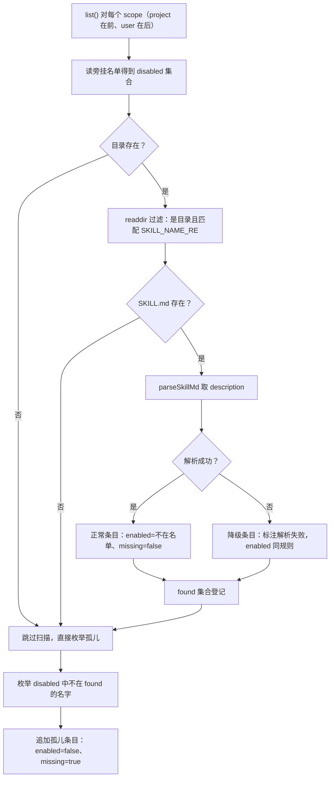
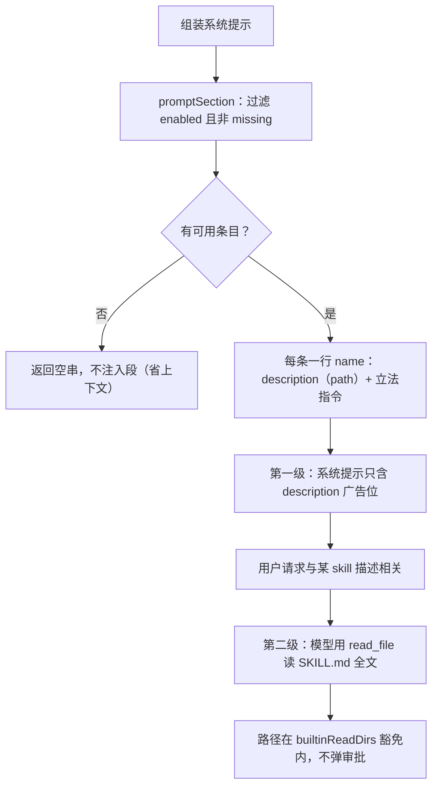
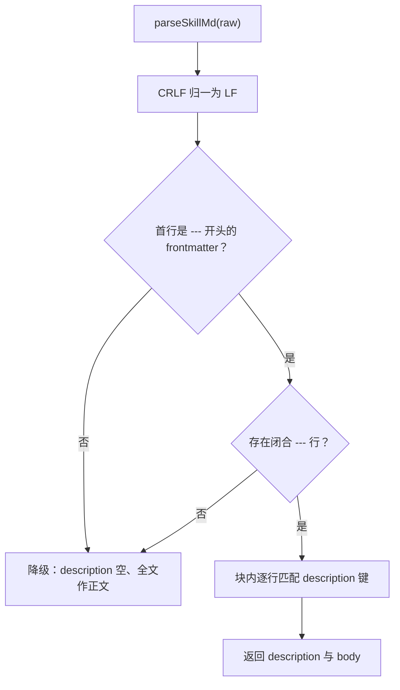
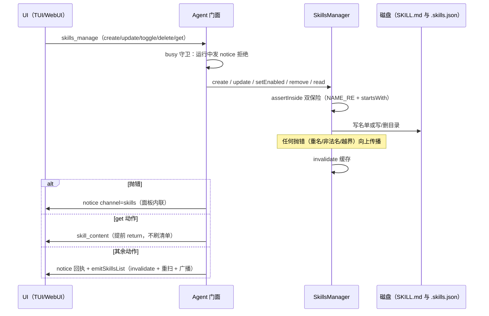

# 08 - 技能系统

> 职责：管理 Agent Skills（SKILL.md 指令文件）——两级目录扫描、旁挂停用名单的三态合成、CRUD 与启停、系统提示的渐进披露注入、调用时的正文渲染。实现集中在 `agent/src/skills/manager.ts` + `agent/src/skills/parser.ts`。
>
> **交互图**：[技能系统：三态合成与启停](./assets/skills-synthesis.html)——来源→扫描→三态合成→过滤→注入主链与 toggle/create/孤儿清理操作回路（对应 §3 三态合成与启停设计项）。

## 1. 职责与边界

| 文件 | 职责 |
|---|---|
| `agent/src/skills/manager.ts` | SkillsManager：list 三态合成、setEnabled、CRUD、forInvocation、promptSection、缓存 |
| `agent/src/skills/parser.ts` | SKILL.md 最小 frontmatter 解析 + 骨架生成 |
| `agent/src/agent.ts` | 消息层编排：skills_manage CRUD（:264-294）、invoke_skill（:407-415）、emitSkillsList 广播（:184-188） |
| `agent/src/permission/manager.ts` | builtinReadDirs 豁免（读 SKILL.md 不弹审批，manager.ts:37-41） |
| `bridge/src/contract/agent-to-ui.ts` | skills_list / skill_content 消息形状（:41-42） |

目录立法（manager.ts:8-17 注释）：只扫两个目录——用户级 `~/.dogegg/skills/`、项目级 `<cwd>/.dogegg/skills/`；**skill 名 = 目录名（唯一事实源）**，frontmatter 的 name 字段仅文档性（parser.ts:3 注释）；同名冲突项目级覆盖用户级（调用/联想取项目级），list() 两条都返回（面板两组都可见）；description 来自 frontmatter（渐进披露——系统提示与面板只展示它，正文按需读取）。

`SKILL_NAME_RE = /^[a-z0-9][a-z0-9-]*$/`（manager.ts:30-31）的三重作用：**防路径穿越**（不允许 `.` `/` `\` 等字符，`..` 无法构造）、**命令名合法性**（skill 名会变成 `/name` 斜杠命令）、**大小写归一**（全小写避免跨平台文件系统大小写敏感差异）。readdir 阶段就过滤非法目录名（list 的 :75），CRUD 阶段 assertInside 再拦一次。

## 2. 核心数据结构

```ts
// agent/src/skills/manager.ts:19-28
export interface SkillInfo {
  name: string
  description: string
  scope: 'project' | 'user'
  path: string
  /** false = 停用名单在案（系统提示/联想/调用全部不可见）。 */
  enabled: boolean
  /** true = 状态名单在案但文件系统已消失（孤儿）——仅供展示与清理。 */
  missing: boolean
}
```

字段级语义：`name` = 目录名（唯一事实源）；`description` 是渐进披露的**唯一广告位**（系统提示与面板只展示它）；`path` 是 SKILL.md 全路径（read_file 引导用）；`enabled/missing` 两个布尔合成三态——enabled=true 即启用，enabled=false && missing=false 即停用，missing=true 即孤儿（必然 enabled=false）。

```ts
// agent/src/skills/manager.ts:30-31
// 目录名 / 命令名立法：小写字母数字连字符，字母开头。
export const SKILL_NAME_RE = /^[a-z0-9][a-z0-9-]*$/
```

旁挂停用名单：状态文件与 skills 目录**同层**（`dirname(dir)/.skills.json`，manager.ts:106-110）——用户级 `~/.dogegg/.skills.json`、项目级 `<repo>/.dogegg/.skills.json`（与 .mcp.json 同构）；只记停用名单 `{ disabled: string[] }`（缺省即启用），**不碰主流 SKILL.md 格式**；项目级停用随 `.dogegg/` 进 git 与仓库共享（:13-15 立法）。

SKILL.md 形态（parser.ts:1-7 注释 + skeletonSkillMd :30-42）：`---` 包裹的 frontmatter 块内取 `description:` 单行键值（不引 YAML 依赖，其余键忽略，parser.ts:22-25）；正文是交给模型的完整指令，`$ARGUMENTS` 是参数占位符。

```markdown
---
name: deploy          ← 仅文档性（真名 = 目录名）
description: 部署到测试环境并检查健康检查端点
---
使用 $ARGUMENTS 作为用户传入的参数。
（在此写下交给模型的完整指令……）
```

解析器是**最小实现**（parser.ts:13-27）：首行必须 `---\n`、找闭合 `\n---`、块内逐行 `^description:\s*(.*)$` 提取（Windows CRLF 先归一，:14）。无闭合块 / 无 frontmatter → description 为空、全文作为正文——格式错误的 skill 降级可用而非失效。

## 3. 设计逐项详解

### 3.1 D-1 三态合成算法（list）

**设计问题**：技能的启用/停用状态在外部会漂移——用户手动删目录、手改 .skills.json、git 检出带来项目级停用名单。list() 必须把「文件系统事实」与「旁挂名单」合成出互斥完备的三态：启用 / 停用 / missing（名单在案但目录已消失）。约束：合成是热路径（见 D-6 缓存立法），单点损坏不能拖垮整个清单。

**方案与取舍**：以**目录扫描为主轴、停用名单为旁挂布尔**——正常条目直接由扫描产出（enabled 只是一个 `!disabled.has(name)` 表达式），孤儿条目由名单反向枚举（disabled 中不在 found 集合的名字）。备选是以名单为主轴（先枚举名单再查目录）会让无名单的 skill 反而变慢，且「解析失败条目」无处安放——被否决。解析失败**照常可见不隐身**（:87 注释「诊断优先于静默」），仍参与停用名单语义（found 集合照常登记）。

**代码走查**：

```ts
// agent/src/skills/manager.ts:71-92
      // 目录存在才扫文件；目录整体消失但状态名单还在时，孤儿枚举照常（见下）——可见供清理。
      if (existsSync(dir)) {
        let entries: string[]
        try {
          entries = readdirSync(dir, { withFileTypes: true }).filter((e) => e.isDirectory() && SKILL_NAME_RE.test(e.name)).map((e) => e.name)
        } catch {
          entries = [] // 目录不可读（权限等）：按无条目处理，孤儿枚举照常
        }
        for (const name of entries) {
          const path = join(dir, name, 'SKILL.md')
          if (!existsSync(path)) continue
          try {
            const { description } = parseSkillMd(readFileSync(path, 'utf8'))
            found.add(name)
            out.push({ name, description, scope, path, enabled: !disabled.has(name), missing: false })
          } catch {
            // SKILL.md 解析失败：条目照常可见（不隐身），标明原因供诊断——它仍参与停用名单语义。
            found.add(name)
            out.push({ name, description: '（SKILL.md 解析失败——请检查 frontmatter/正文）', scope, path, enabled: !disabled.has(name), missing: false })
          }
        }
      }
```

逐段解说：`:75` readdir 一次拿到目录项并**就地过滤**「是目录 + 过 NAME_RE」——非法目录名（穿越尝试、大小写混合）在扫描层就不存在；`:76-78` 目录不可读（权限）→ entries 置空而非抛出，孤儿枚举照常（:77 注释）；`:80-81` 无 SKILL.md 的目录跳过（目录存在但不是有效 skill）；`:83-85` 正常条目：found 登记 + `enabled: !disabled.has(name)`——名单只做布尔翻转；`:86-89` 解析失败条目：found **照常登记**（这样孤儿判定不会误报）、description 换成人话标注，enabled 同规则——停用一个解析失败的 skill 也是合法操作。

```ts
// agent/src/skills/manager.ts:93-97
      // 名单孤儿：停用名单在案、文件系统已消失（外部删除等）——可见供清理，永不进提示/调用。
      for (const name of disabled) {
        if (found.has(name) || !SKILL_NAME_RE.test(name)) continue
        out.push({ name, description: '（目录已不存在）', scope, path: join(dir, name, 'SKILL.md'), enabled: false, missing: true })
      }
```

逐段解说：`:94` 反向枚举停用名单；`:95` 在 found 里的跳过（目录还在，不是孤儿）、名字本身非法的也跳过（名单里的脏数据不渲染成条目）；`:96` 追加 missing=true 条目——**可见供清理，永不进系统提示与调用**（:16-17 三态立法）。合成结果写缓存 `this.cache = out`（:99）。

**流程图**（三态判定全貌）：



**具体输出示例**：用户级目录有 `deploy`（启用）、`lint`（在 .skills.json 停用名单）；项目级目录有 `lint`（启用）、`test`（SKILL.md 损坏）；用户级停用名单还留着早已删除的 `old-skill`。list() 产出（project 在前）：

| name | scope | enabled | missing | description 来源 |
|---|---|---|---|---|
| lint | project | true | false | 项目级 frontmatter |
| test | project | true | false | "（SKILL.md 解析失败——请检查 frontmatter/正文）" |
| deploy | user | true | false | 用户级 frontmatter |
| lint | user | false | false | 用户级 frontmatter（停用名单在案） |
| old-skill | user | false | true | "（目录已不存在）" |

同名 `lint` 两条都在（面板两组可见）；forInvocation/斜杠联想命中**项目级**（enabled 且非缺失条目内项目优先，manager.ts:184）；`old-skill` 只出现在面板（供清理），永不进 promptSection 与联想。

### 3.2 D-2 旁挂名单读写：容错自愈语义

**设计问题**：停用名单是手可编辑的 JSON 状态文件，可能被外部改坏（手改语法错、形状不符）。它若抛错，skills 功能整个挂掉。约束：外部手改损坏可删文件自愈（:112 注释）。

**方案与取舍**：读侧**一律视为空名单**——缺失/JSON 损坏/`disabled` 非数组/元素非字符串四种故障一种处置（类型谓词过滤兜底）；写侧 `mkdirSync(recursive)` + 两空格 JSON。缺省即启用的单向名单让「视为空」永远安全（最坏结果是全部回到启用态，无数据丢失语义）。

**代码走查**：

```ts
// agent/src/skills/manager.ts:113-123
  private readDisabled(scope: 'project' | 'user'): string[] {
    const file = this.statePathFor(scope)
    if (!existsSync(file)) return []
    try {
      const raw = JSON.parse(readFileSync(file, 'utf8')) as { disabled?: unknown }
      if (!Array.isArray(raw.disabled)) return []
      return raw.disabled.filter((x): x is string => typeof x === 'string')
    } catch {
      return []
    }
  }
```

逐段解说：`:115` 文件缺失 → 空名单（常态）；`:118` `disabled` 键非数组（形状不符）→ 空名单；`:119` 类型谓词逐元素过滤非字符串项——**部分损坏只丢坏元素**；`:120-122` JSON 语法错误 → 空名单。四层兜底让 readDisabled 永不抛出。

```ts
// agent/src/skills/manager.ts:132-138
  setEnabled(scope: 'project' | 'user', name: string, enabled: boolean): void {
    this.assertInside(scope, name)
    const names = this.readDisabled(scope)
    const next = enabled ? names.filter((n) => n !== name) : (names.includes(name) ? names : [...names, name])
    this.writeDisabled(scope, next)
    this.invalidate()
  }
```

逐段解说：`:133` 先过路径安全（D-6）；`:135` 启用 = 从名单移除；停用 = 追加且**去重**（已在名单时原样返回，不写重复项）；`:136` 整体重写名单文件；`:137` invalidate 让缓存失效（下次 list 重扫）。**启用一个 missing 条目 = 清理孤儿记录**（:131 注释）——名单里没有目录支撑的条目被移除后，孤儿自然消失。

### 3.3 D-3 渐进披露渲染（promptSection）

**设计问题**：SKILL.md 正文可能很长，全量注入系统提示会挤占上下文窗口；但模型需要知道「有哪些技能可用、何时用」。约束：上下文预算最小化。

**方案与取舍**：**两级披露**——系统提示只花一行广告位（name + description + path），正文按需经 read_file 加载。段首立法指令明确引导第二跳；且该读取路径在 builtinReadDirs 豁免内不弹审批（见《06》§3.5）——不豁免的话每次按需加载都要人审，渐进披露就失去意义。

**代码走查**：

```ts
// agent/src/skills/manager.ts:194-204
  promptSection(): string {
    const skills = this.list().filter((s) => s.enabled && !s.missing)
    if (skills.length === 0) return ''
    const lines = skills.map((s) => `- ${s.name}：${s.description || '（无描述）'}（${s.path}）`).join('\n')
    return [
      '',
      '## 可用 Skills',
      '以下是可用的 skill 指令文件。当用户请求与某个 skill 的描述相关时，先用 read_file 读取其 SKILL.md 获取完整指令再执行。',
      lines,
    ].join('\n')
  }
```

逐段解说：`:195` 只列**可用条目**（`enabled && !missing`）——停用/缺失不广告；`:196` 无 skill 返回空串**不注入段**（省上下文）；`:197` 每条一行 `- 名字：描述（路径）`，无描述也给占位文案（格式不塌）；`:201` 段首立法指令——「先用 read_file 读取其 SKILL.md 获取完整指令再执行」，这就是渐进披露的契约条款。注入点：ContextAssembler 构造的第三参数 `() => this.skills.promptSection() + shellGuidance(...)`（agent.ts:75）——每次组装系统提示时现取（配合 D-6 缓存才不成为热路径）。

**流程图**（两级披露链路）：



### 3.4 D-4 SKILL.md 最小 frontmatter 解析

**设计问题**：需要从 SKILL.md 提取 description（广告位）与正文（指令），但 Agent Skills 生态的 frontmatter 是 YAML 超集，完整解析需要引依赖且引入注入面。

**方案与取舍**：**最小子集解析**——不引 YAML 依赖，只取 `---` 块内「key: value」单行键值，其余键忽略（parser.ts:7 注释）。格式错误的 skill **降级可用而非失效**：无 frontmatter/无闭合块 → description 空、全文作为正文。Windows CRLF 先归一再匹配，避免 `\r` 污染键值。

**代码走查**：

```ts
// agent/src/skills/parser.ts:13-27
export function parseSkillMd(raw: string): ParsedSkillMd {
  const normalized = raw.replace(/\r\n/g, '\n')
  // frontmatter 块：首行必须是 ---，且存在闭合 ---。
  if (!normalized.startsWith('---\n')) return { description: '', body: normalized.trim() }
  const end = normalized.indexOf('\n---', 4)
  if (end < 0) return { description: '', body: normalized.trim() }
  const head = normalized.slice(4, end)
  const body = normalized.slice(normalized.indexOf('\n', end + 1) + 1).trim()
  let description = ''
  for (const line of head.split('\n')) {
    const m = /^description:\s*(.*)$/.exec(line)
    if (m) { description = m[1]!.trim(); break }
  }
  return { description, body }
}
```

逐段解说：`:14` CRLF 归一（后续所有锚点 `---\n` 都依赖 LF）；`:16` 无 frontmatter（首行不是 `---`）→ 降级返回；`:17-18` 从第 4 字符起找闭合 `\n---`，找不到也降级；`:19-20` head 切出 frontmatter 块、body 从闭合行之后取；`:22-25` 逐行正则提 description（首个命中即 break）——`name:` 等其余键被忽略（skill 名以目录名为准，INV-1）。骨架生成 `skeletonSkillMd`（:30-42）产出带 `$ARGUMENTS` 占位的默认正文（:37）——create 的产物立即可用。

**流程图**（解析降级路径）：



### 3.5 D-5 forInvocation 与 $ARGUMENTS 渲染

**设计问题**：skill 调用要解决三件事：同名冲突时选谁、停用/缺失/空正文怎么拒、参数怎么进正文。约束：渲染产物直接作为用户消息进轮次，必须是最终 prompt 文本。

**方案与取舍**：命中算法在**可用条目内项目级优先**（`find` 项目级命中 ?? 全量 find，:184）——项目覆盖用户是调用语义（面板两条都可见是展示语义，两者不冲突）。参数替换双路径：正文有 `$ARGUMENTS` 占位则 `replaceAll`；无占位且带参则追加说明段——用户带参调用无占位骨架时不丢参数。渲染产物作为**用户消息** submit（agent.ts:411）——skill 是"预填的用户 prompt"，与手动输入同权同路径，权限/压缩/取消天然生效，没有第二条执行通道。

**代码走查**：

```ts
// agent/src/skills/manager.ts:182-191
  forInvocation(name: string, args: string): string {
    const available = this.list().filter((s) => s.enabled && !s.missing)
    const found = available.filter((s) => s.name === name).find((s) => s.scope === 'project') ?? available.find((s) => s.name === name)
    if (!found) throw new Error(`未找到 skill：${name}（可能已停用或目录缺失）`)
    const { body } = parseSkillMd(readFileSync(found.path, 'utf8'))
    if (!body) throw new Error(`skill ${name} 的 SKILL.md 正文为空`)
    const trimmedArgs = args.trim()
    if (body.includes('$ARGUMENTS')) return body.replaceAll('$ARGUMENTS', trimmedArgs)
    return trimmedArgs ? `${body}\n\n用户参数：${trimmedArgs}` : body
  }
```

逐段解说：`:183` 先过滤出可用条目（停用/缺失退出竞争——项目级停用时同名用户级照常生效）；`:184` 同名条目**项目级优先**（先在 project scope 里 find，找不到再全量 find）；`:185` 未命中抛错（门面转 notice，agent.ts:412-414）；`:187` 正文为空也抛错（空 prompt 进轮次只会浪费一轮）；`:189` 有占位 → `replaceAll` 替换为 trim 后参数；`:190` 无占位且带参 → 追加 `\n\n用户参数：<args>` 段（骨架生成的默认正文就带占位，skeletonSkillMd:37）。

### 3.6 D-6 CRUD 与路径安全双保险 + 缓存失效

**设计问题**：CRUD 是文件系统写操作，name 来自 UI 输入——必须保证不越出两个根目录。同时 list() 是热路径（系统提示段与 token 估算在每次状态变化时都触发），现扫文件系统不可接受。

**方案与取舍**：路径安全**双保险**——name 先过 NAME_RE（字符白名单，`..` 无法构造），再确认 `join(dir, name)` 结果 `startsWith(dir)` 不越出根目录。缓存失效三时机：任何写操作末尾 invalidate、`setProjectDir`（/cd 切换，:43-46）、门面显式 invalidate（emitSkillsList，agent.ts:184-188）——**外部手改文件也在此可见**（面板/联想的清单永远反映磁盘事实）。

**代码走查**：

```ts
// agent/src/skills/manager.ts:142-152
  create(scope: 'project' | 'user', name: string, description: string): void {
    if (!SKILL_NAME_RE.test(name)) throw new Error(`skill 名称只能用小写字母、数字、连字符（且字母开头）：${name}`)
    const dir = this.dirFor(scope)
    if (!dir) throw new Error('项目级 skills 目录不可用（当前无工作目录）')
    const skillDir = join(dir, name)
    if (existsSync(skillDir)) throw new Error(`skill 已存在：${name}（${scope}）`)
    mkdirSync(skillDir, { recursive: true })
    writeFileSync(join(skillDir, 'SKILL.md'), skeletonSkillMd(name, description), 'utf8')
    this.writeDisabled(scope, this.readDisabled(scope).filter((n) => n !== name))
    this.invalidate()
  }
```

逐段解说：`:143` NAME_RE 校验（人话错误信息）；`:147` 重名抛错（不静默覆盖）；`:148-149` mkdir + 骨架 SKILL.md——「增」的产物格式正确立即可用；`:150` **从停用名单移除同名条目**——同名重建（此前停用后被删）视为全新开始、默认启用（:141 注释）；`:151` invalidate。

```ts
// agent/src/skills/manager.ts:207-213
  private assertInside(scope: 'project' | 'user', name: string): void {
    if (!SKILL_NAME_RE.test(name)) throw new Error(`非法 skill 名称：${name}`)
    const dir = this.dirFor(scope)
    if (!dir) throw new Error('项目级 skills 目录不可用（当前无工作目录）')
    const resolved = join(dir, name)
    if (!resolved.startsWith(dir)) throw new Error(`skill 路径越界：${name}`)
  }
```

逐段解说：`:208` 第一道保险：NAME_RE（update/remove/read/setEnabled 都过这里，create 在 :143 自己过）；`:211-212` 第二道保险：join 结果 `startsWith(dir)` ——即使未来 NAME_RE 放宽，越界路径仍被拦。其余 CRUD：update 整文件替换（:155-161，TUI $EDITOR / WebUI 编辑弹框落点）、remove 整目录删除且幂等（:165-170，`rmSync(recursive, force)` 不存在静默成功——也是 missing 条目"删除即清理"的落点；名单同步清理不留孤儿）、read 返回全文（:173-178）。

### 3.7 D-7 面板 CRUD 的消息层走查（agent.ts:264-294）

**设计问题**：五个动作（create/update/delete/get/toggle）共用一条消息，响应形状不同（get 回全文、其余回清单），错误要面板内联可见而非静默。

**方案与取舍**：统一 try/catch 把所有抛错转 `notice channel='skills'`（:291-293）——面板内联显示；get 特殊化提前 return（它的响应不是清单）；toggle 前查 `wasMissing` 区分文案——**避免把清理孤儿误读为恢复了可用 skill**。

**代码走查**：

```ts
// agent/src/agent.ts:274-281
        case 'toggle': {
          // 对缺失态条目「启用」即清理孤儿记录——文案区分，避免误导为恢复了可用 skill。
          const wasMissing = this.skills.list().find((s) => s.scope === cmd.scope && s.name === cmd.name)?.missing === true
          this.skills.setEnabled(cmd.scope, cmd.name, cmd.enabled === true)
          const action = cmd.enabled ? (wasMissing ? '已清理（移除孤儿记录）' : '已启用') : '已停用'
          this.emit({ type: 'notice', text: `skill ${action}：${cmd.name}（${cmd.scope}）` })
          break
        }
```

逐段解说：`:276` toggle 前先查该条目的 missing 标志（setEnabled 之后孤儿已被清理，事后查不到了——必须先查）；`:277` 执行启停；`:278-279` 三种文案按 (enabled, wasMissing) 组合区分。其余动作：create 生成骨架 + notice（:267-270）；update 全文替换；get 回 `skill_content` 消息且**提前 return**（:287-288，get 的响应不是清单）；delete 整目录删除 + notice（:282-285）；所有动作末尾 `emitSkillsList()`（:290）刷新清单。

**skills_request 的播种语义**（agent.ts:400-402）：每次都 `emitSkillsList()`（invalidate + 重扫 + 广播）——外部手改 SKILL.md 或手动删目录后打开面板即见。**门面的调用入口**（agent.ts:407-415）：`invoke_skill` 前置 isConfigured 检查 → `skills.forInvocation(name, args)` → 渲染产物 `turnRunner.submit(skillText, resolveTurnParams())`。

**流程图**（管理操作的消息往返）：



## 4. 关键立法与不变量

- **INV-1 名字唯一事实源**：skill 名 = 目录名，frontmatter name 仅文档性。
- **INV-2 三态完备**：启用 / 停用 / missing 三态互斥完备；missing 永不进 promptSection 与 forInvocation。
- **INV-3 旁挂名单只记停用**：缺省即启用；SKILL.md 主流格式零污染；项目级随 git 共享。
- **INV-4 读容错自愈**：名单损坏视为空、目录不可读视为空——skills 功能永不因状态文件挂掉。
- **INV-5 渐进披露**：提示词只花 description 一行；正文按需 read_file（读豁免免审批）。
- **INV-6 CRUD 全部限定根目录内**：NAME_RE + startsWith 双保险。
- **INV-7 项目级覆盖用户级**：调用与联想取项目级，面板两条都可见。
- **INV-8 停用不删除**：setEnabled 停用只进旁挂名单——SKILL.md 与目录原样保留，重新启用零恢复成本；enabled=false 是唯一"半存在"形态（missing 是另一种）。

## 5. 失败模式与恢复

| 失败 | 行为 | 恢复 |
|---|---|---|
| .skills.json 损坏/手改坏 | 视为空名单（:118-122） | 删文件即自愈；启停操作重写正确格式 |
| SKILL.md frontmatter 坏 | 条目照常可见、标注解析失败（:89） | 面板 get 全文诊断后 update 修复 |
| 外部删除目录但名单还在 | missing 孤儿条目可见（:96） | 面板"启用"（清理记录）或 remove |
| 目录不可读（权限） | entries 置空、孤儿枚举照常（:77） | 修权限后 invalidate 生效 |
| create 重名/非法名 | 抛错 → notice channel='skills' 内联提示 | 改名重试 |
| invoke 停用/缺失/空正文 | forInvocation 抛错 → notice（agent.ts:412-414） | 先启停或补正文 |
| /cd 后项目目录漂移 | setProjectDir + invalidate（:43-46），门面随后重扫广播（agent.ts:501-502） | 自动 |
| 项目级停用同名用户级 | 停用只作用于所在 scope；用户级条目照常参与竞争（list 两条独立） | 用户级可正常 invoke |

## 6. 与其它子系统的接缝

- **→ 06 权限**：用户级 skills 目录进 builtinReadDirs——read_file 读 SKILL.md 的 ask 豁免（manager.ts:22 构造注入，agent.ts:74）。
- **→ 02 轮次**：invoke_skill 把渲染产物作为用户消息 submit；promptSection 每轮组装进系统提示。
- **→ 05 工具**：模型按提示段用 read_file 按需加载正文（渐进披露的第二跳）。
- **→ 11/12 前端**：skills_list 六字段驱动 TUI features/skills 与 WebUI settings/skills；skills_manage 五动作 + invoke_skill 共用消息契约。
- **→ 09 会话**：set_cwd 连动 setProjectDir——skills 随项目环境走。
- **→ 05 工具展示**：渐进披露的第二跳由 read_file 完成——SKILL.md 可能很长，全量注入系统提示会挤占窗口；正文按需加载是上下文预算策略的一部分（与压缩管线同一问题域）。
- **← 12 WebUI**：设置页 Skills section 订阅 skills_list **全量**（含 enabled/missing 状态字段）做启停管理，而 use-skills 联想池过滤可用条目——同一广播两种消费粒度（use-skills.ts:5-6 注释，:14 过滤）。
