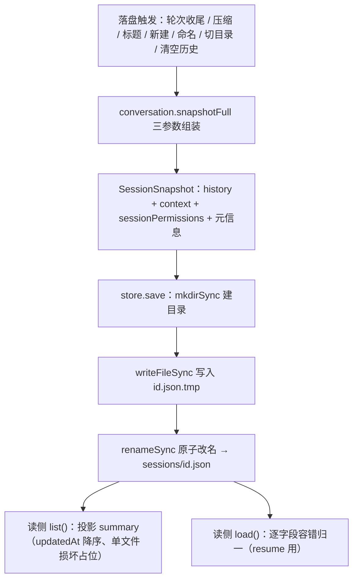
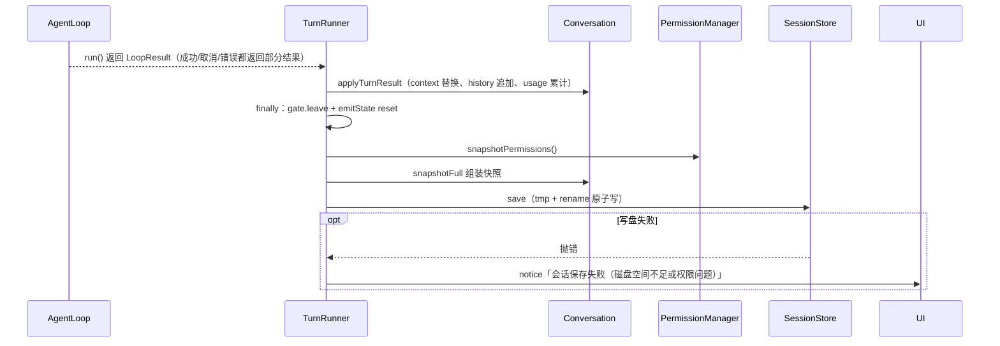
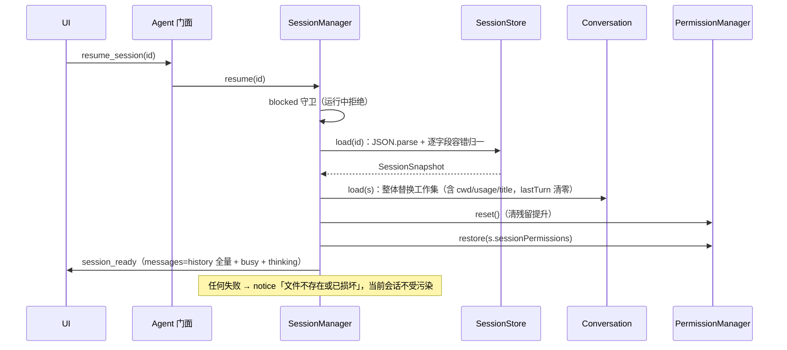
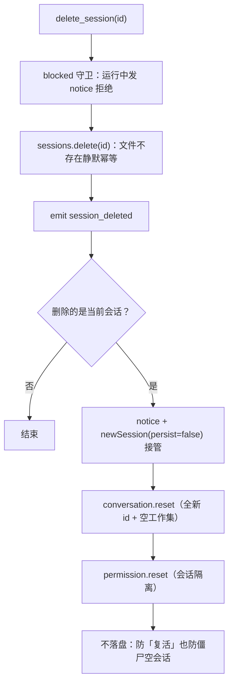

# 09 - 会话与持久化

> 职责：把"发生过什么 + 授权到哪 + 干到哪"完整存档到磁盘，并在 resume 时精确还原。三个文件分工：`agent/src/session/conversation.ts`（内存工作集，R1 双写分离的唯一持有者）、`agent/src/session/store.ts`（JSON 落盘与读取）、`agent/src/session/manager.ts`（会话生命周期命令）。

## 1. 职责与边界

| 文件 | 职责 |
|---|---|
| `agent/src/session/conversation.ts` | Conversation 工作集：history/context/thinking/id/cwd/usage/compactions/title |
| `agent/src/session/store.ts` | SessionStore：`~/.dogegg/sessions/<id>.json` 的原子读写删列表 |
| `agent/src/session/manager.ts` | SessionManager：new/resume/delete/list/clear 的实现归属 |
| `agent/src/ctx.ts` | AgentContext（workset 的接线板，conversation 由门面注入） |
| `agent/src/turn/turn-runner.ts` | 轮次收尾落盘（saveOrNotice）与标题落盘 |
| `agent/src/agent.ts` | rename/set_cwd 的即时落盘（:466-523） |

依赖矩阵中 session 域只依赖 shared 与 ROOT（architecture.test.ts:128-139，`session: ['shared', 'ROOT']` 在 :130）——它不知道 turn/mcp/permission 的存在，接收的是结构子集 `TurnDelta`（conversation.ts:5-14：LoopResult 的形状子集，**session 不依赖 turn**）。

## 2. 核心数据结构：存档 JSON 形状逐字段

`SessionSnapshot`（store.ts:13-24）序列化后的文件形状（store.ts:48-59 的写入顺序）：

| 字段 | 类型 | 语义 |
|---|---|---|
| `id` | string | 会话唯一 id（`newId()` 生成），文件名 `<id>.json` |
| `updatedAt` | string | 写入时 `new Date().toISOString()`（save 时打点，列表排序依据） |
| `history` | Message[] | **完整原文**（永不压缩，UI 显示与 preview 用）——R1 双写的历史侧 |
| `context` | Message[] | **发给模型的消息**（可能已压缩成摘要）——R1 双写的模型侧；resume 后模型续接的是它 |
| `sessionPermissions` | ToolPermission[] | 会话内权限提升（`{tool, patterns}` 分组；patterns 空 = 整工具，非空 = 范围模式，path 已是绝对形式） |
| `usage` | `{promptTokens, completionTokens, turns}` | 会话累计**真实**用量（API 返回值，resume 续计） |
| `compactions` | number | 累计压缩次数（/context 仪表盘展示） |
| `title?` | string | /rename 手动命名或首轮自动标题；缺省时列表展示 preview（:20-21） |
| `cwd` | string | 创建/切换时的工作目录（resume 恢复，项目→会话切换还原目录，:11-12） |
| `thinking` | `{text}[]` | 推理模型思考内容数组（与 assistant 消息一一对应，空串占位；恢复思考块显示，**不进 history/context**，:12-13） |

`SessionSummary`（store.ts:27-33）是列表投影：`id / updatedAt / preview / cwd / title`。preview 取 **history 中从尾部向前扫到的第一条非 tool 且 content 非空字符串消息**的前 40 字符（store.ts:104-111）——用 history 而非 context，因为 preview 要反映用户真实对话而非压缩摘要；从尾部向前扫而非只看末条，因为轮次收尾时 history 常以 tool 消息结尾（只看末条会得到空 preview，侧栏全是无摘要条目）。

一个落盘文件的实际形状（带注释示意）：

```jsonc
{
  "id": "a1b2c3d4e5f6",
  "updatedAt": "2026-09-15T08:30:00.000Z",
  "history": [ { "role": "user", "content": "修复登录 bug" },
               { "role": "assistant", "content": null,
                 "tool_calls": [{ "id": "t1", "type": "function",
                                  "function": { "name": "edit_file", "arguments": "{...}" } }] },
               { "role": "tool", "tool_call_id": "t1", "content": "已替换 1 处（原第 42 行起）" } ],
  "context": [ /* 同上，但长对话时此处可能已被压缩为一条摘要消息 */ ],
  "sessionPermissions": [ { "tool": "shell", "patterns": [] },
                          { "tool": "write_file", "patterns": ["/work/proj/docs/**"] } ],
  "usage": { "promptTokens": 51230, "completionTokens": 8814, "turns": 6 },
  "compactions": 1,
  "title": "修复登录 bug",
  "cwd": "D:\\work\\proj",
  "thinking": [ { "text": "用户要求…（推理全文）" }, { "text": "" } ]
}
```

注意三处细节：history 与 context **独立序列化**（压缩只改 context）；sessionPermissions 的 path 模式已是落库时解析好的**绝对 posix 形式**（《06》§3.6 第 4 步）；thinking 末条的空串占位对应一条无 reasoning 的 assistant 消息（一一对应立法，《02》INV-7）。title 有值才序列化（store.ts:58 的条件展开）——缺省字段保持 undefined 语义。

## 3. 设计逐项详解

### 3.1 D-1 存档四件套的落盘与原子写（store.save）

**设计问题**：会话文件承载四类互不归属的状态——history（UI 侧）、context（模型侧）、sessionPermissions（权限域）、元信息（id/updatedAt/usage/compactions/title/cwd/thinking）。它们由不同子系统持有，落盘必须在**一个入口**组装完成，且进程中断不能留下半写文件。

**方案与取舍**：组装唯一入口是 `conversation.snapshotFull(sessionPermissions, usage, compactions)`（conversation.ts:149-151）——history/context/thinking/id/cwd 由工作集自带，其余三参数由各自提供方传入（权限快照、用量、压缩计数），Session 不持它们的引用（依赖矩阵立法）。落盘用 **tmp + rename 原子写**：rename 在同一文件系统上是原子操作，进程在 writeFileSync 中途被杀只留 .tmp 垃圾，正本完整（store.ts:40 注释）。

**代码走查**：

```ts
// agent/src/session/store.ts:44-61
  save(snapshot: SessionSnapshot): void {
    mkdirSync(this.baseDir, { recursive: true })
    const target = this.file(snapshot.id)
    const tmp = target + '.tmp'
    writeFileSync(tmp, JSON.stringify({
      id: snapshot.id,
      updatedAt: new Date().toISOString(),
      history: snapshot.history,
      context: snapshot.context,
      sessionPermissions: snapshot.sessionPermissions,
      usage: snapshot.usage,
      compactions: snapshot.compactions,
      cwd: snapshot.cwd,
      thinking: snapshot.thinking,
      ...(snapshot.title ? { title: snapshot.title } : {}),
    }))
    renameSync(tmp, target)
  }
```

逐段解说：`:45` 建目录（首次保存/目录被清后自动恢复）；`:47` 副本写 `.tmp` 后缀；`:50` `updatedAt` 在**写入时刻**打点——列表按它降序（最新在前）；`:51-52` history 与 context 独立序列化（R1 双写持久化的落点）；`:58` `title` 条件展开——无标题时字段不出现在 JSON（缺省 undefined 语义，列表回退 preview）；`:60` rename 原子转正。

**流程图**（四件套组成与读写两侧）：



### 3.2 D-2 R1 双写与轮次增量（conversation）

**设计问题**：压缩只应影响模型看到的上下文，不能破坏用户看到的对话记录；同时轮次结束时工作集要一次性吸收 loop 的全部变更。

**方案与取舍**：**R1 双写分离**——history 与 context 是两个独立数组：user 消息入队时同时 push 两侧（原文一致）；轮次收尾时 `context` 整体被 loop 返回值**替换**（loop 内部可能已压缩）、`newMessages` 追加进 history——「用户看到的」与「模型续接的」各自独立演化（conversation.ts:24 注释立法）。

**代码走查**：

```ts
// agent/src/session/conversation.ts:65-69
  pushUserMessage(text: string): void {
    const msg: Message = { role: 'user', content: text }
    this.history.push(msg)
    this.context.push(msg)
  }
```

```ts
// agent/src/session/conversation.ts:73-84
  applyTurnResult(result: TurnDelta): void {
    this.context = result.context
    this.history.push(...result.newMessages)
    this.thinking.push(...result.thinking)
    if (result.usage) {
      this.usage.promptTokens += result.usage.promptTokens
      this.usage.completionTokens += result.usage.completionTokens
      this.usage.turns += 1
      this.lastTurn = { ...result.usage }
    }
    this.compactions += result.compactions ?? 0
  }
```

逐段解说：`:67-68` 双写点唯一（user 消息）；`:74` context **整体替换**——loop 是 context 的唯一写手（含自动压缩后的摘要消息）；`:75` history 只追加 loop 透传的新消息（assistant/tool 原文）——压缩丢给模型的信息不丢给用户（INV-1）；`:76` thinking 累积（与 assistant 消息一一对应，不进 history/context）；`:77-82` 用量**双口径**：跨轮累计进 `usage`（持久化、resume 续计），本轮快照记入 `lastTurn`（`{ ...result.usage }` 浅拷贝覆盖，:81——不持久化，load 时清零 :143）；`:83` 压缩计数累加（手动压缩走 `incrementCompaction` 另一入口，:107-110）。

双口径的用途（bridge agent-to-ui.ts:28-31）：`context_state.lastTurn` 与本地估算并排展示——**可见估算器校准误差**；`sessionUsage` 是跨会话累计。数据源头是 LlmUsage（API `stream_options.include_usage` 精确值，见《03》§2.3），与本地粗估（estimate.ts）是两套体系。

### 3.3 D-3 落盘时机全景与失败通知（saveOrNotice）

**设计问题**：snapshotFull 有**六个调用点**，失败语义按打扰成本分级——轮次收尾的保存失败必须让用户看见（否则整轮对话可能无声丢失），次要路径（标题/命名/切换落盘）静默即可。

**方案与取舍**：轮次收尾统一走 `saveOrNotice`——成功/取消/错误都在 `finally` 落盘（runTurn 的 finally，turn-runner.ts:128-133），失败发 notice"会话保存失败（磁盘空间不足或权限问题）"不静默。六个调用点：

1. **轮次收尾**：TurnRunner.finally → saveOrNotice（turn-runner.ts:185-197）；
2. **手动压缩后**（turn-runner.ts:155-161）；
3. **标题落盘**（turn-runner.ts:68-75，静默失败）；
4. **newSession 立即保存空会话**（SessionManager 私有 save，manager.ts:97-105，静默失败——侧栏即时显示新会话）；
5. **/rename 即时落盘**（agent.ts:471-479，静默失败——命名本身已有 notice 回执）；
6. **/set_cwd 即时落盘**（agent.ts:507-516）——会话文件携带 cwd，WebUI 侧栏按 cwd 分组项目树，**不即时保存的话新项目要等下一轮对话落盘后才出现**（agent.ts:505-506 注释）。

**代码走查**：

```ts
// agent/src/turn/turn-runner.ts:185-197
  private saveOrNotice(): void {
    try {
      this.deps.sessions.save(
        this.deps.conversation.snapshotFull(
          this.deps.ctx.permission.snapshotPermissions(),
          this.deps.conversation.getUsage(),
          this.deps.conversation.getCompactions(),
        ),
      )
    } catch {
      this.deps.emit({ type: 'notice', text: '会话保存失败（磁盘空间不足或权限问题）' })
    }
  }
```

逐段解说：`:189` 权限快照由 PermissionManager 现取——落盘时刻的会话提升原样存档；`:190-191` 用量与压缩计数由工作集提供；`:194-196` 失败只发 notice 不重抛——轮次本身已完成，保存失败不改变轮次结果，但用户必须知道磁盘有问题。

**流程图**（一轮结束的落盘时序）：



### 3.4 D-4 resume 恢复链

**设计问题**：resume 要从单个 JSON 文件精确还原五方面状态：对话显示（history）、模型续接（context）、权限提升、用量/统计、工作目录。文件可能来自旧版本格式；失败不能污染当前会话。

**方案与取舍**：恢复链四步——load（逐字段容错归一）→ conversation.load（整体替换工作集）→ permission.reset+restore（先清残留再按存档还原）→ emit session_ready。**旧格式兼容**：`history ?? messages`（只有 messages 的旧文件）、`context ?? [...history]`（重建为拷贝）；**旧格式 allowedTools 不再读取——旧会话的提升视为空，重新询问一次即可**（store.ts:68 注释）。**恢复不影响运行体**：MCP 按当前配置重连、工具可用性由当前配置决定——会话存档不冻结运行环境。

**代码走查**：

```ts
// agent/src/session/store.ts:63-76
  load(id: string): SessionSnapshot {
    const raw = JSON.parse(readFileSync(this.file(id), 'utf8'))
    // 兼容旧格式（只有 messages）：若无 history/context 字段，回退用 messages。
    const history: Message[] = raw.history ?? raw.messages ?? []
    const context: Message[] = raw.context ?? [...history]
    // 旧格式的 allowedTools 不再读取——旧会话的提升视为空（重新询问一次即可）。
    const sessionPermissions: ToolPermission[] = raw.sessionPermissions ?? []
    const usage = raw.usage ?? { promptTokens: 0, completionTokens: 0, turns: 0 }
    const compactions: number = raw.compactions ?? 0
    const title: string | undefined = typeof raw.title === 'string' ? raw.title : undefined
    const cwd: string = raw.cwd ?? ''
    const thinking: { text: string }[] = raw.thinking ?? []
    return { id: raw.id ?? id, history, context, sessionPermissions, usage, compactions, title, cwd, thinking }
  }
```

逐段解说：`:66` `history ?? messages` 双键回退；`:67` 旧格式无 context → 重建为 history 拷贝（模型侧从完整历史起步）；`:69` 提升只认 `sessionPermissions`（旧 allowedTools 字段被 :68 注释显式立法废弃）；`:70-74` usage/compactions/title/cwd/thinking 各有零值兜底——任何缺失字段都不抛错。

第二步 `conversation.load(s)`（conversation.ts:136-146）整体替换工作集：`:137-140` history/context/thinking/sessionId 一步到位；`:141` **快照带 cwd 时一并恢复**（项目→会话切换还原目录；项目级 .mcp.json / .dogegg/skills 随新 cwd 生效，见《07》/《08》）；`:143` lastTurn 清零——本轮还没有"上一轮"（lastTurn 不持久化）；`:144-145` usage 续计、compactions/title 恢复。

```ts
// agent/src/session/manager.ts:68-85
  resume(id: string): void {
    if (this.blocked()) return
    if (this.rejectInvalidId(id)) return
    try {
      const s = this.deps.sessions.load(id)
      this.deps.conversation.load(s)
      // 恢复该会话的权限提升（resume 不清空，保留之前设置的提升；旧格式的 allowedTools 字段直接无视）。
      this.deps.ctx.permission.reset()
      this.deps.ctx.permission.restore(s.sessionPermissions)
      const thinking = this.deps.conversation.getThinking()
      this.deps.emit({
        type: 'session_ready',
        id: s.id,
        messages: [...this.deps.conversation.getHistory()],
        // busy 与 WP2 的 session_ready 契约同步（恢复链立法，见 newSession 内注释）。
        busy: this.deps.ctx.gate.busy,
        ...(thinking.length ? { thinking: [...thinking] } : {}),
      })
      // 成功路径（cwd 已随存档恢复到 conversation）：跨项目 resume 后重挂项目级资源。
      this.deps.onSessionSwitched?.(this.deps.conversation.getCwd())
    } catch {
      this.deps.emit({ type: 'notice', text: `会话 ${id} 加载失败（文件不存在或已损坏）` })
    }
  }
```

逐段解说：`:69` blocked 守卫（运行中拒绝恢复）；`:70` 非法 id 白名单防御（防路径穿越，立法见 manager 文件头）；`:72-73` load 两级（store 归一 → conversation 替换）；`:75-76` **先 reset 再 restore**——可能残留上一会话的提升被强制清空，提升从不跨会话泄漏，然后按存档还原；`:78-85` session_ready 带 history 全量 + **必填 `busy`**（快照重发时 agent 是否在跑——运行中刷新/新标签接入不得把 UI 打回 idle，UI 据 busy 先落「运行中」形态）+ thinking（有思考内容才附字段）——UI 聊天区重现完整对话与思考块；`:88` 成功后按最终 cwd 重挂项目级资源；`:89-91` 任何失败 → notice"文件不存在或已损坏"——当前会话工作集不受污染（INV-5）。

**流程图**（恢复链消息往返）：



### 3.5 D-5 会话生命周期与删除接管

**设计问题**：newSession 必须实现会话隔离（allow_always 只对当前会话生效）；deleteSession 删除**当前会话**时陷入两难——内存旧工作集若不替换，下一轮落盘会把刚删的会话"复活"；新会话若立即落盘，删空的项目永远非空（僵尸空会话挡住 WebUI 的"删除项目"）。

**方案与取舍**：newSession 全链 reset（conversation + permission），默认立即保存空会话（侧栏即时显示）；删除接管用 **`persist: false` 变体**——只换内存不落盘，两个失败方向都被立法堵死（manager.ts:87-89 注释）。newSession 可选指定 cwd（WebUI 项目树添加会话用，校验是目录否则 notice）。

**代码走查**：

```ts
// agent/src/session/manager.ts:87-93
    // 删除的是当前会话 → 立即换一个新空会话（persist=false，首次对话才落盘）。内存旧工作集
    // 必须被替换：否则下一轮落盘会把刚删掉的会话原样写回（「复活」）；但不能立即落盘新会话：
    // 否则删空的项目永远非空，WebUI 的删除项目会被这个僵尸空会话挡住。
    if (id === this.deps.conversation.getId()) {
      this.deps.emit({ type: 'notice', text: '当前会话已删除，已切换到新会话' })
      this.newSession(undefined, { persist: false })
    }
```

逐段解说：`:90` 判定删除目标是否当前会话（id 相等）；`:91` notice 让用户知道工作区已切换；`:92` persist=false 接管——配合 `newSession`（manager.ts:30-44）主体：`conversation.reset()`（全新 id + 空工作集，conversation.ts:124-133）→ `permission.reset()`（:40，**会话隔离立法**）→ `persist !== false` 才立即保存（:42）→ emit session_ready。`sessions.delete`（store.ts:79-82）文件不存在静默幂等（UI 与磁盘状态短暂不一致时无副作用）；deleteSession 整体带 blocked() 守卫（manager.ts:19-25, 78-79）——运行中不能删正在使用的会话。

**流程图**（删除接管决策）：



### 3.6 D-6 列表投影与项目分组（store.list）

**设计问题**：侧栏需要跨全部会话文件的列表视图；单个文件损坏不能阻断整个列表；preview 要反映用户真实对话。

**方案与取舍**：逐文件 try/catch——解析失败返回占位项 `{ preview: '（文件损坏）' }`（:100, :115-117）；preview 取 **history 中从尾部向前扫到的第一条非 tool 且 content 非空字符串消息**前 40 字符（:104-111）——用 history 而非 context（压缩摘要不该出现在侧栏），向前扫而非只看末条（轮次收尾时 history 常以 tool 消息结尾）；`cwd` 随 summary 下发（agent-to-ui.ts）——WebUI 侧栏按 cwd 分组项目树，"项目遗忘" = 删除该项目下全部会话。

**代码走查**：

```ts
// agent/src/session/store.ts:95-120
  list(): SessionSummary[] {
    if (!existsSync(this.baseDir)) return []
    return readdirSync(this.baseDir)
      .filter((f) => f.endsWith('.json'))
      .map((f) => {
        // 单个文件损坏不阻断整个列表——跳过并返回占位项。
        try {
          const raw = JSON.parse(readFileSync(join(this.baseDir, f), 'utf8'))
          const history: Message[] = raw.history ?? raw.messages ?? []
          let preview = ''
          for (let i = history.length - 1; i >= 0; i--) {
            const m = history[i]!
            if (m.role !== 'tool' && typeof m.content === 'string' && m.content.length > 0) {
              preview = m.content.slice(0, 40)
              break
            }
          }
          const cwd: string = raw.cwd ?? ''
          const title: string | undefined = typeof raw.title === 'string' ? raw.title : undefined
          return { id: raw.id ?? f.replace('.json', ''), updatedAt: raw.updatedAt ?? '', preview, cwd, title }
        } catch {
          return { id: f.replace('.json', ''), updatedAt: '', preview: '（文件损坏）', cwd: '' }
        }
      })
      .sort((a, b) => b.updatedAt.localeCompare(a.updatedAt)) // 降序：最新在前
  }
```

逐段解说：`:96` 目录不存在 → 空列表（首次启动）；`:98` 只收 `.json` 后缀——**残留的 `.tmp` 副本不参与列表**（`.tmp` 不以 `.json` 结尾）；`:104-111` preview 从尾部向前扫，三重条件（非 tool 消息、content 是字符串、非空）才截取 40 字符；`:116` 损坏占位项——updatedAt 空串使其排序沉底；`:119` `localeCompare` 降序，最新在前。WebUI 侧的删除项目链路（app.tsx:95-106）：UI 统计该项目下会话数 → confirm 弹框明示"将删除其下 N 个会话的记录。项目目录本身不会被删除"（:98-100）→ 逐个 `delete_session` + `forgetProject`（:102-103）——knownProjects 是 UI 侧集合、只增不自动减（use-sessions.ts:32-38 聚合 effect），项目显示与否由它决定；删除当前会话时触发 D-5 的 persist=false 接管——"删空的项目永远非空"的僵尸问题被两端合力堵死。

### 3.7 D-7 /rename 与标题优先级

**设计问题**：会话标题有两个来源——首轮后的自动生成（LLM 调用，fire-and-forget）与 /rename 手动命名。自动生成是异步的，生成期间用户可能已手动命名（竞态窗口），胜负规则必须确定。

**方案与取舍**：**手动命名优先**——maybeAutoTitle 双重防线：生成前查 `conversation.getTitle()`（已有标题直接放弃，:51），写回前**再查一次**（:65——"生成期间 /rename 已落（竞态窗口），手动命名优先，自动结果直接丢弃"，turn-runner.ts:47 注释）。

**代码走查**：

```ts
// agent/src/turn/turn-runner.ts:49-57
  private maybeAutoTitle(params: TurnParams): void {
    if (this.titleGenerating) return
    if (this.deps.conversation.getTitle()) return
    if (this.deps.ctx.gate.busy) return
    const history = this.deps.conversation.getHistory()
    const user = history.find((m) => m.role === 'user')
    const assistant = history.find((m) => m.role === 'assistant')
    if (!user || !assistant || typeof user.content !== 'string') return
    this.titleGenerating = true
```

逐段解说：`:50` in-flight 去重（生成中再次完成轮次跳过——`titleGenerating` 标志，finally 复位 :79）；`:51` 已有标题（含 /rename）不再生成；`:52` gate 空闲才生成（不与运行中轮次抢资源）；`:53-56` 首轮需同时有 user+assistant 消息才生成；`:57` 置位后异步执行，写回前 :65 再查一次标题（竞态兜底）、:66 setTitle、:68-75 静默落盘 + :77 重推 session_list。/rename 侧（agent.ts:466-483）：trim 后空则 notice 用法提示 → `conversation.setTitle` → 立即 snapshotFull 落盘（:471-479 静默失败——命名 notice 已是回执）→ notice"会话已命名" → 重推 session_list。标题经 session_list 广播到两端状态栏/侧栏（WebUI 侧栏显示 `title || preview`；重命名弹框预填原名采用同一回退，app.tsx:62-65）。

### 3.8 本轮新增持久化立法（2026-09）

本轮（v0.2 发布前）补齐的三类持久化立法，均为读写两端的崩溃安全收口：

1. **原子写全覆盖（tmp + rename）**：凡「唯一副本、损坏不可自愈」的 JSON 一律原子写——会话存档（store.save 自带 tmp + renameSync）、config（ConfigStore.save 经 shared 的 atomicWriteFileSync）、`.skills.json`（skills/manager.ts）、`.mcp.json`（mcp/project.ts）四处统一（helper 立法见 agent/src/shared/atomic.ts：直接 writeFileSync 中途被杀会留半截 JSON，下次启动 parse 失败——config 损坏会以 ConfigParseError 启动失败、会话损坏直接丢失，因此收口在写入端而非恢复端）。
2. **/clear 即时落盘**（manager.clearHistory）：只清内存不清磁盘的话，resume 会把「已清空」的对话原样复活——clearHistory 在 blocked 守卫后立即 snapshotFull 全量保存（title/usage/cwd 原样保留，清历史不清标题），落盘失败发 notice 告知「resume 可能复活旧历史」。
3. **检查点配对毒化修补**：检查点快照可能以「带 tool_calls 且无配对 tool 结果」的 assistant 结尾（onProgress 在 assistant push 后立即落检查点，工具尚在执行时崩溃/断电）——这种「毒化」context 在恢复后的下一轮会被严格实现的 OpenAI API 以 400 拒绝（协议要求每个 tool_call 必须有配对的 tool 消息）。修补规则收口为**契约级纯函数 `patchUnpairedToolCalls`（bridge/src/contract/message-pairing.ts，纯函数、不改入参、无修补时零拷贝）**，同一规则三处应用：loop 发请求前（context 修补后发模型）、turn-runner 检查点**写入前**（快照的 history/context 修补后落盘）、Conversation **加载后**（兜底修复旧版本写入的毒化文件）。

## 4. 关键立法与不变量

- **INV-1 R1 双写持久化**：history 与 context 都落盘——resume 后"用户看到的"（history）与"模型续接的"（context）各自精确还原；压缩丢给模型的信息不丢给用户。
- **INV-2 原子写**：tmp + rename，磁盘上永远没有半写正本。
- **INV-3 提升临时、配置持久**：sessionPermissions 随会话存续（resume 还原、new 清空）；config 三桶跨会话不变。
- **INV-4 幂等删除**：delete 文件不存在静默成功（UI 与磁盘状态短暂不一致时无副作用）。
- **INV-5 损坏不扩散**：列表单文件损坏返回占位项；load 失败发 notice"文件不存在或已损坏"（manager.ts:61-63）——当前会话工作集不受污染。
- **INV-6 落盘失败可见**：轮次收尾的保存失败发 notice；次要路径（标题/命名）静默——按打扰成本分级。

## 5. 失败模式与恢复

| 失败 | 行为 | 恢复 |
|---|---|---|
| 轮次收尾写盘失败 | notice"会话保存失败（磁盘空间不足或权限问题）"（turn-runner.ts:195） | 用户清磁盘/修权限，下一轮重试 |
| resume 文件不存在/损坏 | notice"会话 X 加载失败"（manager.ts:61-63） | 会话列表重选；当前会话不受影响 |
| 旧格式会话文件 | load 逐字段兜底（messages→history、无 context 重建、allowedTools 丢弃） | 无缝升级，最多权限重问一次 |
| 列表中个别文件损坏 | 占位项"（文件损坏）"，列表其余正常（store.ts:102-104） | 手动删坏文件 |
| 半写文件（进程中断） | 原子写保证正本完好；残留 .tmp 不参与列表（filter `.json` 会含 .tmp? 否——`.tmp` 后缀不以 `.json` 结尾） | 无需恢复 |
| 删除当前会话 | persist=false 新会话接管（防复活/防僵尸空会话） | 首轮对话后才持久化 |
| /cd 后 cwd 与存档不一致 | set_cwd 即时落盘（agent.ts:507-516）；resume 恢复存档 cwd | 自动收敛 |
| thinking 与 assistant 数错位 | 一一对应立法（空串占位，《02》INV-7）+ resume 重建跳过空串 | 无需恢复 |
| 删除会话时正在运行 | deleteSession 的 blocked() 守卫发 notice（manager.ts:19-25, 78-79）——运行中不能删正在使用的会话 | 等轮次结束或取消后重试 |
| resume 残留上一会话的提升 | restore 前强制 reset（manager.ts:52-53）——提升从不跨会话泄漏 | 无需恢复 |

## 6. 与其它子系统的接缝

- **→ 02 轮次**：pushUserMessage / applyTurnResult / replaceContext 是轮次与工作集的全部交接面；TurnDelta 结构子集避免 session 依赖 turn。
- **→ 06 权限**：snapshotFull 的 sessionPermissions 参数由 `permission.snapshotPermissions()` 提供；resume 链里 reset+restore。
- **→ 07 MCP / 08 skills**：cwd 恢复后项目级配置（.mcp.json / .dogegg/skills）随新 cwd 生效；newSession(cwd) 同理。
- **→ 10 配置**：配置与会话是两套持久化（config.json vs sessions/*.json），互不嵌套。
- **→ 11/12 前端**：session_list/ session_ready/ session_deleted 消息驱动 TUI sessionPicker 与 WebUI 侧栏项目树。
