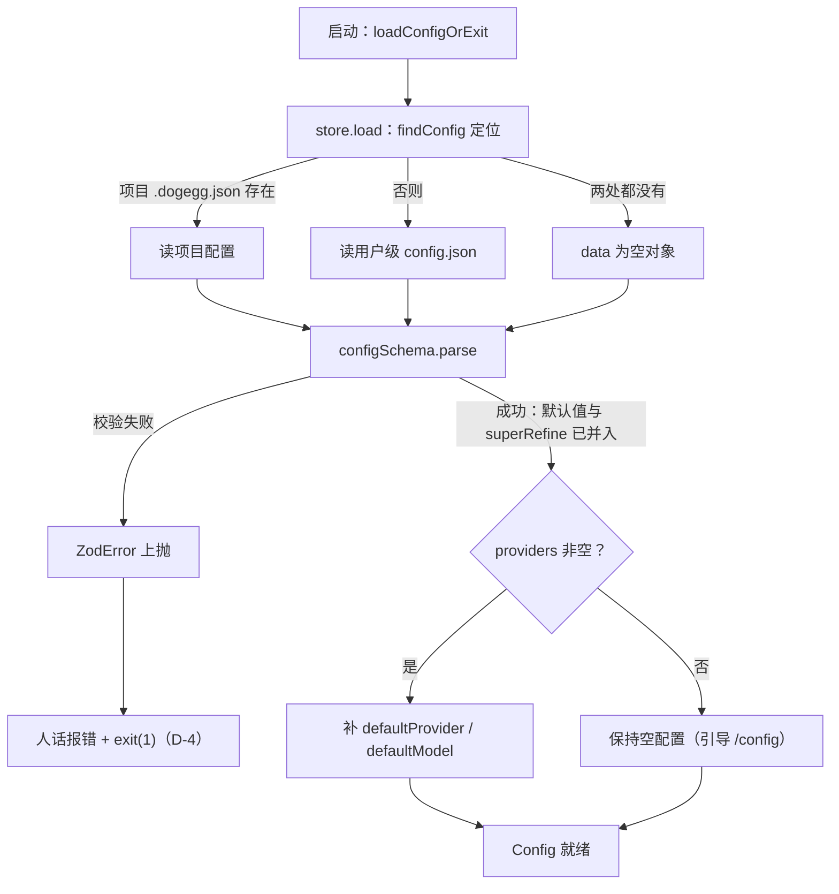
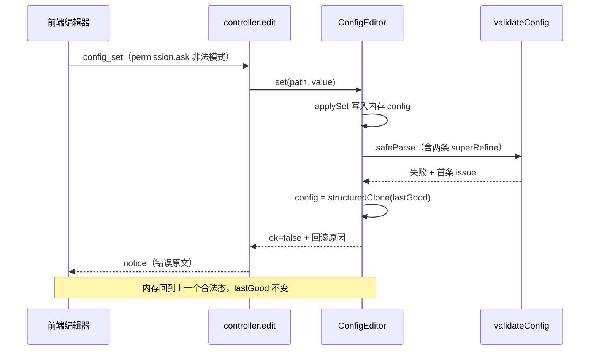
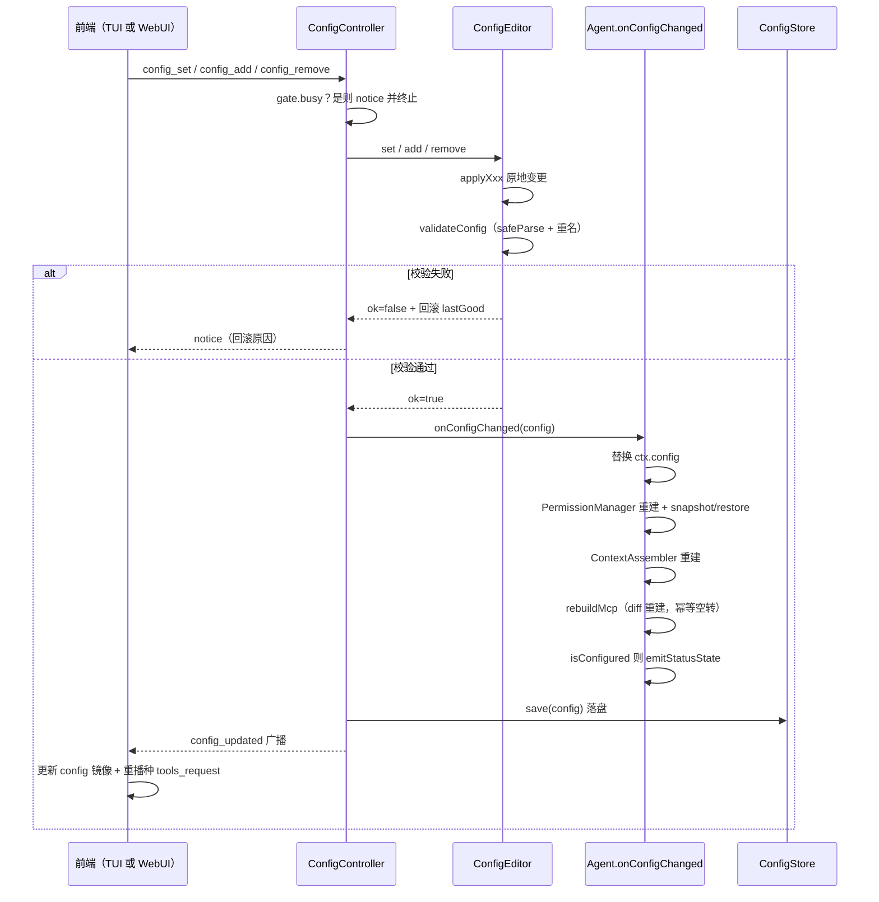

# 10 - 配置体系与编辑器

> 职责：一个 JSON 配置文件的生命周期——schema 立法（bridge）、加载与落盘（store.ts）、内存编辑与校验回滚（editor/）、消息驱动的控制器（controller.ts）。编辑流程（/config 与 WebUI 设置区）与运行时联动（权限/assembler/MCP 重建）都从这里出发。
>
> **交互图**：[配置体系：加载校验与热更新](./assets/config-pipeline.html)——加载校验链主链、两端编辑同 schema 校验与回滚支路、config_updated 热更新广播（对应 §3 加载/编辑/热更新设计项）。

## 1. 职责与边界

| 文件 | 职责 |
|---|---|
| `bridge/src/contract/config.ts` | configSchema 全字段 + 权限 v3 schema + 两条 superRefine + isConfigured |
| `agent/src/config/store.ts` | ConfigStore：定位策略、zod 加载、默认值填充、落盘 |
| `agent/src/config/resolve.ts` | resolveCurrent：从 config 解析当前 provider + model（未命中回落首个） |
| `agent/src/config/editor/paths.ts` | 点号路径 → 强类型操作解析（parseConfigSet/parseConfigAdd） |
| `agent/src/config/editor/mutate.ts` | applySet/applyAdd/applyRemove 原地变更 |
| `agent/src/config/editor/validate.ts` | zod safeParse + 重名检查 + 回滚快照 |
| `agent/src/config/editor/editor.ts` | ConfigEditor 门面：lastGood 快照持有者 |
| `agent/src/config/controller.ts` | ConfigController：config_* 消息实现归属 + edit 统一链路 |
| `agent/src/agent.ts` | onConfigChanged 运行时联动（:333-343） |
| `bin/dogegg.ts` | loadConfigOrExit 加载失败路径（:20-39） |
| `ui/src/tui/features/config/` | TUI 配置树：buildEntries 双端共用（build/entries/keys/navigation） |
| `ui/src/webui/components/settings/` | WebUI 设置五区（view/permissions/skills/mcp） |

依赖矩阵中 config 域只依赖 ROOT（architecture.test.ts:131）——schema 的权威在 bridge，agent 域只有读写与编辑。

## 2. 核心数据结构：configSchema 全字段（bridge/src/contract/config.ts:114-142）

| 字段 | 类型/默认 | 说明 |
|---|---|---|
| `systemPrompt` | string?, 可选 | 自定义系统提示词路径/文本（缺省内置，agent.ts:455 判断） |
| `defaultProvider` / `defaultModel` | string?, 可选 | 缺省时 store.load 补第一个（store.ts:44-49） |
| `maxIterations` | int, 默认 -1 | 对话最大轮次：**-1 = 无限**（靠取消/错误终止）；正整数 = 上限（无人值守批处理）；**0 非法**（config.ts:119 的 refine） |
| `maxRetries` | int≥0, 默认 3 | LLM 请求重试次数（《03》§3.4） |
| `shellProgram` | string?, 可选 | shell 解释器（缺省平台默认；非法值被 resolveShell 回退，《05》§3.4） |
| `permission` | permissionSchema, 默认出厂 | 三桶 v3 结构化（见下） |
| `mcpServers` | mcpServerSchema[], 默认 [] | 全局 MCP 服务列表（transport stdio/http 判别联合，:25-42） |
| `providers` | providerSchema[], 默认 [] | provider = { name, protocol:'openai', baseURL, apiKey, models[] }；model = { name, contextWindow=128000, maxOutput=16384, reasoning=false }（:7-20） |

**出厂默认权限**（config.ts:125-138）：读类工具（read_file/ls/glob/grep）整工具 allow；写类与 shell（write_file/edit_file/shell）整工具 ask——**仅对"配置文件未写 permission 字段"的加载生效**（schema default 语义）；用户显式配置的三桶整体覆盖不合并（:122-124 立法）。

**校验宽松/严格的分界**（config.ts:3-5 注释）：模型/提供商字段刻意放宽（name/baseURL/apiKey/models 允许暂空）——支持 /config 里"自由创建节点、逐字段填写"的编辑流程；能否真正对话由 `isConfigured()`（:169-175：存在完整 provider 且默认模型可解析）判定，而非 schema 强制非空。**权限模式严格**：两条 superRefine（作用域锚点 + 服务键前缀，见《06》§3.7）fail-closed。

## 3. 设计逐项详解

### 3.1 D-1 schema 单源立法与宽严分界

- **设计问题**：配置是 provider 密钥、轮次上限、权限三桶、MCP 服务的唯一事实源，被 agent 域与两个前端共同读写。约束：三端（引擎/TUI/WebUI）对同一字段不能有第二种解释；编辑流要求"先建空节点、逐字段填写"可走通，而安全字段（权限）不允许任何宽松形态流入引擎。
- **方案与取舍**：schema 全部住在 bridge/contract——bridge 不依赖任何兄弟包，agent 与 ui 都只能从它 import 类型与校验，天然单源。宽严分界立法写在字段注释里：模型/提供商字段放宽 + `isConfigured()` 做运行时完整性判定（而非 schema 强制非空）；`maxIterations` 用 refine 拒 0（0 会让"无限"与"立即终止"语义混淆）。备选是"编辑期逐字段强校验"——被否：自由创建流程会被空 apiKey 卡死，编辑体验换不来额外安全（安全由权限 schema 单独严格）。
- **代码走查**：

**`bridge/src/contract/config.ts:114-125`**

```ts
export const configSchema = z.object({
  systemPrompt: z.string().optional(),
  defaultProvider: z.string().optional(),
  defaultModel: z.string().optional(),
  // 对话最大轮次：-1 = 无限（默认，靠取消/错误终止）；正整数 = 上限（无人值守批处理用）。0 非法。
  maxIterations: z.number().int().refine((n) => n === -1 || n >= 1).default(-1),
  maxRetries: z.number().int().min(0).default(3),
  shellProgram: z.string().optional(),
  // 出厂默认权限（设计 §4.1）：读类工具放行（只读安全、探索顺畅的前提），写类/命令默认 ask。
  // 仅对「配置文件未写 permission 字段」的加载生效；用户显式配置的三桶不受影响。
  // v3 形态：whole = 整键生效。
  permission: permissionSchema.default({
```

前 4 行是放宽区：三个顶层标量全部 `optional()`，无 minLength、无格式断言——空值交给 `isConfigured()` 判定（:169-175），编辑流"自由创建节点"由此可行。119 行的 refine 精确圈定合法值域 `n === -1 || n >= 1`——0 被显式排除（"上限为 0"只会造成"永远无法开始对话"的配置陷阱）；122-124 行注释立法出厂默认的生效条件（仅补缺、不合并），125 行把默认值直接挂进 schema——**默认值是 schema 的一部分而非 load 时的手写补丁**，任何 `parse` 路径（含编辑器 afterEdit 的 safeParse）都得到一致的出厂形态。

### 3.2 D-2 权限 v3：两条 superRefine 的 fail-closed 加载期拒绝

- **设计问题**：权限规则写错有两种灾难形态——路径模式忘了锚点（`docs/**` 从盘根匹配必然失配，用户以为已放行/已限制）与服务键写裸名（`mcp:<名>` 前缀立法下静默失配）。两者的共同点：**不报错但永不生效**，是安全配置里最坏的失败方式。约束：错误必须在加载/编辑当下浮出，而非首次工具调用时。
- **方案与取舍**：v3 结构（桶 → 键 → `{ whole, patterns }`）+ 两条 superRefine。作用域前缀校验只对 `BUILTIN_PATH_TOOLS`（config.ts:72）的 patterns 生效——MCP 服务键的 patterns 是内部工具名选择器，无路径锚点语义（立法注释 :89-96）；服务键前缀校验是 configSchema 级的交叉校验，拿 `mcpServers` 名单对照 permission 桶键。备选"运行时首次匹配时告警"被否：告警会淹没在对话流里，且"看起来生效"比"明确报错"危险。
- **代码走查**：

**`bridge/src/contract/config.ts:143-162`**

```ts
  // 服务键前缀交叉校验（立法）：permission 桶键若与 mcpServers 里的服务名同名的裸键，
  // 在前缀化立法（mcp:<服务名>）下不再作为服务键生效——会静默失配，加载期直接拒绝并指明写法。
  // 仅校验全局 mcpServers 名单；项目级（.dogegg/.mcp.json）服务的裸键由调用方按需校验。
  .superRefine((cfg, ctx) => {
    // 服务键强制前缀立法：服务键必须写 mcp:<服务名>——裸服务名键在前缀化立法下不作为服务键
    // 生效（静默失配），加载期直接拒绝并指明写法。服务名零约束（前缀隔离保证与内建名无歧义）。
    const names = new Set(cfg.mcpServers.map((srv) => srv.name))
    if (names.size === 0) return
    for (const bucket of [cfg.permission.allow, cfg.permission.reject, cfg.permission.ask]) {
      for (const key of Object.keys(bucket)) {
        if (key.startsWith('mcp:')) continue
        if (names.has(key)) {
          ctx.addIssue({
            code: 'custom',
            message: `权限键 "${key}" 是 MCP 服务名——服务键必须写为 "mcp:${key}"（见 docs/config.md 的 MCP 服务键章节）`,
          })
        }
      }
    }
  })
```

149 行从同一份配置里取服务名单（不引入外部事实源）；150 行空名单早退（无 MCP 服务时裸键校验无意义）；153 行 `mcp:` 前缀键跳过——前缀键天然不在裸名空间；154 行命中即 `addIssue`，错误信息直接给出**正确写法**（`"mcp:${key}"`）——报错即修复指引，用户不需要查文档就能改对。155-158 行的 issue 走 zod 标准通道，因此加载期（loadConfigOrExit）与编辑期（validateConfig）两条链路自动共享同一拒绝行为。

### 3.3 D-3 定位与加载：项目优先、空配置可启动

- **设计问题**：配置文件可能有 0~2 个位置（项目 `.dogegg.json`、用户级 `~/.dogegg/config.json`），启动必须回答"读哪个、读不到怎么办"。约束：路径策略不能外泄为公共 API；全新用户（无任何文件）必须能直接进入 TUI 被引导到 /config，而不是被文件缺失挡在门外。
- **方案与取舍**：`findConfig` 模块私有（store.ts:6-7 注释立法"外部只经 ConfigStore 存取"），优先级=项目级 > 用户级——"在项目里配置的项目用，全局配置全局用"的空间语义。读不到文件返回 `{}` 而非报错：空配置经 zod parse 后 providers 为空、`isConfigured` 为 false，`submit` 被挡并提示"尚未配置 provider，请先 /config"（agent.ts:350）。备选"启动时自动创建默认文件"被否：会在用户目录里留下误导性文件，且空配置本身已经表达"未配置"。
- **代码走查**：

**`agent/src/config/store.ts:34-51`**

```ts
  load(raw?: unknown): Config {
    let data: unknown
    if (raw !== undefined) {
      data = raw
    } else {
      const file = findConfig()
      data = file ? JSON.parse(readFileSync(file, 'utf8')) : {}
    }
    const parsed = configSchema.parse(data)
    // 仅在存在 provider 时补默认 provider/model；空配置保持无默认值。
    if (parsed.providers.length > 0) {
      const defaultProvider = parsed.defaultProvider ?? parsed.providers[0]!.name
      const provider = parsed.providers.find((p) => p.name === defaultProvider) ?? parsed.providers[0]!
      const defaultModel = parsed.defaultModel ?? provider.models[0]?.name
      return { ...parsed, defaultProvider, defaultModel: defaultModel ?? parsed.defaultModel }
    }
    return parsed
  }
```

36-38 行是测试接缝：`raw` 注入绕过文件系统，使 store 可单测（与构造器 `defaultPath` 同一思路）。40 行三态合一：项目文件 / 用户文件 / 空对象，全部交给同一句 `configSchema.parse`——**不存在"手动构建默认配置"的旁路**，默认值永远由 schema 出。43-49 行的补默认逻辑只在 `providers.length > 0` 时执行（43 行注释是立法）：空配置保持无默认值——若给空配置也塞 defaultProvider，会产生"看起来配了其实没有 provider"的假象；47 行 model 回落链（defaultModel ?? 首个 model）与 46 行 provider 回落同构，且 defaultProvider 未命中清单时也回落首个（46 行 `??`）。

- **流程图**——配置加载校验链（读文件 → zod（默认值 + 两条 superRefine）→ 补默认 → 就绪）：



### 3.4 D-4 加载失败的人话出口（loadConfigOrExit）

- **设计问题**：旧格式配置（如 v1/v2 permission）加载必抛 ZodError——裸抛给用户的是堆栈。约束（bin/dogegg.ts:17-19 注释立法）：错误信息必须可执行——指明待修文件、逐字段原因（带配置内路径）、恢复方式、格式文档位置；且**不覆写文件**（损坏配置的原样保留是排障前提）。
- **方案与取舍**：在组合根（bin/dogegg.ts）catch 后拼四要素输出再 `exit(1)`，而非在 store 里报错——store 保持"纯加载"职责，报错形态属于 CLI 产品行为。文档路径用 `import.meta.dirname → cwd → 在线` 三候选 `existsSync` 取第一个真实存在的（:31-36）——"本地实际存在的路径优先，在线文档可能尚未发布"。
- **代码走查**：

**`bin/dogegg.ts:20-39`**

```ts
function loadConfigOrExit(): ReturnType<ConfigStore['load']> {
  const store = new ConfigStore()
  try {
    return store.load()
  } catch (err) {
    const source = store.sourcePath()
    const issues = err instanceof ZodError
      ? err.issues.map((i) => (i.path.length > 0 ? `${i.path.join('.')}：${i.message}` : i.message)).join('；')
      : String(err)
    console.error(`配置加载失败（文件：${source ?? '未找到'}）：${issues}`)
    console.error('恢复方式：把上述字段改写为当前格式 { "whole": boolean, "patterns": string[] }；或整段删除 "permission" 字段回退出厂默认，再经 /config 重新配置。')
    const doc = [
      join(import.meta.dirname, '../docs/versions/0.2/03-用户手册/01-配置指南.md'),
      join(process.cwd(), 'docs/versions/0.2/03-用户手册/01-配置指南.md'),
      join(process.cwd(), 'docs/config.md'),
    ].find((candidate: string) => existsSync(candidate))
    console.error(`配置格式说明：${doc ?? 'docs/versions/0.2/03-用户手册/01-配置指南.md（仓库内；在线版尚未发布）'}`)
    process.exit(1)
  }
}
```

25 行 `sourcePath()` 指明"该改哪个文件"（用户可能不知道项目级与用户级谁在生效）；26-27 行把 ZodError 的每条 issue 前缀为 `path.join('.')：message`——错误自带配置内坐标，可直接定位字段；29 行 `?? '未找到'` 兜底"文件在加载后又被删"的边缘态；31-36 行文档路径三候选按 `existsSync` 短路——`find` 返回第一个真实存在的路径（本地实际存在的优先，在线文档可能尚未发布）；38 行 exit(1) 且全程没有写文件动作。

对一个含旧格式 permission 的配置，输出形态（:29-36），四要素齐备——**待修文件**（sourcePath() 或"未找到"）、**逐字段原因**（path.join('.') 前缀）、**两条恢复方式**（改格式或删字段回出厂默认）、**文档路径**（本地实际存在的路径优先）：

```
配置加载失败（文件：/home/u/.dogegg/config.json）：permission：Invalid input
恢复方式：把上述字段改写为当前格式 { "whole": boolean, "patterns": string[] }；或整段删除 "permission" 字段回退出厂默认，再经 /config 重新配置。
配置格式说明：/usr/lib/node_modules/dogegg/docs/versions/0.2/03-用户手册/01-配置指南.md
```

### 3.5 D-5 点号路径文法：UI 编辑的强类型操作解析

- **设计问题**：UI 编辑不直接改 JSON，而是发 `config_set/config_add/config_remove` 上行消息。若后端按字符串路径手写 split 梯子，每个字段的校验逻辑散落且不可测。约束：非法路径必须可判（返回 null 而非猜）；值类型错误要在进入变更前归一（防手写消息塞错类型静默通过）。
- **方案与取舍**：`parseConfigSet` 把路径解析成 `ConfigSetOp` **判别联合**（paths.ts:30-34），"取代旧代码 applyConfigSet 里的手写 split 梯子"（:29 注释）。每分支三件事：段数/字段名白名单校验（非法 → null）、index 数字校验、值容错归一（asString/asNumber/asBoolean，:4-6——运行时类型检查替代 as 断言）。**permission 是整桶替换原语**（:59-62）：值 = 键 → `{whole, patterns}` 对象整体替换（asBucketRules 逐键过滤非字符串模式、形状非法键丢弃——fail-closed 防御手写消息，:10-22）；UI 重算整桶对象提交，天然原子，无需 item 级增删改消息。
- **代码走查**：

**`agent/src/config/editor/paths.ts:51-64`**

```ts
export function parseConfigSet(path: string, value: unknown): ConfigSetOp | null {
  const seg = path.split('.')

  // 单段顶层标量
  if (seg.length === 1 && isTopField(path)) {
    if (path === 'maxIterations' || path === 'maxRetries') return { kind: 'top', field: path, value: asNumber(value) }
    return { kind: 'top', field: path, value: asString(value) }
  }
  // permission.<bucket>：桶值 = 键 → { whole, patterns }（v3 结构化；整桶对象整体替换，编辑两端统一走此原语）。
  if (seg.length === 2 && seg[0] === 'permission') {
    const bucket = seg[1]!
    if (bucket === 'allow' || bucket === 'reject' || bucket === 'ask') return { kind: 'permission', bucket, value: asBucketRules(value) }
    return null
  }
```

52 行 split 一次、后续分支只看 `seg.length`——分支顺序即路径形状白名单；54-58 行顶层分支按字段名二分值类型（数字字段走 asNumber，其余 asString）；60-64 行 permission 分支只认三个桶名（63 行其余值返回 null——**未知桶名是显式拒绝而非静默忽略**）；62 行把值整个交给 `asBucketRules` 归一，形状非法的键在此被丢弃（:10-22），UI 层造出的坏值到不了 mutate。`applySet/applyAdd`（mutate.ts:5-39）越界 index **静默跳过**（:4 注释；19、25 两处 `if (!p) return`）——竞态删除后迟到的编辑不炸。`applyRemove`（mutate.ts:42-48）只允许 providers/models 两路径。

### 3.6 D-6 校验 + 回滚：内存配置永远合法

- **设计问题**：编辑操作直接改内存对象，一旦非法值流入：轻则 UI 显示坏状态，重则落盘后下次启动无法加载。约束：任何时刻 `editor.getConfig()` 返回的都必须是 zod 可接受的形状；失败要可恢复（回滚而非锁死）。
- **方案与取舍**：`ConfigEditor` 持有 `config` + `lastGood`（构造时 structuredClone，editor.ts:10-14），每次 set/add/remove 后走 `afterEdit` 统一重校验；失败回滚到 lastGood 并把首条 issue 文本返回给调用方 emit。备选"只在落盘前校验"被否——内存里的非法态会污染后续编辑的 diff 基准；"编辑器内自建校验规则"被否——校验规则二份必然与 bridge schema 漂移。
- **代码走查**：

**`agent/src/config/editor/editor.ts:46-56`**

```ts
  // 编辑后统一：重校验 + 重名检查；成功更新 lastGood，失败回滚到 lastGood。
  private afterEdit(): { ok: boolean; error?: string } {
    const result = validateConfig(this.config, this.lastGood)
    if (!result.ok) {
      this.config = structuredClone(result.config)
      return { ok: false, error: result.error }
    }
    this.config = result.config
    this.lastGood = structuredClone(this.config)
    return { ok: true }
  }
```

48 行 validateConfig（validate.ts:24-34）做两层：`configSchema.safeParse`（失败返回 `lastGood` + '配置校验失败，已回滚：' + 首条 issue，validate.ts:27——**两条 superRefine 在此同样生效**，编辑期造出的无锚点模式/裸服务键会被拒）；`findDuplicateName`（:4-20，仅非空名判重——**编辑期的新空节点允许多个共存**，:3 注释）发现重名同样回滚。49-51 行失败分支：`structuredClone(result.config)` 回滚——用克隆而非直接引用，切断 lastGood 与工作对象的别名关系；53-55 行成功分支：config 更新为 parse 后结果（**并入 zod 默认值**——编辑后的形状与从盘加载的形状同构），lastGood 同步为克隆快照。**不变量：非法值在编辑当下即被拒绝并回滚，落盘的永远是 parse 过的形状。**

- **流程图**——一次非法编辑的校验回滚（两端共用此链路，UI 侧 TUI 与 WebUI 等价）：



### 3.7 D-7 控制器统一链路：五步 edit

- **设计问题**：set/add/remove/replaceMcpServers 四个入口若各自实现"校验→落盘→广播→联动"，任何一处漏掉（比如忘 emit）都会让前端镜像与后端漂移。约束：编辑相关的一切副作用必须收敛到一个序列，且编辑运行中要阻塞（竞态写配置会与运行中的权限判定/assembler 组装交错）。
- **方案与取舍**：`edit(fn)` 是唯一入口，五步固定；`replaceMcpServers`（:35-37）是 /mcp 面板全局写入的整组替换原语——不走点号路径文法（数组结构由 zod 整体校验），但共用同一条链路（gate/校验/落盘/广播/联动，:33-34 注释）。**顺序有讲究**：onConfigChanged 在 save 之前（:48-49）——运行时先吃新配置，落盘失败时内存与广播已完成（见 §5 失败模式表）；config_updated 最后 emit（:50）——前端收到时后端必然已联动完成，前端无需再询问。
- **代码走查**：

**`agent/src/config/controller.ts:39-51`**

```ts
  // 配置编辑统一入口：委托 ConfigEditor，成功后同步运行时 + 落盘 + emit。
  private edit(fn: (e: ConfigEditor) => { ok: boolean; error?: string }): void {
    if (this.deps.ctx.gate.busy) { this.deps.emit({ type: 'notice', text: '运行中，请稍候' }); return }
    const result = fn(this.deps.editor)
    if (!result.ok) {
      this.deps.emit({ type: 'notice', text: result.error ?? '配置编辑失败' })
      return
    }
    const config = this.deps.editor.getConfig()
    this.deps.onConfigChanged(config)
    this.deps.configs.save(config)
    this.deps.emit({ type: 'config_updated', config })
  }
```

41 行 gate.busy 检查是**编辑运行中阻塞**的唯一实现点（INV-6）——四个入口自动继承；43-45 行失败短路径：notice 带回滚原因后直接 return，不落盘不广播（失败的编辑对系统零痕迹）；47-50 行成功链路严格有序：联动 → 落盘 → 广播。`config_updated` 是运行时联动的唯一信号（INV-9）——onConfigChanged 的重建与两端 UI 刷新都挂在这条消息上，无旁路写入口。

### 3.8 D-8 运行时联动：onConfigChanged 的三重建一推送

- **设计问题**：配置里的 permission/systemPrompt/mcpServers/provider 在内存里都以"构造时注入"的形态被持有（PermissionManager、ContextAssembler 皆为构造时快照）——改了 config 不等于运行时生效。约束：会话内已获得的授权（allow_always 提升）不能因重建丢失；MCP 重建要幂等（无变化不广播）。
- **方案与取舍**：整体替换 ctx 中可变的三个成员（agent.ts:331-332 注释立法），PermissionManager 用 snapshot/restore 对子保留提升；ContextAssembler 直接重建（组装函数闭包现取 skills/shell 引导，新 systemPrompt 路径即时生效）；MCP 走 `rebuildMcp()` 的串行 diff 重建链（agent.ts:203-209，"触发源多（启动/config_updated/set_cwd/面板 manage），链式排队防交错重入"）——无变化时幂等空转不广播（《07》§3.2）。provider/model 变更经 `emitStatusState` 即时推送状态栏，不等下一轮状态机变化（:341 注释）。
- **代码走查**：

**`agent/src/agent.ts:331-343`**

```ts
  // 配置编辑成功后的运行时联动：整体替换 ctx 中可变的三个成员。
  // PermissionManager 重建时保留运行时 allow_always 授权；ContextAssembler 重建使新 prompt 路径生效。
  private onConfigChanged(config: Config): void {
    this.ctx.config = config
    const saved = this.ctx.permission.snapshotPermissions()
    this.ctx.permission = new PermissionManager(config.permission, [this.skills.userDirPath()], () => this.registry.identities())
    this.ctx.permission.restore(saved)
    this.ctx.assembler = new ContextAssembler(config.systemPrompt, this.registry, () => this.skills.promptSection() + shellGuidance(resolveShell(config.shellProgram)))
    // mcpServers 可能随配置变化——diff 重建（无变化时幂等空转，不广播）。
    void this.rebuildMcp().catch(() => {})
    // provider/model 变更即时推送到状态栏与右侧面板——否则要等下一轮问答的状态机变化才刷新。
    if (isConfigured(this.ctx.config)) { this.emitStatusState() }
  }
```

335-337 行的 snapshot→new→restore 三步是**授权保留**的关键：新 PermissionManager 先以新配置三桶构造（配置的永久规则生效），再 restore 会话提升——两者叠加而非互斥；338 行 assembler 重建携带新 systemPrompt 与现算的 skills/shell 段闭包；340 行 `void` 触发不等待（异步链内部已串行化）；342 行 `isConfigured` 守卫——provider 未配好时不推送状态（推送半配置状态反而误导）。

- **流程图**——config_updated 热更新广播全链：



### 3.9 D-9 两端编辑同构：TUI buildEntries 与 WebUI 设置五区

- **设计问题**：同一棵配置树要在终端（键盘导航）与浏览器（表单控件）两套交互范式下呈现，且权限编辑语义（v3 三态：整选/按模式勾选/空选）必须逐字节一致——两端各写一套业务判断必然漂移。
- **方案与取舍**：TUI 侧 `buildEntries(config, path, treeCtx, tools)` 是纯函数，渲染层（ConfigOverlay）与按键层（handleConfigKeys）共用同一份 entries——app.tsx:308-309 算一次存进 `configEntriesRef`，按键层经 `deps.configEntries()` 复用（use-key-routing.ts:29-30："杜绝两处 buildEntries 漂移"）。`selectTool` 的 `afterRunPath` 实现"选择即钻入"（entries.ts:15-16 注释）——新增权限键后直接落到该键的细化层，免去 esc 退回再钻入的往返。WebUI 侧 PermissionsSection 的所有编辑 = **重算整桶对象 → config_set 桶路径**（permissions.tsx:6-7 注释立法），与 TUI 的整桶替换原语完全同构；工具清单都来自运行时事实（tools_request → tools_list），MCP 服务键组内对运行时工具清单勾选。
- **代码走查**（TUI 侧——selectTool 的服务键构造与 afterRunPath）：

**`ui/src/tui/features/config/build.ts:265-289`**

```ts
      // 候选 = MCP 服务逐个 + 内建工具逐个，加入即空数组（整键生效：服务 = 整组，工具 = 整工具）。
      // MCP 不再逐工具罗列——服务是一个权限单元（避免工具多时列表爆炸），逐工具细化在钻入视图勾选。
      // 服务清单 = 配置 mcpServers ⊕ 运行时身份（配置快照只含全局服务，项目级服务从运行时补齐）。
      // 排除已在当前桶中的键（避免重复添加）；同一键允许出现在多个桶（优先级语义的用途）。
      const bucket = config.permission[path.bucket]
      const entries: Entry[] = []

      const serverToolCount = new Map<string, number>()
      const serverNames = new Set<string>(config.mcpServers.map((s) => s.name))
      for (const t of tools ?? []) {
        if (t.identity.kind !== 'mcp') continue
        serverNames.add(t.identity.server)
        serverToolCount.set(t.identity.server, (serverToolCount.get(t.identity.server) ?? 0) + 1)
      }
      for (const name of serverNames) {
        const key = `mcp:${name}` // v3 立法：服务键必须带 mcp: 前缀（键空间与内建工具名正交）
        if (key in bucket) continue
        const n = serverToolCount.get(name)
        entries.push({
          label: `${name}（MCP 服务 · ${n === undefined ? '未运行' : `${n} 个工具`}）`,
          kind: 'action',
          value: '',
          run: () => ctx.set(`permission.${path.bucket}`, { ...bucket, [key]: { whole: true, patterns: [] } }),
          afterRunPath: { kind: 'permissionTool', bucket: path.bucket, tool: key }, // 选择即钻入细化层
        })
```

272-278 行服务清单 = 配置 mcpServers ⊕ 运行时身份（配置快照只含全局服务，项目级服务从运行时补齐——274 行注释）；280 行构造前缀键（v3 立法），281 行排除已在桶中的键（同一键可出现在多个桶——优先级语义的用途）；287 行 run 提交整桶对象（新增键 `whole: true` 起步）；288 行 afterRunPath 让按键层在 run 后直接钻入 `permissionTool` 细化层（keys.ts:38-39 的分支消费它）。

WebUI 侧同构：设置五区（settings/view.tsx:15-47）的 General/Models/Permissions 区全部走 config_set/config_add/config_remove；PermissionsSection（permissions.tsx:219-252）挂载即 tools_request 播种（:225-231，"registry 是活的，MCP 运行期注册的工具自动出现"），所有编辑 = **重算整桶对象 → config_set 桶路径**（:233-236 的 setBucket 是唯一出口——整桶替换天然原子 + 后端 validate/回滚兜底，permissions.tsx:6-7 注释立法）；Skills/MCP 区走 skills_manage/mcp_manage，编辑失败（zod 回滚/名称冲突/服务键裸名）以 notice 回流，channel 字段定位到对应 section 内联显示（skills.tsx:38、mcp.tsx:76 的 `msg.channel === 'skills'/'mcp'` 分支）。

## 4. 关键立法与不变量

- **INV-1 不兼容演进原则（ADR-0013）**：配置格式不做旧版兼容——schema 只接受当前版本；格式不符加载报错（人话 + 文档指引 + 退出）。**格式即版本**：无版本号字段、无迁移机器；格式演进 = 一次性人工迁移（错误信息给出迁移指引）。
- **INV-2 内存配置永远合法**：一切编辑过 zod safeParse，失败即回滚 lastGood。
- **INV-3 permission 整桶原子**：桶级替换原语，无部分更新状态。
- **INV-4 出厂默认只补缺**：permission default 仅在字段整体缺失时生效；显式配置整体覆盖。
- **INV-5 宽严分界**：编辑流字段放宽（isConfigured 判完整性）；安全相关严格（权限两条 superRefine、maxIterations 拒 0）。
- **INV-6 编辑运行中阻塞**：gate.busy 时 set/add/remove 一律 notice（controller.ts:41）。
- **INV-7 落盘路径策略**：save 目标 = 已存在的配置文件优先（项目 .dogegg.json 优先于用户级），都没有则落到 `~/.dogegg/config.json`（store.ts:16-19）——"在项目里配置的项目用，全局配置全局用"的空间语义自然成立。
- **INV-8 测试隔离警示**：ConfigStore 构造器的 defaultPath 是落盘测试接缝，"凡会触发配置保存的测试必须注入临时路径，否则会用测试数据覆写用户真实配置"（store.ts:23-25 的 ⚠️ 注释立法）。
- **INV-9 config_updated 是运行时联动的唯一信号**：编辑器成功必 emit（controller.ts:50）——onConfigChanged 的 permission/assembler/MCP 重建与两端 UI 刷新都挂在这一条消息上，无旁路写入口。

## 5. 失败模式与恢复

| 失败 | 行为 | 恢复 |
|---|---|---|
| 配置文件 JSON 损坏 | load 抛错 → loadConfigOrExit 人话报错 + exit(1)，不覆写 | 按提示修文件或删字段回默认 |
| zod 校验失败（含旧格式） | 同上；issue 带配置内路径 | "整段删除回退出厂默认，再经 /config 重配" |
| 编辑值非法（如 permission 模式无锚点） | afterEdit 回滚 lastGood + notice 显示首条 issue（validate.ts:27） | UI 修正后重提交；配置保持上一个合法态 |
| provider/model 重名 | 重名检查回滚（validate.ts:29-32）；空名节点不判重 | 改名保存 |
| 无效点号路径 | parse 返回 null → notice"无效的配置路径"（editor.ts:22） | UI 侧修正 |
| 越界 index 编辑 | applySet 静默跳过（mutate.ts:19, 25） | 无需恢复（竞态容忍） |
| 落盘失败 | save 抛错 → edit 链路外未捕获？——save 在 onConfigChanged 之后（controller.ts:49），异常被 agent.send 的 catch 吞（agent.ts:117） | 内存与广播已完成；下次编辑重写 |
| 测试覆写真实配置 | ConfigStore 构造注入 defaultPath 接缝（store.ts:23-25 警示注释） | 测试规范约束 |

## 6. 与其它子系统的接缝

- **→ 02 轮次**：TurnParams 每轮从 config 现解析（maxIterations/maxRetries/shellProgram/reasoning/windowTokens，agent.ts:318-329 resolveTurnParams）；resolveCurrent（resolve.ts:6-10）是 provider/model 解析的唯一入口。
- **→ 03 LLM**：provider 连接参数与 model 参数的唯一来源。
- **→ 06 权限**：permission 三桶 + 两条 superRefine（详见《06》§3.7）；onConfigChanged 的 snapshot/restore 保留提升。
- **→ 07 MCP**：mcpServers 字段 + replaceMcpServers 原语 + rebuild 联动；项目级 `.dogegg/.mcp.json` 与全局合并（agent.ts:196-198 mergeMcp）。
- **→ 11/12 前端**：config_state/config_updated 消息 + config_set/add/remove 消息是两端 /config 面板与设置区的全部通道（TUI features/config 的 buildEntries 与 WebUI settings/permissions 共用 v3 整桶替换原语，见《11》§3.6、《12》§3.6）。
