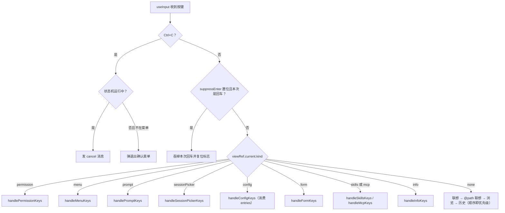
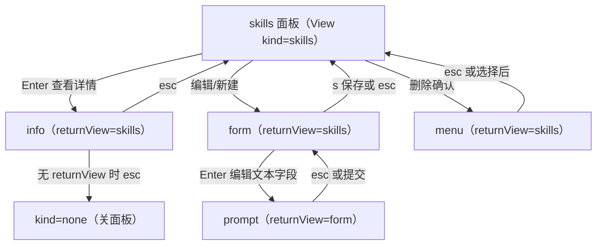
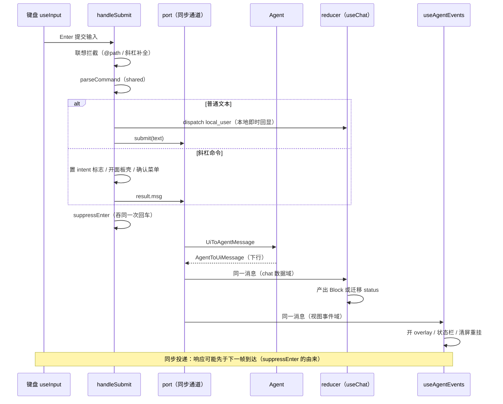
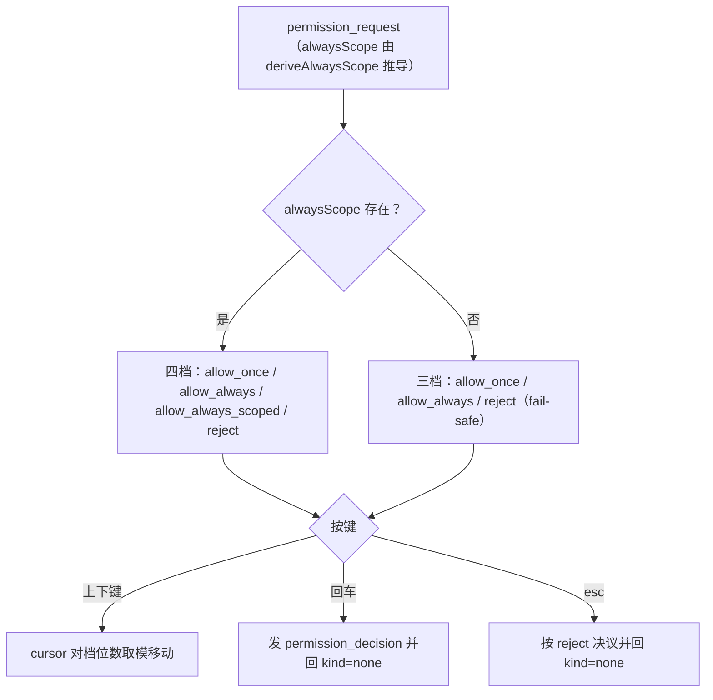

# 11 - TUI 架构

> 职责：终端界面（`ui/src/tui/`，Ink/React）——渲染分层（Static/动态）、视图态联合类型 + 按键分派构成的弹层体系、配置树编辑器、与 agent 的消息交互。它只 import `@dogegg/bridge`（消费 `channel.uiPort`），与 WebUI 零代码共享界面实现，共享逻辑全部下沉 `ui/src/shared/`。

## 1. 职责与边界

| 目录/文件 | 职责 |
|---|---|
| `ui/src/tui/app/app.tsx` | 装配层：chat 数据域 + 视图事件域 + 键盘路由 + 布局渲染 |
| `ui/src/tui/app/use-chat.ts` | chat 数据域：每条 agent 消息进 shared reducer |
| `ui/src/tui/app/use-agent-events.ts` | 视图事件域：消息 → overlay 开合/状态栏/清屏重挂 |
| `ui/src/tui/app/use-key-routing.ts` | 键盘路由：全局拦截 → 按 view.kind 分派 features/*/keys |
| `ui/src/tui/app/entry.tsx` | renderTui 入口：clearScreen 与 Ctrl+C 兜底计时 |
| `ui/src/tui/view-state.ts` | View 联合类型（弹层体系唯一状态）+ SkillEntry/McpServerEntry |
| `ui/src/tui/features/config/` | 配置树编辑器：buildEntries（TUI）/ navigation / keys / view（v3 权限语义经 shared/ 与 WebUI 同构） |
| `ui/src/tui/features/*/keys.ts` | 各弹层纯逻辑按键处理器（测试注入 spy api） |
| `ui/src/tui/components/` | TopBar / MessageBlock / StatusBar / MultilineInput / PendingTool 等 |
| `ui/src/tui/theme/` | palette（纯数据）+ registry（可变单例）+ token-map |
| `ui/src/tui/markdown/` | markdown → 带色文本（Static 渲染前一次性转换） |
| `ui/src/shared/` | 双前端共用：reducer/block/commands/permission/tool-display/status |

## 2. 核心数据结构

### 2.1 View 联合类型（view-state.ts:28-38，逐字段摘录见 §3.3 D-3）

十个 kind：`none`（无弹层）/ `permission`（id+tool+input+alwaysScope?+cursor）/ `menu`（title+items+cursor+returnView?）/ `sessionPicker`（sessions+cursor+query）/ `prompt`（title+value+onSubmit+returnPath?/returnCursor?/returnView?）/ `skills`（cursor+skills）/ `mcp`（cursor+servers）/ `config`（path+cursor+preview）/ `info`（title+lines+returnView?）/ `form`（title+fields+cursor+returnView+submitLabel+onSubmit）。

View 是 **UI 自己的视图态**，与后端状态机（State 十态）正交叠加（view-state.ts:4 注释）。两个立法注解直接写在类型上：`returnView`——面板内钻入的弹层 esc 回来源视图，不存在"一次 esc 丢整个面板层级"（:31, :37 注释）；`FormField`（:40-47）的 `options` 存在 = 固定选项字段（Enter 循环切换），否则文本字段（Enter 弹 prompt 编辑），`readonly` = 身份锁定行。

### 2.2 ChatState（shared/reducer.ts:7-15）

`blocks: Block[]`（已落盘块）+ `status: State` + `partial`（未落盘流式块）+ `toolActive`（最后 tool 块未收 tool_end——Static 模式不能固化打印）+ `pendingTool`（tool_pending → tool_start 之间的准备中提示）。reducer 的输入是 `AgentToUiMessage | { type:'local_user' }`（:13）——**后端消息与本地动作同池**。

## 3. 设计逐项详解

### 3.1 D-1 渲染分层：Static 不可变 + 动态区

- **设计问题**：终端 UI 的历史消息会无限增长，若全部交给 Ink 重绘，渲染成本随会话长度线性上涨，且"视口裁切估算行数永远不准"（entry.tsx:10 注释）。约束：历史查看不能受终端高度限制；已打印内容不可修改。
- **方案与取舍**：不用 alt-screen（ADR-0008），采用 Claude Code 式架构——已完成的消息块经 `<Static>` 打印一次即进终端原生滚动缓冲区，永不重绘；用户用终端原生滚动查看历史；Ink 只重绘底部动态区（未完成块+流式+输入+状态栏）。输入框固定底部、overlay 在其上叠加而非整屏替换——保留对话上下文的视觉连续性。代价是"改变已打印历史"只能整体清屏重挂（`clearScreenRemount`，app.tsx:86-88：clearScreen + staticKey 自增）。
- **代码走查**：

**`ui/src/tui/app/app.tsx:318-329`**

```ts
  // Static items：品牌头 + 已完成的块（toolActive 时最后一块未完成，留在动态区）。
  // 品牌头延迟打印：Static 只在首现时渲染一次——启动瞬间 config/status 还没回来，
  // 先打印会永远定格在「加载配置中…」/ 短横线；等两者就绪再打印即为准确信息。
  const headerReady = configSnapshot !== null && statusBarData.cwd !== undefined
  const stableCount = chat.toolActive && chat.blocks.length > 0 ? chat.blocks.length - 1 : chat.blocks.length
  const staticItems: StaticItem[] = [
    ...(headerReady ? [{ type: 'header' as const }] : []),
    ...chat.blocks.slice(0, stableCount).map((block) => ({ type: 'block' as const, block })),
  ]

  // 动态区：未完成的 tool 块（会再更新）+ 流式 partial。
  const activeBlocks = chat.toolActive ? chat.blocks.slice(stableCount) : []
```

321 行 `headerReady` 实现品牌头**延迟打印**：Static 只在 item 首次出现时渲染一次，启动瞬间 config/status 未回就打印会永远定格在"加载配置中…"，等 `configSnapshot` 与 `statusBarData.cwd` 双双就绪才把 header 项塞进数组；322 行 `stableCount` 是稳定/活跃分界——`toolActive` 时最后一块未完成留动态区（slice 少取一个），否则全部块进 Static；329 行动态区取的正是 stableCount 之后的残留块。块渲染前完成 markdown → 带色纯文本转换（app.tsx:337-345，Static 只渲染一次无性能问题；流式 partial 走 renderMarkdown 的第二入口 :356-360）。`staticKey` 是 Static 的重挂载 key——会话切换/清空/主题切换时清屏重绘（Static 已输出内容无法就地修改）。渲染区结构（app.tsx:331-474）：Static 区（:334-349）→ 动态区 Box（:352-458：activeBlocks + StreamingBlock + PendingTool + 联想列表 + 输入框 + 全部 overlay）→ StatusBar 恒在底部（:461-471）。components/ 各组件（TopBar/MessageBlock/StatusBar/MultilineInput/PendingTool/StreamingBlock/list-picker）与 markdown/render.ts 都是为这两区服务的无状态渲染件。

### 3.2 D-2 键盘路由：全局拦截 → suppressEnter → view.kind 分派

- **设计问题**：十种视图各有按键语义，且存在两类全局抢占（Ctrl+C、同步通道的回车重放）。约束：本文件只做分派不做判断（:57 注释）——判断逻辑下沉 features/*/keys.ts 的纯函数（测试注入 spy api 即可单测）；全局拦截优先级必须高于一切视图分派。
- **方案与取舍**：useInput 回调内三段式——① Ctrl+C 全局拦截（运行中发 cancel；空闲且不在菜单 → 弹退出确认菜单，与 /quit 一致，:68-84）；② suppressEnter 吞回车（:59-65, :85）；③ 按 `viewRef.current.kind` switch 分派（:86-141）。none 态分派顺序即优先级（:131-140）：联想（斜杠命令 + skill 命令同池）→ @path 联想 → 浏览（Ctrl+Up/Down 块间焦点）→ 历史（仅在非浏览模式）。ref 镜像是本域的前提：Ink 的 useInput 回调读 state 拿到的是**旧值**（闭包过期），凡按键层需要的状态（view/config/configEntries/status/cwd/blocks/suggestCursor/browseIdx/expanded/inputHistory/historyCursor）全部走 ref 镜像，每个 setter 都是"ref + setState 成对"（app.tsx:42、:83）——此教训写进了 deps 接口注释（use-key-routing.ts:23）。
- **代码走查**：

**`ui/src/tui/app/use-key-routing.ts:56-65`**

```ts
// 键盘路由的装配层：全局拦截（Ctrl+C / suppressEnter）→ 按 view.kind 分派给特征的 keys 处理器。
// 各特征的按键逻辑在 features/*/keys.ts（纯逻辑，测试注入 spy api）——本文件只做分派，不做判断。
export function useKeyRouting(deps: KeyRoutingDeps): { suppressEnter(): void } {
  const suppressEnterRef = useRef(false)
  // 吞掉紧随命令后的第一次回车：port 是同步通道，命令的响应可能立即设新 view，
  // 不吞的话同一个回车会被 useInput 在新 view 里再处理一次（误选中第一项）。
  const suppressEnter = useCallback(() => {
    suppressEnterRef.current = true
    queueMicrotask(() => { suppressEnterRef.current = false })
  }, [])
```

61 行注释是此机制的立法：port 是同步通道，命令的响应可能**在同一个事件循环内**设新 view，不吞的话同一次回车按键会先提交命令、再被 useInput 在新 view 里当"确认"处理一次（误选中第一项）；63-64 行实现是 ref 置位 + `queueMicrotask` 复位——只吞紧接着的一次回车，不影响后续正常输入。所有开 overlay 的命令统一在 post 前调 suppressEnter（app.tsx:297-300）。

- **流程图**——键盘事件路由（按键 → 全局拦截 → 按当前视图分派 features）：



### 3.3 D-3 视图态联合与 returnView 弹层链

- **设计问题**：设置类面板会层层钻入（skills → 表单 → 文本编辑 → 提示），若每层弹层各自维护"我是从哪来的"，esc 行为必然漂移；同一时刻必须至多一个 overlay，否则终端渲染无法表达。
- **方案与取舍**：单一 `View` 联合类型表达全部 overlay 的开合（stateDiagram 意义上的唯一状态源）；需要"返回"的弹层带 `returnView` 字段——esc 回来源视图而非关整个面板。表单视图（features/form/，view-state.ts:38）是钻入链的核心节点：一行一字段；Enter 编辑文本（弹 prompt，`returnView` 回表单——已填字段不丢）或循环选项；s 或保存行提交（onSubmit(values)；校验失败经 notice → info 带 returnView 回表单，use-key-routing.ts:107-113）；readonly 行锁定身份字段。skills/mcp 面板的编辑按钮构造 fields 并携带 returnView。
- **代码走查**：

**`ui/src/tui/view-state.ts:28-38`**

```ts
export type View =
  | { kind: 'none' }
  | { kind: 'permission'; id: string; tool: string; input: unknown; alwaysScope?: { pattern: string }; cursor: number }
  | { kind: 'menu'; title: string; items: { label: string; onSelect: () => void }[]; cursor: number; /** esc 返回来源视图（缺省关面板）——面板内确认菜单不再「一键退出设置」。 */ returnView?: View }
  | { kind: 'sessionPicker'; sessions: { id: string; preview: string; title?: string; updatedAt: string }[]; cursor: number; query: string }
  | { kind: 'prompt'; title: string; value: string; onSubmit: (v: string) => void; returnPath?: ConfigPath; returnCursor?: number; returnView?: View }
  | { kind: 'skills'; cursor: number; skills: SkillEntry[] }
  | { kind: 'mcp'; cursor: number; servers: McpServerEntry[] }
  | { kind: 'config'; path: ConfigPath; cursor: number; preview: boolean | null }
  | { kind: 'info'; title: string; lines: string[]; /** esc 返回来源视图（缺省关面板）——面板内钻入的详情不再「一键退出设置」。 */ returnView?: View } // /context /tools /status /system /log /help 的只读面板
  | { kind: 'form'; title: string; fields: FormField[]; cursor: number; returnView: View; submitLabel: string; onSubmit: (values: string[]) => void } // 多字段表单（/mcp、/skills 的新建/编辑）：一行一字段，Enter 编辑/切换
```

第 31、37 行的行内立法注释即 returnView 语义：menu 与 info 的 returnView 是**可选**的（顶层命令开的 menu/info esc 直接关面板），而 form 的 returnView 是**必填**（:38）——表单永远是从某个面板钻入的，不存在顶层表单。`prompt` 的 returnPath/returnCursor（:33）是配置树专用：标量编辑完成后回原层原 cursor。info 是六个信息类命令（/context /tools /status /system /log /help）共用的只读壳（独立翻页状态 infoScroll，app.tsx:43），notice 提示也复用它（带 returnView 回来源面板）；sessionPicker 的 query 输入即过滤（features/sessions/filter.ts），d 键删除会话。
- **流程图**——视图状态与 returnView 弹层链（以 skills 面板为例，esc 永远回上一级而非退出设置）：



### 3.4 D-4 双域订阅：reducer 管数据、use-agent-events 管视图效应

- **设计问题**：同一条下行消息既要进聊天数据（Block 流），又要触发视图效应（开弹层/清屏/状态栏）。若一个订阅全包，数据逻辑与 UI 副作用耦合，两者都无法独立测试。约束：订阅只建立一次——重复建立会反复重发 config_request/status_request（use-agent-events.ts:46 注释立法）。
- **方案与取舍**：`useChat`（use-chat.ts:9-16）每条消息 dispatch 进 reducer——**数据域**；`useAgentEvents` 同一 port 的第二个订阅（多订阅合法，InMemoryChannel 用 Set 存监听器）只做视图侧效应。deps 经 ref 读取（:48-49）使订阅 effect 只依赖 `deps.port`。intent 标志区分显式请求与后台播种（app.tsx:49-52）：`explicitInfoRef`（/context /status 等显式命令才开 info overlay，2s 轮询静默）、`toolsIntentRef`（/tools 独立标志——tools_list 有挂载/config_updated 的后台播种，共享标志会被误消费："编辑配置后立刻 /context，播种响应先到会抢开工具面板"，app.tsx:281-282 注释）、`configIntent`（/model vs /config 决定 config_state 打开哪个选择器）。
- **代码走查**：

**`ui/src/tui/app/use-agent-events.ts:53-68`**

```ts
  useEffect(() => {
    const off = deps.port.onMessage((msg: AgentToUiMessage) => {
      const d = ref.current
      // 会话切换/清空：清屏 + Static 重挂载（Static 已输出的内容无法撤回）。
      if (msg.type === 'session_ready' || msg.type === 'history_cleared') {
        d.clearScreenRemount()
        d.onSessionCleared()
      }
      if (msg.type === 'session_ready') {
        // 新建/切换会话：标题清零并重拉列表回填——resume 恢复的标题由此回来，全新会话保持无名。
        sessionIdRef.current = msg.id
        d.setStatusBarData((prev) => ({ ...prev, title: undefined }))
        d.port.post({ type: 'list_sessions' })
      }
      // 错误恢复：error 时自动预填上次提交的文本到输入框，用户可直接改或重新提交。
      if (msg.type === 'error') d.onErrorRetry()
```

57-60 行是 INV-1 的视图侧实现：session_ready/history_cleared → 清屏重挂 + 复位散落 UI 态（onSessionCleared 统一复位联想光标/浏览焦点/展开集合，app.tsx:104-109——散落各处的复位点收敛为一个回调，防漏）；61-66 行 session_ready 顺带重拉会话列表，resume 恢复的标题经 session_list 响应回填状态栏。其余分支：permission_request 开权限弹层（:69-70）；state 离开 waiting_permission 时若 permission overlay 还开着则关（:71-73，权限请求中取消的收敛）；session_list 只刷新"已打开的"选择器并按 cwd 归一化过滤（:80-86，路径统一小写+正斜杠兼容 Windows——"每次改名都蹦出列表"的回归被注释立法拦住）；config_updated 更新镜像后重播种 tools_request（:94-97）；tools_list 一律更新镜像但仅显式 /tools 打开面板（:98-109）；permissions_list 渲染可撤销的提升菜单（:168-188，内层菜单 esc 回顶层——returnView 链的运行时构造）。

### 3.5 D-5 命令提交流程：联想拦截 → parseCommand → intent → 面板壳

- **设计问题**：提交路径要同时处理普通文本、斜杠命令、skill 调用、联想补全四类输入，且命令的响应（config_state/session_list/skills_list）到达时要打开正确的视图——但"响应到达时该开什么"只有提交时刻知道。
- **方案与取舍**：handleSubmit（app.tsx:217-304）四步：① @path 联想拦截（末尾有 @token 且选中候选 → 回车替换为补全路径而非提交，Esc 关闭后不拦截，:219-225）；② 斜杠联想拦截（:227-231）；③ `parseCommand(raw, skillsList 名单)`（:233，shared 层解析：user 文本 → dispatch local_user + port.submit；help → info overlay；clear/quit → 确认菜单（不可逆操作，:256-274）；skill 命令与内置命令同池——用户无需记忆"哪个命令是哪来的"）；④ 统一 suppressEnter（:300）后 post 消息。intent 标志在提交时刻置位、响应时刻消费并清零——"提交时的意图"以一次性标志传递而非全局模式。
- **代码走查**：

**`ui/src/tui/app/app.tsx:275-296`**

```ts
      // 命令消息：/model /config 需要 intent 标记（后端回 config_state 时据此打开对应 overlay）。
      if (result.msg.type === 'config_request') {
        const cmd = raw.trim().split(/\s+/)[0]
        configIntent.current = cmd === '/model' ? 'model' : 'config'
      }
      // 显式信息请求标记：/context /status /system /log 会回 info overlay。
      // /tools 不共用此标志——tools_list 有后台播种（挂载/config_updated），共享会误消费
      // （编辑配置后立刻 /context，播种响应先到会抢开工具面板）。
      if (['context_request', 'status_request', 'system_request', 'log_request'].includes(result.msg.type)) {
        explicitInfoRef.current = true
      }
      if (result.msg.type === 'tools_request') {
        toolsIntentRef.current = true
      }
      // /session：先开空壳选择器，session_list 响应到达后填充（选择器已开才会被刷新——
      // 重命名/自动标题等后端推送不再承担弹层职责，见 use-agent-events）。
      if (result.msg.type === 'list_sessions') {
        setView({ kind: 'sessionPicker', sessions: [], cursor: 0, query: '' })
      }
      // /skills /mcp：先开面板壳，响应到达后填充（复用同一「响应只刷新已开面板」语义）。
      if (result.msg.type === 'skills_request') setView({ kind: 'skills', cursor: 0, skills: skillsList })
      if (result.msg.type === 'mcp_request') setView({ kind: 'mcp', cursor: 0, servers: mcpList })
```

276-279 行 /model 与 /config 发同一条 config_request，靠 `configIntent` 区分落点（响应侧 use-agent-events.ts:90-93 消费后清零）；280-288 行两类信息 intent 独立置位（tools 单列的原因写在注释里）；289-296 行"先开空壳、响应填充"模式——响应只刷新已打开的面板（use-agent-events 的 sessionPicker/skills/mcp 分支都有 `kind !==` 守卫），后端主动推送不再承担弹层职责。运行中每 2s 轮询 context_request（app.tsx:209-214，idle/finished/cancelled/error 态自动停止）驱动 StatusBar 的 tokens/windowTokens。
- **流程图**——一次用户提交到渲染的全链路（同步通道）：



### 3.6 D-6 配置树：entries 同源、按键层零业务判断

- **设计问题**：配置树十余层钻取（ConfigPath 14 种 kind，navigation.ts:2-16；`parentPath` :19-32 返回父层，esc 沿链逐级回退），若渲染层与按键层各自计算"这一层有什么条目"，两份清单必然漂移。
- **方案与取舍**：`Entry` 联合类型（entries.ts:4-17）描述每层条目的交互形态——`scalar`（回车 → 输入带当前值，可带 del）/ `prompt`（新增输入）/ `bool`（←→ 切换）/ `goto`（回车钻入子路径）/ `action`（执行回调，可带 `afterRunPath` 执行后直接钻入——"选择即钻入"免去 esc 退回再钻入的往返，:15-16 注释）。`buildEntries(config, path, treeCtx, tools)`（build.ts:11）是纯函数；渲染层（ConfigOverlay）与按键层共用同一份 entries——app.tsx:308-309 算一次存进 `configEntriesRef`，按键层经 `deps.configEntries()` 复用（use-key-routing.ts:29-30："杜绝两处 buildEntries 漂移"）。`TreeCtx`（entries.ts:20-27）把变更翻译成 config_set/add/remove 消息（app.tsx:122-128）+ openSkills/openMcp 面板入口——配置树对 skills/MCP 管理是跳转而非重复实现。权限桶编辑（build.ts 的 permissionBucket/permissionTool 分支）直接消费 v3 结构化形态：整键开关行（whole 显式字段，"空选可表达——开关恒可用、状态恒与引擎一致"）、MCP 服务键用运行时工具清单（tools 参数，身份过滤）做勾选式细化。**双端关系的事实边界**：buildEntries 是 TUI 专属；与 WebUI settings/permissions 共享的是 v3 整桶替换消息原语与 shared/ 层（KNOWN_TOOLS、describeBucketTool）——WebUI 是同构实现而非调用同一函数。
- **代码走查**：

**`ui/src/tui/features/config/keys.ts:44-55`**

```ts
  } else if (key.escape) {
    const parent = parentPath(v.path)
    if (parent) api.setView({ kind: 'config', path: parent, cursor: 0, preview: null })
    else api.setView({ kind: 'none' })
  } else if (inputChar === 'd' && entry) {
    // d 键删除：执行 del 后留在同页，clamp cursor 防越界（删最后一项时 cursor 回退）。
    // scalar 带 del 用于模式列表（permissionTool 的模式行）——回车编辑、d 删该条。
    if ((entry.kind === 'goto' || entry.kind === 'action' || entry.kind === 'scalar') && entry.del) {
      entry.del()
      api.setView({ ...v, cursor: Math.min(v.cursor, Math.max(0, entries.length - 2)), preview: null })
    }
  }
```

45-47 行 esc 的两级语义全由 `parentPath` 决定——根层返回 null 则关编辑器（`kind: 'none'`），其余沿链回退；50-54 行 d 键删除后 clamp cursor（`Math.min(v.cursor, entries.length - 2)`）防越界。按键层的一切行为都来自 entry 自身字段（run/del/afterRunPath/subPath/save）——"这一层有什么、行为是什么"全在 buildEntries 的纯函数世界里（回车分派见 keys.ts:27-43：goto 钻入 / scalar/prompt 开 prompt 弹层 / bool 用 preview / action 按 afterRunPath→del→原地三档导航）。

### 3.7 D-7 审批四档：安全链路的最后一跳

- **设计问题**：权限弹层是 agent 执行工具前的最后人工关口。约束：档位集合必须与 agent 下发的 `alwaysScope` 精确联动（推导不出范围模式时不能显示第四档）；esc 必须有安全侧语义（拒绝而非放行）；决议消息的形状要被回归测试锁定。
- **方案与取舍**：决策项由 `decisionItems(alwaysScopePattern?)` 纯函数组装（decisions.ts:4-5 注释："点它即接受该模式为会话内范围规则；缺失时维持三档（fail-safe）。措辞在本文件组装，契约只携带模式数据"）；↑↓ 移动 cursor（四档 = allow_once / allow_always / allow_always_scoped（仅 alwaysScope 存在时渲染）/ reject），回车把 `permission_decision{id, decision}` 经注入的 `post` api 发出并 setView 回 none（keys.ts:13-19），esc 视为 reject。api 注入模式让该处理器可注入 spy 后单测（决议消息的形状回归被锁定）。
- **代码走查**：

**`ui/src/tui/features/permission/decisions.ts:11-21`**

```ts
export function decisionItems(alwaysScopePattern?: string): DecisionItem[] {
  const items: DecisionItem[] = [
    { decision: 'allow_once', label: '允许一次' },
    { decision: 'allow_always', label: '始终允许（本次会话）' },
  ]
  if (alwaysScopePattern) {
    items.push({ decision: 'allow_always_scoped', label: `对此范围不再询问（${alwaysScopePattern}）` })
  }
  items.push({ decision: 'reject', label: '拒绝' })
  return items
}
```

12-15 行先构造恒有的两档；16-18 行条件插入 scoped 档——模式字符串由 agent 的 `deriveAlwaysScope` 推导并随 permission_request 下发（agent.ts:298-306），UI 不自行推导（契约只携带数据）；19 行 reject 恒在末位。cursor 对 items 取模（keys.ts:15-16），因此档位数变化不影响导航逻辑。
- **流程图**——审批档位决议：



### 3.8 D-8 主题体系：纯数据 palette + 注册表单例 + Proxy 兼容

- **设计问题**：主题色被组件与纯函数（markdown 渲染）大量读取，而"当前主题"是可变状态——直接模块级 let 单例不可测且隐藏依赖。
- **方案与取舍**：三层拆分——palette.ts 是**纯数据**（palette.ts:1-7 注释立法；每套主题一个 12 token 调色板：surface/surfaceAlt/border/faint + text/subtext + accent/green/yellow/cyan/red/purple 五色状态系统，可变状态不在此文件）；registry.ts 的 `ThemeRegistry` 是**唯一可变持有者**（显式类实例，"替代旧模块级 let 单例"），set() 时通知 onChange 监听者——App 订阅它做清屏重挂（app.tsx:88），ThemeProvider 订阅它做 React 重渲染；`palette` Proxy 兼容层让组件与纯函数继续 `palette.x` 取色——可变状态收归注册表而组件零改动（token-map.ts 负责 Block 语义 token → palette 色的映射）。/config 树的 selectTheme 层列出 `themeRegistry.list()`，切换即触发上述两路刷新。
- **代码走查**：

**`ui/src/tui/theme/registry.ts:40-46`**

```ts
// 兼容读取层：组件与纯函数（markdown 渲染）继续以 `palette.x` 取色，
// 读取时透传到 themeRegistry——可变状态已收归注册表，组件零改动。
export const palette: Palette = new Proxy({} as Palette, {
  get(_target, prop: string) {
    return themeRegistry.palette[prop as keyof Palette]
  },
})
```

42 行 Proxy 的 get 每次都透传到 `themeRegistry.palette`——不存在缓存的旧调色板，主题切换后下一帧取到的就是新色；正因读取是动态的，切换才必须配合 clearScreenRemount（Static 区已打印的色码无法回收）。entry.tsx（app/entry.tsx:25-47）的 renderTui 是 Ink render 入口（bin/dogegg.ts:67 调用）：启动清屏、`exitOnCtrlC: false`（Ctrl+C 流到 useInput 由 App 处理）、SIGINT 兜底（1.5 秒内两次 Ctrl+C 强制退出，resetSigintTimer 由键盘路由调用清除兜底窗口）、exit 时恢复 raw mode。

## 4. 关键立法与不变量

- **INV-1 Static 不可变**：进 Static 的块永不重绘；一切"改变历史"的操作（会话切换/清空/折叠切换/主题切换）= 清屏 + staticKey 重挂。
- **INV-2 弹层唯一状态源**：所有 overlay 的开合由 View 联合类型表达；同一时刻至多一个 overlay。
- **INV-3 returnView 层级保持**：面板内钻入的弹层 esc 回来源视图。
- **INV-4 按键逻辑纯函数化**：features/*/keys 不持有状态、不直接订阅；api 注入。
- **INV-5 双域正交**：reducer 管数据、use-agent-events 管视图效应，两个订阅互不越界。
- **INV-6 intent 标志隔离**：显式请求与后台播种的响应互不误消费。
- **INV-7 use-agent-events 订阅单次建立**：deps 经 ref 读取（use-agent-events.ts:46-49）——重复建立订阅会反复重发 config_request/status_request，这是 hook 依赖数组立法的由来。
- **INV-8 配置树视图/按键同源**：entries 由渲染层 buildEntries 计算一次、经 configEntriesRef 供按键层复用（app.tsx:308-309）——任何层级行为改动只改 build.ts 一处。
- **INV-9 退出必须确认**：/quit 与空闲 Ctrl+C 都弹确认菜单（app.tsx:266-274、use-key-routing.ts:75-82）——不可逆操作零直达。

## 5. 失败模式与恢复

- **闭包过期读到旧 state**：ref 镜像立法（§3.2）系统性消除；新增按键层状态必须成对建 ref。
- **同步通道回车误击**：suppressEnter 机制（§3.2）；漏标 suppressEnter 的 overlay 打开路径会产生"回车误选第一项"——所有开 overlay 的命令统一吞回车（app.tsx:297-300）。
- **Static 内容定格错误**：品牌头延迟到数据就绪才打印（app.tsx:320-321）；主题切换走 clearScreenRemount 重绘。
- **权限请求中取消**：use-agent-events 监听 state 迁移——离开 waiting_permission 时 permission overlay 自动关闭（use-agent-events.ts:71-73）。
- **后台播种误开面板**：intent 标志（§3.4）；选择器未开时 session_list 推送被忽略（"每次改名都蹦出列表"的回归被注释立法拦住）。
- **联想光标残留**：输入变化即复位 suggestCursor（app.tsx:79-81）——残留选中会让下次回车误补全而非提交。
- **编辑器交互破坏 raw mode**：openInEditor 暂停 raw mode → spawnSync 阻塞 → finally 恢复 + 清屏重挂 + 重拉清单（app.tsx:90-102）。
- **流式输出期间状态栏 token 过期**：运行中每 2s 轮询 context_request（app.tsx:209-214，idle/finished/cancelled/error 态自动停止）——StatusBar 的 tokens/windowTokens 实时跟随。
- **会话切换后的残留 UI 态**：onSessionCleared 统一复位（联想光标/浏览焦点/展开集合，app.tsx:104-109）——散落各处的复位点收敛为一个回调，防漏。

## 6. 与其它子系统的接缝

- **→ 01 契约/通道**：消费 `channel.uiPort`（bin/dogegg.ts:67 传入）；同步投递语义被 suppressEnter 与 intent 机制依赖。
- **→ 12 WebUI**：shared/ 层（reducer/commands/permission/tool-display）双端共用；权限树的 v3 语义与整桶替换原语双端一致（buildEntries 为 TUI 专属，WebUI settings/permissions 为同构实现）；管理操作发同一套消息。
- **→ 10 配置**：config_set/add/remove + config_state/config_updated 全链路；buildEntries 的权限树直接镜像 v3 形态。
- **→ 06 权限**：permission overlay 渲染四档决议（含 alwaysScope 第四档）；decisions.ts 翻译按键 → permission_decision 消息。
- **→ 08 skills / 07 MCP**：/skills 与 /mcp 面板 + form 表单 CRUD；skills 面板"改"走系统 $EDITOR（openInEditor）或 update 消息。
- **→ 05 工具展示**：MessageBlock 渲染 Block 时按 kind 分派展示（user 横幅 / thinking 折叠 / tool 卡片含 diff）——tool 卡片的标题与正文解析来自 shared/tool-display 的"回执即契约"实现，与《05》INV-5 的格式立法闭环。
- **← entry.tsx**：`clearScreen`（ANSI 清屏序列）与 `resetSigintTimer` 是 app 层两个全局副作用的家——从 app.tsx 分离使它们的调用点（清屏重挂、Ctrl+C 计时）在模块边界可见。
- **← use-chat.ts**：chat 域是唯一把 reducer 全量喂消息的订阅——view-state 的弹层开合不在 reducer 里（那是 use-agent-events 的职责），保证"数据状态"与"界面状态"各自可独立测试与复述。
