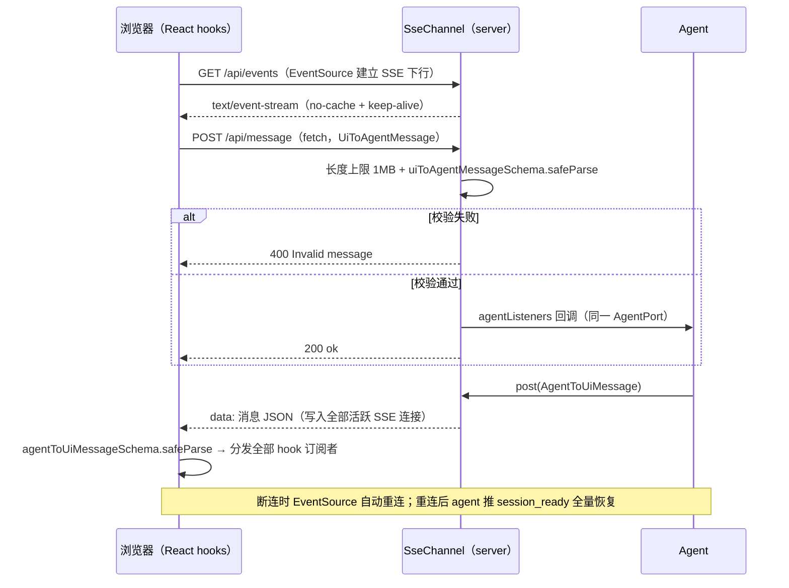
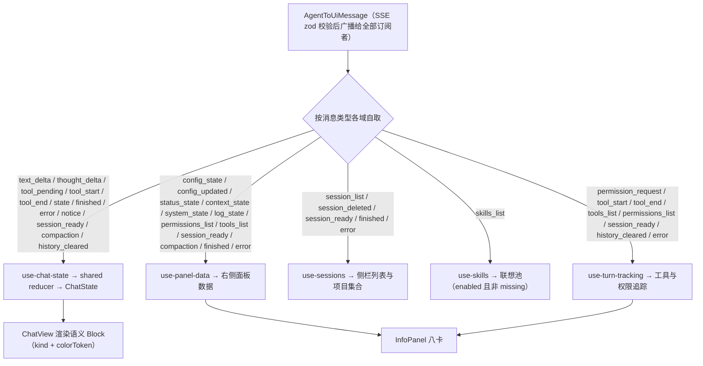
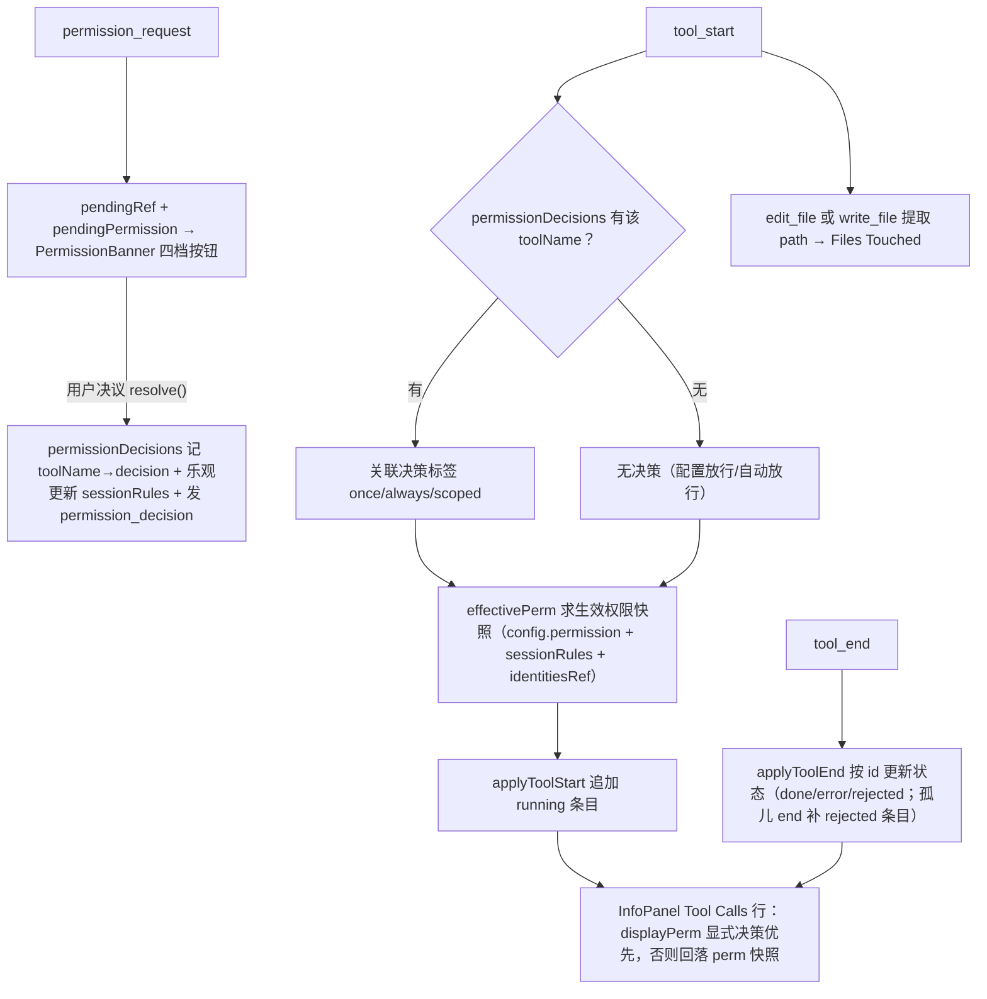

# 12 - WebUI 架构

> 职责：浏览器界面（`ui/src/webui/`，React + Vite + CSS Modules）——SSE 通道封装、六数据域 hook、装配层三栏布局、设置五区与信息面板八卡。它只 import `@dogegg/bridge`（webui 不依赖 agent/server，由 architecture.test.ts:47-51 断言），前端构建产物被 `@dogegg/server` 静态托管。

## 1. 职责与边界

| 目录/文件 | 职责 |
|---|---|
| `ui/src/webui/main.tsx` | 入口：createSseUiPort + Root（连接状态回调）+ 全局 ErrorBoundary |
| `ui/src/webui/channel/sse-client.ts` | SSE UiPort：EventSource 下行 + fetch POST 上行 + zod 校验 + 连接状态 |
| `ui/src/webui/app/app.tsx` | 装配层：特征装配 + 三栏布局 + 模态层 + safePost |
| `ui/src/webui/features/chat/use-chat-state.ts` | chat 数据域（shared reducer 的 WebUI 消费） |
| `ui/src/webui/features/sessions/use-sessions.ts` | 会话列表 + 已知项目集合 |
| `ui/src/webui/features/skills/use-skills.ts` | 技能联想池（过滤停用/缺失） |
| `ui/src/webui/features/info-panel/use-panel-data.ts` | 面板数据域（config/status/context/system/log/permissions/tools） |
| `ui/src/webui/features/turn-tracking/use-turn-tracking.ts` | 工具调用生命周期 + 权限决策关联 + 身份镜像 |
| `ui/src/webui/features/chrome/use-ui-chrome.ts` | 界面外壳：modal 总管/toast/折叠/主题/Cmd+K |
| `ui/src/webui/components/` | chat-view / input-bar / info-panel / settings / sidebar / 弹框族 / primitives |
| `ui/src/webui/view-state.ts` | Modal 联合类型 + 主题 + COMMAND_TO_MODAL + SessionItem/FileTouched |
| `ui/src/shared/` | 双前端共用平台无关逻辑（见 §6） |

## 2. 核心数据结构

### 2.1 SSE 客户端与 UiPort（sse-client.ts:11-68）

`createSseUiPort(onConnectionChange?)` 返回标准 `UiPort`：

- **下行**：`new EventSource('/api/events')`（:22）→ onmessage 里 `JSON.parse` → **`agentToUiMessageSchema.safeParse` 校验，失败则丢弃不传 listener**（:32-36，与 server 端上行校验对称的双向防线）；onerror 按 `es.readyState` 区分 `reconnecting`（浏览器自动重连中）与 `disconnected`（CLOSED，:42-50）；
- **上行**：`fetch POST /api/message`，body 为 JSON.stringify(msg)；非 2xx 抛错（:57-66）；
- **连接状态机**：`'connected' | 'reconnecting' | 'disconnected'`（:4），经回调通知 UI（顶栏指示器 + 首次断连 toast，:9-10 注释）。**恢复语义立法**：EventSource 断开浏览器自动重连，重连后 server 侧 agent 推 `session_ready` 恢复完整状态（:9 注释）——UI 无需自建快照协议。

### 2.2 Modal 联合类型（view-state.ts:12-20）

主区域永远是聊天，面板切换通过 modal 叠加（view-state.ts:1-2）：`none / settings{section?} / command-palette / confirm / fs-browser / prompt / help`。`COMMAND_TO_MODAL`（:25-31）只映射打开 modal 的命令（/config /model /skills /mcp /help）；信息类命令（/context /status 等）不打开 modal，而是展开右侧面板 + 高亮（:23-24 注释）。

## 3. 设计逐项详解

### 3.1 D-1 SSE 双通道与双向 zod 防线

- **设计问题**：浏览器与 agent 之间需要全双工消息通道，但 agent 只有 `AgentPort` 一个进出接口。约束：UI→agent 方向是公网可达的 POST 端点，必须防恶意 payload；agent→UI 方向的坏消息不能让任何 hook 崩溃；断连后状态必须能无协议地恢复。
- **方案与取舍**：`SseChannel` 实现 `AgentPort`（"本身就是 AgentPort——agent 与 HTTP 路由共享同一实例"，main-web.ts:24 注释）——下行 SSE 广播 + 上行 POST 回调；浏览器侧 `createSseUiPort` 把 EventSource + fetch 封装回标准 `UiPort`，于是六个 hook 的订阅代码与 TUI 完全同构。双向都过 zod：上行在 server 端校验（400 拒绝），下行在浏览器端校验（静默丢弃）——schema 是同一份 bridge 契约。恢复语义立法（sse-client.ts:9）：EventSource 断开浏览器自动重连，重连后 agent 推 session_ready 全量恢复——UI 无需自建快照协议。上行错误用 safePost 兜住（webui app.tsx:34-45）：port.post 的 Promise 结果捕获，用户操作失败 toast 提示——WebUI 上行是异步 fetch（与 TUI 同步通道不同），错误必须显式兜住。
- **代码走查**（浏览器侧下行防线）：

**`ui/src/webui/channel/sse-client.ts:29-40`**

```ts
  es.onmessage = (e: MessageEvent) => {
    try {
      const raw = JSON.parse(e.data)
      // zod 校验下行消息——校验失败则丢弃，不传给 listener。
      const result = agentToUiMessageSchema.safeParse(raw)
      if (result.success) {
        listeners.forEach((l) => l(result.data))
      }
    } catch {
      // 忽略无法解析的消息（不应发生，但防御性处理）
    }
  }
```

33 行 safeParse 失败时不调用任何 listener——坏消息止步于通道层，六个 hook 的消息处理不需要各自的 try/catch；31-39 行的 try 包住 JSON.parse 与分发全程，畸形帧不会冒泡成未捕获异常；listener 是 Set（:12），一个消息依次同步分发给全部订阅者（多订阅合法，与 bridge 的 InMemoryChannel 同语义）。

**`server/src/channel/sse.ts:59-76`**（server 侧上行防线）

```ts
    req.on('end', () => {
      if (tooLarge) {
        res.writeHead(413, { 'Content-Type': 'text/plain' })
        res.end('Request body too large')
        return
      }
      try {
        const raw = JSON.parse(body)
        // zod 校验——确保 POST body 是合法的 UiToAgentMessage。
        const result = uiToAgentMessageSchema.safeParse(raw)
        if (!result.success) {
          res.writeHead(400, { 'Content-Type': 'application/json' })
          res.end(JSON.stringify({ error: 'Invalid message', details: result.error.issues }))
          return
        }
        this.agentListeners.forEach((l) => l(result.data))
        res.writeHead(200, { 'Content-Type': 'text/plain' })
        res.end('ok')
```

52-57 行（略）边收边累计长度，超 1MB 立即 `req.destroy()`（MAX_BODY_SIZE，:8——防恶意大 body 耗尽内存）；60-63 行超限返回 413；68-73 行 zod 校验失败返回 400 + issue 明细；74 行校验通过才触发 agentListeners——**非法消息到不了 Agent**。HTTP 面（http-server.ts:41-75）：请求分发顺序 CORS → API 路由 → 静态文件；默认绑定 127.0.0.1、CORS 仅允许 localhost 来源（"防止其他网站跨站 POST 驱动 shell 执行"，http-server.ts:8）；静态文件服务带路径穿越防护（static-files.ts:26-31，`pathRelative` 不以 `..` 开头才放行，否则 403）与 SPA fallback；Router 四端点：/api/events（SSE）、/api/message（POST）、/api/fs（目录/文件浏览 → FsBrowserModal 与系统提示词文件选择器）、/api/shells（shell 检测 → 设置区解释器下拉，router.ts:23-46）。
- **流程图**——SSE 下行 + POST 上行双通道：



### 3.2 D-2 消息 reducer：纯函数分发与语义 Block

- **设计问题**：聊天区要把十几种下行消息归约成可渲染的块流，且流式块（partial）与落盘块（blocks）的边界极易出错（幽灵块、取消后残留）。约束：转换必须可单测（★ 注释）、不含具体视觉值。
- **方案与取舍**：reducer（shared/reducer.ts:103-201）是 `AgentToUiMessage → ChatState` 的纯函数，产出语义 Block（kind + colorToken），视觉映射归各 UI theme 层（ADR-0003）。关键机制：flush 把进行中的 partial 落盘成完整块（thinking 存折叠摘要 + full 全文）；tool_end 用 `toolId` 精确匹配 tool_start 的块——"不靠数组尾部（notice/compaction 块可能插在中间）"（reducer.ts:139 注释）；state 迁移到 cancelled/idle 时 flush（:157-158 注释："避免取消后残留的流式文本被下一轮 text_delta 拼接"）；session_ready 带 history + thinking 数组，`rebuildBlocksFromHistory` 按 tool_call_id 结构化重建、thinking 条目与 assistant 消息一一对应消费（:52-101）。ChatView 消费 ChatState 渲染（components/chat-view/view.tsx:17-19 的 `endRef.scrollIntoView({behavior:'smooth'})` 在 blocks/partial/pendingTool 变化时自动滚动）；message-block 内部由 tool-display 的"回执即契约"解析器渲染工具标题与 diff（edit_file 行号锚点、grep 命中前缀）。
- **代码走查**：

**`ui/src/shared/reducer.ts:105-122`**

```ts
export function reducer(state: ChatState, msg: Action): ChatState {
  switch (msg.type) {
    case 'local_user':
      return { ...state, blocks: [...state.blocks, { kind: 'user', color: 'accent', text: msg.text }] }
    case 'text_delta': {
      // 推理模型的思考与回答是两种块：轮到 text_delta 时，若有未落盘的思考块，先 flush 再开新回答块。
      const base = state.partial?.kind === 'thinking' ? flush(state) : state
      return { ...base, status: 'responding', partial: { kind: 'assistant', text: (base.partial?.text ?? '') + msg.delta } }
    }
    case 'thought_delta': {
      const base = state.partial?.kind === 'assistant' ? flush(state) : state
      return { ...base, status: 'thinking', partial: { kind: 'thinking', text: (base.partial?.text ?? '') + msg.delta } }
    }
    case 'message':
      return msg.role === 'assistant' ? flush(state) : state
    case 'tool_pending':
      // 模型正在生成工具调用参数——UI 显示准备中提示（tool_start 到达时清除）。
      return { ...state, pendingTool: msg.name }
```

107 行 local_user 与后端消息同池——用户气泡本地即时回显不等回声；110-117 行是思考/回答互斥的关键：任一方向的 delta 到来时若 partial 是另一种 kind，先 flush 再开新块——推理模型"思考→回答→思考"交错时块边界恒正确；120-122 行 tool_pending 只置标志不动 blocks——两端 UI 的准备中提示文案出自 shared 的 `pendingToolLabel`（§3.8 D-8）。reducer 不认识的消息（tools_list/status_state 等 info 类响应）返回原 state（:188-194）——**数据域与面板域的职责分界在 reducer 里显式表达**。
- **流程图**——一条下行消息的分发（多订阅，各域自取子集）：



### 3.3 D-3 六 hook 数据域：独立订阅、挂载播种、会话隔离

- **设计问题**：侧栏、联想池、面板、追踪各有完全不同的消息子集与刷新时机；浏览器刷新（F5）后所有内存镜像清零，必须能自动回到一致状态；切换会话时旧会话的面板数据不能残留。
- **方案与取舍**：每个 hook 独立订阅 port（app.tsx:15-16 注释："数据域在各 feature 的 hook 里……各自独立订阅 port"——多订阅合法），挂载即发播种请求；session_ready 是统一的会话边界事件——各域在收到时各自清理+重播种。具体：**use-chat-state**（use-chat-state.ts:9-16）是 shared reducer 的直接消费（与 TUI use-chat 同构）；**use-sessions**（use-sessions.ts:18-30）只关心 session_list/session_deleted/session_ready/finished/error，session_ready 与 finished/error（预览已随落盘更新）触发刷新，session_deleted 本地过滤；**knownProjects**（:32-38）从 sessions 的 cwd 提取的项目集合**只增不自动减**——会话全删后项目仍显示，直到显式 forgetProject（"项目遗忘"语义，《09》§3.6）；**use-skills**（use-skills.ts:12-14）挂载播种 skills_request，只保留 `enabled && !missing` 条目——**斜杠联想/Cmd+K 不该出现停用与孤儿**；设置页 Skills section 单独订阅 skills_list 全量（含状态字段）做启停管理——同一广播两个消费粒度；**use-panel-data**（use-panel-data.ts:49-100）镜像 config/status/context/system/log/permissions/tools，compaction/finished/error 也驱动刷新。
- **代码走查**（session_ready 的面板数据隔离）：

**`ui/src/webui/features/info-panel/use-panel-data.ts:57-70`**

```ts
      } else if (msg.type === 'session_ready') {
        setSessionId(msg.id)
        // 清除旧会话的右侧面板数据——新会话的数据需要重新请求。
        setContextState(null)
        setSystemState(null)
        setLogState(null)
        setPermissionsList([])
        // 请求新会话的实时状态 + 右侧面板数据（不依赖 InfoPanel 的 effect timing）。
        port.post({ type: 'status_request' })
        port.post({ type: 'context_request' })
        port.post({ type: 'system_request' })
        port.post({ type: 'log_request' })
        port.post({ type: 'tools_request' })
        port.post({ type: 'permissions_request' })
```

59-63 行先清四类面板镜像——不清的话切换瞬间会显示上一个会话的 context/log（数据张冠李戴）；65-70 行的六连请求是"恢复风暴"：不依赖 InfoPanel 组件的 effect timing，会话切换后右侧面板即刻有数据源。

### 3.4 D-4 turn-tracking：工具生命周期 + 权限决策关联 + 三镜像

- **设计问题**：InfoPanel 的 Tool Calls 卡要回答"每个工具是谁授权的"——配置永久放行、会话提升（always/scoped）、用户当次决策是三种不同来源；而 permission_request.id 与 tool_start.id 不同（后端分别生成），且浏览器刷新后内存镜像为空。约束：权限展示必须与 agent 引擎用同一身份事实（MCP 服务键按身份命中，《06》§3.3）。
- **方案与取舍**：三个 ref 镜像 + 一个决策映射：`sessionRules`（permissions_list 广播的副本，:27——供 effectivePerm 区分"配置永久 allow"与"会话提升 always/scoped"的展示来源）、`identitiesRef`（tools_list 镜像，:34 声明、:46 回填——effectivePerm 判定 MCP 服务键规则必需）、`configRef`（追踪最新 config——订阅回调不能直接读 config state）。`pendingRef` 是 pendingPermission 的镜像（:36-37 注释："订阅回调是首渲染闭包，读 state 恒为 null"——与 TUI 同款闭包过期教训）。决议关联用 toolName：resolve() 先记 `permissionDecisions` 映射并**乐观更新 sessionRules**（:99-101 注释："提升在 permission.apply 即刻生效，不等 permissions_list 往返，同轮内后续同范围工具的 tool_start 就能按 always/scoped 展示"），tool_start 到达时按 toolName 取出决策并关联（用后清除，防同名工具继承）；纯逻辑（applyToolStart/applyToolEnd/extractFilesTouched）下沉 logic/tool-tracking.ts（无 React 依赖，可单测）。
- **代码走查**：

**`ui/src/webui/features/turn-tracking/use-turn-tracking.ts:69-82`**

```ts
      } else if (msg.type === 'tool_start') {
        setPendingTool(null)
        const seq = ++toolSeqRef.current
        // 按 toolName 查找 decision——permission_request.id 与 tool_start.id 不同。
        const decision = permissionDecisions.current.get(msg.name)
        // 记录执行时的生效权限快照（区分配置 allow 与会话提升 always）——不随后续设置变化。
        const perm = effectivePerm(configRef.current?.permission ?? { allow: {}, reject: {}, ask: {} }, msg.name, sessionRules.current, identitiesRef.current)
        setToolCalls((prev) => applyToolStart(prev, msg, decision, perm, seq))
        // 用完后清除 decision（避免下一个同名工具继承上次决策）。
        if (decision) permissionDecisions.current.delete(msg.name)
        // 提升决策后刷新 Session Permissions 列表——tool_start 到达时 permission.apply 已执行。
        if (decision === 'allow_always' || decision === 'allow_always_scoped') port.post({ type: 'permissions_request' })
        const touched = extractFilesTouched(msg)
        if (touched) setFilesTouched((prev) => [...prev, touched])
```

73 行按 toolName（非 id）关联决策——id 错位问题的解法写在注释里；75 行 `effectivePerm` 在执行时刻求快照（"不随后续设置变化"——回看历史行时展示的是当时的授权依据）；78 行取用即删，防止下一个同名 ask 工具误继承；80 行提升类决策后主动重播 permissions_request（与乐观更新互为校正——:99-100 注释的"随后端广播校正"）；81-82 行 edit_file/write_file 提取 path 进 Files Touched。挂载播种（:40-42）+ session_ready 时清空并重播种（:58-65，"会话隔离：提升集随会话存档恢复——先清空镜像，再从后端重新播种"）。纯逻辑的孤儿 end 兜底（logic/tool-tracking.ts:33-58 `applyToolEnd`）：41 行按 id 精确匹配，47 行状态三分类（rejected/error/done），49-51 行 perm 以 end 时刻快照为准（"tool_start 与 tool_end 之间可能发生会话提升"），57 行孤儿 end（被拒绝/未知工具，无前置 tool_start）补建 rejected 条目——列表不缺行。

- **流程图**——工具跟踪与权限徽章：



### 3.5 D-5 信息面板八卡与 Available Tools 分组

- **设计问题**：右侧面板要在有限宽度内容纳八类信息且不互相挤压；工具清单含 MCP 长命名空间名，平铺会撑爆面板；权限徽章必须按完整注册名 + 身份求值（短显示名会判错服务键规则）。
- **方案与取舍**：`InfoCard` 卡片式可折叠 section（info-panel/view.tsx:283-299）+ highlight（命令反馈高亮，高亮时自动展开 :288）+ defaultOpen：**Status & Model**（会话名 + provider/model + 状态 pill）、**Context**（估算/窗口渐变进度条 + 五段 breakdown + lastTurn 真实用量并排 + 会话累计——"双口径"展示，《09》§3.7；三个口径每行标明，"会话累计含已被压缩掉的历史，因此大于当前估算属预期" :139-140 注释）、**Tool Calls**（turn-tracking 的 toolCalls 列表 + pendingTool 占位行）、**Files Touched**、**Available Tools**（身份分组）、**Session Permissions**（默认折叠，含 revoke）、**System Prompt**（默认折叠）、**Log Tail**（默认折叠）。
- **代码走查**：

**`ui/src/webui/components/info-panel/view.tsx:305-319`**

```ts
function AvailableTools({ tools, config }: { tools: ToolListItem[]; config: Config | null }) {
  const identities = useMemo(() => new Map(tools.map((t) => [t.name, t.identity])), [tools])
  const { builtin, servers } = useMemo(() => {
    const builtin: ToolListItem[] = []
    const serverMap = new Map<string, ToolListItem[]>()
    for (const t of tools) {
      if (t.identity.kind === 'builtin') builtin.push(t)
      else {
        const list = serverMap.get(t.identity.server) ?? []
        list.push(t)
        serverMap.set(t.identity.server, list)
      }
    }
    return { builtin, servers: [...serverMap.entries()].sort(([a], [b]) => a.localeCompare(b)) }
  }, [tools])
```

306 行 identities 映射（tools_list 的身份镜像的组件内复制品）——随后传给 `getToolPermission(item.name, config, identities)`（ToolRow，:344-357），MCP 服务键规则（整组/勾选）在徽章上正确生效（:301-304 注释："权限徽章按完整注册名求值，并把 tools_list 的身份镜像注入判定"）；307-319 行按身份分两组：系统工具平铺 + 各 MCP 服务一个可折叠 ToolGroup（组头服务名 + 工具数 + MCP 徽章），行内展示**内部工具短名**（title 保留完整注册名，:302-303 注释——长命名空间名不再撑爆窄面板）。

### 3.6 D-6 设置五区：同一批上行消息的数据通路

- **设计问题**：配置/MCP/Skills 三类管理要在浏览器里编辑，但后端只有一套消息契约与校验（zod 回滚/重名/服务键裸名）。约束：所有编辑必须收敛到同一批上行消息，错误必须能定位回出错的确切 section。
- **方案与取舍**：左侧导航五个 section（General/Models/Permissions/Skills/MCP Servers），全部写路径收敛到 config_set/add/remove 与 skills_manage/mcp_manage，后端校验/回滚/广播后经 config_updated/skills_list/mcp_list 回流刷新。编辑失败以 notice 回流——General/Models/Permissions 区以全局 toast 呈现，Skills/MCP 区经 `channel` 字段内联定位（skills.tsx:38、mcp.tsx:76 的 `msg.channel === 'skills'/'mcp'` 分支——agent-to-ui.ts:39 契约立法的 WebUI 消费）。Skills 区的"编辑"先经 get 取全文（pendingGetRef 锚点防旧响应开错编辑器，skills.tsx:31-32）；MCP 区表单 args/env/headers 用 JSON 字面量输入，解析失败由 agent 侧校验兜底转 notice（mcp.tsx:8 注释）。
- **代码走查**：

**`ui/src/webui/components/settings/view.tsx:29-47`**

```tsx
  return (
    <div className={styles.settings}>
      <nav className={styles.nav}>
        <NavBtn icon={SlidersHorizontal} label="General" active={section === 'general'} onClick={() => setSection('general')} />
        <NavBtn icon={Cpu} label="Models" active={section === 'models'} onClick={() => setSection('models')} />
        <NavBtn icon={ShieldCheck} label="Permissions" active={section === 'permissions'} onClick={() => setSection('permissions')} />
        <NavBtn icon={FileText} label="Skills" active={section === 'skills'} onClick={() => setSection('skills')} />
        <NavBtn icon={Server} label="MCP Servers" active={section === 'mcp'} onClick={() => setSection('mcp')} />
      </nav>
      <div className={styles.content}>
        {section === 'general' && <GeneralSection config={config} port={port} />}
        {section === 'models' && <ModelsSection config={config} port={port} />}
        {section === 'permissions' && <PermissionsSection config={config} port={port} />}
        {section === 'skills' && <SkillsSection port={port} />}
        {section === 'mcp' && <McpSection port={port} />}
      </div>
    </div>
  )
}
```

30-37 行导航即五区清单（section 是 useState，`initialSection` 支持从 /skills /mcp 命令定位直达，:21 注释）；38-45 行条件渲染——General/Models/Permissions 直接吃 `config` 镜像，Skills/MCP 自带数据订阅（不依赖 config）。各 section 的写原语与读数据：

| Section | 写原语 | 读数据 |
|---|---|---|
| General | `config_set`（顶层标量：shellProgram/maxIterations/maxRetries/systemPrompt——文件选择器走 FsFilePicker） | panel.config + /api/shells |
| Models | `config_add('providers')` / `config_remove` / `config_set('providers.<i>.<field>')` | panel.config |
| Permissions | `config_set('permission.<bucket>', 整桶对象)` | panel.config + permissions_list + tools_list |
| Skills | `skills_manage`（create/update/delete/get/toggle） | skills_list（设置页消费全量含停用/missing） |
| MCP | `mcp_manage`（save/delete/toggle，scope 区分 global/project） | mcp_list（transport 明细编辑预填） |

### 3.7 D-7 命令、输入栏与命令面板

- **设计问题**：WebUI 的命令入口有三个（InputBar 斜杠、InputBar 图标、Cmd+K 面板），必须与 TUI 的 parseCommand 语义完全一致，且信息类命令要有可见反馈（TUI 开 info overlay 的等价物）。
- **方案与取舍**：InputBar → parseCommand（shared）→ 三类分派：`onCommandNav` 按 COMMAND_TO_MODAL 开 modal；`onCommandFeedback`（app.tsx:73-85）：/cd → fs-browser 弹框、/rename → prompt 弹框（预填原名——title 优先回退 preview，app.tsx:60-66 注释"与列表展示 title || preview 一致"）、/skills /mcp → settings 定位 section、信息类命令 → `getCommandFeedback(cmd)`（shared）映射到面板 section 高亮（highlightInfoSection 展开面板 + 3s 计时高亮）。输入栏细节（input-bar/view.tsx）：容器式 textarea + 底部工具栏（Slash/MoreHorizontal/Eraser/Archive/Plus/FolderPlus）+ 发送/停止切换（isRunning 时 ArrowUp 变 Square，:356-364）；斜杠联想 `matchCommands(input, skills)` 与 skill 命令同池（:62-63），suggestIdx 走 **ref 镜像**（:33-36 的 suggestIdxRef + setSuggest 成对——与 TUI 同款闭包过期教训）；输入历史（:38-40）ArrowUp/Down 在输入框为空时回溯（inputHistory + historyIdx，-1 = 非浏览态，上限 50 条 :170-171）；错误重填（:54-60）App 传 retryText 时自动回填输入框并 onRetryConsumed——与 TUI onErrorRetry 同一立法的 WebUI 形态；快捷菜单点外收起（:42-52 document mousedown + contains，卸载清理）；@path 补全（:65-155）逐层下钻 + 3s TTL 目录缓存 + cwd 切换清空。
- **代码走查**：

**`ui/src/webui/view-state.ts:22-31`**

```ts
// 斜杠命令 → modal 导航映射。
// 只有打开 modal 的命令在这里——信息类命令（/context /status /tools /system /log /permissions）
// 不打开 modal，而是在 App 的 onMessage 中展开右侧面板 + toast。
export const COMMAND_TO_MODAL: Record<string, { modal: Exclude<Modal, { kind: 'none' }> }> = {
  '/config': { modal: { kind: 'settings' } },
  '/model': { modal: { kind: 'settings' } },
  '/skills': { modal: { kind: 'settings', section: 'skills' } },
  '/mcp': { modal: { kind: 'settings', section: 'mcp' } },
  '/help': { modal: { kind: 'help' } },
}
```

25 行的类型把 value 约束为非 none 的 Modal——映射表里不可能出现"导航到什么都没有"的命令；23-24 行注释是信息类命令不走此表的立法（它们走 onCommandFeedback 的高亮反馈路径）。CommandPalette（Cmd/Ctrl+K，use-ui-chrome.ts:64-73 的 window keydown 监听）是总入口：会话切换（前 10 个）、技能执行、主题、设置导航、新建/清空等命令合一（app.tsx:201-216），skills 传 use-skills 的过滤池（停用/孤儿不出现）；需要参数/专用 UI 的命令（/cd /rename /skills /mcp）路由到与输入框一致的行为（command-palette/view.tsx:58-62 注释："裸 parseCommand 对它们只会得到 help（无参数），点了没反应"）。Sidebar（app.tsx:110-129）：项目树（cwd 分组 + knownProjects）→ 会话列表（title || preview + updatedAt）→ 新建会话（可选 cwd：openAddProject 走 FsBrowserModal）→ 删除会话/项目（confirm 弹框；删项目 = 逐个 delete_session + forgetProject，:95-106）→ 设置入口 → 主题切换；折叠态由 data-sidebar-collapsed 驱动 CSS。

### 3.8 D-8 双端对称与 shared 层

- **设计问题**：两个前端各自实现聊天与命令逻辑，任何一处各自发挥都会让同一消息在两端表现不同。约束：架构测试断言 shared 不依赖 agent（architecture.test.ts:52-55）；两端互不依赖。
- **方案与取舍**：**消息同源**：管理操作（配置/MCP/Skills/权限）两端发同一套消息（config_set/skills_manage/mcp_manage/permission_*），agent 无端感知（main.tsx:13 注释："与 TUI 的 renderTui(uiPort) 对称——唯一区别是传输方式"）。**ui/src/shared/ 双端共用**：reducer.ts（消息 → ChatState 块流：flush 落盘 partial、rebuildBlocksFromHistory 按 tool_call_id 结构化重建历史、thinking 一一对应消费——两端聊天区的唯一事实转换器）；commands.ts（parseCommand/matchCommands，skill 命令动态并入联想池，commands.ts:33 的 `[...COMMANDS, ...skills]` 同池）；permission.ts（effectivePerm/displayPerm/getToolPermission——三桶判定归 bridge 的 classifyPermission，UI 不自行实现）；tool-display.ts（formatToolTitle/Body，"回执即契约"的消费端）；status.ts（状态标签与 isStateRunning/pendingToolLabel）。**意图一致、形态各异**：同一 returnView/确认弹层/intent 标志等立法在两端有形态不同的等价物（TUI View vs WebUI Modal；TUI menu 确认 vs ConfirmModal；TUI info overlay vs InfoPanel 高亮）。
- **代码走查**：

**`ui/src/shared/status.ts:18-28`**

```ts
// 判断状态是否为"运行中"——TUI 和 WebUI 共用，消除两份重复的 isRunning 检查。
export function isStateRunning(state: State): boolean {
  return state !== 'idle' && state !== 'finished' && state !== 'cancelled' && state !== 'error'
}

// 工具参数生成期间（tool_pending → tool_start）的提示文案——TUI/WebUI 必须同一出处，
// 两端各写一份迟早漂移（此前的「生成调用参数」vs「准备调用」即教训）。
// 语义上该阶段是在流式生成调用参数，但用户视角统一表述为「正在调用」；工具名缺失时退化为泛化文案。
export function pendingToolLabel(name: string): string {
  return name ? `正在调用 ${name}…` : '正在调用工具…'
}
```

20 行的排除式定义（非 idle/finished/cancelled/error 即运行中）在两端驱动同一批 UI 分支（TUI 的 Ctrl+C 语义、WebUI 的发送/停止切换与轮询启停）；22-25 行注释记录了一次真实漂移事故（"生成调用参数"vs"准备调用"）——shared 层收编文案的立法依据；27 行的空名退化保证 tool_pending 缺名时两端文案一致。theme/token-map（WebUI 侧）是 Block 语义 → 视觉的映射表：KIND_ICON（语义 kind → Lucide SVG 图标）、TOKEN_CSS_VAR（colorToken → CSS 变量名）、KIND_LABEL——Block 不携带终端色码（ADR-0003），三主题（Midnight/Forest/Dawn）的 CSS 把 `--color-token-*` 映射到具体值（theme/themes/*.css），主题切换 = data-theme 属性切换（use-ui-chrome.ts:59-61）。

### 3.9 D-9 连接状态与 Toast

- **设计问题**：SSE 断连/重连是 WebUI 特有的故障维度，需要用户可见但不打扰（重连抖动不能反复弹 toast）；toast 与面板高亮各有计时器，共享计时器会互相清除。
- **方案与取舍**：连接状态经 createSseUiPort 回调传给 Root（main.tsx:16-20——port 与连接回调在首渲染一次性建立）再进 chrome hook；prevConnState ref 记录上一态，**首次**从 connected 变为非 connected 时 toast 提醒，重连成功也提示一次（use-ui-chrome.ts:47-56）；toast/highlight 各有独立计时器 ref（:26-27），重复触发重置计时——"修复之前共享 toastTimer 导致 toast 不消失的 bug"（:39 注释）。渲染异常由 ErrorBoundary 分区兜底（main.tsx:23-29 包 Root、app.tsx 按 Sidebar/Chat/Info Panel 分区 :110-168）——局部降级不整页崩。
- **代码走查**：

**`ui/src/webui/features/chrome/use-ui-chrome.ts:47-56`**

```ts
  // 连接状态变化——首次断连时 toast 提醒，重连后也提示。
  useEffect(() => {
    const prev = prevConnState.current
    if (prev !== 'connected' && connectionState === 'connected') {
      if (prev === 'disconnected' || prev === 'reconnecting') showToast('Reconnected')
    } else if (prev === 'connected' && connectionState !== 'connected') {
      showToast(connectionState === 'disconnected' ? 'Connection lost' : 'Reconnecting...')
    }
    prevConnState.current = connectionState ?? 'reconnecting'
  }, [connectionState, showToast])
```

50-51 行重连提示只在"从断开/重连中来"时发——初值 'reconnecting'（:29）让首连成功不弹"Reconnected"；52-53 行区分断连（Connection lost）与重连中（Reconnecting...）；55 行无条件下一态——effect 每次都推进 prev，同类事件不会连续触发。TopBar 的连接指示器直接消费 connectionState（app.tsx:136）。

## 4. 关键立法与不变量

- **INV 下行消息必须过 zod**：sse-client safeParse，失败丢弃（:32-36）——坏消息不进任何 hook，UI 不断流。
- **INV 上行消息必须过 zod（server 侧对称）**：SseChannel postHandler 校验，失败 400（sse.ts:68-73）；body 上限 1MB（:8）。
- **INV 多订阅合法、卸载退订**：各 hook 独立 effect + off——无泄漏。
- **INV 刷新后镜像必须播种**：挂载即 permissions/tools/skills/sessions/config/status 请求（各 hook）——浏览器 F5 自动恢复完整状态（session_ready）。
- **INV 块渲染语义化（ADR-0003）**：Block 只有 kind+colorToken；WebUI 的 theme/token-map 负责语义→Lucide 图标/CSS 变量的映射——不继承终端色码，两端主题独立演进。
- **INV 不可逆操作必须确认**：/clear、删除会话、删除项目都过 ConfirmModal（app.tsx:52-54、91-106）——与 TUI 确认菜单同一立法。

## 5. 失败模式与恢复

| 失败 | 机制 | 恢复 |
|---|---|---|
| SSE 断连 | EventSource 自动重连；onerror 区分 reconnecting/disconnected（sse-client.ts:42-50） | 重连成功 → agent session_ready 全量恢复；首次断连 toast |
| POST 失败 | safePost catch → toast（app.tsx:34-45）；InputBar onPostError | 用户重试；retryText 预填（input-bar:54-60） |
| 渲染异常白屏 | ErrorBoundary 包 Root 与各区域（main.tsx:22-29、app.tsx 分区） | 局部降级不整页崩 |
| 权限横幅悬挂 | pendingRef + state 离开 waiting_permission 即关（use-turn-tracking :54-57） | cancel/决议后 UI 收敛 |
| 旧会话面板数据残留 | session_ready 清 contextState/systemState/logState/permissionsList（use-panel-data :57-70） | 新会话数据重新请求 |
| 管理操作被拒绝 | notice channel='skills'/'mcp' 定位到设置区对应 section 内联显示（skills.tsx:38、mcp.tsx:76） | 原地修正重提交 |
| 输入历史与联想误触发 | 输入非空时 ArrowUp/Down 只走历史、空输入才回溯（input-bar view.tsx:248-268） | 无需恢复 |
| @path 旧响应覆盖新状态 | 拉取完成后按 latestValue 当前输入重新校验目录一致才补（input-bar :138-141） | 丢弃过期候选 |
| get 响应开错编辑器 | pendingGetRef 匹配 name+scope 才 setEditing（skills.tsx:39-41） | 旧响应被忽略 |

## 6. 与其它子系统的接缝

- **→ 01 契约**：上行/下行消息、zod schema 全部来自 bridge；WebUI 是 `agentToUiMessageSchema` 的唯一浏览器端消费方。
- **→ 01/07 server**：静态产物被 HttpServer 托管；/api/fs（目录浏览 → FsBrowserModal、系统提示词文件选择器）与 /api/shells（shell 检测 → 设置区解释器选择）是 WebUI 专属 HTTP 端点（server/src/http/router.ts:32-46）。
- **→ 06 权限**：PermissionBanner 四档决议 + alwaysScope（permission-banner/view.tsx:40-47，edit_file/write_file/shell 附 diff/命令预览 :23-38）；effectivePerm 用 identitiesRef 做服务键判定。
- **→ 08 skills / 07 MCP**：use-skills 双粒度消费（联想池过滤 / 设置页全量）；settings 五区。
- **→ 09 会话**：侧栏项目树（cwd 分组）、删除项目 = 逐会话 delete_session + forgetProject、knownProjects 遗忘语义。
- **→ 02 轮次**：ChatView 的流式渲染消费 text_delta/thought_delta/tool_pending/tool_end——与 TUI 同一份 reducer 逻辑，状态语义零漂移；错误重填（retryText）对应轮次 error 消息。
- **→ 10 配置**：panel.config 镜像 + config_set/add/remove——设置区 General/Models/Permissions 的全部写路径（§3.6），agent 侧校验回滚经 config_updated 回流。
- **→ 11 TUI**：shared 层与立法对称性见 §3.8 D-8；两前端互不依赖由架构测试保证。
- **← server 的 dev 模式**：VITE_DEV=1 时 staticDir 为 null（main-web.ts:37-38），前端由 Vite dev server 代理 API——根目录 vite.config.ts 配置 `/api` 代理到 3001 端口（main-web.ts 以 VITE_DEV=1 PORT=3001 启动），并显式关闭代理缓冲/超时让 SSE 流式响应实时透传（vite.config.ts 的 proxy.configure）。
